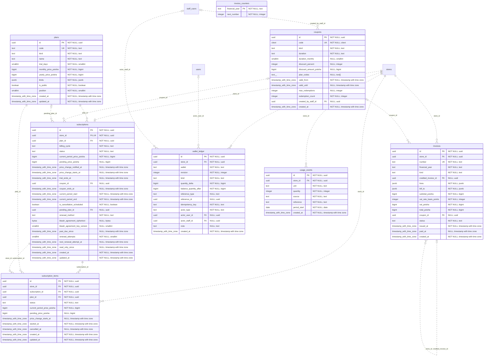

# ER diagram

Built from `packages/db/migrations/meta/0083_snapshot.json`: **101 tables, 1357 columns, 415 explicit indexes and 318 foreign keys**.

Regenerate with `node scripts/generate-er-diagram.mjs`; verify with `node scripts/generate-er-diagram.mjs --check`.

Every column appears once in its owning area's diagram. Every foreign key is drawn in its child table's area, including store ownership, actor links and composite tenant constraints. External tables appear there as reference nodes; their columns are in their own area. Separate single-column and composite constraints can connect the same two tables and are intentionally both shown. Logical references without a foreign key, such as a retained memory checkpoint or a polymorphic source id, are not drawn as database constraints.

Parent cardinality follows nullability of the referring columns: `||` means one required parent; `|o` means zero or one. Children are zero or many (`o{`) unless the referring columns contain a primary or unique key, in which case they are zero or one (`o|`). A partial unique index proves this only when its predicate is the linked column being non-null. Solid lines identify references wholly within the child's primary key; other references use dotted lines. PK and FK markers cover composite keys; UK marks an unconditional single-column unique key. Column comments give SQL nullability and exact type. Checks may further restrict valid states beyond these structural cardinalities.

The schema defines relationships, not completed feature behavior. Refer to [review fixes](review-fixes.md) for implementation acceptance checks and [isolation and access](isolation-and-access.md) for grants and tenant rules.

## Stores, accounts and team

Schema files: `stores.ts`, `auth.ts`, `account-security-events.ts`, `account-recovery.ts`, `team.ts`, `admin.ts`, `staff-recovery.ts`.

```mermaid
erDiagram
    stores ||--o| store_counters : "store_id"
    users ||..o{ sessions : "user_id"
    stores |o..o{ sessions : "active_store_id"
    users ||..o{ push_subscriptions : "user_id"
    users ||..o{ account_security_events : "user_id"
    staff_users |o..o{ account_security_events : "actor_staff_id"
    users ||..o{ account_recoveries : "user_id"
    users ||..o{ account_security_notices : "user_id"
    account_recoveries |o..o{ account_security_notices : "recovery_id"
    stores ||..o{ roles : "store_id"
    stores ||..o{ memberships : "store_id"
    users |o..o{ memberships : "user_id"
    roles |o..o{ memberships : "role_id"
    users |o..o{ memberships : "invited_by_user_id"
    roles |o..o{ memberships : "store_id, role_id"
    stores ||..o{ ownership_transfers : "store_id"
    users ||..o{ ownership_transfers : "owner_user_id"
    users ||..o{ ownership_transfers : "new_owner_user_id"
    staff_users ||..o{ staff_sessions : "staff_user_id"
    staff_users |o..o{ staff_audit_log : "staff_user_id"
    stores ||..o{ support_grants : "store_id"
    staff_users ||..o{ support_grants : "staff_user_id"
    users |o..o{ support_grants : "approved_by_user_id"
    staff_users |o..o{ platform_settings : "updated_by_staff_id"
    staff_users |o..o{ abuse_reports : "reported_by_staff_id"
    staff_users |o..o{ abuse_reports : "handled_by_staff_id"
    staff_users ||..o{ staff_identity_contacts : "staff_user_id"
    staff_users ||..o{ staff_passkeys : "staff_user_id"
    staff_users ||..o{ staff_challenges : "staff_user_id"
    staff_users ||..o{ staff_user_links : "staff_user_id"
    users ||..o{ staff_user_links : "user_id"
    stores ||..o{ support_sessions : "store_id"
    support_grants ||..o{ support_sessions : "grant_id"
    staff_users ||..o{ support_sessions : "staff_user_id"
    staff_sessions ||..o{ support_sessions : "staff_session_id"
    support_grants ||..o{ support_sessions : "store_id, grant_id"
    staff_users ||..o{ staff_audit_exports : "staff_user_id"
    staff_sessions ||..o{ staff_audit_exports : "staff_session_id"
    staff_audit_log ||--o| staff_alert_deliveries : "audit_id"
    stores ||--o{ staff_recovery_history : "store_id"
    staff_audit_log ||--o{ staff_recovery_history : "audit_id"
    stores {
        uuid id PK "NOT NULL; uuid"
        text name "NOT NULL; text"
        text slug UK "NULL; text"
        text legal_name "NULL; text"
        text business_type "NULL; text"
        text phone "NULL; text"
        citext email "NULL; citext"
        text address "NULL; text"
        text district "NULL; text"
        text vat_bin "NULL; text"
        text trade_licence_number "NULL; text"
        text logo_object_key "NULL; text"
        text time_zone "NOT NULL; text"
        text__ how_you_sell "NOT NULL; text[]"
        text onboarding_customer_count_range "NULL; text"
        text__ extensions "NOT NULL; text[]"
        smallint customer_inactivity_days "NOT NULL; smallint"
        smallint attribution_window_days "NOT NULL; smallint"
        jsonb settings "NOT NULL; jsonb"
        text status "NOT NULL; text"
        text suspended_reason "NULL; text"
        timestamp_with_time_zone delete_after "NULL; timestamp with time zone"
        timestamp_with_time_zone created_at "NOT NULL; timestamp with time zone"
        timestamp_with_time_zone updated_at "NOT NULL; timestamp with time zone"
    }
    store_counters {
        uuid store_id PK,FK "NOT NULL; uuid"
        integer next_order_number "NOT NULL; integer"
    }
    users {
        uuid id PK "NOT NULL; uuid"
        text name "NOT NULL; text"
        text phone UK "NULL; text"
        timestamp_with_time_zone phone_verified_at "NULL; timestamp with time zone"
        citext email "NULL; citext"
        timestamp_with_time_zone email_verified_at "NULL; timestamp with time zone"
        text password_hash "NULL; text"
        text google_subject UK "NULL; text"
        bytea totp_secret_ciphertext "NULL; bytea"
        smallint totp_key_version "NULL; smallint"
        timestamp_with_time_zone totp_enabled_at "NULL; timestamp with time zone"
        integer totp_last_step "NULL; integer"
        integer security_version "NOT NULL; integer"
        text__ backup_code_hashes "NULL; text[]"
        text language "NOT NULL; text"
        boolean is_disabled "NOT NULL; boolean"
        timestamp_with_time_zone last_sign_in_at "NULL; timestamp with time zone"
        text terms_version "NULL; text"
        timestamp_with_time_zone terms_accepted_at "NULL; timestamp with time zone"
        timestamp_with_time_zone created_at "NOT NULL; timestamp with time zone"
        timestamp_with_time_zone updated_at "NOT NULL; timestamp with time zone"
    }
    sessions {
        uuid id PK "NOT NULL; uuid"
        bytea token_hash UK "NOT NULL; bytea"
        uuid user_id FK "NOT NULL; uuid"
        uuid active_store_id FK "NULL; uuid"
        inet ip "NULL; inet"
        text user_agent "NULL; text"
        boolean is_remembered "NOT NULL; boolean"
        timestamp_with_time_zone last_seen_at "NOT NULL; timestamp with time zone"
        timestamp_with_time_zone expires_at "NOT NULL; timestamp with time zone"
        timestamp_with_time_zone revoked_at "NULL; timestamp with time zone"
        timestamp_with_time_zone created_at "NOT NULL; timestamp with time zone"
    }
    push_subscriptions {
        uuid id PK "NOT NULL; uuid"
        uuid user_id FK "NOT NULL; uuid"
        text endpoint UK "NOT NULL; text"
        text p256dh "NOT NULL; text"
        text auth "NOT NULL; text"
        text user_agent "NULL; text"
        timestamp_with_time_zone last_successful_push_at "NULL; timestamp with time zone"
        timestamp_with_time_zone created_at "NOT NULL; timestamp with time zone"
    }
    account_security_events {
        uuid id PK "NOT NULL; uuid"
        uuid user_id FK "NOT NULL; uuid"
        text event "NOT NULL; text"
        text actor_type "NOT NULL; text"
        uuid actor_staff_id FK "NULL; uuid"
        text reason_type "NULL; text"
        inet ip "NULL; inet"
        text user_agent "NULL; text"
        jsonb details "NOT NULL; jsonb"
        timestamp_with_time_zone created_at "NOT NULL; timestamp with time zone"
    }
    account_recoveries {
        uuid id PK "NOT NULL; uuid"
        uuid user_id FK "NOT NULL; uuid"
        text credential_state "NOT NULL; text"
        text cancel_hash "NOT NULL; text"
        text completion_hash "NOT NULL; text"
        text status "NOT NULL; text"
        timestamp_with_time_zone eligible_at "NULL; timestamp with time zone"
        timestamp_with_time_zone created_at "NOT NULL; timestamp with time zone"
    }
    account_security_notices {
        uuid id PK "NOT NULL; uuid"
        uuid user_id FK "NOT NULL; uuid"
        uuid recovery_id FK "NULL; uuid"
        bytea ciphertext "NOT NULL; bytea"
        smallint key_version "NOT NULL; smallint"
        integer attempts "NOT NULL; integer"
        timestamp_with_time_zone retry_at "NOT NULL; timestamp with time zone"
        uuid lease_id "NULL; uuid"
        timestamp_with_time_zone lease_until "NULL; timestamp with time zone"
        timestamp_with_time_zone delivered_at "NULL; timestamp with time zone"
        timestamp_with_time_zone created_at "NOT NULL; timestamp with time zone"
    }
    roles {
        uuid id PK "NOT NULL; uuid"
        uuid store_id FK "NOT NULL; uuid"
        text name "NOT NULL; text"
        jsonb permissions "NOT NULL; jsonb"
        boolean can_see_full_phone "NOT NULL; boolean"
        boolean can_export_lists "NOT NULL; boolean"
        boolean can_refund "NOT NULL; boolean"
        timestamp_with_time_zone created_at "NOT NULL; timestamp with time zone"
        timestamp_with_time_zone updated_at "NOT NULL; timestamp with time zone"
    }
    memberships {
        uuid id PK "NOT NULL; uuid"
        uuid store_id FK "NOT NULL; uuid"
        uuid user_id FK "NULL; uuid"
        text built_in_role "NULL; text"
        uuid role_id FK "NULL; uuid"
        text status "NOT NULL; text"
        text invite_phone "NULL; text"
        citext invite_email "NULL; citext"
        bytea invite_token_hash UK "NULL; bytea"
        timestamp_with_time_zone invite_expires_at "NULL; timestamp with time zone"
        uuid invited_by_user_id FK "NULL; uuid"
        timestamp_with_time_zone joined_at "NULL; timestamp with time zone"
        timestamp_with_time_zone removed_at "NULL; timestamp with time zone"
        timestamp_with_time_zone last_active_at "NULL; timestamp with time zone"
        jsonb notification_preferences "NOT NULL; jsonb"
        timestamp_with_time_zone created_at "NOT NULL; timestamp with time zone"
        timestamp_with_time_zone updated_at "NOT NULL; timestamp with time zone"
    }
    ownership_transfers {
        uuid id PK "NOT NULL; uuid"
        uuid store_id FK "NOT NULL; uuid"
        uuid owner_user_id FK "NOT NULL; uuid"
        uuid new_owner_user_id FK "NOT NULL; uuid"
        text status "NOT NULL; text"
        timestamp_with_time_zone expires_at "NOT NULL; timestamp with time zone"
        timestamp_with_time_zone created_at "NOT NULL; timestamp with time zone"
        timestamp_with_time_zone updated_at "NOT NULL; timestamp with time zone"
    }
    staff_users {
        uuid id PK "NOT NULL; uuid"
        citext email UK "NOT NULL; citext"
        text name "NOT NULL; text"
        text access_subject UK "NULL; text"
        text password_hash "NULL; text"
        timestamp_with_time_zone enrolled_at "NULL; timestamp with time zone"
        integer failed_attempts "NOT NULL; integer"
        timestamp_with_time_zone blocked_until "NULL; timestamp with time zone"
        bigint totp_last_step "NULL; bigint"
        text role "NOT NULL; text"
        text status "NOT NULL; text"
        bytea totp_secret_ciphertext "NULL; bytea"
        smallint totp_key_version "NULL; smallint"
        jsonb passkeys "NOT NULL; jsonb"
        timestamp_with_time_zone last_sign_in_at "NULL; timestamp with time zone"
        timestamp_with_time_zone created_at "NOT NULL; timestamp with time zone"
        timestamp_with_time_zone updated_at "NOT NULL; timestamp with time zone"
    }
    staff_sessions {
        uuid id PK "NOT NULL; uuid"
        bytea token_hash UK "NOT NULL; bytea"
        uuid staff_user_id FK "NOT NULL; uuid"
        inet ip "NULL; inet"
        text user_agent "NULL; text"
        timestamp_with_time_zone last_seen_at "NULL; timestamp with time zone"
        timestamp_with_time_zone expires_at "NOT NULL; timestamp with time zone"
        timestamp_with_time_zone revoked_at "NULL; timestamp with time zone"
        timestamp_with_time_zone created_at "NOT NULL; timestamp with time zone"
    }
    staff_audit_log {
        uuid id PK "NOT NULL; uuid"
        text operator_identity "NULL; text"
        uuid actor_user_id "NULL; uuid"
        uuid staff_user_id FK "NULL; uuid"
        text action "NOT NULL; text"
        uuid store_id "NULL; uuid"
        text target_type "NULL; text"
        uuid target_id "NULL; uuid"
        text reason "NOT NULL; text"
        jsonb action_details "NULL; jsonb"
        inet ip "NULL; inet"
        timestamp_with_time_zone created_at "NOT NULL; timestamp with time zone"
    }
    support_grants {
        uuid id PK "NOT NULL; uuid"
        uuid store_id FK "NOT NULL; uuid"
        uuid staff_user_id FK "NOT NULL; uuid"
        text__ scopes "NOT NULL; text[]"
        text access "NOT NULL; text"
        text status "NOT NULL; text"
        text reason "NOT NULL; text"
        integer duration_minutes "NOT NULL; integer"
        boolean is_break_glass "NOT NULL; boolean"
        uuid approved_by_user_id FK "NULL; uuid"
        timestamp_with_time_zone requested_at "NOT NULL; timestamp with time zone"
        timestamp_with_time_zone approved_at "NULL; timestamp with time zone"
        timestamp_with_time_zone expires_at "NULL; timestamp with time zone"
        timestamp_with_time_zone ended_at "NULL; timestamp with time zone"
    }
    platform_settings {
        text key PK "NOT NULL; text"
        jsonb value "NOT NULL; jsonb"
        uuid updated_by_staff_id FK "NULL; uuid"
        timestamp_with_time_zone updated_at "NOT NULL; timestamp with time zone"
    }
    staff_audit_log_days {
        date day PK "NOT NULL; date"
        integer row_count "NOT NULL; integer"
        bytea previous_hash "NULL; bytea"
        bytea hash "NOT NULL; bytea"
        timestamp_with_time_zone sealed_at "NOT NULL; timestamp with time zone"
    }
    abuse_reports {
        uuid id PK "NOT NULL; uuid"
        uuid store_id "NOT NULL; uuid"
        text source "NOT NULL; text"
        text category "NOT NULL; text"
        text status "NOT NULL; text"
        text description "NOT NULL; text"
        jsonb evidence "NULL; jsonb"
        uuid reported_by_staff_id FK "NULL; uuid"
        uuid handled_by_staff_id FK "NULL; uuid"
        text resolution "NULL; text"
        timestamp_with_time_zone resolved_at "NULL; timestamp with time zone"
        timestamp_with_time_zone created_at "NOT NULL; timestamp with time zone"
        timestamp_with_time_zone updated_at "NOT NULL; timestamp with time zone"
    }
    staff_identity_contacts {
        uuid id PK "NOT NULL; uuid"
        uuid staff_user_id FK "NOT NULL; uuid"
        text kind "NOT NULL; text"
        text value "NOT NULL; text"
        timestamp_with_time_zone created_at "NOT NULL; timestamp with time zone"
    }
    staff_passkeys {
        text credential_id PK "NOT NULL; text"
        uuid staff_user_id FK "NOT NULL; uuid"
        bytea public_key "NOT NULL; bytea"
        bigint counter "NOT NULL; bigint"
        timestamp_with_time_zone created_at "NOT NULL; timestamp with time zone"
    }
    staff_challenges {
        bytea token_hash PK "NOT NULL; bytea"
        uuid staff_user_id FK "NOT NULL; uuid"
        text purpose "NOT NULL; text"
        text password_hash "NULL; text"
        text password_state "NULL; text"
        text webauthn_challenge "NULL; text"
        bytea totp_secret_ciphertext "NULL; bytea"
        smallint totp_key_version "NULL; smallint"
        timestamp_with_time_zone expires_at "NOT NULL; timestamp with time zone"
        timestamp_with_time_zone consumed_at "NULL; timestamp with time zone"
        timestamp_with_time_zone created_at "NOT NULL; timestamp with time zone"
    }
    staff_user_links {
        uuid id PK "NOT NULL; uuid"
        uuid staff_user_id FK "NOT NULL; uuid"
        uuid user_id FK "NOT NULL; uuid"
        timestamp_with_time_zone created_at "NOT NULL; timestamp with time zone"
    }
    support_sessions {
        uuid id PK "NOT NULL; uuid"
        uuid store_id FK "NOT NULL; uuid"
        uuid grant_id FK "NOT NULL; uuid"
        uuid staff_user_id FK "NOT NULL; uuid"
        uuid staff_session_id FK "NOT NULL; uuid"
        bytea handoff_hash UK "NOT NULL; bytea"
        bytea token_hash UK "NULL; bytea"
        timestamp_with_time_zone handoff_expires_at "NOT NULL; timestamp with time zone"
        timestamp_with_time_zone consumed_at "NULL; timestamp with time zone"
        timestamp_with_time_zone created_at "NOT NULL; timestamp with time zone"
    }
    staff_audit_exports {
        uuid id PK "NOT NULL; uuid"
        uuid staff_user_id FK "NOT NULL; uuid"
        uuid staff_session_id FK "NOT NULL; uuid"
        text staff_name "NOT NULL; text"
        jsonb filter "NOT NULL; jsonb"
        text status "NOT NULL; text"
        integer progress "NOT NULL; integer"
        integer attempts "NOT NULL; integer"
        uuid lease_id "NULL; uuid"
        timestamp_with_time_zone leased_until "NULL; timestamp with time zone"
        text contents "NULL; text"
        text error "NULL; text"
        timestamp_with_time_zone expires_at "NOT NULL; timestamp with time zone"
        timestamp_with_time_zone created_at "NOT NULL; timestamp with time zone"
    }
    staff_alert_deliveries {
        uuid audit_id PK,FK "NOT NULL; uuid"
        text status "NOT NULL; text"
        integer attempts "NOT NULL; integer"
        uuid lease_id "NULL; uuid"
        timestamp_with_time_zone leased_until "NULL; timestamp with time zone"
        timestamp_with_time_zone next_attempt_at "NOT NULL; timestamp with time zone"
        text error "NULL; text"
        timestamp_with_time_zone delivered_at "NULL; timestamp with time zone"
    }
    staff_recovery_history {
        uuid store_id PK,FK "NOT NULL; uuid"
        uuid audit_id PK,FK "NOT NULL; uuid"
    }
```

## Channels, customers and chats

Schema files: `areas.ts`, `channels.ts`, `contacts.ts`, `imports.ts`, `contact-memory.ts`, `customer-insights.ts`, `chats.ts`, `due-book.ts`.

```mermaid
erDiagram
    bd_areas |o..o{ bd_areas : "parent_id"
    stores ||..o{ channel_connections : "store_id"
    users |o..o{ channel_connections : "connected_by_user_id"
    stores ||..o{ meta_page_subscriptions : "store_id"
    stores ||..o{ sms_sender_ids : "store_id"
    files |o..o{ sms_sender_ids : "trade_licence_file_id"
    files |o..o{ sms_sender_ids : "nid_file_id"
    users |o..o{ sms_sender_ids : "requested_by_user_id"
    files |o..o{ sms_sender_ids : "store_id, trade_licence_file_id"
    files |o..o{ sms_sender_ids : "store_id, nid_file_id"
    stores ||..o{ contacts : "store_id"
    bd_areas |o..o{ contacts : "bd_area_id"
    imports |o..o{ contacts : "store_id, import_id"
    stores ||..o{ contact_merges : "store_id"
    contacts |o..o{ contact_merges : "kept_contact_id"
    contacts |o..o{ contact_merges : "merged_contact_id"
    users ||..o{ contact_merges : "merged_by_user_id"
    users |o..o{ contact_merges : "undone_by_user_id"
    contacts |o..o{ contact_merges : "store_id, kept_contact_id"
    contacts |o..o{ contact_merges : "store_id, merged_contact_id"
    stores ||..o{ contact_match_suggestions : "store_id"
    contacts ||..o{ contact_match_suggestions : "contact_id"
    contacts ||..o{ contact_match_suggestions : "matched_contact_id"
    users |o..o{ contact_match_suggestions : "decided_by_user_id"
    contacts ||..o{ contact_match_suggestions : "store_id, contact_id"
    contacts ||..o{ contact_match_suggestions : "store_id, matched_contact_id"
    stores ||..o{ contact_identities : "store_id"
    contacts ||..o{ contact_identities : "contact_id"
    channel_connections ||..o{ contact_identities : "channel_connection_id"
    contacts ||..o{ contact_identities : "store_id, contact_id"
    channel_connections ||..o{ contact_identities : "store_id, channel_connection_id"
    stores ||..o{ consents : "store_id"
    contacts ||..o{ consents : "contact_id"
    users |o..o{ consents : "captured_by_user_id"
    imports |o..o{ consents : "store_id, import_id"
    contacts ||..o{ consents : "store_id, contact_id"
    contacts ||--o| contact_stats : "contact_id"
    stores ||..o{ contact_stats : "store_id"
    contacts ||..o| contact_stats : "store_id, contact_id"
    stores ||..o{ segments : "store_id"
    users |o..o{ segments : "created_by_user_id"
    stores ||..o{ imports : "store_id"
    files ||..o{ imports : "file_id"
    files |o..o{ imports : "report_file_id"
    users |o..o{ imports : "created_by_user_id"
    users |o..o{ imports : "started_by_user_id"
    files ||..o{ imports : "store_id, file_id"
    files |o..o{ imports : "store_id, report_file_id"
    contacts ||--o| contact_memories : "contact_id"
    stores ||..o{ contact_memories : "store_id"
    users |o..o{ contact_memories : "edited_by_user_id"
    contacts ||..o| contact_memories : "store_id, contact_id"
    stores ||..o{ customer_insights : "store_id"
    users |o..o{ customer_insights : "hidden_by_user_id"
    stores ||..o{ conversations : "store_id"
    contacts ||..o{ conversations : "contact_id"
    channel_connections ||..o{ conversations : "channel_connection_id"
    users |o..o{ conversations : "assignee_user_id"
    contacts ||..o{ conversations : "store_id, contact_id"
    channel_connections ||..o{ conversations : "store_id, channel_connection_id"
    stores ||..o{ messages : "store_id"
    conversations ||..o{ messages : "conversation_id"
    users |o..o{ messages : "author_user_id"
    users |o..o{ messages : "rated_by_user_id"
    conversations ||..o{ messages : "store_id, conversation_id"
    contact_identities |o..o{ messages : "store_id, sender_identity_id"
    contact_identities |o..o{ messages : "store_id, recipient_identity_id"
    stores ||..o{ social_comments : "store_id"
    channel_connections ||..o{ social_comments : "channel_connection_id"
    post_targets |o..o{ social_comments : "post_target_id"
    contacts |o..o{ social_comments : "contact_id"
    conversations |o..o{ social_comments : "conversation_id"
    channel_connections ||..o{ social_comments : "store_id, channel_connection_id"
    post_targets |o..o{ social_comments : "store_id, post_target_id"
    contacts |o..o{ social_comments : "store_id, contact_id"
    conversations |o..o{ social_comments : "store_id, conversation_id"
    stores ||..o{ saved_replies : "store_id"
    users |o..o{ saved_replies : "created_by_user_id"
    stores ||..o{ sms_messages : "store_id"
    contacts |o..o{ sms_messages : "contact_id"
    sms_sender_ids |o..o{ sms_messages : "sender_id_id"
    users |o..o{ sms_messages : "created_by_user_id"
    contacts |o..o{ sms_messages : "store_id, contact_id"
    sms_sender_ids |o..o{ sms_messages : "store_id, sender_id_id"
    stores ||..o{ due_entries : "store_id"
    users |o..o{ due_entries : "recorded_by_user_id"
    contacts ||..o{ due_entries : "store_id, contact_id"
    stores ||..o{ due_messages : "store_id"
    users |o..o{ due_messages : "requested_by_user_id"
    contacts ||..o{ due_messages : "store_id, contact_id"
    due_entries |o..o| due_messages : "store_id, entry_id"
    bd_areas {
        integer id PK "NOT NULL; integer"
        text kind "NOT NULL; text"
        integer parent_id FK "NULL; integer"
        text name "NOT NULL; text"
        text name_bn "NULL; text"
    }
    channel_connections {
        uuid id PK "NOT NULL; uuid"
        uuid store_id FK "NOT NULL; uuid"
        text kind "NOT NULL; text"
        text external_account_id "NOT NULL; text"
        text linked_page_external_id "NULL; text"
        text display_name "NOT NULL; text"
        bytea access_token_ciphertext "NULL; bytea"
        smallint key_version "NULL; smallint"
        timestamp_with_time_zone token_expires_at "NULL; timestamp with time zone"
        text status "NOT NULL; text"
        boolean is_ai_live "NOT NULL; boolean"
        text whatsapp_quality_rating "NULL; text"
        text whatsapp_messaging_tier "NULL; text"
        jsonb settings "NOT NULL; jsonb"
        uuid connected_by_user_id FK "NULL; uuid"
        timestamp_with_time_zone connected_at "NOT NULL; timestamp with time zone"
        timestamp_with_time_zone disconnected_at "NULL; timestamp with time zone"
        timestamp_with_time_zone created_at "NOT NULL; timestamp with time zone"
        timestamp_with_time_zone updated_at "NOT NULL; timestamp with time zone"
    }
    meta_page_subscriptions {
        uuid id PK "NOT NULL; uuid"
        uuid store_id FK "NOT NULL; uuid"
        text page_external_id "NOT NULL; text"
        bytea access_token_ciphertext "NOT NULL; bytea"
        smallint key_version "NOT NULL; smallint"
        timestamp_with_time_zone created_at "NOT NULL; timestamp with time zone"
    }
    sms_sender_ids {
        uuid id PK "NOT NULL; uuid"
        uuid store_id FK "NOT NULL; uuid"
        text sender_name "NOT NULL; text"
        text status "NOT NULL; text"
        uuid trade_licence_file_id FK "NULL; uuid"
        uuid nid_file_id FK "NULL; uuid"
        text rejection_reason "NULL; text"
        uuid requested_by_user_id FK "NULL; uuid"
        timestamp_with_time_zone decided_at "NULL; timestamp with time zone"
        timestamp_with_time_zone created_at "NOT NULL; timestamp with time zone"
        timestamp_with_time_zone updated_at "NOT NULL; timestamp with time zone"
    }
    contacts {
        uuid id PK "NOT NULL; uuid"
        uuid store_id FK "NOT NULL; uuid"
        text name "NULL; text"
        text phone "NULL; text"
        timestamp_with_time_zone phone_verified_at "NULL; timestamp with time zone"
        text whatsapp_phone "NULL; text"
        citext email "NULL; citext"
        text address "NULL; text"
        text district "NULL; text"
        integer bd_area_id FK "NULL; integer"
        text gender "NULL; text"
        smallint birthday_day "NULL; smallint"
        smallint birthday_month "NULL; smallint"
        smallint birth_year "NULL; smallint"
        text source "NOT NULL; text"
        text kind "NOT NULL; text"
        text not_customer_reason "NULL; text"
        boolean is_blocked "NOT NULL; boolean"
        boolean is_over_plan_limit "NOT NULL; boolean"
        text__ tags "NOT NULL; text[]"
        text notes "NULL; text"
        text external_ref "NULL; text"
        uuid import_id FK "NULL; uuid"
        timestamp_with_time_zone deleted_at "NULL; timestamp with time zone"
        timestamp_with_time_zone created_at "NOT NULL; timestamp with time zone"
        timestamp_with_time_zone updated_at "NOT NULL; timestamp with time zone"
    }
    contact_merges {
        uuid id PK "NOT NULL; uuid"
        uuid store_id FK "NOT NULL; uuid"
        text operation_key "NOT NULL; text"
        uuid kept_contact_id FK "NULL; uuid"
        uuid merged_contact_id FK "NULL; uuid"
        jsonb moved_rows "NOT NULL; jsonb"
        jsonb replaced_fields "NOT NULL; jsonb"
        jsonb after_state "NOT NULL; jsonb"
        jsonb undo_conflicts "NOT NULL; jsonb"
        timestamp_with_time_zone evidence_redacted_at "NULL; timestamp with time zone"
        uuid merged_by_user_id FK "NOT NULL; uuid"
        timestamp_with_time_zone undo_until "NOT NULL; timestamp with time zone"
        timestamp_with_time_zone undone_at "NULL; timestamp with time zone"
        uuid undone_by_user_id FK "NULL; uuid"
        timestamp_with_time_zone created_at "NOT NULL; timestamp with time zone"
    }
    contact_match_suggestions {
        uuid id PK "NOT NULL; uuid"
        uuid store_id FK "NOT NULL; uuid"
        uuid contact_id FK "NOT NULL; uuid"
        uuid matched_contact_id FK "NOT NULL; uuid"
        text reason "NOT NULL; text"
        text phone "NULL; text"
        uuid order_id "NULL; uuid"
        uuid conversation_id "NULL; uuid"
        text status "NOT NULL; text"
        uuid decided_by_user_id FK "NULL; uuid"
        timestamp_with_time_zone decided_at "NULL; timestamp with time zone"
        timestamp_with_time_zone created_at "NOT NULL; timestamp with time zone"
    }
    contact_identities {
        uuid id PK "NOT NULL; uuid"
        uuid store_id FK "NOT NULL; uuid"
        uuid contact_id FK "NOT NULL; uuid"
        uuid channel_connection_id FK "NOT NULL; uuid"
        text channel "NOT NULL; text"
        text external_id "NOT NULL; text"
        text profile_name "NULL; text"
        timestamp_with_time_zone created_at "NOT NULL; timestamp with time zone"
    }
    consents {
        uuid id PK "NOT NULL; uuid"
        uuid store_id FK "NOT NULL; uuid"
        uuid contact_id FK "NOT NULL; uuid"
        text channel "NOT NULL; text"
        text status "NOT NULL; text"
        text source "NOT NULL; text"
        uuid import_id FK "NULL; uuid"
        text evidence "NULL; text"
        uuid captured_by_user_id FK "NULL; uuid"
        timestamp_with_time_zone captured_at "NOT NULL; timestamp with time zone"
    }
    contact_stats {
        uuid contact_id PK,FK "NOT NULL; uuid"
        uuid store_id FK "NOT NULL; uuid"
        integer orders_count "NOT NULL; integer"
        integer delivered_count "NOT NULL; integer"
        integer returned_count "NOT NULL; integer"
        bigint net_spend_poisha "NOT NULL; bigint"
        timestamp_with_time_zone first_order_at "NULL; timestamp with time zone"
        timestamp_with_time_zone last_order_at "NULL; timestamp with time zone"
        integer usual_gap_days "NULL; integer"
        text favourite_category "NULL; text"
        text lifecycle_stage "NOT NULL; text"
        timestamp_with_time_zone updated_at "NOT NULL; timestamp with time zone"
    }
    segments {
        uuid id PK "NOT NULL; uuid"
        uuid store_id FK "NOT NULL; uuid"
        text name "NOT NULL; text"
        text ready_made_key "NULL; text"
        jsonb rules "NOT NULL; jsonb"
        text ai_prompt "NULL; text"
        uuid created_by_user_id FK "NULL; uuid"
        timestamp_with_time_zone created_at "NOT NULL; timestamp with time zone"
        timestamp_with_time_zone updated_at "NOT NULL; timestamp with time zone"
    }
    imports {
        uuid id PK "NOT NULL; uuid"
        uuid store_id FK "NOT NULL; uuid"
        text kind "NOT NULL; text"
        text status "NOT NULL; text"
        uuid file_id FK "NOT NULL; uuid"
        jsonb column_mapping "NULL; jsonb"
        text duplicate_mode "NOT NULL; text"
        boolean has_consent_confirmation "NOT NULL; boolean"
        jsonb consent_evidence "NULL; jsonb"
        integer rows_total "NULL; integer"
        integer rows_added "NULL; integer"
        integer rows_updated "NULL; integer"
        integer rows_skipped "NULL; integer"
        integer rows_failed "NULL; integer"
        jsonb checkpoint "NULL; jsonb"
        uuid report_file_id FK "NULL; uuid"
        uuid created_by_user_id FK "NULL; uuid"
        timestamp_with_time_zone started_at "NULL; timestamp with time zone"
        uuid started_by_user_id FK "NULL; uuid"
        timestamp_with_time_zone finished_at "NULL; timestamp with time zone"
        timestamp_with_time_zone claimed_at "NULL; timestamp with time zone"
        timestamp_with_time_zone last_progress_at "NULL; timestamp with time zone"
        timestamp_with_time_zone undo_finished_at "NULL; timestamp with time zone"
        integer requeue_count "NOT NULL; integer"
        timestamp_with_time_zone created_at "NOT NULL; timestamp with time zone"
        timestamp_with_time_zone updated_at "NOT NULL; timestamp with time zone"
    }
    contact_memories {
        uuid contact_id PK,FK "NOT NULL; uuid"
        uuid store_id FK "NOT NULL; uuid"
        text summary "NOT NULL; text"
        jsonb facts "NOT NULL; jsonb"
        timestamp_with_time_zone built_at "NULL; timestamp with time zone"
        timestamp_with_time_zone cleared_at "NULL; timestamp with time zone"
        uuid edited_by_user_id FK "NULL; uuid"
        timestamp_with_time_zone edited_at "NULL; timestamp with time zone"
        integer version "NOT NULL; integer"
        timestamp_with_time_zone created_at "NOT NULL; timestamp with time zone"
        timestamp_with_time_zone updated_at "NOT NULL; timestamp with time zone"
    }
    customer_insights {
        uuid id PK "NOT NULL; uuid"
        uuid store_id FK "NOT NULL; uuid"
        text kind "NOT NULL; text"
        text source "NOT NULL; text"
        date period_start "NOT NULL; date"
        date period_end "NOT NULL; date"
        jsonb figures "NOT NULL; jsonb"
        text fact_text "NULL; text"
        text tip_text "NULL; text"
        uuid ai_run_id "NULL; uuid"
        timestamp_with_time_zone hidden_at "NULL; timestamp with time zone"
        uuid hidden_by_user_id FK "NULL; uuid"
        timestamp_with_time_zone built_at "NOT NULL; timestamp with time zone"
        timestamp_with_time_zone created_at "NOT NULL; timestamp with time zone"
    }
    conversations {
        uuid id PK "NOT NULL; uuid"
        uuid store_id FK "NOT NULL; uuid"
        uuid contact_id FK "NOT NULL; uuid"
        uuid channel_connection_id FK "NOT NULL; uuid"
        text channel "NOT NULL; text"
        text status "NOT NULL; text"
        text responder "NOT NULL; text"
        uuid assignee_user_id FK "NULL; uuid"
        text handover_reason "NULL; text"
        timestamp_with_time_zone handed_over_at "NULL; timestamp with time zone"
        timestamp_with_time_zone ai_resumes_at "NULL; timestamp with time zone"
        text intent_tag "NULL; text"
        text lead_temperature "NULL; text"
        boolean has_buying_interest "NOT NULL; boolean"
        timestamp_with_time_zone last_inbound_at "NULL; timestamp with time zone"
        timestamp_with_time_zone last_outbound_at "NULL; timestamp with time zone"
        timestamp_with_time_zone last_message_at "NULL; timestamp with time zone"
        text last_message_preview "NULL; text"
        timestamp_with_time_zone window_expires_at "NULL; timestamp with time zone"
        integer unread_count "NOT NULL; integer"
        text ai_summary "NULL; text"
        uuid memory_built_through_message_id "NULL; uuid"
        timestamp_with_time_zone memory_built_through_message_at "NULL; timestamp with time zone"
        integer memory_version "NOT NULL; integer"
        integer version "NOT NULL; integer"
        timestamp_with_time_zone created_at "NOT NULL; timestamp with time zone"
        timestamp_with_time_zone updated_at "NOT NULL; timestamp with time zone"
    }
    messages {
        uuid id PK "NOT NULL; uuid"
        uuid store_id FK "NOT NULL; uuid"
        uuid conversation_id FK "NOT NULL; uuid"
        text direction "NOT NULL; text"
        text author_type "NOT NULL; text"
        uuid author_user_id FK "NULL; uuid"
        text kind "NOT NULL; text"
        text body "NULL; text"
        jsonb attachments "NULL; jsonb"
        text media_text "NULL; text"
        text external_id "NULL; text"
        text idempotency_key "NULL; text"
        uuid sender_identity_id FK "NULL; uuid"
        uuid recipient_identity_id FK "NULL; uuid"
        text send_category "NULL; text"
        text status "NOT NULL; text"
        text error_code "NULL; text"
        text source_type "NOT NULL; text"
        uuid source_id "NULL; uuid"
        uuid ai_run_id "NULL; uuid"
        jsonb ai_sources "NULL; jsonb"
        text ai_rating "NULL; text"
        text ai_rating_reason "NULL; text"
        uuid rated_by_user_id FK "NULL; uuid"
        timestamp_with_time_zone rated_at "NULL; timestamp with time zone"
        timestamp_with_time_zone ai_fixed_at "NULL; timestamp with time zone"
        timestamp_with_time_zone sent_at "NULL; timestamp with time zone"
        timestamp_with_time_zone delivered_at "NULL; timestamp with time zone"
        timestamp_with_time_zone read_at "NULL; timestamp with time zone"
        timestamp_with_time_zone created_at "NOT NULL; timestamp with time zone"
    }
    social_comments {
        uuid id PK "NOT NULL; uuid"
        uuid store_id FK "NOT NULL; uuid"
        uuid channel_connection_id FK "NOT NULL; uuid"
        uuid post_target_id FK "NULL; uuid"
        text external_post_id "NOT NULL; text"
        text external_comment_id "NOT NULL; text"
        text parent_external_comment_id "NULL; text"
        uuid contact_id FK "NULL; uuid"
        text author_name "NULL; text"
        text body "NULL; text"
        text classification "NULL; text"
        text status "NOT NULL; text"
        text public_reply_external_id "NULL; text"
        timestamp_with_time_zone private_replied_at "NULL; timestamp with time zone"
        uuid conversation_id FK "NULL; uuid"
        timestamp_with_time_zone commented_at "NOT NULL; timestamp with time zone"
        timestamp_with_time_zone created_at "NOT NULL; timestamp with time zone"
        timestamp_with_time_zone updated_at "NOT NULL; timestamp with time zone"
    }
    saved_replies {
        uuid id PK "NOT NULL; uuid"
        uuid store_id FK "NOT NULL; uuid"
        text title "NOT NULL; text"
        text body "NOT NULL; text"
        text shortcut "NULL; text"
        uuid created_by_user_id FK "NULL; uuid"
        timestamp_with_time_zone created_at "NOT NULL; timestamp with time zone"
        timestamp_with_time_zone updated_at "NOT NULL; timestamp with time zone"
    }
    sms_messages {
        uuid id PK "NOT NULL; uuid"
        uuid store_id FK "NOT NULL; uuid"
        uuid contact_id FK "NULL; uuid"
        text phone "NOT NULL; text"
        text purpose "NOT NULL; text"
        text subject_type "NULL; text"
        uuid subject_id "NULL; uuid"
        uuid sender_id_id FK "NULL; uuid"
        text body "NOT NULL; text"
        smallint parts "NOT NULL; smallint"
        integer credits_used "NOT NULL; integer"
        text status "NOT NULL; text"
        text provider_message_id "NULL; text"
        text error_code "NULL; text"
        text idempotency_key "NOT NULL; text"
        uuid created_by_user_id FK "NULL; uuid"
        timestamp_with_time_zone sent_at "NULL; timestamp with time zone"
        timestamp_with_time_zone delivered_at "NULL; timestamp with time zone"
        timestamp_with_time_zone failed_at "NULL; timestamp with time zone"
        timestamp_with_time_zone created_at "NOT NULL; timestamp with time zone"
    }
    due_entries {
        uuid id PK "NOT NULL; uuid"
        uuid store_id FK "NOT NULL; uuid"
        uuid contact_id FK "NOT NULL; uuid"
        text kind "NOT NULL; text"
        bigint amount_poisha "NOT NULL; bigint"
        timestamp_with_time_zone occurred_at "NOT NULL; timestamp with time zone"
        text method "NULL; text"
        text note "NULL; text"
        text source "NOT NULL; text"
        uuid recorded_by_user_id FK "NULL; uuid"
        timestamp_with_time_zone created_at "NOT NULL; timestamp with time zone"
    }
    due_messages {
        uuid id PK "NOT NULL; uuid"
        uuid store_id FK "NOT NULL; uuid"
        uuid contact_id FK "NOT NULL; uuid"
        text kind "NOT NULL; text"
        uuid entry_id FK "NULL; uuid"
        text body "NOT NULL; text"
        text status "NOT NULL; text"
        text skip_reason "NULL; text"
        integer credits "NULL; integer"
        text provider_message_id "NULL; text"
        uuid requested_by_user_id FK "NULL; uuid"
        timestamp_with_time_zone created_at "NOT NULL; timestamp with time zone"
        timestamp_with_time_zone sent_at "NULL; timestamp with time zone"
    }
```

## Products, orders and payments

Schema files: `products.ts`, `orders.ts`, `payments.ts`.

```mermaid
erDiagram
    stores ||..o{ products : "store_id"
    stores ||..o{ product_variants : "store_id"
    products ||..o{ product_variants : "product_id"
    products ||..o{ product_variants : "store_id, product_id"
    stores ||..o{ stock_movements : "store_id"
    product_variants ||..o{ stock_movements : "variant_id"
    users |o..o{ stock_movements : "actor_user_id"
    product_variants ||..o{ stock_movements : "store_id, variant_id"
    stores ||..o{ restock_requests : "store_id"
    product_variants ||..o{ restock_requests : "variant_id"
    contacts ||..o{ restock_requests : "contact_id"
    conversations |o..o{ restock_requests : "conversation_id"
    product_variants ||..o{ restock_requests : "store_id, variant_id"
    contacts ||..o{ restock_requests : "store_id, contact_id"
    conversations |o..o{ restock_requests : "store_id, conversation_id"
    stores ||..o{ delivery_zones : "store_id"
    stores ||..o{ discount_codes : "store_id"
    contacts |o..o{ discount_codes : "contact_id"
    users |o..o{ discount_codes : "created_by_user_id"
    contacts |o..o{ discount_codes : "store_id, contact_id"
    stores ||..o{ orders : "store_id"
    contacts |o..o{ orders : "buyer_contact_id"
    conversations |o..o{ orders : "conversation_id"
    users |o..o{ orders : "created_by_user_id"
    bd_areas |o..o{ orders : "recipient_bd_area_id"
    delivery_zones |o..o{ orders : "delivery_zone_id"
    discount_codes |o..o{ orders : "discount_code_id"
    users |o..o{ orders : "shipped_by_user_id"
    orders |o..o{ orders : "possible_duplicate_of_order_id"
    contacts |o..o{ orders : "store_id, buyer_contact_id"
    conversations |o..o{ orders : "store_id, conversation_id"
    discount_codes |o..o{ orders : "store_id, discount_code_id"
    delivery_zones |o..o{ orders : "store_id, delivery_zone_id"
    orders |o..o{ orders : "store_id, possible_duplicate_of_order_id"
    stores ||..o{ order_items : "store_id"
    orders ||..o{ order_items : "order_id"
    product_variants ||..o{ order_items : "variant_id"
    orders ||..o{ order_items : "store_id, order_id"
    product_variants ||..o{ order_items : "store_id, variant_id"
    stores ||..o{ order_confirmations : "store_id"
    orders ||..o{ order_confirmations : "store_id, order_id"
    stores ||..o{ payment_gateway_credentials : "store_id"
    users |o..o{ payment_gateway_credentials : "connected_by_user_id"
    stores ||..o{ payment_intents : "store_id"
    payment_gateway_credentials |o..o{ payment_intents : "credential_id"
    orders |o..o{ payment_intents : "order_id"
    invoices |o..o{ payment_intents : "invoice_id"
    users |o..o{ payment_intents : "verified_by_user_id"
    users |o..o{ payment_intents : "created_by_user_id"
    payment_gateway_credentials |o..o{ payment_intents : "store_id, credential_id"
    orders |o..o{ payment_intents : "store_id, order_id"
    invoices |o..o{ payment_intents : "store_id, invoice_id"
    stores ||..o{ payment_events : "store_id"
    payment_intents ||..o{ payment_events : "payment_intent_id"
    payment_intents ||..o{ payment_events : "store_id, payment_intent_id"
    stores ||..o{ refunds : "store_id"
    payment_intents ||..o{ refunds : "payment_intent_id"
    users |o..o{ refunds : "requested_by_user_id"
    payment_intents ||..o{ refunds : "store_id, payment_intent_id"
    files |o..o{ gateway_settlement_lines : "report_file_id"
    payment_intents |o..o{ gateway_settlement_lines : "payment_intent_id"
    staff_users |o..o{ gateway_settlement_lines : "matched_by_staff_id"
    products {
        uuid id PK "NOT NULL; uuid"
        uuid store_id FK "NOT NULL; uuid"
        text name "NOT NULL; text"
        text description "NULL; text"
        text category "NULL; text"
        text__ aliases "NOT NULL; text[]"
        bigint price_poisha "NOT NULL; bigint"
        bigint compare_at_price_poisha "NULL; bigint"
        uuid__ image_file_ids "NOT NULL; uuid[]"
        jsonb options "NOT NULL; jsonb"
        boolean is_stock_tracked "NOT NULL; boolean"
        boolean is_visible_in_chats "NOT NULL; boolean"
        boolean is_visible_in_order_link "NOT NULL; boolean"
        text status "NOT NULL; text"
        integer ask_count "NOT NULL; integer"
        vector_512_ search_embedding "NULL; vector(512)"
        vector_512_ image_embedding "NULL; vector(512)"
        text embedding_model "NULL; text"
        text search_text_hash "NULL; text"
        text external_ref "NULL; text"
        timestamp_with_time_zone created_at "NOT NULL; timestamp with time zone"
        timestamp_with_time_zone updated_at "NOT NULL; timestamp with time zone"
    }
    product_variants {
        uuid id PK "NOT NULL; uuid"
        uuid store_id FK "NOT NULL; uuid"
        uuid product_id FK "NOT NULL; uuid"
        text title "NOT NULL; text"
        jsonb option_values "NOT NULL; jsonb"
        text sku "NULL; text"
        bigint price_override_poisha "NULL; bigint"
        bigint cost_poisha "NULL; bigint"
        integer on_hand "NOT NULL; integer"
        integer reserved "NOT NULL; integer"
        integer low_stock_threshold "NULL; integer"
        uuid__ image_file_ids "NOT NULL; uuid[]"
        boolean is_default "NOT NULL; boolean"
        smallint position "NOT NULL; smallint"
        text status "NOT NULL; text"
        text external_source "NULL; text"
        text external_account_id "NULL; text"
        text external_ref "NULL; text"
        timestamp_with_time_zone created_at "NOT NULL; timestamp with time zone"
        timestamp_with_time_zone updated_at "NOT NULL; timestamp with time zone"
    }
    stock_movements {
        uuid id PK "NOT NULL; uuid"
        uuid store_id FK "NOT NULL; uuid"
        uuid variant_id FK "NOT NULL; uuid"
        text kind "NOT NULL; text"
        integer quantity "NOT NULL; integer"
        integer on_hand_after "NOT NULL; integer"
        integer reserved_after "NOT NULL; integer"
        uuid order_id "NULL; uuid"
        text reason "NULL; text"
        uuid actor_user_id FK "NULL; uuid"
        timestamp_with_time_zone created_at "NOT NULL; timestamp with time zone"
    }
    restock_requests {
        uuid id PK "NOT NULL; uuid"
        uuid store_id FK "NOT NULL; uuid"
        uuid variant_id FK "NOT NULL; uuid"
        uuid contact_id FK "NOT NULL; uuid"
        uuid conversation_id FK "NULL; uuid"
        text status "NOT NULL; text"
        timestamp_with_time_zone notified_at "NULL; timestamp with time zone"
        timestamp_with_time_zone created_at "NOT NULL; timestamp with time zone"
    }
    delivery_zones {
        uuid id PK "NOT NULL; uuid"
        uuid store_id FK "NOT NULL; uuid"
        text name "NOT NULL; text"
        bigint charge_poisha "NOT NULL; bigint"
        integer__ bd_area_ids "NOT NULL; integer[]"
        boolean is_default "NOT NULL; boolean"
        smallint position "NOT NULL; smallint"
        timestamp_with_time_zone created_at "NOT NULL; timestamp with time zone"
        timestamp_with_time_zone updated_at "NOT NULL; timestamp with time zone"
    }
    discount_codes {
        uuid id PK "NOT NULL; uuid"
        uuid store_id FK "NOT NULL; uuid"
        citext code "NOT NULL; citext"
        text kind "NOT NULL; text"
        integer discount_percent "NULL; integer"
        bigint discount_amount_poisha "NULL; bigint"
        bigint minimum_order_poisha "NULL; bigint"
        text source_type "NOT NULL; text"
        uuid source_id "NULL; uuid"
        uuid contact_id FK "NULL; uuid"
        timestamp_with_time_zone valid_from "NOT NULL; timestamp with time zone"
        timestamp_with_time_zone valid_until "NULL; timestamp with time zone"
        integer max_redemptions "NULL; integer"
        integer redemption_count "NOT NULL; integer"
        boolean is_disabled "NOT NULL; boolean"
        uuid created_by_user_id FK "NULL; uuid"
        timestamp_with_time_zone created_at "NOT NULL; timestamp with time zone"
        timestamp_with_time_zone updated_at "NOT NULL; timestamp with time zone"
    }
    orders {
        uuid id PK "NOT NULL; uuid"
        uuid store_id FK "NOT NULL; uuid"
        integer number "NOT NULL; integer"
        text buyer_name "NULL; text"
        uuid buyer_contact_id FK "NULL; uuid"
        uuid conversation_id FK "NULL; uuid"
        text source "NOT NULL; text"
        text created_by_type "NOT NULL; text"
        uuid created_by_user_id FK "NULL; uuid"
        boolean is_recipient_buyer "NOT NULL; boolean"
        text recipient_name "NOT NULL; text"
        text recipient_phone "NOT NULL; text"
        text recipient_address "NOT NULL; text"
        text recipient_district "NOT NULL; text"
        integer recipient_bd_area_id FK "NULL; integer"
        uuid delivery_zone_id FK "NULL; uuid"
        text stage "NOT NULL; text"
        text on_hold_reason "NULL; text"
        date follow_up_on "NULL; date"
        text cancel_reason "NULL; text"
        text return_reason "NULL; text"
        text payment_status "NOT NULL; text"
        bigint items_subtotal_poisha "NOT NULL; bigint"
        bigint order_discount_poisha "NOT NULL; bigint"
        bigint delivered_items_subtotal_poisha "NULL; bigint"
        bigint delivered_order_discount_poisha "NULL; bigint"
        uuid discount_code_id FK "NULL; uuid"
        bigint delivery_charge_poisha "NOT NULL; bigint"
        boolean is_delivery_charge_overridden "NOT NULL; boolean"
        bigint advance_paid_poisha "NOT NULL; bigint"
        bigint cod_amount_poisha "NOT NULL; bigint"
        bigint cod_collected_poisha "NULL; bigint"
        text courier "NULL; text"
        text courier_other_name "NULL; text"
        text tracking_code "NULL; text"
        bigint courier_charge_poisha "NULL; bigint"
        bigint cod_fee_poisha "NULL; bigint"
        text confirmation_method "NULL; text"
        timestamp_with_time_zone confirmed_at "NULL; timestamp with time zone"
        timestamp_with_time_zone shipped_at "NULL; timestamp with time zone"
        uuid shipped_by_user_id FK "NULL; uuid"
        timestamp_with_time_zone delivered_at "NULL; timestamp with time zone"
        timestamp_with_time_zone returned_at "NULL; timestamp with time zone"
        timestamp_with_time_zone cancelled_at "NULL; timestamp with time zone"
        timestamp_with_time_zone cod_collected_at "NULL; timestamp with time zone"
        text attributed_source_type "NULL; text"
        uuid attributed_source_id "NULL; uuid"
        text attributed_channel "NULL; text"
        uuid attributed_touch_id "NULL; uuid"
        timestamp_with_time_zone attributed_touch_at "NULL; timestamp with time zone"
        bigint attributed_amount_poisha "NULL; bigint"
        smallint attributed_window_days "NULL; smallint"
        uuid possible_duplicate_of_order_id FK "NULL; uuid"
        text note "NULL; text"
        text external_ref "NULL; text"
        text idempotency_key "NULL; text"
        timestamp_with_time_zone created_at "NOT NULL; timestamp with time zone"
        timestamp_with_time_zone updated_at "NOT NULL; timestamp with time zone"
    }
    order_items {
        uuid id PK "NOT NULL; uuid"
        uuid store_id FK "NOT NULL; uuid"
        uuid order_id FK "NOT NULL; uuid"
        uuid variant_id FK "NOT NULL; uuid"
        text product_name "NOT NULL; text"
        text variant_title "NOT NULL; text"
        integer quantity "NOT NULL; integer"
        integer delivered_quantity "NULL; integer"
        bigint unit_price_poisha "NOT NULL; bigint"
        bigint unit_cost_poisha "NULL; bigint"
        bigint line_discount_poisha "NOT NULL; bigint"
        bigint delivered_line_discount_poisha "NULL; bigint"
        boolean is_stock_tracked "NOT NULL; boolean"
        boolean is_oversell_allowed "NOT NULL; boolean"
        timestamp_with_time_zone created_at "NOT NULL; timestamp with time zone"
    }
    order_confirmations {
        uuid id PK "NOT NULL; uuid"
        uuid store_id FK "NOT NULL; uuid"
        uuid order_id FK "NOT NULL; uuid"
        bytea token_hash UK "NOT NULL; bytea"
        timestamp_with_time_zone created_at "NOT NULL; timestamp with time zone"
        timestamp_with_time_zone used_at "NULL; timestamp with time zone"
    }
    payment_gateway_credentials {
        uuid id PK "NOT NULL; uuid"
        uuid store_id FK "NOT NULL; uuid"
        text gateway "NOT NULL; text"
        text mode "NOT NULL; text"
        text account_label "NOT NULL; text"
        bytea ciphertext "NOT NULL; bytea"
        smallint key_version "NOT NULL; smallint"
        text status "NOT NULL; text"
        timestamp_with_time_zone last_verified_at "NULL; timestamp with time zone"
        uuid connected_by_user_id FK "NULL; uuid"
        timestamp_with_time_zone created_at "NOT NULL; timestamp with time zone"
        timestamp_with_time_zone updated_at "NOT NULL; timestamp with time zone"
    }
    payment_intents {
        uuid id PK "NOT NULL; uuid"
        uuid store_id FK "NOT NULL; uuid"
        text flow "NOT NULL; text"
        text purpose "NOT NULL; text"
        text gateway "NOT NULL; text"
        uuid credential_id FK "NULL; uuid"
        uuid order_id FK "NULL; uuid"
        uuid invoice_id FK "NULL; uuid"
        bigint amount_poisha "NOT NULL; bigint"
        text currency "NOT NULL; text"
        text merchant_reference UK "NOT NULL; text"
        text short_code UK "NULL; text"
        text__ allowed_payment_methods "NULL; text[]"
        text gateway_payment_id "NULL; text"
        text gateway_transaction_id "NULL; text"
        text status "NOT NULL; text"
        text review_reason "NULL; text"
        bigint verified_amount_poisha "NULL; bigint"
        bigint refunded_poisha "NOT NULL; bigint"
        bigint reserved_refund_poisha "NOT NULL; bigint"
        text masked_card_label "NULL; text"
        text failure_reason "NULL; text"
        boolean is_sandbox "NOT NULL; boolean"
        timestamp_with_time_zone expires_at "NOT NULL; timestamp with time zone"
        timestamp_with_time_zone voided_at "NULL; timestamp with time zone"
        timestamp_with_time_zone succeeded_at "NULL; timestamp with time zone"
        timestamp_with_time_zone settled_at "NULL; timestamp with time zone"
        uuid verified_by_user_id FK "NULL; uuid"
        timestamp_with_time_zone next_check_at "NULL; timestamp with time zone"
        smallint check_count "NOT NULL; smallint"
        uuid created_by_user_id FK "NULL; uuid"
        timestamp_with_time_zone created_at "NOT NULL; timestamp with time zone"
        timestamp_with_time_zone updated_at "NOT NULL; timestamp with time zone"
    }
    payment_events {
        uuid id PK "NOT NULL; uuid"
        uuid store_id FK "NOT NULL; uuid"
        uuid payment_intent_id FK "NOT NULL; uuid"
        text kind "NOT NULL; text"
        text from_status "NULL; text"
        text to_status "NULL; text"
        text gateway_reference "NULL; text"
        text gateway "NULL; text"
        text gateway_event_id "NULL; text"
        jsonb event_payload "NULL; jsonb"
        timestamp_with_time_zone created_at "NOT NULL; timestamp with time zone"
    }
    refunds {
        uuid id PK "NOT NULL; uuid"
        uuid store_id FK "NOT NULL; uuid"
        uuid payment_intent_id FK "NOT NULL; uuid"
        bigint amount_poisha "NOT NULL; bigint"
        text reason "NOT NULL; text"
        text status "NOT NULL; text"
        text gateway_refund_id "NULL; text"
        text idempotency_key "NOT NULL; text"
        boolean is_approved_with_two_factor "NOT NULL; boolean"
        uuid requested_by_user_id FK "NULL; uuid"
        timestamp_with_time_zone created_at "NOT NULL; timestamp with time zone"
        timestamp_with_time_zone updated_at "NOT NULL; timestamp with time zone"
    }
    gateway_settlement_lines {
        uuid id PK "NOT NULL; uuid"
        text gateway "NOT NULL; text"
        date settlement_date "NOT NULL; date"
        text gateway_transaction_id "NOT NULL; text"
        bigint amount_poisha "NOT NULL; bigint"
        bigint fee_poisha "NOT NULL; bigint"
        uuid report_file_id FK "NULL; uuid"
        uuid payment_intent_id FK "NULL; uuid"
        text status "NOT NULL; text"
        uuid matched_by_staff_id FK "NULL; uuid"
        text note "NULL; text"
        timestamp_with_time_zone matched_at "NULL; timestamp with time zone"
        timestamp_with_time_zone created_at "NOT NULL; timestamp with time zone"
        timestamp_with_time_zone updated_at "NOT NULL; timestamp with time zone"
    }
```

## AI

Schema files: `ai.ts`, `khata-scans.ts`.

```mermaid
erDiagram
    stores ||--o| ai_agent_settings : "store_id"
    users |o..o{ ai_agent_settings : "updated_by_user_id"
    stores ||..o{ knowledge_items : "store_id"
    files |o..o{ knowledge_items : "file_id"
    users |o..o{ knowledge_items : "created_by_user_id"
    files |o..o{ knowledge_items : "store_id, file_id"
    stores ||..o{ knowledge_chunks : "store_id"
    knowledge_items ||..o{ knowledge_chunks : "knowledge_item_id"
    knowledge_items ||..o{ knowledge_chunks : "store_id, knowledge_item_id"
    stores ||..o{ ai_rule_changes : "store_id"
    ai_rule_changes |o..o| ai_rule_changes : "undoes_change_id"
    users |o..o{ ai_rule_changes : "changed_by_user_id"
    ai_rule_changes |o..o| ai_rule_changes : "store_id, undoes_change_id"
    stores ||..o{ ai_runs : "store_id"
    stores ||..o{ assistant_messages : "store_id"
    users ||..o{ assistant_messages : "user_id"
    stores ||..o{ khata_pages : "store_id"
    users |o..o{ khata_pages : "created_by_user_id"
    files ||..o{ khata_pages : "store_id, file_id"
    stores ||..o{ khata_rows : "store_id"
    khata_pages ||..o{ khata_rows : "store_id, page_id"
    contacts |o..o{ khata_rows : "store_id, matched_contact_id"
    ai_agent_settings {
        uuid store_id PK,FK "NOT NULL; uuid"
        boolean is_auto_reply_on "NOT NULL; boolean"
        text reply_language "NOT NULL; text"
        jsonb abilities "NOT NULL; jsonb"
        jsonb handover_rules "NOT NULL; jsonb"
        smallint debounce_seconds "NOT NULL; smallint"
        smallint claim_timeout_minutes "NULL; smallint"
        integer return_to_ai_minutes "NULL; integer"
        text extra_rules "NULL; text"
        jsonb testers "NOT NULL; jsonb"
        jsonb test_questions "NOT NULL; jsonb"
        bigint daily_cost_ceiling_poisha "NULL; bigint"
        integer version "NOT NULL; integer"
        uuid updated_by_user_id FK "NULL; uuid"
        timestamp_with_time_zone updated_at "NOT NULL; timestamp with time zone"
    }
    knowledge_items {
        uuid id PK "NOT NULL; uuid"
        uuid store_id FK "NOT NULL; uuid"
        text kind "NOT NULL; text"
        text question "NULL; text"
        text answer "NULL; text"
        text__ keywords "NOT NULL; text[]"
        uuid file_id FK "NULL; uuid"
        text source_url "NULL; text"
        text status "NOT NULL; text"
        integer facts_count "NOT NULL; integer"
        integer times_used "NOT NULL; integer"
        uuid created_by_user_id FK "NULL; uuid"
        timestamp_with_time_zone created_at "NOT NULL; timestamp with time zone"
        timestamp_with_time_zone updated_at "NOT NULL; timestamp with time zone"
    }
    knowledge_chunks {
        uuid id PK "NOT NULL; uuid"
        uuid store_id FK "NOT NULL; uuid"
        uuid knowledge_item_id FK "NOT NULL; uuid"
        text content "NOT NULL; text"
        vector_512_ embedding "NOT NULL; vector(512)"
        text embedding_model "NOT NULL; text"
        integer token_count "NOT NULL; integer"
        timestamp_with_time_zone created_at "NOT NULL; timestamp with time zone"
    }
    ai_rule_changes {
        uuid id PK "NOT NULL; uuid"
        uuid store_id FK "NOT NULL; uuid"
        text source "NOT NULL; text"
        text target "NOT NULL; text"
        uuid target_id "NULL; uuid"
        jsonb before "NOT NULL; jsonb"
        jsonb after "NOT NULL; jsonb"
        text summary "NOT NULL; text"
        uuid undoes_change_id FK,UK "NULL; uuid"
        uuid changed_by_user_id FK "NULL; uuid"
        timestamp_with_time_zone created_at "NOT NULL; timestamp with time zone"
    }
    ai_runs {
        uuid id PK "NOT NULL; uuid"
        uuid store_id FK "NOT NULL; uuid"
        text purpose "NOT NULL; text"
        text tier "NOT NULL; text"
        text model "NOT NULL; text"
        text prompt_version "NOT NULL; text"
        text subject_type "NULL; text"
        uuid subject_id "NULL; uuid"
        integer input_tokens "NOT NULL; integer"
        integer cached_input_tokens "NOT NULL; integer"
        integer output_tokens "NOT NULL; integer"
        bigint cost_micro_usd "NOT NULL; bigint"
        jsonb tool_calls "NULL; jsonb"
        text outcome "NOT NULL; text"
        text error_code "NULL; text"
        integer latency_ms "NULL; integer"
        timestamp_with_time_zone created_at PK "NOT NULL; timestamp with time zone"
    }
    assistant_messages {
        uuid id PK "NOT NULL; uuid"
        uuid store_id FK "NOT NULL; uuid"
        uuid user_id FK "NOT NULL; uuid"
        uuid thread_id "NOT NULL; uuid"
        text role "NOT NULL; text"
        text content "NOT NULL; text"
        jsonb data_used "NULL; jsonb"
        uuid ai_run_id "NULL; uuid"
        timestamp_with_time_zone created_at "NOT NULL; timestamp with time zone"
    }
    khata_pages {
        uuid id PK "NOT NULL; uuid"
        uuid store_id FK "NOT NULL; uuid"
        uuid file_id FK "NOT NULL; uuid"
        text status "NOT NULL; text"
        text failure_code "NULL; text"
        timestamp_with_time_zone claimed_at "NULL; timestamp with time zone"
        uuid created_by_user_id FK "NULL; uuid"
        timestamp_with_time_zone created_at "NOT NULL; timestamp with time zone"
        timestamp_with_time_zone updated_at "NOT NULL; timestamp with time zone"
    }
    khata_rows {
        uuid id PK "NOT NULL; uuid"
        uuid store_id FK "NOT NULL; uuid"
        uuid page_id FK "NOT NULL; uuid"
        integer row_number "NOT NULL; integer"
        date entry_date "NULL; date"
        text name "NOT NULL; text"
        text phone "NULL; text"
        text item "NULL; text"
        bigint amount_poisha "NOT NULL; bigint"
        text kind "NOT NULL; text"
        smallint confidence "NOT NULL; smallint"
        uuid matched_contact_id FK "NULL; uuid"
        text match_kind "NULL; text"
        timestamp_with_time_zone created_at "NOT NULL; timestamp with time zone"
    }
```



## Content, campaigns and automations

Schema files: `social.ts`, `campaigns.ts`, `automations.ts`.

```mermaid
erDiagram
    stores ||--o| brand_profiles : "store_id"
    users |o..o{ brand_profiles : "updated_by_user_id"
    stores ||..o{ content_pieces : "store_id"
    users |o..o{ content_pieces : "created_by_user_id"
    stores ||..o{ posts : "store_id"
    users |o..o{ posts : "created_by_user_id"
    users |o..o{ posts : "approved_by_user_id"
    stores ||..o{ post_targets : "store_id"
    posts ||..o{ post_targets : "post_id"
    channel_connections ||..o{ post_targets : "channel_connection_id"
    posts ||..o{ post_targets : "store_id, post_id"
    channel_connections ||..o{ post_targets : "store_id, channel_connection_id"
    stores ||..o{ whatsapp_templates : "store_id"
    channel_connections ||..o{ whatsapp_templates : "channel_connection_id"
    channel_connections ||..o{ whatsapp_templates : "store_id, channel_connection_id"
    stores ||..o{ campaigns : "store_id"
    channel_connections |o..o{ campaigns : "channel_connection_id"
    whatsapp_templates |o..o{ campaigns : "whatsapp_template_id"
    users |o..o{ campaigns : "approved_by_user_id"
    users |o..o{ campaigns : "created_by_user_id"
    channel_connections |o..o{ campaigns : "store_id, channel_connection_id"
    whatsapp_templates |o..o{ campaigns : "store_id, whatsapp_template_id"
    campaigns |o..o{ campaigns : "store_id, source_campaign_id"
    stores ||..o{ campaign_recipients : "store_id"
    campaigns ||..o{ campaign_recipients : "campaign_id"
    contacts ||..o{ campaign_recipients : "contact_id"
    contact_identities |o..o{ campaign_recipients : "contact_identity_id"
    campaigns ||..o{ campaign_recipients : "store_id, campaign_id"
    contacts ||..o{ campaign_recipients : "store_id, contact_id"
    contact_identities |o..o{ campaign_recipients : "store_id, contact_identity_id"
    stores ||..o{ tracked_links : "store_id"
    contacts |o..o{ tracked_links : "contact_id"
    contacts |o..o{ tracked_links : "store_id, contact_id"
    stores ||..o{ tracked_link_visits : "store_id"
    tracked_links ||..o{ tracked_link_visits : "tracked_link_id"
    tracked_links ||..o{ tracked_link_visits : "store_id, tracked_link_id"
    stores ||..o{ tracked_link_visit_days : "store_id"
    tracked_links ||--o{ tracked_link_visit_days : "tracked_link_id"
    tracked_links ||..o{ tracked_link_visit_days : "store_id, tracked_link_id"
    stores ||..o{ automations : "store_id"
    automation_versions |o..o{ automations : "published_version_id"
    users |o..o{ automations : "created_by_user_id"
    automation_versions |o..o{ automations : "store_id, published_version_id"
    stores ||..o{ automation_versions : "store_id"
    automations ||..o{ automation_versions : "automation_id"
    users |o..o{ automation_versions : "published_by_user_id"
    automations ||..o{ automation_versions : "store_id, automation_id"
    stores ||..o{ automation_runs : "store_id"
    automations ||..o{ automation_runs : "automation_id"
    automation_versions ||..o{ automation_runs : "version_id"
    contacts ||..o{ automation_runs : "contact_id"
    orders |o..o{ automation_runs : "trigger_order_id"
    automations ||..o{ automation_runs : "store_id, automation_id"
    automation_versions ||..o{ automation_runs : "store_id, version_id"
    contacts ||..o{ automation_runs : "store_id, contact_id"
    stores ||..o{ automation_run_steps : "store_id"
    automation_runs ||..o{ automation_run_steps : "run_id"
    contacts ||..o{ automation_run_steps : "contact_id"
    automation_runs ||..o{ automation_run_steps : "store_id, run_id"
    contacts ||..o{ automation_run_steps : "store_id, contact_id"
    brand_profiles {
        uuid store_id PK,FK "NOT NULL; uuid"
        text voice "NULL; text"
        text audience "NULL; text"
        text__ preferred_words "NOT NULL; text[]"
        text call_to_action_bn "NULL; text"
        text call_to_action_en "NULL; text"
        text default_tone "NULL; text"
        text__ languages "NOT NULL; text[]"
        text__ words_to_avoid "NOT NULL; text[]"
        text__ hashtags "NOT NULL; text[]"
        boolean is_emoji_allowed "NOT NULL; boolean"
        uuid updated_by_user_id FK "NULL; uuid"
        timestamp_with_time_zone updated_at "NOT NULL; timestamp with time zone"
    }
    content_pieces {
        uuid id PK "NOT NULL; uuid"
        uuid store_id FK "NOT NULL; uuid"
        text kind "NOT NULL; text"
        text language "NOT NULL; text"
        text body "NOT NULL; text"
        uuid created_by_user_id FK "NULL; uuid"
        boolean is_ai_written "NOT NULL; boolean"
        uuid ai_run_id "NULL; uuid"
        timestamp_with_time_zone created_at "NOT NULL; timestamp with time zone"
        timestamp_with_time_zone updated_at "NOT NULL; timestamp with time zone"
    }
    posts {
        uuid id PK "NOT NULL; uuid"
        uuid store_id FK "NOT NULL; uuid"
        text kind "NOT NULL; text"
        text caption "NULL; text"
        uuid__ media_file_ids "NOT NULL; uuid[]"
        text link_url "NULL; text"
        text first_comment "NULL; text"
        boolean is_ai_written "NOT NULL; boolean"
        uuid ai_run_id "NULL; uuid"
        uuid created_by_user_id FK "NULL; uuid"
        text idempotency_key "NULL; text"
        uuid approved_by_user_id FK "NULL; uuid"
        timestamp_with_time_zone approved_at "NULL; timestamp with time zone"
        timestamp_with_time_zone deleted_at "NULL; timestamp with time zone"
        timestamp_with_time_zone created_at "NOT NULL; timestamp with time zone"
        timestamp_with_time_zone updated_at "NOT NULL; timestamp with time zone"
    }
    post_targets {
        uuid id PK "NOT NULL; uuid"
        uuid store_id FK "NOT NULL; uuid"
        uuid post_id FK "NOT NULL; uuid"
        uuid channel_connection_id FK "NOT NULL; uuid"
        text caption_override "NULL; text"
        text status "NOT NULL; text"
        timestamp_with_time_zone scheduled_for "NULL; timestamp with time zone"
        text container_id "NULL; text"
        text external_post_id "NULL; text"
        timestamp_with_time_zone published_at "NULL; timestamp with time zone"
        smallint attempts "NOT NULL; smallint"
        text error_code "NULL; text"
        text error_message "NULL; text"
        integer reach "NULL; integer"
        integer reactions "NULL; integer"
        integer comments "NULL; integer"
        integer shares "NULL; integer"
        integer link_taps "NULL; integer"
        timestamp_with_time_zone metrics_at "NULL; timestamp with time zone"
        timestamp_with_time_zone next_metrics_at "NULL; timestamp with time zone"
        timestamp_with_time_zone created_at "NOT NULL; timestamp with time zone"
        timestamp_with_time_zone updated_at "NOT NULL; timestamp with time zone"
    }
    whatsapp_templates {
        uuid id PK "NOT NULL; uuid"
        uuid store_id FK "NOT NULL; uuid"
        uuid channel_connection_id FK "NOT NULL; uuid"
        text name "NOT NULL; text"
        text language "NOT NULL; text"
        text category "NOT NULL; text"
        jsonb components "NOT NULL; jsonb"
        text meta_template_id "NULL; text"
        text status "NOT NULL; text"
        text rejection_reason "NULL; text"
        text quality_rating "NOT NULL; text"
        boolean is_ready_made "NOT NULL; boolean"
        timestamp_with_time_zone created_at "NOT NULL; timestamp with time zone"
        timestamp_with_time_zone updated_at "NOT NULL; timestamp with time zone"
    }
    campaigns {
        uuid id PK "NOT NULL; uuid"
        uuid store_id FK "NOT NULL; uuid"
        text name "NOT NULL; text"
        text goal "NULL; text"
        text channel "NOT NULL; text"
        uuid channel_connection_id FK "NULL; uuid"
        text category "NOT NULL; text"
        uuid whatsapp_template_id FK "NULL; uuid"
        jsonb content "NOT NULL; jsonb"
        uuid__ include_segment_ids "NOT NULL; uuid[]"
        uuid__ exclude_segment_ids "NOT NULL; uuid[]"
        uuid source_campaign_id FK "NULL; uuid"
        text source_outcome "NULL; text"
        text status "NOT NULL; text"
        text pause_reason "NULL; text"
        integer balance_pause_revision "NULL; integer"
        boolean is_ai_written "NOT NULL; boolean"
        timestamp_with_time_zone scheduled_for "NULL; timestamp with time zone"
        uuid approved_by_user_id FK "NULL; uuid"
        timestamp_with_time_zone approved_at "NULL; timestamp with time zone"
        integer approval_segment_index "NOT NULL; integer"
        uuid approval_cursor "NULL; uuid"
        integer approval_checked_count "NOT NULL; integer"
        integer approval_estimated_total "NOT NULL; integer"
        timestamp_with_time_zone approval_progress_at "NULL; timestamp with time zone"
        text approval_failure_code "NULL; text"
        text short_link_base "NULL; text"
        timestamp_with_time_zone started_at "NULL; timestamp with time zone"
        timestamp_with_time_zone finished_at "NULL; timestamp with time zone"
        timestamp_with_time_zone settlement_pending_at "NULL; timestamp with time zone"
        timestamp_with_time_zone settled_at "NULL; timestamp with time zone"
        bigint estimated_cost_poisha "NULL; bigint"
        bigint reserved_poisha "NOT NULL; bigint"
        bigint actual_cost_poisha "NOT NULL; bigint"
        integer recipients_count "NOT NULL; integer"
        integer skipped_count "NOT NULL; integer"
        integer sent_count "NOT NULL; integer"
        integer delivered_count "NOT NULL; integer"
        integer read_count "NOT NULL; integer"
        integer tapped_count "NOT NULL; integer"
        integer failed_count "NOT NULL; integer"
        timestamp_with_time_zone counts_at "NULL; timestamp with time zone"
        uuid created_by_user_id FK "NULL; uuid"
        timestamp_with_time_zone created_at "NOT NULL; timestamp with time zone"
        timestamp_with_time_zone updated_at "NOT NULL; timestamp with time zone"
    }
    campaign_recipients {
        uuid id PK "NOT NULL; uuid"
        uuid store_id FK "NOT NULL; uuid"
        uuid campaign_id FK "NOT NULL; uuid"
        uuid contact_id FK "NOT NULL; uuid"
        uuid contact_identity_id FK "NULL; uuid"
        text destination_address "NULL; text"
        text status "NOT NULL; text"
        timestamp_with_time_zone claimed_at "NULL; timestamp with time zone"
        timestamp_with_time_zone dispatch_started_at "NULL; timestamp with time zone"
        text opt_out_link_code "NULL; text"
        text__ redirect_link_codes "NULL; text[]"
        text skip_reason "NULL; text"
        text provider_message_id "NULL; text"
        bigint cost_poisha "NULL; bigint"
        text error_code "NULL; text"
        timestamp_with_time_zone sent_at "NULL; timestamp with time zone"
        timestamp_with_time_zone delivered_at "NULL; timestamp with time zone"
        timestamp_with_time_zone read_at "NULL; timestamp with time zone"
        timestamp_with_time_zone tapped_at "NULL; timestamp with time zone"
        timestamp_with_time_zone failed_at "NULL; timestamp with time zone"
        integer sms_credits "NULL; integer"
        integer send_attempts "NOT NULL; integer"
        timestamp_with_time_zone created_at "NOT NULL; timestamp with time zone"
    }
    tracked_links {
        uuid id PK "NOT NULL; uuid"
        uuid store_id FK "NOT NULL; uuid"
        text code UK "NOT NULL; text"
        text kind "NOT NULL; text"
        text target_url "NULL; text"
        text source_type "NOT NULL; text"
        uuid source_id "NULL; uuid"
        uuid contact_id FK "NULL; uuid"
        integer tap_count "NOT NULL; integer"
        timestamp_with_time_zone first_tapped_at "NULL; timestamp with time zone"
        timestamp_with_time_zone last_tapped_at "NULL; timestamp with time zone"
        timestamp_with_time_zone created_at "NOT NULL; timestamp with time zone"
    }
    tracked_link_visits {
        uuid id PK "NOT NULL; uuid"
        uuid store_id FK "NOT NULL; uuid"
        uuid tracked_link_id FK "NOT NULL; uuid"
        text event_key "NOT NULL; text"
        timestamp_with_time_zone occurred_at PK "NOT NULL; timestamp with time zone"
        bytea visitor_hash "NULL; bytea"
    }
    tracked_link_visit_days {
        uuid store_id FK "NOT NULL; uuid"
        uuid tracked_link_id PK,FK "NOT NULL; uuid"
        date day PK "NOT NULL; date"
        integer visits "NOT NULL; integer"
        integer unique_visitors "NOT NULL; integer"
        timestamp_with_time_zone first_at "NOT NULL; timestamp with time zone"
        timestamp_with_time_zone last_at "NOT NULL; timestamp with time zone"
    }
    automations {
        uuid id PK "NOT NULL; uuid"
        uuid store_id FK "NOT NULL; uuid"
        text name "NOT NULL; text"
        text template_key "NULL; text"
        text trigger_type "NOT NULL; text"
        text status "NOT NULL; text"
        text pause_reason "NULL; text"
        integer balance_pause_revision "NULL; integer"
        timestamp_with_time_zone balance_resumed_at "NULL; timestamp with time zone"
        boolean has_balance_resume_send_allowance "NOT NULL; boolean"
        boolean is_transactional "NOT NULL; boolean"
        smallint priority "NOT NULL; smallint"
        jsonb draft_graph "NOT NULL; jsonb"
        uuid published_version_id FK "NULL; uuid"
        uuid created_by_user_id FK "NULL; uuid"
        timestamp_with_time_zone created_at "NOT NULL; timestamp with time zone"
        timestamp_with_time_zone updated_at "NOT NULL; timestamp with time zone"
    }
    automation_versions {
        uuid id PK "NOT NULL; uuid"
        uuid store_id FK "NOT NULL; uuid"
        uuid automation_id FK "NOT NULL; uuid"
        integer version "NOT NULL; integer"
        jsonb graph "NOT NULL; jsonb"
        boolean is_stopped "NOT NULL; boolean"
        uuid published_by_user_id FK "NULL; uuid"
        timestamp_with_time_zone published_at "NOT NULL; timestamp with time zone"
    }
    automation_runs {
        uuid id PK "NOT NULL; uuid"
        uuid store_id FK "NOT NULL; uuid"
        uuid automation_id FK "NOT NULL; uuid"
        uuid version_id FK "NOT NULL; uuid"
        uuid contact_id FK "NOT NULL; uuid"
        text trigger_key "NOT NULL; text"
        uuid trigger_order_id FK "NULL; uuid"
        text current_step_key "NOT NULL; text"
        text status "NOT NULL; text"
        text exit_reason "NULL; text"
        timestamp_with_time_zone wake_at "NULL; timestamp with time zone"
        timestamp_with_time_zone claimed_at "NULL; timestamp with time zone"
        smallint attempts "NOT NULL; smallint"
        text last_error "NULL; text"
        timestamp_with_time_zone entered_at "NOT NULL; timestamp with time zone"
        timestamp_with_time_zone finished_at "NULL; timestamp with time zone"
        timestamp_with_time_zone updated_at "NOT NULL; timestamp with time zone"
    }
    automation_run_steps {
        uuid id PK "NOT NULL; uuid"
        uuid store_id FK "NOT NULL; uuid"
        uuid run_id FK "NOT NULL; uuid"
        uuid contact_id FK "NOT NULL; uuid"
        text step_key "NOT NULL; text"
        text kind "NOT NULL; text"
        text outcome "NOT NULL; text"
        text channel "NULL; text"
        text category "NULL; text"
        text opt_out_url "NULL; text"
        text rendered_text "NULL; text"
        text destination_hash "NULL; text"
        timestamp_with_time_zone first_tried_at "NULL; timestamp with time zone"
        text skip_reason "NULL; text"
        text provider_message_id "NULL; text"
        bigint cost_poisha "NULL; bigint"
        timestamp_with_time_zone sent_at "NULL; timestamp with time zone"
        timestamp_with_time_zone delivered_at "NULL; timestamp with time zone"
        timestamp_with_time_zone read_at "NULL; timestamp with time zone"
        timestamp_with_time_zone tapped_at "NULL; timestamp with time zone"
        timestamp_with_time_zone created_at "NOT NULL; timestamp with time zone"
    }
```



## Billing

Schema files: `billing.ts`.



## Platform and reporting

Schema files: `platform.ts`, `data-requests.ts`, `analytics.ts`, `tasks.ts`.

```mermaid
erDiagram
    stores ||..o{ audit_log : "store_id"
    users |o..o{ audit_log : "actor_user_id"
    staff_users |o..o{ audit_log : "actor_staff_id"
    stores ||..o{ notifications : "store_id"
    users ||..o{ notifications : "user_id"
    stores |o..o{ files : "store_id"
    users |o..o{ files : "uploaded_by_user_id"
    staff_users |o..o{ files : "uploaded_by_staff_id"
    stores ||..o{ data_requests : "store_id"
    contacts |o..o{ data_requests : "contact_id"
    users |o..o{ data_requests : "requested_by_user_id"
    staff_users |o..o{ data_requests : "handled_by_staff_id"
    files |o..o{ data_requests : "file_id"
    contacts |o..o{ data_requests : "store_id, contact_id"
    files |o..o{ data_requests : "store_id, file_id"
    stores ||--o{ store_daily_metrics : "store_id"
    stores ||..o{ tasks : "store_id"
    contacts |o..o{ tasks : "contact_id"
    conversations |o..o{ tasks : "conversation_id"
    orders |o..o{ tasks : "order_id"
    users |o..o{ tasks : "assignee_user_id"
    users |o..o{ tasks : "created_by_user_id"
    contacts |o..o{ tasks : "store_id, contact_id"
    conversations |o..o{ tasks : "store_id, conversation_id"
    orders |o..o{ tasks : "store_id, order_id"
    audit_log {
        uuid id PK "NOT NULL; uuid"
        uuid store_id FK "NOT NULL; uuid"
        text actor_type "NOT NULL; text"
        uuid actor_user_id FK "NULL; uuid"
        uuid actor_staff_id FK "NULL; uuid"
        text action "NOT NULL; text"
        text entity_type "NOT NULL; text"
        uuid entity_id "NULL; uuid"
        jsonb before "NULL; jsonb"
        jsonb after "NULL; jsonb"
        text reason "NULL; text"
        inet ip "NULL; inet"
        timestamp_with_time_zone created_at PK "NOT NULL; timestamp with time zone"
    }
    outbox_events {
        uuid id PK "NOT NULL; uuid"
        uuid store_id "NOT NULL; uuid"
        text type "NOT NULL; text"
        jsonb payload "NOT NULL; jsonb"
        timestamp_with_time_zone occurred_at "NOT NULL; timestamp with time zone"
        timestamp_with_time_zone claimed_at "NULL; timestamp with time zone"
        timestamp_with_time_zone published_at "NULL; timestamp with time zone"
        smallint attempts "NOT NULL; smallint"
    }
    webhook_events {
        uuid id PK "NOT NULL; uuid"
        text provider "NOT NULL; text"
        text external_id "NOT NULL; text"
        jsonb payload "NULL; jsonb"
        text status "NOT NULL; text"
        text error "NULL; text"
        timestamp_with_time_zone received_at "NOT NULL; timestamp with time zone"
        timestamp_with_time_zone processed_at "NULL; timestamp with time zone"
    }
    notifications {
        uuid id PK "NOT NULL; uuid"
        uuid store_id FK "NOT NULL; uuid"
        uuid user_id FK "NOT NULL; uuid"
        text category "NOT NULL; text"
        text type "NOT NULL; text"
        smallint priority "NOT NULL; smallint"
        text title "NOT NULL; text"
        text body "NULL; text"
        jsonb action_context "NULL; jsonb"
        text action_url "NULL; text"
        bigint estimated_value_poisha "NULL; bigint"
        text status "NOT NULL; text"
        timestamp_with_time_zone snoozed_until "NULL; timestamp with time zone"
        text dedupe_key "NOT NULL; text"
        timestamp_with_time_zone expires_at "NULL; timestamp with time zone"
        timestamp_with_time_zone escalated_at "NULL; timestamp with time zone"
        timestamp_with_time_zone created_at "NOT NULL; timestamp with time zone"
        timestamp_with_time_zone updated_at "NOT NULL; timestamp with time zone"
    }
    files {
        uuid id PK "NOT NULL; uuid"
        uuid store_id FK "NULL; uuid"
        text purpose "NOT NULL; text"
        text object_key UK "NOT NULL; text"
        text file_name "NULL; text"
        text content_type "NOT NULL; text"
        bigint size_bytes "NOT NULL; bigint"
        bytea sha256 "NULL; bytea"
        text status "NOT NULL; text"
        text reject_reason "NULL; text"
        uuid uploaded_by_user_id FK "NULL; uuid"
        uuid uploaded_by_staff_id FK "NULL; uuid"
        timestamp_with_time_zone expires_at "NULL; timestamp with time zone"
        timestamp_with_time_zone created_at "NOT NULL; timestamp with time zone"
    }
    maintenance_watermarks {
        text rollup PK "NOT NULL; text"
        date completed_through "NOT NULL; date"
        timestamp_with_time_zone updated_at "NOT NULL; timestamp with time zone"
    }
    data_requests {
        uuid id PK "NOT NULL; uuid"
        uuid store_id FK "NOT NULL; uuid"
        text kind "NOT NULL; text"
        text status "NOT NULL; text"
        uuid contact_id FK "NULL; uuid"
        uuid requested_by_user_id FK "NULL; uuid"
        timestamp_with_time_zone due_at "NOT NULL; timestamp with time zone"
        uuid handled_by_staff_id FK "NULL; uuid"
        uuid file_id FK "NULL; uuid"
        text note "NULL; text"
        timestamp_with_time_zone completed_at "NULL; timestamp with time zone"
        timestamp_with_time_zone created_at "NOT NULL; timestamp with time zone"
        timestamp_with_time_zone updated_at "NOT NULL; timestamp with time zone"
    }
    store_daily_metrics {
        uuid store_id PK,FK "NOT NULL; uuid"
        date day PK "NOT NULL; date"
        text metric PK "NOT NULL; text"
        text dimension PK "NOT NULL; text"
        bigint value "NOT NULL; bigint"
        timestamp_with_time_zone updated_at "NOT NULL; timestamp with time zone"
    }
    platform_daily_metrics {
        date day PK "NOT NULL; date"
        text metric PK "NOT NULL; text"
        text dimension PK "NOT NULL; text"
        bigint value "NOT NULL; bigint"
        timestamp_with_time_zone updated_at "NOT NULL; timestamp with time zone"
    }
    tasks {
        uuid id PK "NOT NULL; uuid"
        uuid store_id FK "NOT NULL; uuid"
        text title "NOT NULL; text"
        text source "NOT NULL; text"
        text status "NOT NULL; text"
        uuid contact_id FK "NULL; uuid"
        uuid conversation_id FK "NULL; uuid"
        uuid order_id FK "NULL; uuid"
        uuid assignee_user_id FK "NULL; uuid"
        uuid created_by_user_id FK "NULL; uuid"
        timestamp_with_time_zone due_at "NULL; timestamp with time zone"
        timestamp_with_time_zone done_at "NULL; timestamp with time zone"
        timestamp_with_time_zone created_at "NOT NULL; timestamp with time zone"
        timestamp_with_time_zone updated_at "NOT NULL; timestamp with time zone"
    }
```



## Foreign-key registry

Delete actions below are the snapshot declarations. The SQL migration is authoritative for triggers, grants and constraint changes outside Drizzle, including safe detach behavior on nullable references.

| Constraint                                                           | Child columns                                             | Parent columns                              | On delete |
| -------------------------------------------------------------------- | --------------------------------------------------------- | ------------------------------------------- | --------- |
| `account_recoveries_user_id_users_id_fk`                             | `account_recoveries(user_id)`                             | `users(id)`                                 | cascade   |
| `account_security_notices_user_id_users_id_fk`                       | `account_security_notices(user_id)`                       | `users(id)`                                 | cascade   |
| `account_security_notices_recovery_id_account_recoveries_id_fk`      | `account_security_notices(recovery_id)`                   | `account_recoveries(id)`                    | cascade   |
| `account_security_events_user_id_users_id_fk`                        | `account_security_events(user_id)`                        | `users(id)`                                 | no action |
| `account_security_events_actor_staff_id_staff_users_id_fk`           | `account_security_events(actor_staff_id)`                 | `staff_users(id)`                           | no action |
| `abuse_reports_reported_by_staff_id_staff_users_id_fk`               | `abuse_reports(reported_by_staff_id)`                     | `staff_users(id)`                           | no action |
| `abuse_reports_handled_by_staff_id_staff_users_id_fk`                | `abuse_reports(handled_by_staff_id)`                      | `staff_users(id)`                           | no action |
| `platform_settings_updated_by_staff_id_staff_users_id_fk`            | `platform_settings(updated_by_staff_id)`                  | `staff_users(id)`                           | no action |
| `staff_alert_deliveries_audit_id_staff_audit_log_id_fk`              | `staff_alert_deliveries(audit_id)`                        | `staff_audit_log(id)`                       | no action |
| `staff_audit_exports_staff_user_id_staff_users_id_fk`                | `staff_audit_exports(staff_user_id)`                      | `staff_users(id)`                           | no action |
| `staff_audit_exports_staff_session_id_staff_sessions_id_fk`          | `staff_audit_exports(staff_session_id)`                   | `staff_sessions(id)`                        | no action |
| `staff_audit_log_staff_user_id_staff_users_id_fk`                    | `staff_audit_log(staff_user_id)`                          | `staff_users(id)`                           | no action |
| `staff_challenges_staff_user_id_staff_users_id_fk`                   | `staff_challenges(staff_user_id)`                         | `staff_users(id)`                           | no action |
| `staff_identity_contacts_staff_user_id_staff_users_id_fk`            | `staff_identity_contacts(staff_user_id)`                  | `staff_users(id)`                           | no action |
| `staff_passkeys_staff_user_id_staff_users_id_fk`                     | `staff_passkeys(staff_user_id)`                           | `staff_users(id)`                           | no action |
| `staff_sessions_staff_user_id_staff_users_id_fk`                     | `staff_sessions(staff_user_id)`                           | `staff_users(id)`                           | cascade   |
| `staff_user_links_staff_user_id_staff_users_id_fk`                   | `staff_user_links(staff_user_id)`                         | `staff_users(id)`                           | no action |
| `staff_user_links_user_id_users_id_fk`                               | `staff_user_links(user_id)`                               | `users(id)`                                 | no action |
| `support_grants_store_id_stores_id_fk`                               | `support_grants(store_id)`                                | `stores(id)`                                | no action |
| `support_grants_staff_user_id_staff_users_id_fk`                     | `support_grants(staff_user_id)`                           | `staff_users(id)`                           | no action |
| `support_grants_approved_by_user_id_users_id_fk`                     | `support_grants(approved_by_user_id)`                     | `users(id)`                                 | no action |
| `support_sessions_store_id_stores_id_fk`                             | `support_sessions(store_id)`                              | `stores(id)`                                | no action |
| `support_sessions_grant_id_support_grants_id_fk`                     | `support_sessions(grant_id)`                              | `support_grants(id)`                        | no action |
| `support_sessions_staff_user_id_staff_users_id_fk`                   | `support_sessions(staff_user_id)`                         | `staff_users(id)`                           | no action |
| `support_sessions_staff_session_id_staff_sessions_id_fk`             | `support_sessions(staff_session_id)`                      | `staff_sessions(id)`                        | no action |
| `support_sessions_grant_store_fk`                                    | `support_sessions(store_id, grant_id)`                    | `support_grants(store_id, id)`              | no action |
| `ai_agent_settings_store_id_stores_id_fk`                            | `ai_agent_settings(store_id)`                             | `stores(id)`                                | no action |
| `ai_agent_settings_updated_by_user_id_users_id_fk`                   | `ai_agent_settings(updated_by_user_id)`                   | `users(id)`                                 | no action |
| `ai_rule_changes_store_id_stores_id_fk`                              | `ai_rule_changes(store_id)`                               | `stores(id)`                                | no action |
| `ai_rule_changes_undoes_change_id_ai_rule_changes_id_fk`             | `ai_rule_changes(undoes_change_id)`                       | `ai_rule_changes(id)`                       | no action |
| `ai_rule_changes_changed_by_user_id_users_id_fk`                     | `ai_rule_changes(changed_by_user_id)`                     | `users(id)`                                 | no action |
| `ai_rule_changes_undoes_change_id_store_fk`                          | `ai_rule_changes(store_id, undoes_change_id)`             | `ai_rule_changes(store_id, id)`             | no action |
| `ai_runs_store_id_stores_id_fk`                                      | `ai_runs(store_id)`                                       | `stores(id)`                                | no action |
| `assistant_messages_store_id_stores_id_fk`                           | `assistant_messages(store_id)`                            | `stores(id)`                                | no action |
| `assistant_messages_user_id_users_id_fk`                             | `assistant_messages(user_id)`                             | `users(id)`                                 | cascade   |
| `knowledge_chunks_store_id_stores_id_fk`                             | `knowledge_chunks(store_id)`                              | `stores(id)`                                | no action |
| `knowledge_chunks_knowledge_item_id_knowledge_items_id_fk`           | `knowledge_chunks(knowledge_item_id)`                     | `knowledge_items(id)`                       | cascade   |
| `knowledge_chunks_knowledge_item_id_store_fk`                        | `knowledge_chunks(store_id, knowledge_item_id)`           | `knowledge_items(store_id, id)`             | cascade   |
| `knowledge_items_store_id_stores_id_fk`                              | `knowledge_items(store_id)`                               | `stores(id)`                                | no action |
| `knowledge_items_file_id_files_id_fk`                                | `knowledge_items(file_id)`                                | `files(id)`                                 | no action |
| `knowledge_items_created_by_user_id_users_id_fk`                     | `knowledge_items(created_by_user_id)`                     | `users(id)`                                 | no action |
| `knowledge_items_file_id_store_fk`                                   | `knowledge_items(store_id, file_id)`                      | `files(store_id, id)`                       | no action |
| `store_daily_metrics_store_id_stores_id_fk`                          | `store_daily_metrics(store_id)`                           | `stores(id)`                                | no action |
| `bd_areas_parent_id_bd_areas_id_fk`                                  | `bd_areas(parent_id)`                                     | `bd_areas(id)`                              | no action |
| `push_subscriptions_user_id_users_id_fk`                             | `push_subscriptions(user_id)`                             | `users(id)`                                 | cascade   |
| `sessions_user_id_users_id_fk`                                       | `sessions(user_id)`                                       | `users(id)`                                 | cascade   |
| `sessions_active_store_id_stores_id_fk`                              | `sessions(active_store_id)`                               | `stores(id)`                                | no action |
| `automation_run_steps_store_id_stores_id_fk`                         | `automation_run_steps(store_id)`                          | `stores(id)`                                | no action |
| `automation_run_steps_run_id_automation_runs_id_fk`                  | `automation_run_steps(run_id)`                            | `automation_runs(id)`                       | cascade   |
| `automation_run_steps_contact_id_contacts_id_fk`                     | `automation_run_steps(contact_id)`                        | `contacts(id)`                              | cascade   |
| `automation_run_steps_run_id_store_fk`                               | `automation_run_steps(store_id, run_id)`                  | `automation_runs(store_id, id)`             | cascade   |
| `automation_run_steps_contact_id_store_fk`                           | `automation_run_steps(store_id, contact_id)`              | `contacts(store_id, id)`                    | cascade   |
| `automation_runs_store_id_stores_id_fk`                              | `automation_runs(store_id)`                               | `stores(id)`                                | no action |
| `automation_runs_automation_id_automations_id_fk`                    | `automation_runs(automation_id)`                          | `automations(id)`                           | no action |
| `automation_runs_version_id_automation_versions_id_fk`               | `automation_runs(version_id)`                             | `automation_versions(id)`                   | no action |
| `automation_runs_contact_id_contacts_id_fk`                          | `automation_runs(contact_id)`                             | `contacts(id)`                              | cascade   |
| `automation_runs_trigger_order_id_orders_id_fk`                      | `automation_runs(trigger_order_id)`                       | `orders(id)`                                | set null  |
| `automation_runs_automation_id_store_fk`                             | `automation_runs(store_id, automation_id)`                | `automations(store_id, id)`                 | no action |
| `automation_runs_version_id_store_fk`                                | `automation_runs(store_id, version_id)`                   | `automation_versions(store_id, id)`         | no action |
| `automation_runs_contact_id_store_fk`                                | `automation_runs(store_id, contact_id)`                   | `contacts(store_id, id)`                    | cascade   |
| `automation_versions_store_id_stores_id_fk`                          | `automation_versions(store_id)`                           | `stores(id)`                                | no action |
| `automation_versions_automation_id_automations_id_fk`                | `automation_versions(automation_id)`                      | `automations(id)`                           | no action |
| `automation_versions_published_by_user_id_users_id_fk`               | `automation_versions(published_by_user_id)`               | `users(id)`                                 | no action |
| `automation_versions_automation_id_store_fk`                         | `automation_versions(store_id, automation_id)`            | `automations(store_id, id)`                 | no action |
| `automations_store_id_stores_id_fk`                                  | `automations(store_id)`                                   | `stores(id)`                                | no action |
| `automations_published_version_id_automation_versions_id_fk`         | `automations(published_version_id)`                       | `automation_versions(id)`                   | no action |
| `automations_created_by_user_id_users_id_fk`                         | `automations(created_by_user_id)`                         | `users(id)`                                 | no action |
| `automations_published_version_id_store_fk`                          | `automations(store_id, published_version_id)`             | `automation_versions(store_id, id)`         | no action |
| `coupons_created_by_staff_id_staff_users_id_fk`                      | `coupons(created_by_staff_id)`                            | `staff_users(id)`                           | no action |
| `invoices_store_id_stores_id_fk`                                     | `invoices(store_id)`                                      | `stores(id)`                                | no action |
| `invoices_credited_invoice_id_invoices_id_fk`                        | `invoices(credited_invoice_id)`                           | `invoices(id)`                              | no action |
| `invoices_coupon_id_coupons_id_fk`                                   | `invoices(coupon_id)`                                     | `coupons(id)`                               | no action |
| `invoices_credits_invoice_id_store_fk`                               | `invoices(store_id, credited_invoice_id)`                 | `invoices(store_id, id)`                    | no action |
| `subscription_items_store_id_stores_id_fk`                           | `subscription_items(store_id)`                            | `stores(id)`                                | no action |
| `subscription_items_subscription_id_subscriptions_id_fk`             | `subscription_items(subscription_id)`                     | `subscriptions(id)`                         | no action |
| `subscription_items_plan_id_plans_id_fk`                             | `subscription_items(plan_id)`                             | `plans(id)`                                 | no action |
| `subscription_items_subscription_id_store_fk`                        | `subscription_items(store_id, subscription_id)`           | `subscriptions(store_id, id)`               | no action |
| `subscriptions_store_id_stores_id_fk`                                | `subscriptions(store_id)`                                 | `stores(id)`                                | no action |
| `subscriptions_plan_id_plans_id_fk`                                  | `subscriptions(plan_id)`                                  | `plans(id)`                                 | no action |
| `subscriptions_coupon_id_coupons_id_fk`                              | `subscriptions(coupon_id)`                                | `coupons(id)`                               | no action |
| `subscriptions_pending_plan_id_plans_id_fk`                          | `subscriptions(pending_plan_id)`                          | `plans(id)`                                 | no action |
| `usage_events_store_id_stores_id_fk`                                 | `usage_events(store_id)`                                  | `stores(id)`                                | no action |
| `wallet_ledger_store_id_stores_id_fk`                                | `wallet_ledger(store_id)`                                 | `stores(id)`                                | no action |
| `wallet_ledger_actor_user_id_users_id_fk`                            | `wallet_ledger(actor_user_id)`                            | `users(id)`                                 | no action |
| `wallet_ledger_actor_staff_id_staff_users_id_fk`                     | `wallet_ledger(actor_staff_id)`                           | `staff_users(id)`                           | no action |
| `campaign_recipients_store_id_stores_id_fk`                          | `campaign_recipients(store_id)`                           | `stores(id)`                                | no action |
| `campaign_recipients_campaign_id_campaigns_id_fk`                    | `campaign_recipients(campaign_id)`                        | `campaigns(id)`                             | cascade   |
| `campaign_recipients_contact_id_contacts_id_fk`                      | `campaign_recipients(contact_id)`                         | `contacts(id)`                              | cascade   |
| `campaign_recipients_contact_identity_id_contact_identities_id_fk`   | `campaign_recipients(contact_identity_id)`                | `contact_identities(id)`                    | no action |
| `campaign_recipients_campaign_id_store_fk`                           | `campaign_recipients(store_id, campaign_id)`              | `campaigns(store_id, id)`                   | cascade   |
| `campaign_recipients_contact_id_store_fk`                            | `campaign_recipients(store_id, contact_id)`               | `contacts(store_id, id)`                    | cascade   |
| `campaign_recipients_contact_identity_id_store_fk`                   | `campaign_recipients(store_id, contact_identity_id)`      | `contact_identities(store_id, id)`          | no action |
| `campaigns_store_id_stores_id_fk`                                    | `campaigns(store_id)`                                     | `stores(id)`                                | no action |
| `campaigns_channel_connection_id_channel_connections_id_fk`          | `campaigns(channel_connection_id)`                        | `channel_connections(id)`                   | no action |
| `campaigns_whatsapp_template_id_whatsapp_templates_id_fk`            | `campaigns(whatsapp_template_id)`                         | `whatsapp_templates(id)`                    | no action |
| `campaigns_approved_by_user_id_users_id_fk`                          | `campaigns(approved_by_user_id)`                          | `users(id)`                                 | no action |
| `campaigns_created_by_user_id_users_id_fk`                           | `campaigns(created_by_user_id)`                           | `users(id)`                                 | no action |
| `campaigns_channel_connection_id_store_fk`                           | `campaigns(store_id, channel_connection_id)`              | `channel_connections(store_id, id)`         | no action |
| `campaigns_whatsapp_template_id_store_fk`                            | `campaigns(store_id, whatsapp_template_id)`               | `whatsapp_templates(store_id, id)`          | no action |
| `campaigns_source_campaign_id_store_fk`                              | `campaigns(store_id, source_campaign_id)`                 | `campaigns(store_id, id)`                   | no action |
| `tracked_link_visit_days_store_id_stores_id_fk`                      | `tracked_link_visit_days(store_id)`                       | `stores(id)`                                | no action |
| `tracked_link_visit_days_tracked_link_id_tracked_links_id_fk`        | `tracked_link_visit_days(tracked_link_id)`                | `tracked_links(id)`                         | cascade   |
| `tracked_link_visit_days_tracked_link_id_store_fk`                   | `tracked_link_visit_days(store_id, tracked_link_id)`      | `tracked_links(store_id, id)`               | cascade   |
| `tracked_link_visits_store_id_stores_id_fk`                          | `tracked_link_visits(store_id)`                           | `stores(id)`                                | no action |
| `tracked_link_visits_tracked_link_id_tracked_links_id_fk`            | `tracked_link_visits(tracked_link_id)`                    | `tracked_links(id)`                         | cascade   |
| `tracked_link_visits_tracked_link_id_store_fk`                       | `tracked_link_visits(store_id, tracked_link_id)`          | `tracked_links(store_id, id)`               | cascade   |
| `tracked_links_store_id_stores_id_fk`                                | `tracked_links(store_id)`                                 | `stores(id)`                                | no action |
| `tracked_links_contact_id_contacts_id_fk`                            | `tracked_links(contact_id)`                               | `contacts(id)`                              | cascade   |
| `tracked_links_contact_id_store_fk`                                  | `tracked_links(store_id, contact_id)`                     | `contacts(store_id, id)`                    | cascade   |
| `whatsapp_templates_store_id_stores_id_fk`                           | `whatsapp_templates(store_id)`                            | `stores(id)`                                | no action |
| `whatsapp_templates_channel_connection_id_channel_connections_id_fk` | `whatsapp_templates(channel_connection_id)`               | `channel_connections(id)`                   | no action |
| `whatsapp_templates_channel_connection_id_store_fk`                  | `whatsapp_templates(store_id, channel_connection_id)`     | `channel_connections(store_id, id)`         | no action |
| `channel_connections_store_id_stores_id_fk`                          | `channel_connections(store_id)`                           | `stores(id)`                                | no action |
| `channel_connections_connected_by_user_id_users_id_fk`               | `channel_connections(connected_by_user_id)`               | `users(id)`                                 | no action |
| `meta_page_subscriptions_store_id_stores_id_fk`                      | `meta_page_subscriptions(store_id)`                       | `stores(id)`                                | no action |
| `sms_sender_ids_store_id_stores_id_fk`                               | `sms_sender_ids(store_id)`                                | `stores(id)`                                | no action |
| `sms_sender_ids_trade_licence_file_id_files_id_fk`                   | `sms_sender_ids(trade_licence_file_id)`                   | `files(id)`                                 | no action |
| `sms_sender_ids_nid_file_id_files_id_fk`                             | `sms_sender_ids(nid_file_id)`                             | `files(id)`                                 | no action |
| `sms_sender_ids_requested_by_user_id_users_id_fk`                    | `sms_sender_ids(requested_by_user_id)`                    | `users(id)`                                 | no action |
| `sms_sender_ids_trade_licence_file_id_store_fk`                      | `sms_sender_ids(store_id, trade_licence_file_id)`         | `files(store_id, id)`                       | no action |
| `sms_sender_ids_nid_file_id_store_fk`                                | `sms_sender_ids(store_id, nid_file_id)`                   | `files(store_id, id)`                       | no action |
| `conversations_store_id_stores_id_fk`                                | `conversations(store_id)`                                 | `stores(id)`                                | no action |
| `conversations_contact_id_contacts_id_fk`                            | `conversations(contact_id)`                               | `contacts(id)`                              | no action |
| `conversations_channel_connection_id_channel_connections_id_fk`      | `conversations(channel_connection_id)`                    | `channel_connections(id)`                   | no action |
| `conversations_assignee_user_id_users_id_fk`                         | `conversations(assignee_user_id)`                         | `users(id)`                                 | no action |
| `conversations_contact_id_store_fk`                                  | `conversations(store_id, contact_id)`                     | `contacts(store_id, id)`                    | no action |
| `conversations_channel_connection_id_store_fk`                       | `conversations(store_id, channel_connection_id)`          | `channel_connections(store_id, id)`         | no action |
| `messages_store_id_stores_id_fk`                                     | `messages(store_id)`                                      | `stores(id)`                                | no action |
| `messages_conversation_id_conversations_id_fk`                       | `messages(conversation_id)`                               | `conversations(id)`                         | no action |
| `messages_author_user_id_users_id_fk`                                | `messages(author_user_id)`                                | `users(id)`                                 | no action |
| `messages_rated_by_user_id_users_id_fk`                              | `messages(rated_by_user_id)`                              | `users(id)`                                 | no action |
| `messages_conversation_id_store_fk`                                  | `messages(store_id, conversation_id)`                     | `conversations(store_id, id)`               | no action |
| `messages_sender_identity_store_fk`                                  | `messages(store_id, sender_identity_id)`                  | `contact_identities(store_id, id)`          | no action |
| `messages_recipient_identity_store_fk`                               | `messages(store_id, recipient_identity_id)`               | `contact_identities(store_id, id)`          | no action |
| `saved_replies_store_id_stores_id_fk`                                | `saved_replies(store_id)`                                 | `stores(id)`                                | no action |
| `saved_replies_created_by_user_id_users_id_fk`                       | `saved_replies(created_by_user_id)`                       | `users(id)`                                 | no action |
| `sms_messages_store_id_stores_id_fk`                                 | `sms_messages(store_id)`                                  | `stores(id)`                                | no action |
| `sms_messages_contact_id_contacts_id_fk`                             | `sms_messages(contact_id)`                                | `contacts(id)`                              | set null  |
| `sms_messages_sender_id_id_sms_sender_ids_id_fk`                     | `sms_messages(sender_id_id)`                              | `sms_sender_ids(id)`                        | no action |
| `sms_messages_created_by_user_id_users_id_fk`                        | `sms_messages(created_by_user_id)`                        | `users(id)`                                 | no action |
| `sms_messages_contact_id_store_fk`                                   | `sms_messages(store_id, contact_id)`                      | `contacts(store_id, id)`                    | no action |
| `sms_messages_sender_id_id_store_fk`                                 | `sms_messages(store_id, sender_id_id)`                    | `sms_sender_ids(store_id, id)`              | no action |
| `social_comments_store_id_stores_id_fk`                              | `social_comments(store_id)`                               | `stores(id)`                                | no action |
| `social_comments_channel_connection_id_channel_connections_id_fk`    | `social_comments(channel_connection_id)`                  | `channel_connections(id)`                   | no action |
| `social_comments_post_target_id_post_targets_id_fk`                  | `social_comments(post_target_id)`                         | `post_targets(id)`                          | no action |
| `social_comments_contact_id_contacts_id_fk`                          | `social_comments(contact_id)`                             | `contacts(id)`                              | no action |
| `social_comments_conversation_id_conversations_id_fk`                | `social_comments(conversation_id)`                        | `conversations(id)`                         | no action |
| `social_comments_channel_connection_id_store_fk`                     | `social_comments(store_id, channel_connection_id)`        | `channel_connections(store_id, id)`         | no action |
| `social_comments_post_target_id_store_fk`                            | `social_comments(store_id, post_target_id)`               | `post_targets(store_id, id)`                | no action |
| `social_comments_contact_id_store_fk`                                | `social_comments(store_id, contact_id)`                   | `contacts(store_id, id)`                    | no action |
| `social_comments_conversation_id_store_fk`                           | `social_comments(store_id, conversation_id)`              | `conversations(store_id, id)`               | no action |
| `contact_memories_contact_id_contacts_id_fk`                         | `contact_memories(contact_id)`                            | `contacts(id)`                              | cascade   |
| `contact_memories_store_id_stores_id_fk`                             | `contact_memories(store_id)`                              | `stores(id)`                                | no action |
| `contact_memories_edited_by_user_id_users_id_fk`                     | `contact_memories(edited_by_user_id)`                     | `users(id)`                                 | no action |
| `contact_memories_contact_id_store_fk`                               | `contact_memories(store_id, contact_id)`                  | `contacts(store_id, id)`                    | cascade   |
| `consents_store_id_stores_id_fk`                                     | `consents(store_id)`                                      | `stores(id)`                                | no action |
| `consents_contact_id_contacts_id_fk`                                 | `consents(contact_id)`                                    | `contacts(id)`                              | cascade   |
| `consents_captured_by_user_id_users_id_fk`                           | `consents(captured_by_user_id)`                           | `users(id)`                                 | no action |
| `consents_import_id_store_fk`                                        | `consents(store_id, import_id)`                           | `imports(store_id, id)`                     | no action |
| `consents_contact_id_store_fk`                                       | `consents(store_id, contact_id)`                          | `contacts(store_id, id)`                    | cascade   |
| `contact_identities_store_id_stores_id_fk`                           | `contact_identities(store_id)`                            | `stores(id)`                                | no action |
| `contact_identities_contact_id_contacts_id_fk`                       | `contact_identities(contact_id)`                          | `contacts(id)`                              | cascade   |
| `contact_identities_channel_connection_id_channel_connections_id_fk` | `contact_identities(channel_connection_id)`               | `channel_connections(id)`                   | no action |
| `contact_identities_contact_id_store_fk`                             | `contact_identities(store_id, contact_id)`                | `contacts(store_id, id)`                    | cascade   |
| `contact_identities_channel_connection_id_store_fk`                  | `contact_identities(store_id, channel_connection_id)`     | `channel_connections(store_id, id)`         | no action |
| `contact_match_suggestions_store_id_stores_id_fk`                    | `contact_match_suggestions(store_id)`                     | `stores(id)`                                | no action |
| `contact_match_suggestions_contact_id_contacts_id_fk`                | `contact_match_suggestions(contact_id)`                   | `contacts(id)`                              | cascade   |
| `contact_match_suggestions_matched_contact_id_contacts_id_fk`        | `contact_match_suggestions(matched_contact_id)`           | `contacts(id)`                              | cascade   |
| `contact_match_suggestions_decided_by_user_id_users_id_fk`           | `contact_match_suggestions(decided_by_user_id)`           | `users(id)`                                 | no action |
| `contact_match_suggestions_contact_id_store_fk`                      | `contact_match_suggestions(store_id, contact_id)`         | `contacts(store_id, id)`                    | cascade   |
| `contact_match_suggestions_matched_contact_id_store_fk`              | `contact_match_suggestions(store_id, matched_contact_id)` | `contacts(store_id, id)`                    | cascade   |
| `contact_merges_store_id_stores_id_fk`                               | `contact_merges(store_id)`                                | `stores(id)`                                | no action |
| `contact_merges_kept_contact_id_contacts_id_fk`                      | `contact_merges(kept_contact_id)`                         | `contacts(id)`                              | set null  |
| `contact_merges_merged_contact_id_contacts_id_fk`                    | `contact_merges(merged_contact_id)`                       | `contacts(id)`                              | set null  |
| `contact_merges_merged_by_user_id_users_id_fk`                       | `contact_merges(merged_by_user_id)`                       | `users(id)`                                 | no action |
| `contact_merges_undone_by_user_id_users_id_fk`                       | `contact_merges(undone_by_user_id)`                       | `users(id)`                                 | no action |
| `contact_merges_kept_contact_id_store_fk`                            | `contact_merges(store_id, kept_contact_id)`               | `contacts(store_id, id)`                    | no action |
| `contact_merges_merged_contact_id_store_fk`                          | `contact_merges(store_id, merged_contact_id)`             | `contacts(store_id, id)`                    | no action |
| `contact_stats_contact_id_contacts_id_fk`                            | `contact_stats(contact_id)`                               | `contacts(id)`                              | cascade   |
| `contact_stats_store_id_stores_id_fk`                                | `contact_stats(store_id)`                                 | `stores(id)`                                | no action |
| `contact_stats_contact_id_store_fk`                                  | `contact_stats(store_id, contact_id)`                     | `contacts(store_id, id)`                    | cascade   |
| `contacts_store_id_stores_id_fk`                                     | `contacts(store_id)`                                      | `stores(id)`                                | no action |
| `contacts_bd_area_id_bd_areas_id_fk`                                 | `contacts(bd_area_id)`                                    | `bd_areas(id)`                              | no action |
| `contacts_import_id_store_fk`                                        | `contacts(store_id, import_id)`                           | `imports(store_id, id)`                     | no action |
| `segments_store_id_stores_id_fk`                                     | `segments(store_id)`                                      | `stores(id)`                                | no action |
| `segments_created_by_user_id_users_id_fk`                            | `segments(created_by_user_id)`                            | `users(id)`                                 | no action |
| `customer_insights_store_id_stores_id_fk`                            | `customer_insights(store_id)`                             | `stores(id)`                                | no action |
| `customer_insights_hidden_by_user_id_users_id_fk`                    | `customer_insights(hidden_by_user_id)`                    | `users(id)`                                 | no action |
| `data_requests_store_id_stores_id_fk`                                | `data_requests(store_id)`                                 | `stores(id)`                                | no action |
| `data_requests_contact_id_contacts_id_fk`                            | `data_requests(contact_id)`                               | `contacts(id)`                              | set null  |
| `data_requests_requested_by_user_id_users_id_fk`                     | `data_requests(requested_by_user_id)`                     | `users(id)`                                 | no action |
| `data_requests_handled_by_staff_id_staff_users_id_fk`                | `data_requests(handled_by_staff_id)`                      | `staff_users(id)`                           | no action |
| `data_requests_file_id_files_id_fk`                                  | `data_requests(file_id)`                                  | `files(id)`                                 | no action |
| `data_requests_contact_id_store_fk`                                  | `data_requests(store_id, contact_id)`                     | `contacts(store_id, id)`                    | no action |
| `data_requests_file_id_store_fk`                                     | `data_requests(store_id, file_id)`                        | `files(store_id, id)`                       | no action |
| `due_entries_store_id_stores_id_fk`                                  | `due_entries(store_id)`                                   | `stores(id)`                                | no action |
| `due_entries_recorded_by_user_id_users_id_fk`                        | `due_entries(recorded_by_user_id)`                        | `users(id)`                                 | no action |
| `due_entries_contact_id_store_fk`                                    | `due_entries(store_id, contact_id)`                       | `contacts(store_id, id)`                    | cascade   |
| `due_messages_store_id_stores_id_fk`                                 | `due_messages(store_id)`                                  | `stores(id)`                                | no action |
| `due_messages_requested_by_user_id_users_id_fk`                      | `due_messages(requested_by_user_id)`                      | `users(id)`                                 | no action |
| `due_messages_contact_id_store_fk`                                   | `due_messages(store_id, contact_id)`                      | `contacts(store_id, id)`                    | cascade   |
| `due_messages_entry_id_store_fk`                                     | `due_messages(store_id, entry_id)`                        | `due_entries(store_id, id)`                 | no action |
| `imports_store_id_stores_id_fk`                                      | `imports(store_id)`                                       | `stores(id)`                                | no action |
| `imports_file_id_files_id_fk`                                        | `imports(file_id)`                                        | `files(id)`                                 | no action |
| `imports_report_file_id_files_id_fk`                                 | `imports(report_file_id)`                                 | `files(id)`                                 | no action |
| `imports_created_by_user_id_users_id_fk`                             | `imports(created_by_user_id)`                             | `users(id)`                                 | no action |
| `imports_started_by_user_id_users_id_fk`                             | `imports(started_by_user_id)`                             | `users(id)`                                 | no action |
| `imports_file_id_store_fk`                                           | `imports(store_id, file_id)`                              | `files(store_id, id)`                       | no action |
| `imports_report_file_id_store_fk`                                    | `imports(store_id, report_file_id)`                       | `files(store_id, id)`                       | no action |
| `khata_pages_store_id_stores_id_fk`                                  | `khata_pages(store_id)`                                   | `stores(id)`                                | no action |
| `khata_pages_created_by_user_id_users_id_fk`                         | `khata_pages(created_by_user_id)`                         | `users(id)`                                 | no action |
| `khata_pages_file_id_store_fk`                                       | `khata_pages(store_id, file_id)`                          | `files(store_id, id)`                       | no action |
| `khata_rows_store_id_stores_id_fk`                                   | `khata_rows(store_id)`                                    | `stores(id)`                                | no action |
| `khata_rows_page_id_store_fk`                                        | `khata_rows(store_id, page_id)`                           | `khata_pages(store_id, id)`                 | cascade   |
| `khata_rows_matched_contact_id_store_fk`                             | `khata_rows(store_id, matched_contact_id)`                | `contacts(store_id, id)`                    | no action |
| `delivery_zones_store_id_stores_id_fk`                               | `delivery_zones(store_id)`                                | `stores(id)`                                | no action |
| `discount_codes_store_id_stores_id_fk`                               | `discount_codes(store_id)`                                | `stores(id)`                                | no action |
| `discount_codes_contact_id_contacts_id_fk`                           | `discount_codes(contact_id)`                              | `contacts(id)`                              | set null  |
| `discount_codes_created_by_user_id_users_id_fk`                      | `discount_codes(created_by_user_id)`                      | `users(id)`                                 | no action |
| `discount_codes_contact_id_store_fk`                                 | `discount_codes(store_id, contact_id)`                    | `contacts(store_id, id)`                    | no action |
| `order_confirmations_store_id_stores_id_fk`                          | `order_confirmations(store_id)`                           | `stores(id)`                                | no action |
| `order_confirmations_order_id_store_fk`                              | `order_confirmations(store_id, order_id)`                 | `orders(store_id, id)`                      | cascade   |
| `order_items_store_id_stores_id_fk`                                  | `order_items(store_id)`                                   | `stores(id)`                                | no action |
| `order_items_order_id_orders_id_fk`                                  | `order_items(order_id)`                                   | `orders(id)`                                | cascade   |
| `order_items_variant_id_product_variants_id_fk`                      | `order_items(variant_id)`                                 | `product_variants(id)`                      | no action |
| `order_items_order_id_store_fk`                                      | `order_items(store_id, order_id)`                         | `orders(store_id, id)`                      | cascade   |
| `order_items_variant_id_store_fk`                                    | `order_items(store_id, variant_id)`                       | `product_variants(store_id, id)`            | no action |
| `orders_store_id_stores_id_fk`                                       | `orders(store_id)`                                        | `stores(id)`                                | no action |
| `orders_buyer_contact_id_contacts_id_fk`                             | `orders(buyer_contact_id)`                                | `contacts(id)`                              | set null  |
| `orders_conversation_id_conversations_id_fk`                         | `orders(conversation_id)`                                 | `conversations(id)`                         | set null  |
| `orders_created_by_user_id_users_id_fk`                              | `orders(created_by_user_id)`                              | `users(id)`                                 | no action |
| `orders_recipient_bd_area_id_bd_areas_id_fk`                         | `orders(recipient_bd_area_id)`                            | `bd_areas(id)`                              | no action |
| `orders_delivery_zone_id_delivery_zones_id_fk`                       | `orders(delivery_zone_id)`                                | `delivery_zones(id)`                        | no action |
| `orders_discount_code_id_discount_codes_id_fk`                       | `orders(discount_code_id)`                                | `discount_codes(id)`                        | no action |
| `orders_shipped_by_user_id_users_id_fk`                              | `orders(shipped_by_user_id)`                              | `users(id)`                                 | no action |
| `orders_possible_duplicate_of_order_id_orders_id_fk`                 | `orders(possible_duplicate_of_order_id)`                  | `orders(id)`                                | no action |
| `orders_buyer_contact_id_store_fk`                                   | `orders(store_id, buyer_contact_id)`                      | `contacts(store_id, id)`                    | no action |
| `orders_conversation_id_store_fk`                                    | `orders(store_id, conversation_id)`                       | `conversations(store_id, id)`               | no action |
| `orders_discount_code_id_store_fk`                                   | `orders(store_id, discount_code_id)`                      | `discount_codes(store_id, id)`              | no action |
| `orders_delivery_zone_id_store_fk`                                   | `orders(store_id, delivery_zone_id)`                      | `delivery_zones(store_id, id)`              | no action |
| `orders_possible_duplicate_of_order_id_store_fk`                     | `orders(store_id, possible_duplicate_of_order_id)`        | `orders(store_id, id)`                      | no action |
| `gateway_settlement_lines_report_file_id_files_id_fk`                | `gateway_settlement_lines(report_file_id)`                | `files(id)`                                 | no action |
| `gateway_settlement_lines_payment_intent_id_payment_intents_id_fk`   | `gateway_settlement_lines(payment_intent_id)`             | `payment_intents(id)`                       | no action |
| `gateway_settlement_lines_matched_by_staff_id_staff_users_id_fk`     | `gateway_settlement_lines(matched_by_staff_id)`           | `staff_users(id)`                           | no action |
| `payment_events_store_id_stores_id_fk`                               | `payment_events(store_id)`                                | `stores(id)`                                | no action |
| `payment_events_payment_intent_id_payment_intents_id_fk`             | `payment_events(payment_intent_id)`                       | `payment_intents(id)`                       | no action |
| `payment_events_payment_intent_id_store_fk`                          | `payment_events(store_id, payment_intent_id)`             | `payment_intents(store_id, id)`             | no action |
| `payment_gateway_credentials_store_id_stores_id_fk`                  | `payment_gateway_credentials(store_id)`                   | `stores(id)`                                | no action |
| `payment_gateway_credentials_connected_by_user_id_users_id_fk`       | `payment_gateway_credentials(connected_by_user_id)`       | `users(id)`                                 | no action |
| `payment_intents_store_id_stores_id_fk`                              | `payment_intents(store_id)`                               | `stores(id)`                                | no action |
| `payment_intents_credential_id_payment_gateway_credentials_id_fk`    | `payment_intents(credential_id)`                          | `payment_gateway_credentials(id)`           | no action |
| `payment_intents_order_id_orders_id_fk`                              | `payment_intents(order_id)`                               | `orders(id)`                                | no action |
| `payment_intents_invoice_id_invoices_id_fk`                          | `payment_intents(invoice_id)`                             | `invoices(id)`                              | no action |
| `payment_intents_verified_by_user_id_users_id_fk`                    | `payment_intents(verified_by_user_id)`                    | `users(id)`                                 | no action |
| `payment_intents_created_by_user_id_users_id_fk`                     | `payment_intents(created_by_user_id)`                     | `users(id)`                                 | no action |
| `payment_intents_credential_id_store_fk`                             | `payment_intents(store_id, credential_id)`                | `payment_gateway_credentials(store_id, id)` | no action |
| `payment_intents_order_id_store_fk`                                  | `payment_intents(store_id, order_id)`                     | `orders(store_id, id)`                      | no action |
| `payment_intents_invoice_id_store_fk`                                | `payment_intents(store_id, invoice_id)`                   | `invoices(store_id, id)`                    | no action |
| `refunds_store_id_stores_id_fk`                                      | `refunds(store_id)`                                       | `stores(id)`                                | no action |
| `refunds_payment_intent_id_payment_intents_id_fk`                    | `refunds(payment_intent_id)`                              | `payment_intents(id)`                       | no action |
| `refunds_requested_by_user_id_users_id_fk`                           | `refunds(requested_by_user_id)`                           | `users(id)`                                 | no action |
| `refunds_payment_intent_id_store_fk`                                 | `refunds(store_id, payment_intent_id)`                    | `payment_intents(store_id, id)`             | no action |
| `audit_log_store_id_stores_id_fk`                                    | `audit_log(store_id)`                                     | `stores(id)`                                | no action |
| `audit_log_actor_user_id_users_id_fk`                                | `audit_log(actor_user_id)`                                | `users(id)`                                 | no action |
| `audit_log_actor_staff_id_staff_users_id_fk`                         | `audit_log(actor_staff_id)`                               | `staff_users(id)`                           | no action |
| `files_store_id_stores_id_fk`                                        | `files(store_id)`                                         | `stores(id)`                                | no action |
| `files_uploaded_by_user_id_users_id_fk`                              | `files(uploaded_by_user_id)`                              | `users(id)`                                 | no action |
| `files_uploaded_by_staff_id_staff_users_id_fk`                       | `files(uploaded_by_staff_id)`                             | `staff_users(id)`                           | no action |
| `notifications_store_id_stores_id_fk`                                | `notifications(store_id)`                                 | `stores(id)`                                | no action |
| `notifications_user_id_users_id_fk`                                  | `notifications(user_id)`                                  | `users(id)`                                 | cascade   |
| `product_variants_store_id_stores_id_fk`                             | `product_variants(store_id)`                              | `stores(id)`                                | no action |
| `product_variants_product_id_products_id_fk`                         | `product_variants(product_id)`                            | `products(id)`                              | no action |
| `product_variants_product_id_store_fk`                               | `product_variants(store_id, product_id)`                  | `products(store_id, id)`                    | no action |
| `products_store_id_stores_id_fk`                                     | `products(store_id)`                                      | `stores(id)`                                | no action |
| `restock_requests_store_id_stores_id_fk`                             | `restock_requests(store_id)`                              | `stores(id)`                                | no action |
| `restock_requests_variant_id_product_variants_id_fk`                 | `restock_requests(variant_id)`                            | `product_variants(id)`                      | no action |
| `restock_requests_contact_id_contacts_id_fk`                         | `restock_requests(contact_id)`                            | `contacts(id)`                              | cascade   |
| `restock_requests_conversation_id_conversations_id_fk`               | `restock_requests(conversation_id)`                       | `conversations(id)`                         | set null  |
| `restock_requests_variant_id_store_fk`                               | `restock_requests(store_id, variant_id)`                  | `product_variants(store_id, id)`            | no action |
| `restock_requests_contact_id_store_fk`                               | `restock_requests(store_id, contact_id)`                  | `contacts(store_id, id)`                    | cascade   |
| `restock_requests_conversation_id_store_fk`                          | `restock_requests(store_id, conversation_id)`             | `conversations(store_id, id)`               | no action |
| `stock_movements_store_id_stores_id_fk`                              | `stock_movements(store_id)`                               | `stores(id)`                                | no action |
| `stock_movements_variant_id_product_variants_id_fk`                  | `stock_movements(variant_id)`                             | `product_variants(id)`                      | no action |
| `stock_movements_actor_user_id_users_id_fk`                          | `stock_movements(actor_user_id)`                          | `users(id)`                                 | no action |
| `stock_movements_variant_id_store_fk`                                | `stock_movements(store_id, variant_id)`                   | `product_variants(store_id, id)`            | no action |
| `brand_profiles_store_id_stores_id_fk`                               | `brand_profiles(store_id)`                                | `stores(id)`                                | no action |
| `brand_profiles_updated_by_user_id_users_id_fk`                      | `brand_profiles(updated_by_user_id)`                      | `users(id)`                                 | no action |
| `content_pieces_store_id_stores_id_fk`                               | `content_pieces(store_id)`                                | `stores(id)`                                | no action |
| `content_pieces_created_by_user_id_users_id_fk`                      | `content_pieces(created_by_user_id)`                      | `users(id)`                                 | no action |
| `post_targets_store_id_stores_id_fk`                                 | `post_targets(store_id)`                                  | `stores(id)`                                | no action |
| `post_targets_post_id_posts_id_fk`                                   | `post_targets(post_id)`                                   | `posts(id)`                                 | cascade   |
| `post_targets_channel_connection_id_channel_connections_id_fk`       | `post_targets(channel_connection_id)`                     | `channel_connections(id)`                   | no action |
| `post_targets_post_id_store_fk`                                      | `post_targets(store_id, post_id)`                         | `posts(store_id, id)`                       | cascade   |
| `post_targets_channel_connection_id_store_fk`                        | `post_targets(store_id, channel_connection_id)`           | `channel_connections(store_id, id)`         | no action |
| `posts_store_id_stores_id_fk`                                        | `posts(store_id)`                                         | `stores(id)`                                | no action |
| `posts_created_by_user_id_users_id_fk`                               | `posts(created_by_user_id)`                               | `users(id)`                                 | no action |
| `posts_approved_by_user_id_users_id_fk`                              | `posts(approved_by_user_id)`                              | `users(id)`                                 | no action |
| `staff_recovery_history_store_id_stores_id_fk`                       | `staff_recovery_history(store_id)`                        | `stores(id)`                                | no action |
| `staff_recovery_history_audit_id_staff_audit_log_id_fk`              | `staff_recovery_history(audit_id)`                        | `staff_audit_log(id)`                       | no action |
| `store_counters_store_id_stores_id_fk`                               | `store_counters(store_id)`                                | `stores(id)`                                | no action |
| `tasks_store_id_stores_id_fk`                                        | `tasks(store_id)`                                         | `stores(id)`                                | no action |
| `tasks_contact_id_contacts_id_fk`                                    | `tasks(contact_id)`                                       | `contacts(id)`                              | cascade   |
| `tasks_conversation_id_conversations_id_fk`                          | `tasks(conversation_id)`                                  | `conversations(id)`                         | no action |
| `tasks_order_id_orders_id_fk`                                        | `tasks(order_id)`                                         | `orders(id)`                                | no action |
| `tasks_assignee_user_id_users_id_fk`                                 | `tasks(assignee_user_id)`                                 | `users(id)`                                 | no action |
| `tasks_created_by_user_id_users_id_fk`                               | `tasks(created_by_user_id)`                               | `users(id)`                                 | no action |
| `tasks_contact_id_store_fk`                                          | `tasks(store_id, contact_id)`                             | `contacts(store_id, id)`                    | cascade   |
| `tasks_conversation_id_store_fk`                                     | `tasks(store_id, conversation_id)`                        | `conversations(store_id, id)`               | no action |
| `tasks_order_id_store_fk`                                            | `tasks(store_id, order_id)`                               | `orders(store_id, id)`                      | no action |
| `memberships_store_id_stores_id_fk`                                  | `memberships(store_id)`                                   | `stores(id)`                                | no action |
| `memberships_user_id_users_id_fk`                                    | `memberships(user_id)`                                    | `users(id)`                                 | no action |
| `memberships_role_id_roles_id_fk`                                    | `memberships(role_id)`                                    | `roles(id)`                                 | no action |
| `memberships_invited_by_user_id_users_id_fk`                         | `memberships(invited_by_user_id)`                         | `users(id)`                                 | no action |
| `memberships_role_id_store_fk`                                       | `memberships(store_id, role_id)`                          | `roles(store_id, id)`                       | no action |
| `ownership_transfers_store_id_stores_id_fk`                          | `ownership_transfers(store_id)`                           | `stores(id)`                                | no action |
| `ownership_transfers_owner_user_id_users_id_fk`                      | `ownership_transfers(owner_user_id)`                      | `users(id)`                                 | no action |
| `ownership_transfers_new_owner_user_id_users_id_fk`                  | `ownership_transfers(new_owner_user_id)`                  | `users(id)`                                 | no action |
| `roles_store_id_stores_id_fk`                                        | `roles(store_id)`                                         | `stores(id)`                                | no action |
