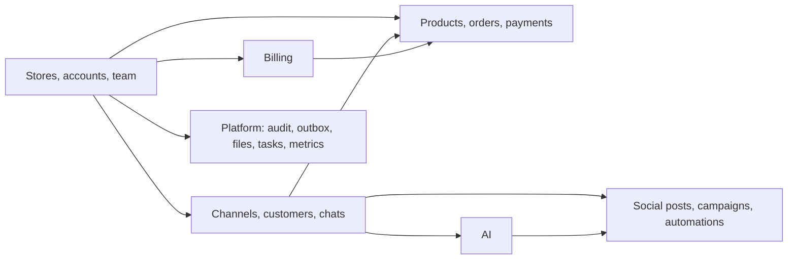
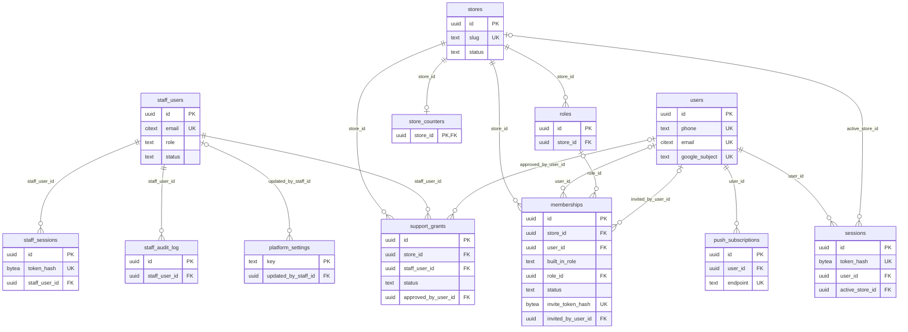
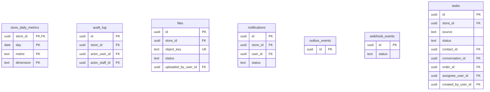
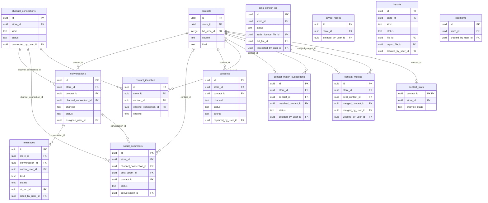
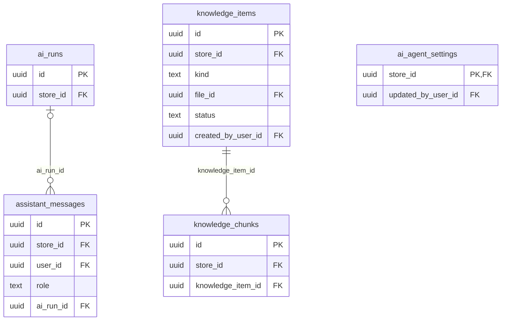
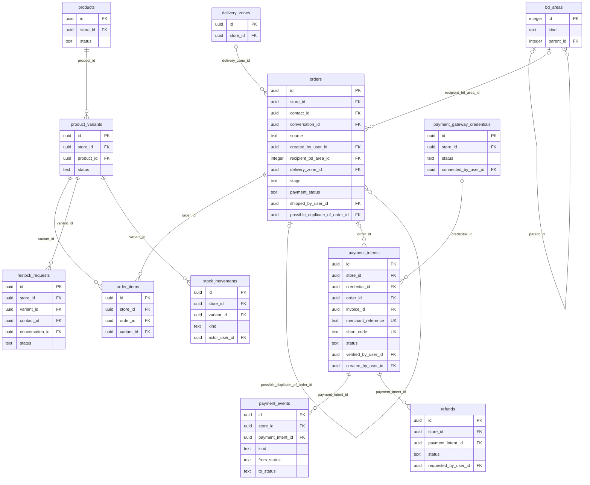
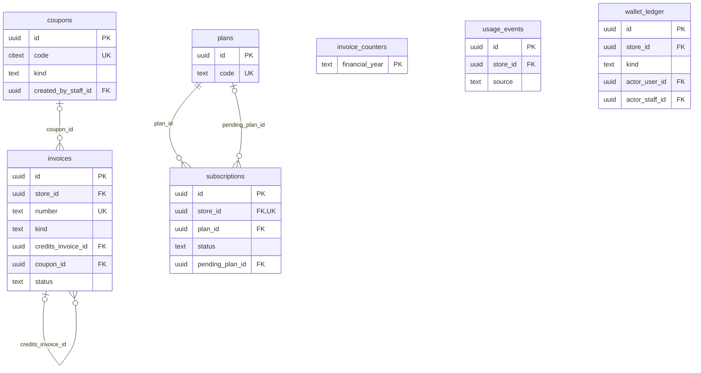
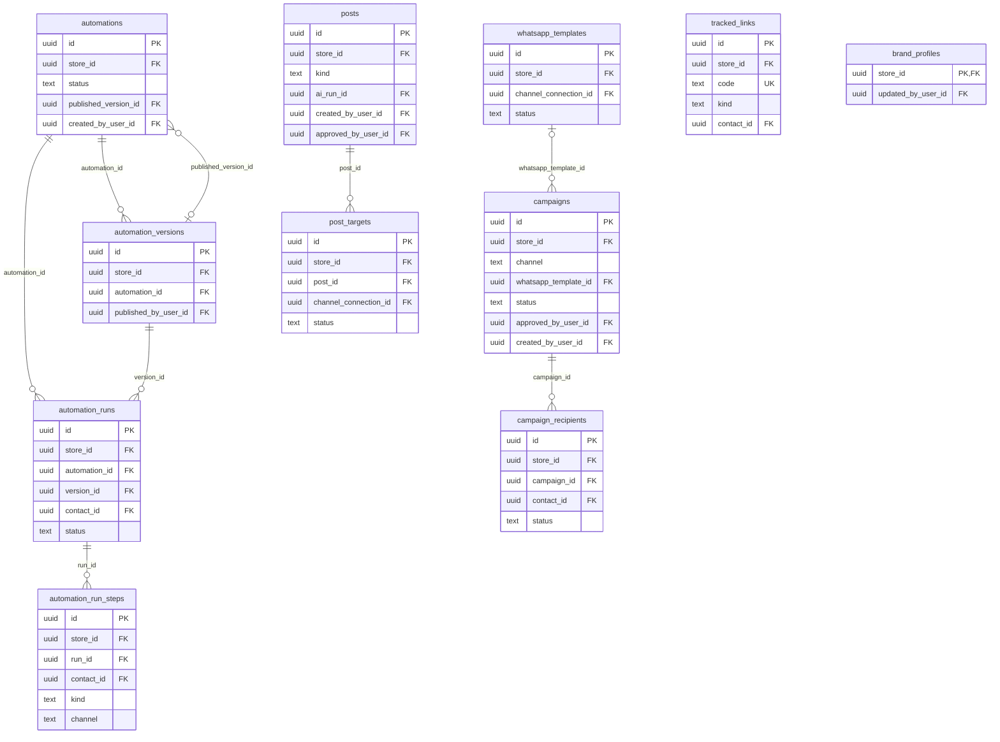

# ER diagram

How the release 1 tables connect. The diagrams are built from the Drizzle snapshot (`packages/db/migrations/meta/0003_snapshot.json`), so they match the migration. Each table lists its key, foreign keys, single-column unique keys and status columns; the schema files have every column.

To keep each diagram readable:

- Each shop table's `store_id` link to `stores` is drawn only in the first diagram. Every shop table has one.
- Links to `users` (who did it), `staff_users` and `files` are drawn only where those tables live.
- Links between areas are listed in the table below and marked `FK` in the column lists.

## Overview

Links between areas:

| Table                  | Points to                                                                             |
| ---------------------- | ------------------------------------------------------------------------------------- |
| `automation_run_steps` | `contact_id` → `contacts`                                                             |
| `automation_runs`      | `contact_id` → `contacts`                                                             |
| `campaign_recipients`  | `contact_id` → `contacts`                                                             |
| `contacts`             | `bd_area_id` → `bd_areas`                                                             |
| `messages`             | `ai_run_id` → `ai_runs`                                                               |
| `orders`               | `contact_id` → `contacts`, `conversation_id` → `conversations`                        |
| `payment_intents`      | `invoice_id` → `invoices`                                                             |
| `post_targets`         | `channel_connection_id` → `channel_connections`                                       |
| `posts`                | `ai_run_id` → `ai_runs`                                                               |
| `restock_requests`     | `contact_id` → `contacts`, `conversation_id` → `conversations`                        |
| `social_comments`      | `post_target_id` → `post_targets`                                                     |
| `tasks`                | `contact_id` → `contacts`, `conversation_id` → `conversations`, `order_id` → `orders` |
| `tracked_links`        | `contact_id` → `contacts`                                                             |
| `whatsapp_templates`   | `channel_connection_id` → `channel_connections`                                       |

## Stores, accounts and team

Tables from `stores.ts`, `auth.ts`, `team.ts`, `admin.ts`.

## Platform

Tables from `platform.ts`, `analytics.ts`, `tasks.ts`.

## Channels, customers and chats

Tables from `channels.ts`, `contacts.ts`, `chats.ts`.

## AI

Tables from `ai.ts`.

## Products, orders and payments

Tables from `products.ts`, `areas.ts`, `orders.ts`, `payments.ts`.

## Billing

Tables from `billing.ts`.

## Social posts, campaigns and automations

Tables from `social.ts`, `campaigns.ts`, `automations.ts`.

