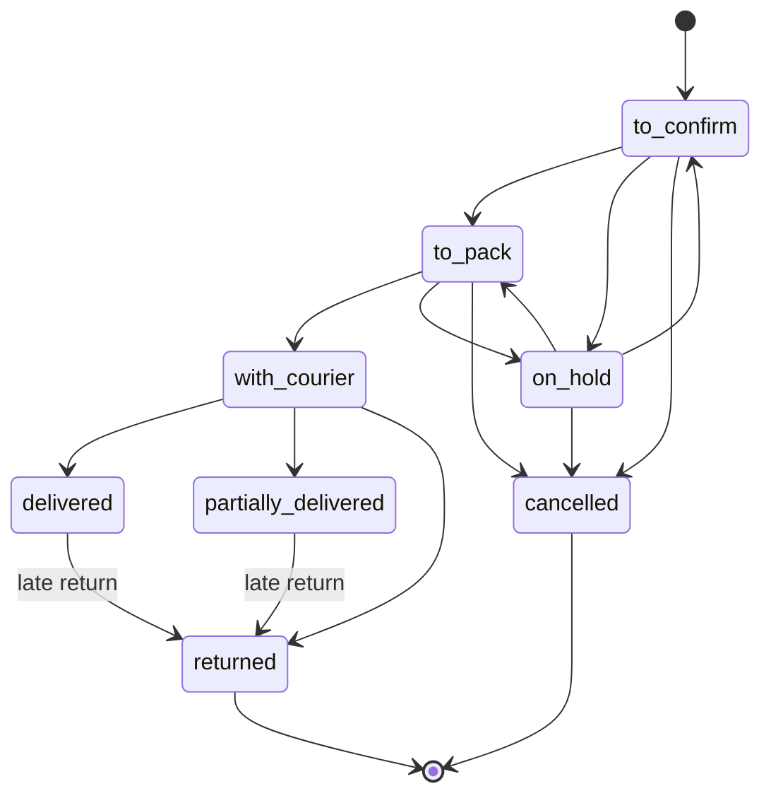
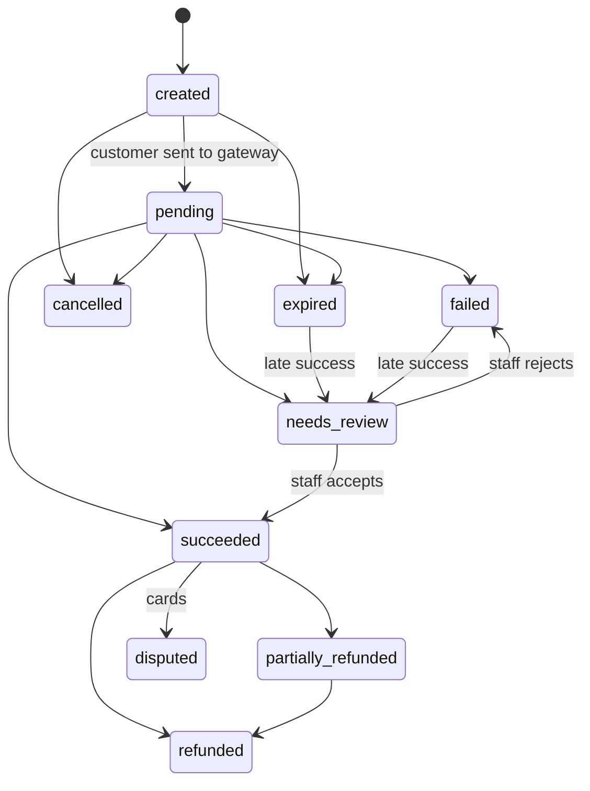
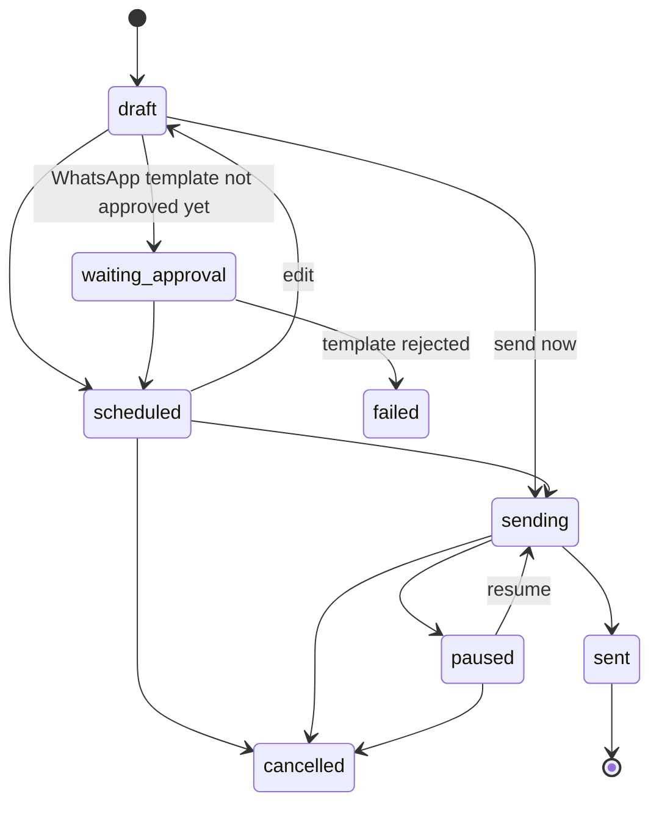

# State machines

Every status column in release 1, its values and the moves allowed between them. The values live in `packages/contracts/src/<feature>.ts` and a `CHECK` in Postgres. The planned owning service must enforce moves, from a transition table kept as data next to it (for example `orders/order-stage.ts`), and each refused move throws the feature's `*_NOT_ALLOWED` error. Postgres checks allowed values and named invariants, not the complete transition graph. Schema tests are not evidence that these services are implemented.

Each change that matters to a person is recorded: order and conversation changes in `audit_log`, payment changes in `payment_events`, stock changes in `stock_movements`.

## Order stage

`orders.stage`, from [06 Orders](../features/06-orders-and-delivery.md). Every order starts at `to_confirm` (Q7: Inquiry is a chat flag, `conversations.has_buying_interest`).

Stock: entering `to_confirm` reserves, `with_courier` turns the reservation into a deduction, `cancelled` releases, `returned` puts units back unless marked damaged.

## Order payment status

`orders.payment_status` moves on its own, apart from the stage.

| From                | To                                           | When                                       |
| ------------------- | -------------------------------------------- | ------------------------------------------ |
| `cod_pending`       | `advance_requested`, `paid`, `cod_collected` | Advance asked for, paid online, cash taken |
| `advance_requested` | `advance_paid`, `cod_pending`                | Advance paid, or the request withdrawn     |
| `advance_paid`      | `cod_collected`, `refund_due`                | Rest collected, or order cancelled         |
| `paid`              | `refund_due`                                 | Order cancelled or returned                |
| `cod_collected`     | `refund_due`                                 | Return after collection                    |
| `refund_due`        | `refunded`                                   | Refund succeeded or recorded by hand       |

## Payment intent

`payment_intents.status`, from [07 Payments](../features/07-payments-and-billing.md). Status only moves forward. `voided_at` is separate: staff can void an intent the customer never paid, and a late success on a voided intent goes to `needs_review`.

`review_reason` says why: `amount_mismatch`, `duplicate`, `late_success`, or `manual_unverified` (a payment staff typed in without a gateway check).

Refunds (`refunds.status`): `requested` → `pending` → `succeeded` or `failed`; an authorized externally paid refund can finish as `recorded_manually`. Requested/pending amounts reserve capacity on the locked payment intent; succeeded/recorded-manually amounts count as refunded. An unknown provider outcome stays pending and reserved. Only a confirmed failure releases capacity, exactly once.

## Conversation

`conversations.status` is where the chat sits for staff; `conversations.responder` is who answers. They change apart.

| Field       | Values                               | Moves                                                                                                                           |
| ----------- | ------------------------------------ | ------------------------------------------------------------------------------------------------------------------------------- |
| `status`    | `open`, `needs_you`, `later`, `done` | Any to any by staff. A new customer message moves `done` and `later` back to `open`. A hand-over moves it to `needs_you`.       |
| `responder` | `ai`, `human`, `paused`              | `ai` → `human` on hand-over or a staff reply; `human` → `ai` by staff or when `return_to_ai_at` passes; `paused` only by staff. |

The AI writes a reply only if, in the short transaction after the model call, `responder` is still `ai` and `version` has not changed (must-fix 2).

Messages (`messages.status`): `queued` → `sent` → `delivered` → `read`, or `failed` from `queued` or `sent`. Inbound messages are `received`. Comments (`social_comments.status`): `new` → `replied`, `needs_you`, `hidden` or `ignored`; `needs_you` → `replied`.

## Campaign and recipients

`campaigns.status`, from [09 Campaigns](../features/09-campaigns-and-automations.md), with `paused` and `failed` added (readiness review F08-01).

`pause_reason`: `manual`, `balance`, `whatsapp_quality`, `template_rejected`, `provider_error`.

Recipients (`campaign_recipients.status`): `queued` → `sending` → `sent` → `delivered` → `read`; `failed` from `sending` or `sent`; `cancelled` from `queued` when the campaign is cancelled; `skipped` can be set at audience build or reached from `queued` or pre-provider `sending` when consent, blocking, window or another final gate fails. Record `skip_reason` and release the reserved cost atomically. Once handed to the provider, reconcile its outcome rather than changing to skipped. Skipped is terminal.

## Social post target

`post_targets.status` (one row per post per page or account):

`draft` → `waiting_approval` (when the store needs approval) → `scheduled` → `publishing` → `published` or `failed`; `failed` → `scheduled` on retry; `cancelled` from any state before `publishing`.

## Workflow

| Column                   | Values                                           | Moves                                                                                        |
| ------------------------ | ------------------------------------------------ | -------------------------------------------------------------------------------------------- |
| `automations.status`     | `draft`, `active`, `paused`, `archived`          | `draft` → `active` on publish; `active` ↔ `paused`; any → `archived`                         |
| `automation_runs.status` | `waiting`, `running`, `done`, `exited`, `failed` | `running` ↔ `waiting` (wait steps); `running` → `done`, `exited` (exit rule met) or `failed` |

A run keeps the `automation_version_id` it started on; publishing a new version does not move running runs. The app may update only `automation_versions.is_stopped`; a worker checks it before the next step. Running leases older than five minutes may be reclaimed with a new `claimed_at` token and incremented diagnostic `attempts` count. Only the worker holding the current claim may commit the step transition; durable send identity and provider reconciliation are separate requirements.

## Account, billing and team

| Column                               | Values                                                           | Moves                                                                                                    |
| ------------------------------------ | ---------------------------------------------------------------- | -------------------------------------------------------------------------------------------------------- |
| `stores.status`                      | `active`, `suspended`, `closing`                                 | `active` ↔ `suspended` (staff); `active` → `closing` (owner closes; purge after the recovery window)     |
| `subscriptions.status`               | `trialing`, `active`, `past_due`, `read_only`, `cancelled`       | `trialing` → `active` or `read_only`; `active` → `past_due` → `active` or `read_only`; any → `cancelled` |
| `invoices.status`                    | `open`, `paid`, `void`                                           | `open` → `paid` or `void`                                                                                |
| `memberships.status`                 | `invited`, `active`, `removed`                                   | `invited` → `active` on accept; any → `removed`                                                          |
| `channel_connections.status`         | `active`, `needs_reconnect`, `disconnected`                      | `active` ↔ `needs_reconnect` (token expired or revoked); any → `disconnected`                            |
| `payment_gateway_credentials.status` | `connected`, `needs_attention`, `disconnected`                   | Same shape as channel connections                                                                        |
| `sms_sender_ids.status`              | `requested`, `in_review`, `approved`, `rejected`                 | Forward only                                                                                             |
| `whatsapp_templates.status`          | `draft`, `pending`, `approved`, `rejected`, `paused`, `disabled` | `draft` → `pending` → `approved` or `rejected`; Meta moves `approved` ↔ `paused` and to `disabled`       |

## Other status columns

| Column                              | Values                                                           | Moves                                                                                                                                                                                                                              |
| ----------------------------------- | ---------------------------------------------------------------- | ---------------------------------------------------------------------------------------------------------------------------------------------------------------------------------------------------------------------------------- |
| `contacts.kind`                     | `chat_only`, `lead`, `customer`, `not_customer`                  | `customer` for a non-cancelled order or an intentional customer add/import/sync; cancellation preserves intentional customers, otherwise use `lead` only with an own phone and `chat_only` without one; `not_customer` is explicit |
| `contact_match_suggestions.status`  | `open`, `merged`, `dismissed`                                    | `open` → `merged` or `dismissed`, by staff only                                                                                                                                                                                    |
| `contact_merges` (no status column) | `undone_at` null or set                                          | Undo within seven days only if not undone/redacted and no active dependent merge; compare after-state, preserve later edits/withdrawals; operation key never becomes reusable                                                      |
| `imports.status`                    | `uploaded`, `mapped`, `validated`, `importing`, `done`, `failed` | Forward only; `failed` from any step                                                                                                                                                                                               |
| `knowledge_items.status`            | `processing`, `active`, `failed`, `archived`                     | `processing` → `active` or `failed`; any → `archived`                                                                                                                                                                              |
| `products.status`                   | `active`, `hidden`, `archived`                                   | Any to any                                                                                                                                                                                                                         |
| `restock_requests.status`           | `waiting`, `notified`, `cancelled`                               | `waiting` → `notified` or `cancelled`                                                                                                                                                                                              |
| `notifications.status`              | `new`, `seen`, `done`, `snoozed`                                 | Any to any, per user                                                                                                                                                                                                               |
| `tasks.status`                      | `open`, `done`, `cancelled`                                      | `open` → `done` or `cancelled`; `done` → `open`                                                                                                                                                                                    |
| `files.status`                      | `pending`, `ready`, `rejected`                                   | `pending` → `ready` or `rejected` (size, type or scan)                                                                                                                                                                             |
| `webhook_events.status`             | `received`, `processed`, `ignored`, `failed`                     | `received` → any; `failed` → `processed` on replay                                                                                                                                                                                 |
| `support_grants.status`             | `requested`, `approved`, `denied`, `ended`, `expired`            | `requested` → `approved` or `denied`; `approved` → `ended` or `expired`                                                                                                                                                            |
| `staff_users.status`                | `active`, `disabled`                                             | Any to any                                                                                                                                                                                                                         |

Revoking an unaccepted invitation sets `removed`, records `removed_at` and invalidates its token. A removed invite may have no `user_id`; only active memberships require one. Invoice settlement status and `paid_at` may change, but issued document fields are immutable and corrected by a credit note.

The order-stage diagram is not a complete inventory or returns implementation: reservation expiry/reacquisition, partial or late returns and cancellation fees need their feature rules and acceptance tests before release.
