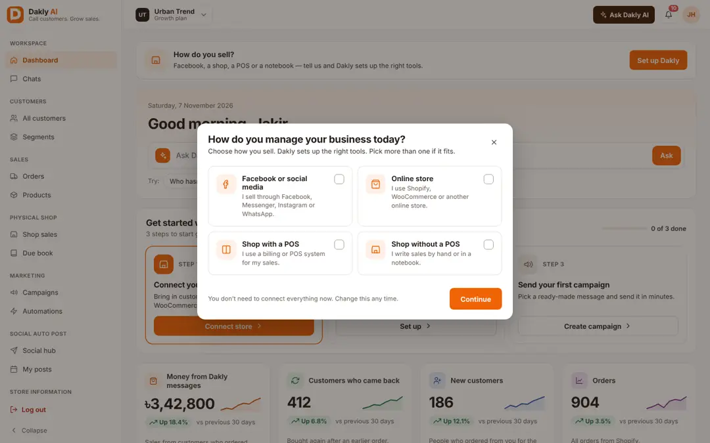
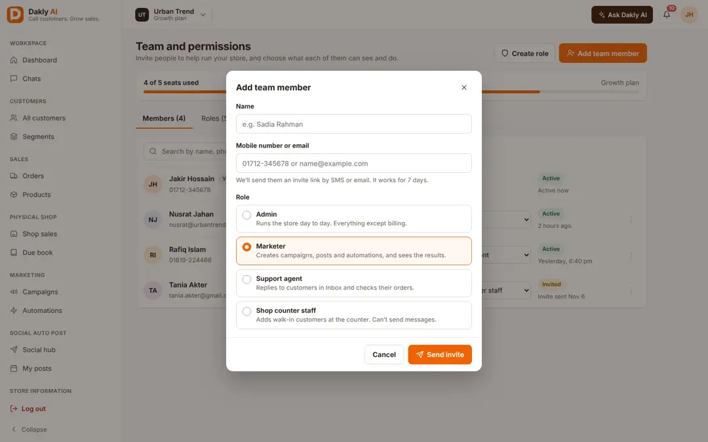
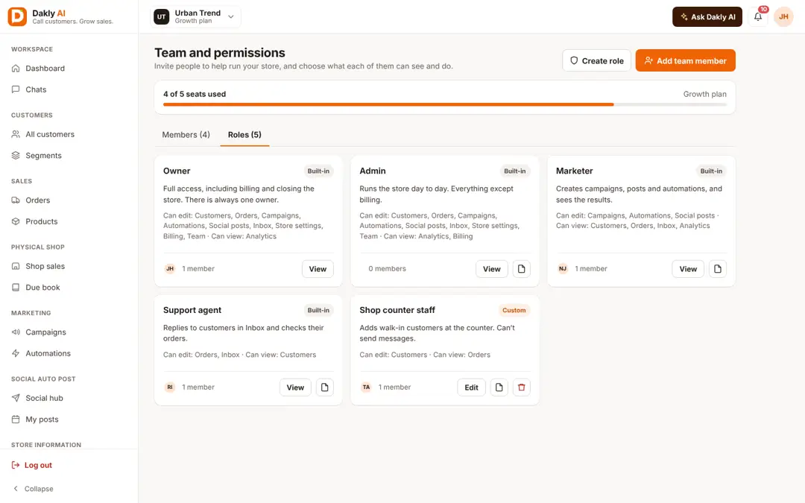
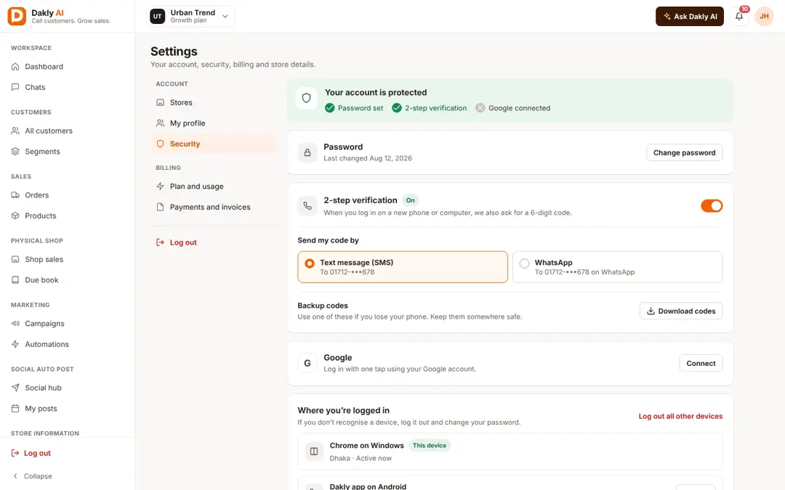
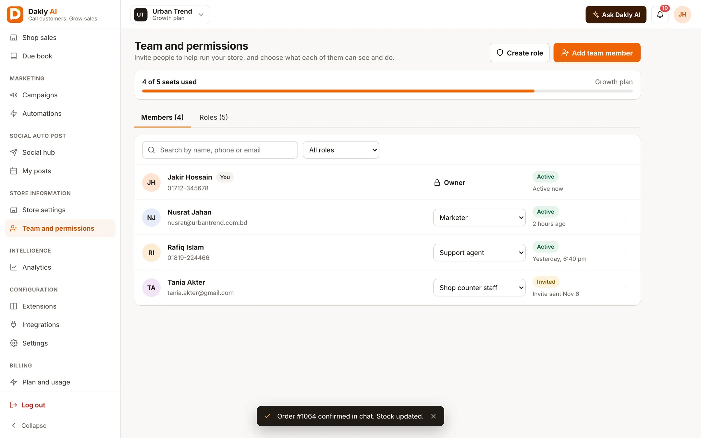
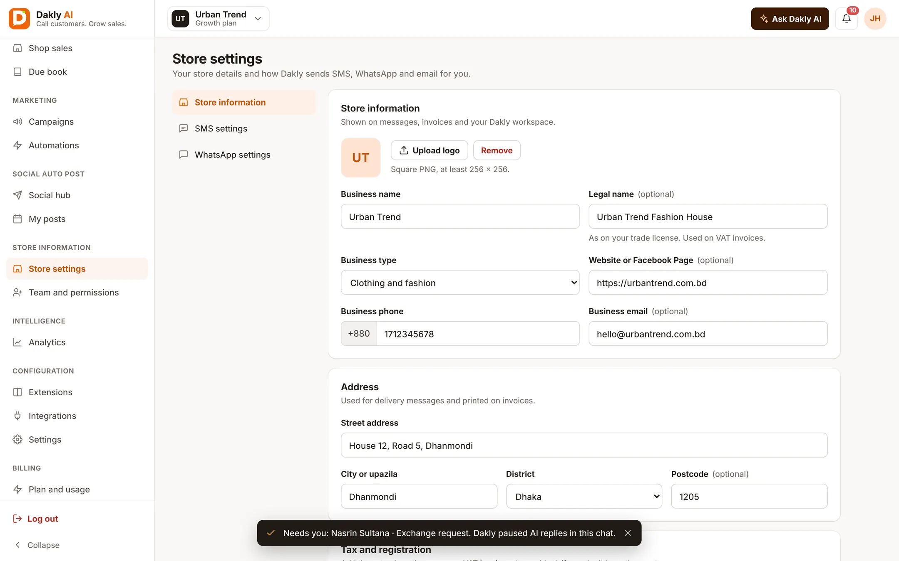
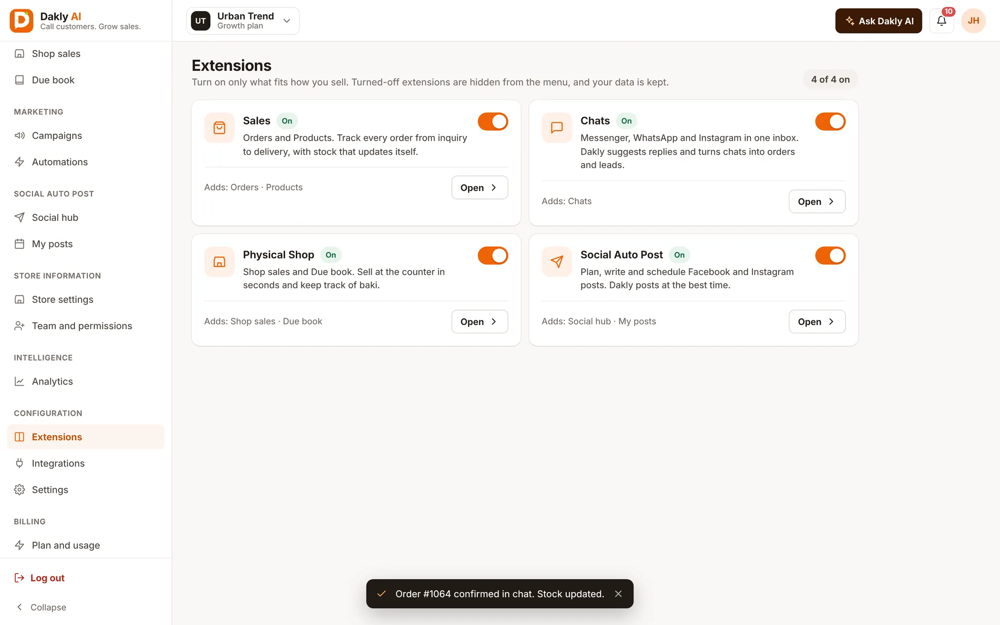

# Account, stores and team

|           |                                                                                                       |
| --------- | ----------------------------------------------------------------------------------------------------- |
| Release   | 1                                                                                                     |
| Status    | Not started                                                                                           |
| Extension | Core                                                                                                  |
| Code      | `packages/core/src/{auth,stores,team,sessions}/`, `apps/web/src/features/{auth,team,store-settings}/` |
| Tasks     | ACC-1 to ACC-15; build order in [plans/core.md](../plans/core.md)                                     |

## Purpose

Lets a shop owner sign up with a mobile number, create a store, invite staff with roles, and keeps every request tied to one verified store. Every other feature depends on this: until it exists, every store route returns `401 STORE_REQUIRED`.

## Decisions that change the PRD

The product requirements below are the PRD text from 12 November 2026. Where a later decision changed it, the decision wins:

- D20: release 1 has five ways to sign in: a code sent to a phone, a code sent to an email, phone with password, email with password, and Google. The sign-in screen shows the Email tab. Codes, password resets, team invites, trial and billing reminders and new-device alerts go by email when the person has a verified email, and by SMS otherwise. Only email campaigns wait for a later release.
- D22: transactional email goes through SendGrid in production and Mailpit in development, behind `EmailDriver`.
- D14 and D15: renewals are paid by bKash (automatic through a bKash agreement), Nagad or City Bank card (pay link). Rocket is not a payment method.
- D1: the Shop counter staff role and the Physical Shop steps in the setup checklist arrive with Physical Shop in release 2.
- Q11: the PRD puts an organisation above stores in release 1. Until Asif answers, a user has memberships in stores and there is no organisation table.

## Product requirements

### What it is for

Get a shop owner from "never heard of Dakly" to a working setup in one sitting, then let them run their account, store, team and bill. Release 1, all parts.

### User stories

- As a new shop owner, I want to sign up with my mobile number in about 2 minutes, so I can try Dakly without a card.
- As an owner, I want Dakly to ask how I sell and switch on only the tools I need, so the menu isn't cluttered.
- As an owner, I want a short checklist that tells me the next setup step, so I know when Dakly is ready to work for me.
- As an owner, I want to invite staff and limit what they see (for example hide phone numbers from chat staff), so my customer list stays safe.
- As an owner, I want to pay by bKash automatically and get VAT invoices, so billing takes no effort.

### Screens

| Screen                                | Elements                                                                                                                                                                                                                                                                                                                                              |
| ------------------------------------- | ----------------------------------------------------------------------------------------------------------------------------------------------------------------------------------------------------------------------------------------------------------------------------------------------------------------------------------------------------- |
| Sign in                               | Mobile and Email tabs (D20); +880 field or email field; password with Show; Forgot password?; Keep me signed in on this device; Sign in; Get a code (by SMS for a phone, by email for an email); Continue with Google; help line; English · বাংলা switch (Bangla shows "coming soon" in release 1). Left panel with 3 selling points on wide screens. |
| Create account (step 1 of 4)          | Full name, mobile, email (optional), password with strength meter, agree to Terms and Privacy.                                                                                                                                                                                                                                                        |
| Verify (step 2 of 4)                  | 6-digit code boxes, resend timer 0:30, change number.                                                                                                                                                                                                                                                                                                 |
| Business details (step 3 of 4)        | Business name, what you sell (8 chips), district (64), how you sell (4 multi-select cards: Facebook or social media; Online store; Shop with a POS; Shop without a POS), customer list size (Under 500; 500–2,000; 2,000–10,000; Over 10,000).                                                                                                        |
| Pick a plan (step 4 of 4)             | Monthly / Yearly switch, 4 plan cards; paid plans say "Start N-day free trial", with N from the plan (D34).                                                                                                                                                                                                                                           |
| Forgot password / New password / Done | Mobile number or email → code → new password (8+ characters with a number) → success.                                                                                                                                                                                                                                                                 |
| Setup checklist (Dashboard)           | Built from the "how you sell" answers (see How it works). Shows "N of M done", each step with a button, Hide guide, Change setup.                                                                                                                                                                                                                     |
| Extensions                            | 4 cards (Sales, Chats, Physical Shop, Social Auto Post): on/off switch, what it adds, Open. Header "N of 4 on".                                                                                                                                                                                                                                       |
| Store settings                        | Tabs Store information, SMS settings, WhatsApp settings (Email settings hidden until email campaigns ship). SMS and WhatsApp settings are in [02-channel-connections.md](02-channel-connections.md).                                                                                                                                                  |
| Team and permissions                  | Members tab (seat meter, invite, role picker per member, status, last active, remove) and Roles tab (built-in and custom roles, per-area access).                                                                                                                                                                                                     |
| Integrations                          | Online store (Shopify, WooCommerce), POS system, Messaging and social (Facebook Pages, Instagram, WhatsApp, SMS).                                                                                                                                                                                                                                     |
| Settings                              | Account: Stores, My profile, Security. Billing: Plan and usage, Payments and invoices.                                                                                                                                                                                                                                                                |

### How it works

**Sign-up**

1. Step 1 validates fields inline. Mobile must be a valid Bangladeshi number not already registered; if it is, show "This number already has an account. Sign in instead" with a link.
2. Dakly sends a 6-digit SMS code (valid 10 minutes, max 5 tries, resend after 30 seconds, max 5 sends per number per hour and 20 per IP per hour).
3. Step 3 saves the store: name, business type, district (prefills Store settings), "how you sell" and size. Size sets the suggested plan (Under 500 → Starter; 500–2,000 → Starter; 2,000–10,000 → Growth; Over 10,000 → Pro), shown with a "Recommended" badge.
4. Step 4: picking Free starts the Free plan; picking a paid plan starts a trial of it with no payment method, as long as the plan's trial length set in the admin panel (D34; 0 means no trial). The trial banner in Plan and usage says when it ends.
5. On finish, Dakly turns extensions on from the "how you sell" answers (see rule ACC-R5), shows the toast "Dakly is set up for how you sell. Turned on: …" and lands on the Dashboard with the setup checklist open.

**Setup checklist**

Steps are added in this order, only for the answers given:

| Answer                         | Steps added                                                                                                                             |
| ------------------------------ | --------------------------------------------------------------------------------------------------------------------------------------- |
| Facebook or social media       | Connect your Facebook Page; Teach Dakly AI your answers (delivery charge, payment, exchange); Add your products; Turn chats into orders |
| Online store                   | Connect Shopify or WooCommerce                                                                                                          |
| Shop with a POS                | Connect your POS                                                                                                                        |
| Shop without a POS (release 2) | Record your first counter sale; Add a baki to the Due book; Scan your khata (optional)                                                  |
| Always                         | Set up WhatsApp and SMS; Send your first campaign                                                                                       |

A step is done when its real condition is true (for example a Page is connected and its token is valid), never by clicking. The checklist hides itself when every step is done and shows "Dakly is ready" once. "Change setup" reopens the "How do you sell?" question, prefilled.

**Extensions**

Turning an extension off hides its pages from the menu, stops its background jobs (for example AI auto-reply stops when Chats is off), and keeps all data. Turning it back on restores everything. If someone opens a link to a hidden page, they land on Extensions with a note.

**Team**

Invite by mobile number (the invite link goes by SMS or WhatsApp) or by email (D20), choose a role, invite link valid 7 days, resend or cancel. Seats count active members and pending invites. When seats are full, Invite shows the plan limit and an Upgrade button.

**Billing**

Plan change: upgrades apply now and charge the prorated difference for the rest of the period; downgrades apply at the next renewal (banner "Changing to X on date, Keep Y"). Cancel keeps the plan until the period ends, then moves to Free (limits drop; data stays but over-limit customers are read-only). Payment methods: bKash tokenized and card auto-pay on the billing date; Nagad and City Bank card payers get a payment link by SMS and email 3 days before (D14, D15). Invoices are Mushak-6.3 VAT invoices with the store's BIN if given.

### Business rules

| ID      | Rule                                                                                                                                                                                                                                                            |
| ------- | --------------------------------------------------------------------------------------------------------------------------------------------------------------------------------------------------------------------------------------------------------------- |
| ACC-R1  | One mobile number = one user login. A verified email can be added to the same user and used to sign in (D20). One user can belong to several stores with a different role in each.                                                                              |
| ACC-R2  | Lock sign-in for 15 minutes after 5 wrong passwords or codes in a row; tell the user by SMS, or by email when the user signed in with email.                                                                                                                    |
| ACC-R3  | "Keep me signed in" lasts 30 days on that device; otherwise the session ends after 12 hours idle.                                                                                                                                                               |
| ACC-R4  | Google sign-in links to an existing account only by verified email; a new Google sign-up must still verify a mobile number.                                                                                                                                     |
| ACC-R5  | Extensions turned on at sign-up: Sales and Chats if "Facebook or social media" is picked; Sales if "Online store" is picked; Social Auto Post if "Facebook or social media" is picked; Physical Shop if a shop answer is picked (release 2). Core is always on. |
| ACC-R6  | Only the Owner can change billing or close the business. Every store has exactly one Owner; ownership changes only by transfer (D35).                                                                                                                           |
| ACC-R7  | Close business requires typing the store name, offers an export of customers, orders and sales first, cancels billing at once and deletes data 30 days later. Can be undone within those 30 days by support.                                                    |
| ACC-R8  | Plan limits: when customers reach the plan limit, new customers are still saved but marked "over limit" and excluded from campaigns until the owner upgrades. Never lose incoming orders or chats because of a limit.                                           |
| ACC-R9  | Trial ending: remind 3 days and 1 day before by SMS, email (when verified) and in-app. With no payment method at the end, move to Free.                                                                                                                         |
| ACC-R10 | Failed auto-pay: retry on days 1, 3 and 5; send SMS each time; after day 7 the store moves to read-only for paid features until paid (chats, orders and shop sales keep working).                                                                               |

### Permissions

Areas each role can be given (No access / View / Edit): Customers, Chats, Orders, Products, Shop sales, Due book, Campaigns, Automations, Social posts, Analytics, Store settings, Billing, Team. Extra switches: See full phone numbers; Download customer lists.

| Role                                     | Default access                                                                                                                                  |
| ---------------------------------------- | ----------------------------------------------------------------------------------------------------------------------------------------------- |
| Owner                                    | Edit everything                                                                                                                                 |
| Admin                                    | Edit everything except Billing (View) and cannot remove Owners                                                                                  |
| Marketer                                 | Edit Customers, Campaigns, Automations, Social posts; View Analytics, Products; No access to Chats, Orders, Shop sales, Due book, Billing, Team |
| Support agent                            | Edit Chats, Orders; View Customers, Products; phone numbers masked                                                                              |
| Shop counter staff (template, release 2) | Edit Shop sales, Due book; View Products; phone numbers masked                                                                                  |

### States and edge cases

- No internet during sign-up: keep entered fields and show "You're offline. We'll continue when you're back."
- SMS code not arriving: after 60 seconds show "Get the code on WhatsApp instead" if the number is on WhatsApp.
- Store with 0 extensions on: menu shows only core pages; Extensions page explains what each adds.
- Meta token expired: show a banner on every affected page (Chats, Social, Integrations) 7 days before expiry and again after, with Reconnect.

### Events and notifications

user.signed\_up, store.created, store.extension\_changed, member.invited, member.joined, whatsapp.connected, whatsapp.quality\_changed, sms.sender\_id\_status, plan.changed, payment.succeeded, payment.failed, trial.ending.

### Acceptance criteria

- Given a new number, when the user completes 4 steps choosing "Facebook or social media" and Growth, then a Growth trial starts, Sales, Chats and Social Auto Post are on, and the checklist shows the 6 matching steps with 0 done.
- Given a connected Facebook Page, when the Dashboard loads, then "Connect your Facebook Page" is ticked without the user clicking it.
- Given a Marketer, when they open Chats from a link, then they see "You don't have access to Chats. Ask the owner."
- Given a store at 2,000 of 2,000 customers on Starter, when a new chat lead orders, then the order and customer are saved and the customer shows "Over plan limit" in the list.

### Beyond the prototype

The prototype is a concept. Its sample shop, numbers, demo providers and some flows are placeholders. This section adds what a production product needs, based on Nabik, respond.io, Shopify admin and similar products.

| Addition                                                                                                                          | Why                                                                           | Release |
| --------------------------------------------------------------------------------------------------------------------------------- | ----------------------------------------------------------------------------- | ------- |
| Organisation above stores: one owner account, many stores, one bill, staff shared across stores with per-store roles              | Shops with 2+ outlets or pages are common; the prototype only switches stores | 1       |
| Activity and audit log page (who changed what, when) for Owners                                                                   | Trust when several staff and an AI work in one shop                           | 1       |
| Two-factor sign-in, session list, new-device alerts                                                                               | Required by the security tab                                                  | 1       |
| Data export of everything (customers, orders, chats, dues) and store closing with deletion                                        | Shops must be able to leave with their data; also a legal duty                | 1       |
| Guided setup that checks real conditions (Page connected, token valid, test message received) instead of fixed counts             | The prototype's checklist numbers are dummy and contradicted the integrations | 1       |
| Usage page with live meters per unit (customers, AI conversations, generations, SMS, WhatsApp balance) and alerts at 80% and 100% | Each AI feature has its own unit (D8)                                         | 1       |
| Single sign-on and custom roles at scale                                                                                          | Larger brands (Nabik's Enterprise tier targets this)                          | Later   |

**Do not copy from the prototype:** demo POS providers (RetailBD, ShopKeeper), the Urban Trend sample data, invoice amounts, and seat counts. Real values come from the billing service and the decisions log.

## Prototype screens

Captured from the prototype on 13 Nov 2026 by opening each button, tab and dialog. Layout only: the numbers, names and some flows are sample data (see the next section).

**Set up Dakly: how do you sell?**

**Set up Dakly, second step**

**Extensions: Sales card**

**Team: add team member**

**Team: create role**

**Team: roles tab**

**Settings: stores**

**Settings: security**

## Where the prototype is wrong or missing

The prototype is a concept with sample data. Build from this doc, not from the prototype, where they differ.

### Design review: Sign-in, onboarding and app shell

The entry flow is thorough and local-first (mobile number + OTP, bKash/Nagad messaging), but onboarding stops at account creation and never hands off to the in-app setup steps.

| Feature              | What the design shows                                                                                                                                                                                                                        | Gaps and questions for build                                                                                                                                                       |
| -------------------- | -------------------------------------------------------------------------------------------------------------------------------------------------------------------------------------------------------------------------------------------- | ---------------------------------------------------------------------------------------------------------------------------------------------------------------------------------- |
| Sign in              | Mobile number (+880) or email tab, password with Show, "Keep me signed in", inline error when the password is empty                                                                                                                          | Define lockout after failed attempts, and what "Keep me signed in" lasts (30 days?). Email tab shows no separate field state in the prototype.                                     |
| Sign in by SMS code  | 6-digit code, 30-second resend timer, change-number link, wrong-code error                                                                                                                                                                   | SMS cost per login is real money in Bangladesh. Decide rate limits per number and per IP.                                                                                          |
| Continue with Google | Button only                                                                                                                                                                                                                                  | Not wired in the prototype. Decide whether Google accounts must also verify a mobile number.                                                                                       |
| Forgot password      | Reset by mobile number and SMS code                                                                                                                                                                                                          | No email reset path, even though email login exists.                                                                                                                               |
| Create account       | Step 1 of 4: name, mobile (verified by SMS), optional email, password, terms checkbox; 14-day free trial, no payment                                                                                                                         | Only step 1 is designed. Steps 2 to 4 (business details, connect store, pick plan?) need screens.                                                                                  |
| Bangla language      | "বাংলা" link says sign-in in Bangla is coming soon                                                                                                                                                                                           | The pitch is "AI that writes in Bangla", so a Bangla UI is likely expected at launch. Decide scope.                                                                                |
| Sidebar navigation   | 12 pages in 7 groups, collapsible to icons, slide-in menu on phone                                                                                                                                                                           | Workable. "Store settings" and "Team" sit under Shop while "Settings" sits under Configuration, which may confuse.                                                                 |
| Store switcher       | Switch between stores (Urban Trend on Growth, Urban Trend Kids on Free), add or manage stores                                                                                                                                                | Multi-store means every record, plan and team role is per store. Confirm billing is per store.                                                                                     |
| Create menu          | Quick create, including Post with AI                                                                                                                                                                                                         | Should list every create action (campaign, customer, segment, post, workflow) so it matches the dashboard shortcuts.                                                               |
| Notifications        | To do / Done tabs. "Fix now" (failed WhatsApp sends, Instagram disconnected, customers waiting for a reply) and "Ways to sell more" (win back 128, VIP offer, welcome 52, plan posts) with estimated ৳ value, total "You could earn ৳49,800" | Strongest feature in the shell. Needs rules for how each estimate is calculated. "Customers waiting for a reply" implies an inbox that does not exist anywhere else in the design. |
| Account menu         | Name, email, role, links to Stores, Profile, Security, Plan, Invoices, Log out                                                                                                                                                               | Fine.                                                                                                                                                                              |
| Log out              | Confirm dialog with "Also log out of my 2 other devices"                                                                                                                                                                                     | Needs a device/session list in Security to back this up.                                                                                                                           |

### Design review: Store settings, Team, Integrations, Settings and billing

These admin areas are unusually complete for a prototype. Billing is fully localised: bKash/Nagad/Rocket, SSLCommerz, 15% VAT and Mushak-6.3 invoices, and the VAT maths is correct (৳3,490 + 15% = ৳4,013.50). The two big holes are WhatsApp message costs, which no plan or page explains, and the Orders and Inbox permissions for modules that don't exist.

| Feature                 | What the design shows                                                                                                                                                                    | Gaps and questions for build                                                                                                                                                        |
| ----------------------- | ---------------------------------------------------------------------------------------------------------------------------------------------------------------------------------------- | ----------------------------------------------------------------------------------------------------------------------------------------------------------------------------------- |
| Store information       | Logo, business and legal name, business type, website/Page, phone, email, address with all 64 districts, trade license, BIN (13 digits), currency BDT, Dhaka time zone                   | Good. Business type list is fashion-led; confirm the target verticals.                                                                                                              |
| SMS settings            | Request a brand sender ID (operator approval) or use a shared number; quiet hours; daily limit                                                                                           | Sender ID approval takes days with BTRC/operators. Show its status and an ETA.                                                                                                      |
| WhatsApp settings       | Connected number verified by Meta, Meta's daily tier (1,000), quiet hours, daily limit to protect quality rating                                                                         | Needs a Meta Business onboarding flow (embedded signup) and template approval status, neither of which is designed.                                                                 |
| Close business          | Type the name to confirm; plan cancelled now, data deleted after 30 days                                                                                                                 | Good. Add a data-export step before delete.                                                                                                                                         |
| Team members            | 4 of 5 seats, invite by mobile or email (link valid 7 days), role per member, status and last active, remove                                                                             | Good.                                                                                                                                                                               |
| Roles and permissions   | 4 built-in roles plus custom "Shop counter staff"; per-area No access / View / Edit; privacy switches to mask phone numbers and block customer export                                    | Strong privacy design. Permissions list "Orders" and "Inbox", but neither has a page in the app. Either design them or drop them from roles.                                        |
| Shopify integration     | Connected, last sync, counts (3,412 customers, 8,960 orders, 214 products), recent activity, Sync now with progress, settings (what to sync, use Shopify marketing consent, tag imports) | Using Shopify's consent field is the right default. 3,412 customers here vs 2,486 elsewhere needs explaining.                                                                       |
| WooCommerce integration | 3-step connect: site URL, then automatic approval in WordPress or REST API keys                                                                                                          | Automatic approval implies a WordPress plugin to build and maintain.                                                                                                                |
| Messaging and social    | WhatsApp Business, SMS sender, Facebook/Instagram status with links to settings                                                                                                          | No email provider is shown, although campaigns and analytics mention email.                                                                                                         |
| My profile              | Name, verified email and mobile, role, time zone                                                                                                                                         | "You're the only person on this account" contradicts the 4-person team.                                                                                                             |
| Security                | Password, 2-step code by SMS or WhatsApp, backup codes, Google login, list of logged-in devices with log out all                                                                         | The summary says "Google connected" while the Google row shows a Connect button.                                                                                                    |
| Stores                  | 2 stores, each with its own plan, customers and campaigns                                                                                                                                | Pro plan lists "Multiple stores and outlets" as a feature, but a Growth user already has 2 stores. Decide whether stores are per-plan or a Pro feature.                             |
| Plan and usage          | Free ৳0, Starter ৳1,490, Growth ৳3,490, Pro ৳7,990 a month + VAT; yearly = 2 months free; limits on customers, AI credits, seats, automations; usage meters                              | Define what one AI credit buys. Starter lists Instagram posting, which elsewhere is "Coming soon".                                                                                  |
| SMS credits             | Packs of 1,000 / 5,000 / 10,000 at ৳0.40 to ৳0.35 per SMS + VAT; credits never expire; Bangla SMS = 70 characters                                                                        | WhatsApp and Messenger costs are not covered anywhere. Meta charges per marketing conversation, so decide whether Dakly passes this through, bundles it, or sells WhatsApp credits. |
| Payments and invoices   | bKash auto-pay default, Visa backup, Nagad/Rocket by payment link 3 days before the bill, SSLCommerz, billing info with BIN, invoice history                                             | Good. Add a failed-payment and grace-period flow.                                                                                                                                   |

### Missing design: sign-up steps 2 to 4

**Why it's needed.** The sign-up screen says "Step 1 of 4" and only step 1 (name, mobile, password) is designed. What a new owner sees in their first 5 minutes decides whether they stay through the 14-day trial.

**Suggested steps** (the team should confirm the order):

1. **Account** (designed): name, mobile with SMS code, optional email, password, terms.
2. **Your business**: business name, type (clothing, cosmetics, etc.), where you sell (Shopify, WooCommerce, Facebook Page only, physical shop), roughly how many customers, district. These answers pick the right next step and templates.
3. **Bring in your customers**: connect Shopify or WooCommerce, import an Excel sheet, or skip and add later. Show sync progress in the background so the owner isn't blocked.
4. **Connect a channel**: SMS works immediately on the shared sender, so offer it first; WhatsApp and Facebook can follow (they take longer, see section 5).

**Then the first dashboard.** A version of the Dashboard for an account with no data: the Get started checklist on top with real progress, sample insights replaced by "Your numbers appear here after your first campaign", and one suggested first campaign ("Welcome your 186 new customers") once data arrives.

**Also design.** Verify-number errors (wrong code, number already registered), "Forgot which number I used", and how an invited team member's first login differs (they skip steps 2 to 4 and land in the store they were invited to).

### Missing design: email channel

**Why it's needed.** Email shows up as a sent channel in campaign history ("Eid ul-Adha collection · WhatsApp + Email"), in Analytics (an Email channel with "Send an email"), in customer consent and in segment counts. But it can't be chosen in the campaign builder, isn't a workflow step, and has no setup under Integrations. The abandoned-cart template also says "then by email".

**Decision first.** Keep email in the first release, or remove every mention of it. Many Bangladeshi shop customers don't read email, so dropping it at launch is reasonable.

**If email stays, design:**

- **Sender setup** (Store settings or Integrations): from name, from address, domain verification (SPF, DKIM records with copy buttons and a "Check" button), reply-to address.
- **Email editor**: drag-and-drop blocks (header with logo, image, text, product grid from the store, button, footer with address and unsubscribe), mobile preview, send test, AI "write this email".
- **Builder and workflows**: Email as a channel card ("356 customers can receive") and as a workflow step.
- **Compliance**: unsubscribe link always included, unsubscribe page, bounce and complaint handling that turns off email consent.
- **Pricing**: Analytics says email "costs almost nothing". Decide whether it's free within plan limits or metered.

## Engineering

### User stories

- As a new seller, I want to sign up with my mobile number or my email, with a one-time code, a password or Google, whichever I find easiest.
- As an owner, I want to invite my chat staff by mobile number and give them access to Chats and Orders only.
- As an owner, I want to see every device signed in to my store and sign one out.
- As a member of two stores, I want to switch between them without signing in again.

### Screens in release 1

Sign-up has four steps in the prototype: register, verify code, business details ("How do you sell?"), plan. The dashboard asks "How do you sell?" a second time; drop the second ask. The Mobile number and Email tabs, Get a code, password and Continue with Google all ship in release 1 (D20).

Team lists members with role, status and last active, and a roles table. The prototype's areas miss Products, Shop sales and Due book, and call Chats "Inbox"; use the area list below.

### How it works

Sign-up and sign-in

Release 1 has five ways in (D20). All of them end at step 5 below.

| Method             | How                                                                                            |
| ------------------ | ---------------------------------------------------------------------------------------------- |
| Phone and code     | 6-digit code by SMS through the `SmsDriver`                                                    |
| Email and code     | 6-digit code by email through the `EmailDriver` (SendGrid in production, Mailpit locally, D22) |
| Phone and password | Password set at sign-up or later in Settings                                                   |
| Email and password | Same; the email must be verified by a code once before the password works                      |
| Google             | OpenID Connect with Google; Dakly keeps the Google subject id and the verified email           |

1. Phones are normalised to `01XXXXXXXXX` with `bdMobileSchema` from `packages/contracts/src/phone.ts`. Emails are trimmed and lower-cased.
2. Codes are stored hashed, live 10 minutes and allow 5 tries. Sends are limited to 5 per phone or email and 20 per IP per hour (Valkey counters).
3. Passwords are hashed with Argon2id. Wrong passwords and codes share the ACC-R2 lockout (D35). "Forgot password" sends a code to the phone or email on the account.
4. Sign-up commits twice ([plan](../plans/core.md)): verifying the code creates the user and a session with no store; the business details step then creates the store, Owner membership, subscription and default settings in one transaction. A user who stops in between resumes at business details on their next sign-in. Sign-in creates nothing. A Google sign-in whose verified email matches an existing user signs that user in; it never creates a second user for the same email.
5. The API issues an opaque session token (32 random bytes) in an `HttpOnly`, `Secure`, `SameSite=Lax` cookie. Only its SHA-256 hash is stored, with the user, active store, IP, user agent and expiry (30 days sliding with "Keep me signed in", otherwise 12 hours idle; D35).
6. Session and permission results are not cached across requests. A failed database check rejects access. Revoked sessions fail on the next request, including account routes without a store. Each request loads the session and current membership and role from the primary PostgreSQL database, checks the session is unexpired and not revoked and the membership is active, and sets `request.storeId`, `request.userId` and `request.access` (role, area levels and flags). `StoreGuard` and `@RequirePermission('orders.edit')` read them.

Switching store: the session's active store changes through `POST /me/active-store`. The store id never comes from the client any other way.

Team: an invite is a membership with status `invited` and a hashed token sent by SMS, WhatsApp or email, valid 7 days. Accepting with a phone or email that already has a user adds a membership, not a user. Removing a member commits their new membership status, so the next request reads it and gets 401 for that store; their sessions keep working for their other stores. Revoking an unaccepted invite sets `removed`, records `removed_at`, and clears the invite token hash and expiry in the same transaction; its user ID may remain null. Only `active` memberships require a user. The complete `(store_id, status)` index supports member counts, including removed invites.

Roles: four built-in roles live in code, `team/built-in-roles.ts` (Shop counter staff is added in release 2). Custom roles are rows per store. A role maps each area to `none`, `view` or `edit`, plus the flags `seeFullPhone`, `exportLists`, `refund`. One pure function, `team/permissions.ts`, answers "can this member do this", and is unit-tested against the role table.

Areas: `dashboard`, `chats`, `customers`, `segments`, `orders`, `products`, `campaigns`, `automations`, `social`, `analytics`, `storeSettings`, `team`, `billing`, `shopSales` (R2), `dueBook` (R2).

Password and 2-step: a password is optional (Argon2id). TOTP is optional for everyone in release 1 (D35). Requiring it for Owners before connecting a payment gateway is built with PAY-2.

### Rules

1. Exactly one Owner per store. Transfer needs the new owner to accept and the old owner's code.
2. An Owner cannot remove themselves. An Admin cannot change an Owner.
3. A removed member's sessions stop working on the next request.
4. Every change to roles and members writes the store audit log. Every change to a person's sign-in methods, 2-step settings and sessions writes `account_security_events` once, under the user.
5. Turning an extension off hides its pages and nav entries and keeps all its data.

### Permissions

Team: `team.edit` to invite, change roles, remove. Store settings: `storeSettings.edit`. Extensions: Owner and Admin only.

### Events

Emits `member.invited`, `member.joined`, `member.removed`, `store.created`, `extension.toggled`.

### Data

`users` (phone, email, verified times, password hash, Google subject id, accepted terms version and time), `sessions`, `push_subscriptions`, `stores` (settings in one JSON column), `store_counters`, `memberships` (invites are memberships with status `invited`; each member's notification preferences), `roles` (custom only; built-in roles are code), `support_grants`, `audit_log`. Sign-in codes live in Valkey ([ADR 0007](../adr/0007-sign-in-identifiers-on-users.md)). Full design: [docs/data](../data/README.md).

### Edge cases to test

- Number or email already registered goes to sign-in.
- Google account whose email belongs to an existing user signs in that user.
- Password sign-in with an unverified email is refused until the email is verified.
- A used code cannot be used again.
- Invite accepted by a number that is already in another store.
- The last Owner tries to leave.
- A session used after the member was removed returns 401.

### Acceptance

- Given a new number, entering the right code creates the user and a session without a store. Completing business details with an eligible plan creates the store and Owner membership atomically: Free starts immediately; a paid plan with a positive `trial_days` starts that trial; a paid plan without a trial requires checkout (PAY-7).
- Given a Support agent, when they open Campaigns, then the page says they have no access, and the API returns `403 PERMISSION_DENIED` for campaign routes.

## Open questions

Q3 (extra stores), Q11 (organisation above stores).
