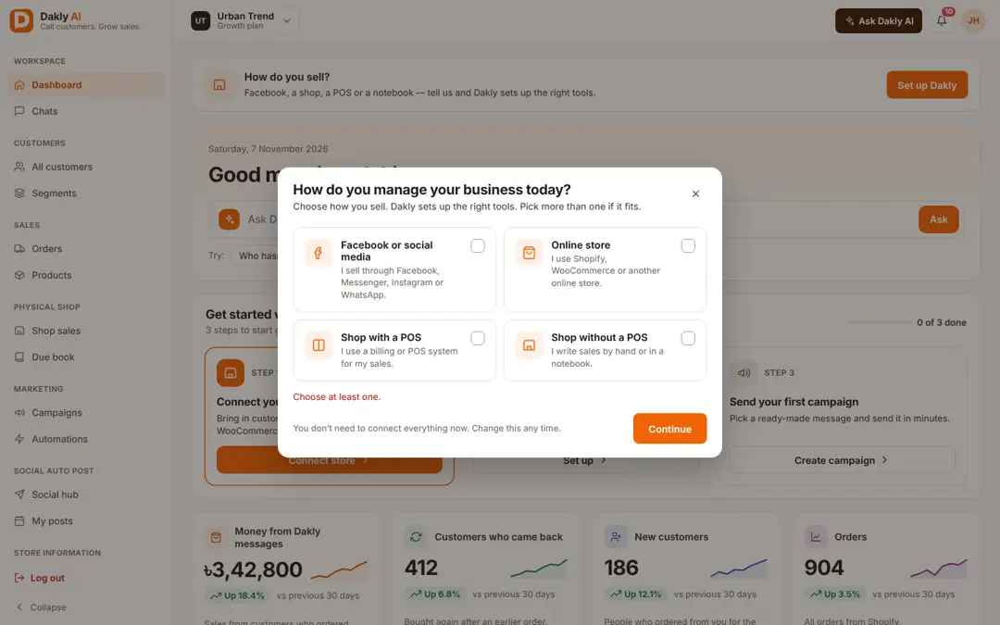
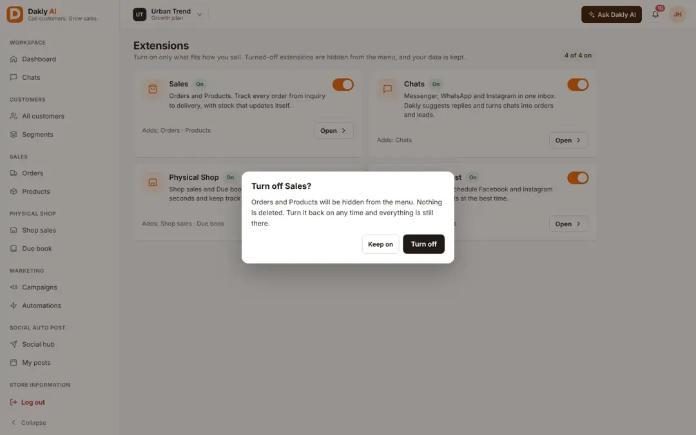
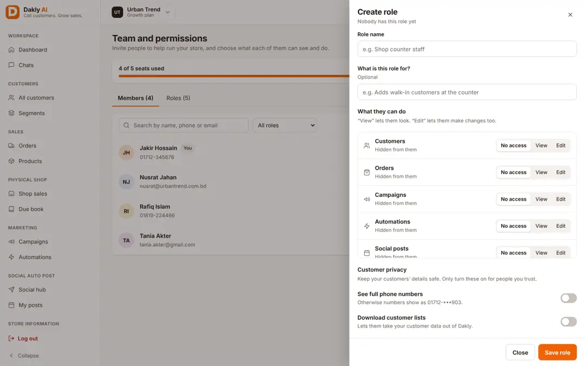
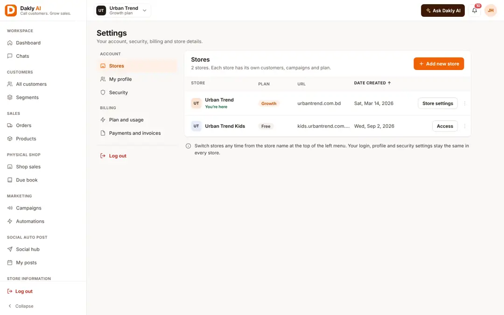
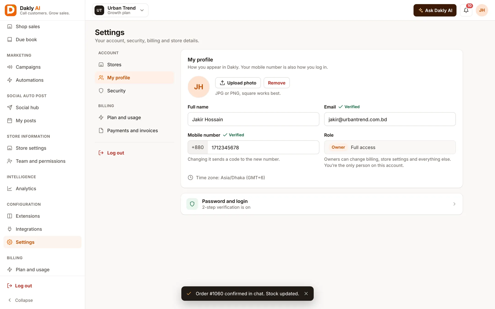

# Account, stores and team

|           |                                                                                                       |
| --------- | ----------------------------------------------------------------------------------------------------- |
| Release   | 1                                                                                                     |
| Status    | Not started                                                                                           |
| Extension | Core                                                                                                  |
| Code      | `packages/core/src/{auth,stores,team,sessions}/`, `apps/web/src/features/{auth,team,store-settings}/` |
| Tasks     | ACC-1 to ACC-15; build order in [plans/core.md](../plans/core.md)                                     |

## Purpose

Lets a shop owner sign up with a mobile number, create a store, invite staff with roles, and keeps every request tied to one verified store. Every other feature depends on this: until it exists, every store route returns `401 STORE_REQUIRED`.

## Decisions that change the PRD

The product requirements below are the PRD text from 12 November 2026. Where a later decision changed it, the decision wins:

- D20: release 1 has five ways to sign in: a code sent to a phone, a code sent to an email, phone with password, email with password, and Google. The sign-in screen shows the Email tab. Codes, password resets, team invites, trial and billing reminders and new-device alerts go by email when the person has a verified email, and by SMS otherwise. Only email campaigns wait for a later release.
- D22: transactional email goes through SendGrid in production and Mailpit in development, behind `EmailDriver`.
- D14 and D15: renewals are paid by bKash (automatic through a bKash agreement), Nagad or City Bank card (pay link). Rocket is not a payment method.
- D1: the Shop counter staff role and the Physical Shop steps in the setup checklist arrive with Physical Shop in release 2.
- Q11: the PRD puts an organisation above stores in release 1. Until Asif answers, a user has memberships in stores and there is no organisation table.

## Product requirements

### What it is for

Get a shop owner from "never heard of Dakly" to a working setup in one sitting, then let them run their account, store, team and bill. Release 1, all parts.

### User stories

- As a new shop owner, I want to sign up with my mobile number in about 2 minutes, so I can try Dakly without a card.
- As an owner, I want Dakly to ask how I sell and switch on only the tools I need, so the menu isn't cluttered.
- As an owner, I want a short checklist that tells me the next setup step, so I know when Dakly is ready to work for me.
- As an owner, I want to invite staff and limit what they see (for example hide phone numbers from chat staff), so my customer list stays safe.
- As an owner, I want to pay by bKash automatically and get VAT invoices, so billing takes no effort.

### Screens

| Screen                                | Elements                                                                                                                                                                                                                                                                                                                                              |
| ------------------------------------- | ----------------------------------------------------------------------------------------------------------------------------------------------------------------------------------------------------------------------------------------------------------------------------------------------------------------------------------------------------- |
| Sign in                               | Mobile and Email tabs (D20); +880 field or email field; password with Show; Forgot password?; Keep me signed in on this device; Sign in; Get a code (by SMS for a phone, by email for an email); Continue with Google; help line; English · বাংলা switch (Bangla shows "coming soon" in release 1). Left panel with 3 selling points on wide screens. |
| Create account (step 1 of 4)          | Full name, mobile, email (optional), password with strength meter, agree to Terms and Privacy.                                                                                                                                                                                                                                                        |
| Verify (step 2 of 4)                  | 6-digit code boxes, resend timer 0:30, change number.                                                                                                                                                                                                                                                                                                 |
| Business details (step 3 of 4)        | Business name, what you sell (8 chips), district (64), how you sell (4 multi-select cards: Facebook or social media; Online store; Shop with a POS; Shop without a POS), customer list size (Under 500; 500–2,000; 2,000–10,000; Over 10,000).                                                                                                        |
| Pick a plan (step 4 of 4)             | Monthly / Yearly switch, 4 plan cards; paid plans say "Start N-day free trial", with N from the plan (D34).                                                                                                                                                                                                                                           |
| Forgot password / New password / Done | Mobile number or email → code → new password (8+ characters with a number) → success.                                                                                                                                                                                                                                                                 |
| Setup checklist (Dashboard)           | Built from the "how you sell" answers (see How it works). Shows "N of M done", each step with a button, Hide guide, Change setup.                                                                                                                                                                                                                     |
| Extensions                            | 4 cards (Sales, Chats, Physical Shop, Social Auto Post): on/off switch, what it adds, Open. Header "N of 4 on".                                                                                                                                                                                                                                       |
| Store settings                        | Tabs Store information, SMS settings, WhatsApp settings (Email settings hidden until email campaigns ship). SMS and WhatsApp settings are in [02-channel-connections.md](02-channel-connections.md).                                                                                                                                                  |
| Team and permissions                  | Members tab (seat meter, invite, role picker per member, status, last active, remove) and Roles tab (built-in and custom roles, per-area access).                                                                                                                                                                                                     |
| Integrations                          | Online store (Shopify, WooCommerce), POS system, Messaging and social (Facebook Pages, Instagram, WhatsApp, SMS).                                                                                                                                                                                                                                     |
| Settings                              | Account: Stores, My profile, Security. Billing: Plan and usage, Payments and invoices.                                                                                                                                                                                                                                                                |

### How it works

**Sign-up**

1. Step 1 validates fields inline. Mobile must be a valid Bangladeshi number not already registered; if it is, show "This number already has an account. Sign in instead" with a link.
2. Dakly sends a 6-digit SMS code (valid 10 minutes, max 5 tries, resend after 30 seconds, max 5 sends per number per hour and 20 per IP per hour).
3. Step 3 saves the store: name, business type, district (prefills Store settings), "how you sell" and size. Size sets the suggested plan (Under 500 → Starter; 500–2,000 → Starter; 2,000–10,000 → Growth; Over 10,000 → Pro), shown with a "Recommended" badge.
4. Step 4: picking Free starts the Free plan; picking a paid plan starts a trial of it with no payment method, as long as the plan's trial length set in the admin panel (D34; 0 means no trial). The trial banner in Plan and usage says when it ends.
5. On finish, Dakly turns extensions on from the "how you sell" answers (see rule ACC-R5), shows the toast "Dakly is set up for how you sell. Turned on: …" and lands on the Dashboard with the setup checklist open.

**Setup checklist**

Steps are added in this order, only for the answers given:

| Answer                         | Steps added                                                                                                                             |
| ------------------------------ | --------------------------------------------------------------------------------------------------------------------------------------- |
| Facebook or social media       | Connect your Facebook Page; Teach Dakly AI your answers (delivery charge, payment, exchange); Add your products; Turn chats into orders |
| Online store                   | Connect Shopify or WooCommerce                                                                                                          |
| Shop with a POS                | Connect your POS                                                                                                                        |
| Shop without a POS (release 2) | Record your first counter sale; Add a baki to the Due book; Scan your khata (optional)                                                  |
| Always                         | Set up WhatsApp and SMS; Send your first campaign                                                                                       |

A step is done when its real condition is true (for example a Page is connected and its token is valid), never by clicking. The checklist hides itself when every step is done and shows "Dakly is ready" once. "Change setup" reopens the "How do you sell?" question, prefilled.

**Extensions**

Turning an extension off hides its pages from the menu, stops its background jobs (for example AI auto-reply stops when Chats is off), and keeps all data. Turning it back on restores everything. If someone opens a link to a hidden page, they land on Extensions with a note.

**Team**

Invite by mobile number (the invite link goes by SMS or WhatsApp) or by email (D20), choose a role, invite link valid 7 days, resend or cancel. Seats count active members and pending invites. When seats are full, Invite shows the plan limit and an Upgrade button.

**Billing**

Plan change: upgrades apply now and charge the prorated difference for the rest of the period; downgrades apply at the next renewal (banner "Changing to X on date, Keep Y"). Cancel keeps the plan until the period ends, then moves to Free (limits drop; data stays but over-limit customers are read-only). Payment methods: bKash tokenized and card auto-pay on the billing date; Nagad and City Bank card payers get a payment link by SMS and email 3 days before (D14, D15). Invoices are Mushak-6.3 VAT invoices with the store's BIN if given.

### Business rules

| ID      | Rule                                                                                                                                                                                                                                                            |
| ------- | --------------------------------------------------------------------------------------------------------------------------------------------------------------------------------------------------------------------------------------------------------------- |
| ACC-R1  | One mobile number = one user login. A verified email can be added to the same user and used to sign in (D20). One user can belong to several stores with a different role in each.                                                                              |
| ACC-R2  | Lock sign-in for 15 minutes after 5 wrong passwords or codes in a row; tell the user by SMS, or by email when the user signed in with email.                                                                                                                    |
| ACC-R3  | "Keep me signed in" lasts 30 days on that device; otherwise the session ends after 12 hours idle.                                                                                                                                                               |
| ACC-R4  | Google sign-in links to an existing account only by verified email; a new Google sign-up must still verify a mobile number.                                                                                                                                     |
| ACC-R5  | Extensions turned on at sign-up: Sales and Chats if "Facebook or social media" is picked; Sales if "Online store" is picked; Social Auto Post if "Facebook or social media" is picked; Physical Shop if a shop answer is picked (release 2). Core is always on. |
| ACC-R6  | Only the Owner can change billing or close the business. Every store has exactly one Owner; ownership changes only by transfer (D35).                                                                                                                           |
| ACC-R7  | Close business requires typing the store name, offers an export of customers, orders and sales first, cancels billing at once and deletes data 30 days later. Can be undone within those 30 days by support.                                                    |
| ACC-R8  | Plan limits: when customers reach the plan limit, new customers are still saved but marked "over limit" and excluded from campaigns until the owner upgrades. Never lose incoming orders or chats because of a limit.                                           |
| ACC-R9  | Trial ending: remind 3 days and 1 day before by SMS, email (when verified) and in-app. With no payment method at the end, move to Free.                                                                                                                         |
| ACC-R10 | Failed auto-pay: retry on days 1, 3 and 5; send SMS each time; after day 7 the store moves to read-only for paid features until paid (chats, orders and shop sales keep working).                                                                               |

### Permissions

Areas each role can be given (No access / View / Edit): Customers, Chats, Orders, Products, Shop sales, Due book, Campaigns, Automations, Social posts, Analytics, Store settings, Billing, Team. Extra switches: See full phone numbers; Download customer lists.

| Role                                     | Default access                                                                                                                                  |
| ---------------------------------------- | ----------------------------------------------------------------------------------------------------------------------------------------------- |
| Owner                                    | Edit everything                                                                                                                                 |
| Admin                                    | Edit everything except Billing (View) and cannot remove Owners                                                                                  |
| Marketer                                 | Edit Customers, Campaigns, Automations, Social posts; View Analytics, Products; No access to Chats, Orders, Shop sales, Due book, Billing, Team |
| Support agent                            | Edit Chats, Orders; View Customers, Products; phone numbers masked                                                                              |
| Shop counter staff (template, release 2) | Edit Shop sales, Due book; View Products; phone numbers masked                                                                                  |

### States and edge cases

- No internet during sign-up: keep entered fields and show "You're offline. We'll continue when you're back."
- SMS code not arriving: after 60 seconds show "Get the code on WhatsApp instead" if the number is on WhatsApp.
- Store with 0 extensions on: menu shows only core pages; Extensions page explains what each adds.
- Meta token expired: show a banner on every affected page (Chats, Social, Integrations) 7 days before expiry and again after, with Reconnect.

### Events and notifications

user.signed\_up, store.created, store.extension\_changed, member.invited, member.joined, whatsapp.connected, whatsapp.quality\_changed, sms.sender\_id\_status, plan.changed, payment.succeeded, payment.failed, trial.ending.

### Acceptance criteria

- Given a new number, when the user completes 4 steps choosing "Facebook or social media" and Growth, then a Growth trial starts, Sales, Chats and Social Auto Post are on, and the checklist shows the 6 matching steps with 0 done.
- Given a connected Facebook Page, when the Dashboard loads, then "Connect your Facebook Page" is ticked without the user clicking it.
- Given a Marketer, when they open Chats from a link, then they see "You don't have access to Chats. Ask the owner."
- Given a store at 2,000 of 2,000 customers on Starter, when a new chat lead orders, then the order and customer are saved and the customer shows "Over plan limit" in the list.

### Beyond the prototype

The prototype is a concept. Its sample shop, numbers, demo providers and some flows are placeholders. This section adds what a production product needs, based on Nabik, respond.io, Shopify admin and similar products.

| Addition                                                                                                                          | Why                                                                           | Release |
| --------------------------------------------------------------------------------------------------------------------------------- | ----------------------------------------------------------------------------- | ------- |
| Organisation above stores: one owner account, many stores, one bill, staff shared across stores with per-store roles              | Shops with 2+ outlets or pages are common; the prototype only switches stores | 1       |
| Activity and audit log page (who changed what, when) for Owners                                                                   | Trust when several staff and an AI work in one shop                           | 1       |
| Two-factor sign-in, session list, new-device alerts                                                                               | Required by the security tab                                                  | 1       |
| Data export of everything (customers, orders, chats, dues) and store closing with deletion                                        | Shops must be able to leave with their data; also a legal duty                | 1       |
| Guided setup that checks real conditions (Page connected, token valid, test message received) instead of fixed counts             | The prototype's checklist numbers are dummy and contradicted the integrations | 1       |
| Usage page with live meters per unit (customers, AI conversations, generations, SMS, WhatsApp balance) and alerts at 80% and 100% | Each AI feature has its own unit (D8)                                         | 1       |
| Single sign-on and custom roles at scale                                                                                          | Larger brands (Nabik's Enterprise tier targets this)                          | Later   |

**Do not copy from the prototype:** demo POS providers (RetailBD, ShopKeeper), the Urban Trend sample data, invoice amounts, and seat counts. Real values come from the billing service and the decisions log.

## Prototype screens

Captured from the prototype on 13 Nov 2026 by opening each button, tab and dialog. Layout only: the numbers, names and some flows are sample data (see the next section).

**Set up Dakly: how do you sell?**

**Set up Dakly, second step**

**Extensions: Sales card**

**Team: add team member**

**Team: create role**

**Team: roles tab**

**Settings: stores**

**Settings: security**

## Where the prototype is wrong or missing

The prototype is a concept with sample data. Build from this doc, not from the prototype, where they differ.

### Design review: Sign-in, onboarding and app shell

The entry flow is thorough and local-first (mobile number + OTP, bKash/Nagad messaging), but onboarding stops at account creation and never hands off to the in-app setup steps.

| Feature              | What the design shows                                                                                                                                                                                                                        | Gaps and questions for build                                                                                                                                                       |
| -------------------- | -------------------------------------------------------------------------------------------------------------------------------------------------------------------------------------------------------------------------------------------- | ---------------------------------------------------------------------------------------------------------------------------------------------------------------------------------- |
| Sign in              | Mobile number (+880) or email tab, password with Show, "Keep me signed in", inline error when the password is empty                                                                                                                          | Define lockout after failed attempts, and what "Keep me signed in" lasts (30 days?). Email tab shows no separate field state in the prototype.                                     |
| Sign in by SMS code  | 6-digit code, 30-second resend timer, change-number link, wrong-code error                                                                                                                                                                   | SMS cost per login is real money in Bangladesh. Decide rate limits per number and per IP.                                                                                          |
| Continue with Google | Button only                                                                                                                                                                                                                                  | Not wired in the prototype. Decide whether Google accounts must also verify a mobile number.                                                                                       |
| Forgot password      | Reset by mobile number and SMS code                                                                                                                                                                                                          | No email reset path, even though email login exists.                                                                                                                               |
| Create account       | Step 1 of 4: name, mobile (verified by SMS), optional email, password, terms checkbox; 14-day free trial, no payment                                                                                                                         | Only step 1 is designed. Steps 2 to 4 (business details, connect store, pick plan?) need screens.                                                                                  |
| Bangla language      | "বাংলা" link says sign-in in Bangla is coming soon                                                                                                                                                                                           | The pitch is "AI that writes in Bangla", so a Bangla UI is likely expected at launch. Decide scope.                                                                                |
| Sidebar navigation   | 12 pages in 7 groups, collapsible to icons, slide-in menu on phone                                                                                                                                                                           | Workable. "Store settings" and "Team" sit under Shop while "Settings" sits under Configuration, which may confuse.                                                                 |
| Store switcher       | Switch between stores (Urban Trend on Growth, Urban Trend Kids on Free), add or manage stores                                                                                                                                                | Multi-store means every record, plan and team role is per store. Confirm billing is per store.                                                                                     |
| Create menu          | Quick create, including Post with AI                                                                                                                                                                                                         | Should list every create action (campaign, customer, segment, post, workflow) so it matches the dashboard shortcuts.                                                               |
| Notifications        | To do / Done tabs. "Fix now" (failed WhatsApp sends, Instagram disconnected, customers waiting for a reply) and "Ways to sell more" (win back 128, VIP offer, welcome 52, plan posts) with estimated ৳ value, total "You could earn ৳49,800" | Strongest feature in the shell. Needs rules for how each estimate is calculated. "Customers waiting for a reply" implies an inbox that does not exist anywhere else in the design. |
| Account menu         | Name, email, role, links to Stores, Profile, Security, Plan, Invoices, Log out                                                                                                                                                               | Fine.                                                                                                                                                                              |
| Log out              | Confirm dialog with "Also log out of my 2 other devices"                                                                                                                                                                                     | Needs a device/session list in Security to back this up.                                                                                                                           |

### Design review: Store settings, Team, Integrations, Settings and billing

These admin areas are unusually complete for a prototype. Billing is fully localised: bKash/Nagad/Rocket, SSLCommerz, 15% VAT and Mushak-6.3 invoices, and the VAT maths is correct (৳3,490 + 15% = ৳4,013.50). The two big holes are WhatsApp message costs, which no plan or page explains, and the Orders and Inbox permissions for modules that don't exist.

| Feature                 | What the design shows                                                                                                                                                                    | Gaps and questions for build                                                                                                                                                        |
| ----------------------- | ---------------------------------------------------------------------------------------------------------------------------------------------------------------------------------------- | ----------------------------------------------------------------------------------------------------------------------------------------------------------------------------------- |
| Store information       | Logo, business and legal name, business type, website/Page, phone, email, address with all 64 districts, trade license, BIN (13 digits), currency BDT, Dhaka time zone                   | Good. Business type list is fashion-led; confirm the target verticals.                                                                                                              |
| SMS settings            | Request a brand sender ID (operator approval) or use a shared number; quiet hours; daily limit                                                                                           | Sender ID approval takes days with BTRC/operators. Show its status and an ETA.                                                                                                      |
| WhatsApp settings       | Connected number verified by Meta, Meta's daily tier (1,000), quiet hours, daily limit to protect quality rating                                                                         | Needs a Meta Business onboarding flow (embedded signup) and template approval status, neither of which is designed.                                                                 |
| Close business          | Type the name to confirm; plan cancelled now, data deleted after 30 days                                                                                                                 | Good. Add a data-export step before delete.                                                                                                                                         |
| Team members            | 4 of 5 seats, invite by mobile or email (link valid 7 days), role per member, status and last active, remove                                                                             | Good.                                                                                                                                                                               |
| Roles and permissions   | 4 built-in roles plus custom "Shop counter staff"; per-area No access / View / Edit; privacy switches to mask phone numbers and block customer export                                    | Strong privacy design. Permissions list "Orders" and "Inbox", but neither has a page in the app. Either design them or drop them from roles.                                        |
| Shopify integration     | Connected, last sync, counts (3,412 customers, 8,960 orders, 214 products), recent activity, Sync now with progress, settings (what to sync, use Shopify marketing consent, tag imports) | Using Shopify's consent field is the right default. 3,412 customers here vs 2,486 elsewhere needs explaining.                                                                       |
| WooCommerce integration | 3-step connect: site URL, then automatic approval in WordPress or REST API keys                                                                                                          | Automatic approval implies a WordPress plugin to build and maintain.                                                                                                                |
| Messaging and social    | WhatsApp Business, SMS sender, Facebook/Instagram status with links to settings                                                                                                          | No email provider is shown, although campaigns and analytics mention email.                                                                                                         |
| My profile              | Name, verified email and mobile, role, time zone                                                                                                                                         | "You're the only person on this account" contradicts the 4-person team.                                                                                                             |
| Security                | Password, 2-step code by SMS or WhatsApp, backup codes, Google login, list of logged-in devices with log out all                                                                         | The summary says "Google connected" while the Google row shows a Connect button.                                                                                                    |
| Stores                  | 2 stores, each with its own plan, customers and campaigns                                                                                                                                | Pro plan lists "Multiple stores and outlets" as a feature, but a Growth user already has 2 stores. Decide whether stores are per-plan or a Pro feature.                             |
| Plan and usage          | Free ৳0, Starter ৳1,490, Growth ৳3,490, Pro ৳7,990 a month + VAT; yearly = 2 months free; limits on customers, AI credits, seats, automations; usage meters                              | Define what one AI credit buys. Starter lists Instagram posting, which elsewhere is "Coming soon".                                                                                  |
| SMS credits             | Packs of 1,000 / 5,000 / 10,000 at ৳0.40 to ৳0.35 per SMS + VAT; credits never expire; Bangla SMS = 70 characters                                                                        | WhatsApp and Messenger costs are not covered anywhere. Meta charges per marketing conversation, so decide whether Dakly passes this through, bundles it, or sells WhatsApp credits. |
| Payments and invoices   | bKash auto-pay default, Visa backup, Nagad/Rocket by payment link 3 days before the bill, SSLCommerz, billing info with BIN, invoice history                                             | Good. Add a failed-payment and grace-period flow.                                                                                                                                   |

### Missing design: sign-up steps 2 to 4

**Why it's needed.** The sign-up screen says "Step 1 of 4" and only step 1 (name, mobile, password) is designed. What a new owner sees in their first 5 minutes decides whether they stay through the 14-day trial.

**Suggested steps** (the team should confirm the order):

1. **Account** (designed): name, mobile with SMS code, optional email, password, terms.
2. **Your business**: business name, type (clothing, cosmetics, etc.), where you sell (Shopify, WooCommerce, Facebook Page only, physical shop), roughly how many customers, district. These answers pick the right next step and templates.
3. **Bring in your customers**: connect Shopify or WooCommerce, import an Excel sheet, or skip and add later. Show sync progress in the background so the owner isn't blocked.
4. **Connect a channel**: SMS works immediately on the shared sender, so offer it first; WhatsApp and Facebook can follow (they take longer, see section 5).

**Then the first dashboard.** A version of the Dashboard for an account with no data: the Get started checklist on top with real progress, sample insights replaced by "Your numbers appear here after your first campaign", and one suggested first campaign ("Welcome your 186 new customers") once data arrives.

**Also design.** Verify-number errors (wrong code, number already registered), "Forgot which number I used", and how an invited team member's first login differs (they skip steps 2 to 4 and land in the store they were invited to).

### Missing design: email channel

**Why it's needed.** Email shows up as a sent channel in campaign history ("Eid ul-Adha collection · WhatsApp + Email"), in Analytics (an Email channel with "Send an email"), in customer consent and in segment counts. But it can't be chosen in the campaign builder, isn't a workflow step, and has no setup under Integrations. The abandoned-cart template also says "then by email".

**Decision first.** Keep email in the first release, or remove every mention of it. Many Bangladeshi shop customers don't read email, so dropping it at launch is reasonable.

**If email stays, design:**

- **Sender setup** (Store settings or Integrations): from name, from address, domain verification (SPF, DKIM records with copy buttons and a "Check" button), reply-to address.
- **Email editor**: drag-and-drop blocks (header with logo, image, text, product grid from the store, button, footer with address and unsubscribe), mobile preview, send test, AI "write this email".
- **Builder and workflows**: Email as a channel card ("356 customers can receive") and as a workflow step.
- **Compliance**: unsubscribe link always included, unsubscribe page, bounce and complaint handling that turns off email consent.
- **Pricing**: Analytics says email "costs almost nothing". Decide whether it's free within plan limits or metered.

## Engineering

### User stories

- As a new seller, I want to sign up with my mobile number or my email, with a one-time code, a password or Google, whichever I find easiest.
- As an owner, I want to invite my chat staff by mobile number and give them access to Chats and Orders only.
- As an owner, I want to see every device signed in to my store and sign one out.
- As a member of two stores, I want to switch between them without signing in again.

### Screens in release 1

Sign-up has four steps in the prototype: register, verify code, business details ("How do you sell?"), plan. The dashboard asks "How do you sell?" a second time; drop the second ask. The Mobile number and Email tabs, Get a code, password and Continue with Google all ship in release 1 (D20).

Team lists members with role, status and last active, and a roles table. The prototype's areas miss Products, Shop sales and Due book, and call Chats "Inbox"; use the area list below.

### How it works

Sign-up and sign-in

Release 1 has five ways in (D20). All of them end at step 5 below.

| Method             | How                                                                                            |
| ------------------ | ---------------------------------------------------------------------------------------------- |
| Phone and code     | 6-digit code by SMS through the `SmsDriver`                                                    |
| Email and code     | 6-digit code by email through the `EmailDriver` (SendGrid in production, Mailpit locally, D22) |
| Phone and password | Password set at sign-up or later in Settings                                                   |
| Email and password | Same; the email must be verified by a code once before the password works                      |
| Google             | OpenID Connect with Google; Dakly keeps the Google subject id and the verified email           |

1. Phones are normalised to `01XXXXXXXXX` with `bdMobileSchema` from `packages/contracts/src/phone.ts`. Emails are trimmed and lower-cased.
2. Codes are stored hashed, live 10 minutes and allow 5 tries. Sends are limited to 5 per phone or email and 20 per IP per hour (Valkey counters).
3. Passwords are hashed with Argon2id. Wrong passwords and codes share the ACC-R2 lockout (D35). "Forgot password" sends a code to the phone or email on the account.
4. Sign-up commits in stages ([plan](../plans/core.md)): verifying the code creates the user and a session with no store; the business details step then uses `StoreTransaction.runForNewStore` to create the store, Owner membership, subscription and default settings in one transaction. Global user and session writes stay outside that transaction. The active store is saved to the session after store setup commits; a retry after a failed session update finds the existing owned store and resumes. A user who stops in between resumes at business details on their next sign-in. Sign-in creates nothing. A Google sign-in whose verified email matches an existing user signs that user in; it never creates a second user for the same email.
5. The API issues an opaque session token (32 random bytes) in an `HttpOnly`, `Secure`, `SameSite=Lax` cookie. Only its SHA-256 hash is stored, with the user, active store, IP, user agent and expiry (30 days sliding with "Keep me signed in", otherwise 12 hours idle; D35).
6. Session and permission results are not cached across requests. A failed database check rejects access. Revoked sessions fail on the next request, including account routes without a store. Each request loads the session and current membership and role from the primary PostgreSQL database, checks the session is unexpired and not revoked and the membership is active, and sets `request.storeId`, `request.userId` and `request.access` (role, area levels and flags). `StoreGuard` and `@RequirePermission('orders.edit')` read them.

Switching store: the session's active store changes through `POST /me/active-store`. The store id never comes from the client any other way.

ACC-3 provides `GET /me` (only id, name, phone and email), `GET /me/stores`, `POST /me/active-store` and `POST /auth/sign-out`. Switching requires an active membership; a missing store and a store without membership both return `404 STORE_NOT_FOUND`. Signing out revokes the session and records one account event in the same account transaction, then clears the cookie. Sign-in and initial cookie issuance are wired by ACC-2.

Sessions use two access reads on each store request: the token-hash lookup joins the user to reject disabled accounts; the store/user lookup joins the current custom role. The session guard publishes claims only after these checks succeed. Reads use the primary app database connection; writes use the account transaction scope. No session or permission cache exists. Renewal checks expiry again after the read and guards its write against revoked or expired rows. Last-seen and sliding expiry change at most once every five minutes.

`WEB_ORIGINS` is a comma-separated list of exact origins, defaulting to `http://localhost:3000` for local work. Every POST, PUT, PATCH and DELETE checks it, including requests without a session. Missing origins are rejected. There are no provider callback routes or exemptions yet; the signed callback marker is added with its first route. Cookies use `HttpOnly`, `SameSite=Lax` and `Path=/`, with `Secure` outside development. Remembered cookies renew their 30-day browser lifetime; other cookies have no persistent expiry.

Customer routes require `customers.view` or `customers.edit`. Their service requires the caller's phone-access flag and masks all response phones without it, including create responses, as `017XXXXX678`.

Team: an invite is a membership with status `invited` and a hashed token sent by SMS, WhatsApp or email, valid 7 days. Accepting with a phone or email that already has a user adds a membership, not a user. Removing a member commits their new membership status, so the next request reads it and gets 401 for that store; their sessions keep working for their other stores. Revoking an unaccepted invite sets `removed`, records `removed_at`, and clears the invite token hash and expiry in the same transaction; its user ID may remain null. Only `active` memberships require a user. The complete `(store_id, status)` index supports member counts, including removed invites.

ACC-5 serves `GET /members`, `POST /members/invites`,
`POST /members/invites/:membershipId/resend`, `PATCH /members/:membershipId`,
`DELETE /members/:membershipId` and the signed-in account route `POST /invites/accept`.
Team View reads the list; Team Edit manages members. An invite takes exactly one
normalized `phone` or `email`, and exactly one `builtInRole` or same-store `roleId`.
No ordinary membership action can invite, remove or change the Owner. Assignments
must fit the actor's current grants.

The list includes active members and pending invitations, including expired invitations
that can be resent. It returns `{ items, nextCursor, seats: { used, limit } }`, with
default `limit=50` and maximum 100. A cursor is the last membership ID; the database
resolves its exact `(created_at, id)` boundary within this store, preserving timestamp
precision. Profiles use one bounded UsersService batch. Phones are masked without
`seeFullPhone`; invite hashes and raw links never appear in API responses.

Seat allocation counts active members plus unexpired pending invites. BillingService
reads the current plan limit; a missing limit allows no additional seats. Each write
locks the store row with `FOR NO KEY UPDATE` and records the membership change and
audit event in the same store transaction. The lock serializes seat allocation without
blocking foreign-key checks from account actions. An expired resend must reserve a
seat again; a full store returns `409 TEAM_SEATS_FULL`.

Invite tokens contain 32 random bytes, are stored only as SHA-256 hashes, and expire
after seven days. Delivery uses SMS for phone invitations and email for email invitations,
after commit. The link carries its token in the URL fragment. Acceptance locates the
store through `membership_for_invite`, then rechecks the current token, status and expiry
under the store lock. Before acquiring that lock, UsersService holds a shared read lock
on the signed-in user's current verified identity in the same store action. This special
account read never writes an account or nests an account transaction. A typed unverified
email or phone cannot accept an invite. Acceptance neither creates a user nor changes an
existing active membership; re-inviting a removed user restores their existing membership.
The response identifies the store and membership; switching the active store remains explicit.

Send and resend share a 30-second cooldown and five sends per normalized recipient per
store per hour, plus twenty sends per IP per hour. Valkey keys contain hashes rather than
recipient values and use a separate namespace from sign-in. Reservations happen before
the store transaction and remain consumed on database or vendor failure.

Repeating invite creation for the same pending recipient and role returns that invite
without another send, audit event or seat. A different role returns `409 INVITE_EXISTS`;
use the explicit role-change route. An expired invite is also returned unchanged until
explicitly resent. This recipient-based retry rule does not use `Idempotency-Key`.
Resend rotates the token, invalidating earlier links. A vendor failure returns
`503 INVITE_DELIVERY_UNAVAILABLE` while leaving the committed invitation valid because
delivery may have succeeded before a timeout. Find it with `GET /members`, then resend
after the cooldown. No queue or automatic retry runs. Cancel and remove are repeat-safe;
acceptance tokens are single-use. Later requests observe committed access changes; already
authorized requests may finish.

SmsModule now exports SmsService for authentication and team invitations. Every SMS
attempt records `sms_delivery` with count, monotonic duration and success/failure through
Nest/Pino, including sign-in codes and lock notices. Labels contain no recipient, link,
message text or vendor exception. This closes the earlier SMS metrics gap. Production
SMS remains fail-closed until ACC-14 supplies a provider; Mailpit checks do not prove
live SMS or SendGrid delivery.

Roles: four built-in roles live in code, `team/built-in-roles.ts` (Shop counter staff is added in release 2). Custom roles are rows per store. A role maps each area to `none`, `view` or `edit`, plus the flags `seeFullPhone`, `exportLists`, `refund`. One pure function, `team/permissions.ts`, answers "can this member do this", and is unit-tested against the role table.

ACC-17 serves `GET /roles` with Team View, and `POST /roles`,
`PATCH /roles/:roleId`, `DELETE /roles/:roleId` with Team Edit. Create takes
`{ name, permissions }`; names are trimmed and limited to 60 characters. A patch
changes the name, replaces the complete permission object, or both. The resulting
permissions must fit the actor's grants even for a rename. Custom roles never grant
Billing Edit or other Owner actions. Ordinary self-assignment is allowed when the
grant rule permits it; it cannot grant Owner powers.

The role list returns `{ items, nextCursor, builtInRoles }`. Custom items have
`id`, `name` and `permissions`; the separate built-in metadata has `builtInRole`
and `permissions`, with no editable database ID. Custom roles are ordered by ID
using the `(store_id, id)` index, default to 50 per page and accept at most 100.
The cursor is the last role ID in this store; a missing or foreign cursor returns
an empty custom page. Built-in metadata accompanies every page.

Role mutations share the membership store lock and commit `role.created`,
`role.changed` or `role.deleted` audit events in the same transaction. Duplicate
names within a store return `409 ROLE_NAME_EXISTS`. Missing or foreign roles
return `404 ROLE_NOT_FOUND`. Deletion returns `409 ROLE_IN_USE` for any membership
reference, including pending, expired or removed memberships, preserving membership
history. Editing a role changes every assigned member's access on their next
request; already authorized requests may finish.

Areas: `dashboard`, `chats`, `customers`, `segments`, `orders`, `products`, `campaigns`, `automations`, `social`, `analytics`, `storeSettings`, `team`, `billing`, `shopSales` (R2), `dueBook` (R2).

The permission policy and four built-in roles are implemented (ACC-4). Every built-in role gets Dashboard View; Segments follows Customers. Areas absent from a role grant no access. Only Owner and Admin have the three flags. Unknown roles grant no access. `edit` includes `view`.

`billing.edit`, store closing and ownership transfer always require the Owner. Custom role JSON accepts at most Billing View. Creating, editing or assigning a role must pass `canGrantRole`: every proposed area level and flag must be within the acting member's own access, including Owner authority.

Ownership transfer (ACC-18)

The Owner selects another active member. `POST /store/ownership-transfer/code` takes
`{ membershipId }` and sends a fresh six-digit code to the Owner's verified email,
or verified phone when no verified email exists. The code expires after ten minutes
and shares sign-in send limits, cooldown, failed-attempt limits and account lockout.
It is bound to the acting Owner, store, proposed member and current verified contact.
General sign-in codes and codes for other actions cannot start a transfer.

`POST /store/ownership-transfer` takes `{ membershipId, code }` and creates a pending
transfer valid for 48 hours. There is one pending transfer per store. Expired rows
stop authorizing acceptance immediately and are marked expired when a new transfer
starts. `GET /store/ownership-transfer` returns `{ transfer }` for the current Owner
or named member. It returns `{ transfer: null }` to any active member when none is
pending; other members receive `403 TRANSFER_DENIED` when one exists. Responses expose
only transfer and account ids, status and expiry. The Owner cancels with
`DELETE /store/ownership-transfer/:transferId`.

The named member accepts with `POST /store/ownership-transfer/accept`, taking
`{ transferId }`. Acceptance requires their active store membership. Q3's current
one-owned-store limit also applies: a member already owning a store receives
`409 TRANSFER_STORE_LIMIT`. Membership in other stores remains allowed. The same
per-user advisory lock used by store creation serializes competing ownership grants.

Code delivery and consumption occur outside store transactions. A consumed code stays
spent when the database action fails. Starting a transfer rechecks current Owner
access, member activity and verified identity after consumption. Identity reads hold
a shared user lock through `UsersService.lockVerifiedIdentity` before the store lock;
acceptance also takes the ownership advisory lock before the store lock. All reads
inside these actions reuse the same connection.

Acceptance locks the store row with `FOR NO KEY UPDATE`, then rechecks the pending
transfer, expiry, named member and current Owner. It changes the previous Owner to
Admin before promoting the named member to Owner, clears any custom role assignment,
and records both `member.role_changed` events and the transfer acceptance in the
same transaction. Audit failure rolls the whole action back. Start and cancellation
also have atomic audit events. Member removal, role changes and transfer acceptance
share the store lock; parallel acceptance or removal leaves exactly one Owner.
Both accounts use their new permissions on their next request through ACC-3.

`TeamModule` exports `PermissionGuard` and its policy evaluator. The guard reads trusted `request.userId`, `request.storeId` and `request.access`. It supports `@RequirePermission`, `@AnyMember`, `@RequireUser` and `@Public`; missing classification or insufficient access returns `403 PERMISSION_DENIED`. Method access rules override controller rules. A signed-in user without a store can use `@RequireUser` routes. A known active member can use `@AnyMember` regardless of area levels. ACC-3 registers the global guards in this order: Origin, Session, User, Store, Permission. User and store checks return `401 AUTH_REQUIRED` and `401 STORE_REQUIRED` before permission evaluation.

API-3 inventories every HTTP handler registered by the production `AppModule`, including imported controllers and inherited methods. The check fails for a missing access rule. An explicit controller or method `StoreGuard` also requires an effective `@RequirePermission` or `@AnyMember` rule. Method rules override controller rules; local guards compose. The global conditional store guard alone does not classify public or user routes as store routes. Fixture controllers verify these failures, and `pnpm test:int` checks the real app.

Password and 2-step: a password is optional (Argon2id). TOTP is optional for everyone in release 1 (D35). Requiring it for Owners before connecting a payment gateway is built with PAY-2.

### Rules

1. Exactly one Owner per store. Transfer needs the new owner to accept and the old owner's code.
2. An Owner cannot remove themselves. An Admin cannot change an Owner.
3. A removed member's sessions stop working on the next request.
4. Every change to roles and members writes the store audit log. Every change to a person's sign-in methods, 2-step settings and sessions writes `account_security_events` once, under the user.
5. Turning an extension off hides its pages and nav entries and keeps all its data.

### Permissions

Team: `team.edit` to invite, change roles, remove. Store settings: `storeSettings.edit`. Extensions: Owner and Admin only.

### Events

Emits `member.invited`, `member.joined`, `member.removed`, `store.created`, `extension.toggled`.

### Data

`users` (phone, email, verified times, password hash, Google subject id, accepted terms version and time), `sessions`, `push_subscriptions`, `stores` (settings in one JSON column), `store_counters`, `memberships` (invites are memberships with status `invited`; each member's notification preferences), `roles` (custom only; built-in roles are code), `support_grants`, `audit_log`, `account_security_events`. Sign-in codes live in Valkey ([ADR 0007](../adr/0007-sign-in-identifiers-on-users.md)). Full design: [docs/data](../data/README.md).

### Edge cases to test

- Number or email already registered goes to sign-in.
- Google account whose email belongs to an existing user signs in that user.
- Password sign-in with an unverified email is refused until the email is verified.
- A used code cannot be used again.
- Invite accepted by a number that is already in another store.
- The last Owner tries to leave.
- A session used after the member was removed returns 401.

### Acceptance

- Given a new number, entering the right code creates the user and a session without a store. Completing business details with an eligible plan creates the store and Owner membership atomically: Free starts immediately; a paid plan with a positive `trial_days` starts that trial; a paid plan without a trial requires checkout (PAY-7).
- Given a Support agent, when they open Campaigns, then the page says they have no access, and the API returns `403 PERMISSION_DENIED` for campaign routes.

## SMS delivery in development

ACC-1 provides `SmsDriver.send({ to, text })`, returning `{ providerMessageId }`.
`MailpitSmsDriver` takes SMTP `{ host, port }` options and captures each SMS as an
email to `<phone>@sms.test`. Its provider message id is Mailpit's queue id,
so the API and UI can retrieve the captured message. The adapter sets five-second
SMTP timeouts and returns `SMS_SEND_FAILED` without the raw vendor error. It logs
neither phone numbers nor message text. `FakeSmsDriver` keeps message copies in
memory and returns distinct ids for unit tests.

`docker compose` runs Mailpit on localhost: SMTP port 1025 and UI/API port 8025.
CI uses the same ports and checks readiness before tests. `MAILPIT_SMTP_HOST` and
`MAILPIT_SMTP_PORT` configure the SMTP connection; `MAILPIT_API_URL` configures
integration test read-back. The integration test removes only its own message.

`SMS_DRIVER=mailpit` is the only supported selection. SmsModule selects Mailpit in
development and tests, using the SMTP settings above. Application startup fails in
production even when `SMS_DRIVER` is omitted: no usable production driver exists
until ACC-14 supplies the provider account, sender id and adapter. Pure environment
parsing remains separate from the consumer factory so cookie settings do not
instantiate an SMS driver. Captured messages do not prove live SMS delivery.

## Code sign-up and sign-in

ACC-2 provides the phone routes. Both require an allowed `Origin`.

- `POST /auth/code`: `purpose: sign_up` takes name, normalized BD phone, optional
  email and `termsVersion`. An existing phone returns `409 AUTH_ACCOUNT_EXISTS`.
  `purpose: sign_in` takes a phone; an unknown account returns
  `404 AUTH_ACCOUNT_NOT_FOUND` without sending a message.
- `POST /auth/code/verify`: takes the same phone and purpose, a six-digit code and
  optional `isRemembered` (default false). It returns 204 and sets the session
  cookie; neither the code nor the session token appears in the response body.

Codes use `crypto.randomInt`, are hashed with their target and purpose, expire in
10 minutes, and allow five wrong tries. A Valkey script checks and deletes a code
atomically. A hash-only consumed marker lasts for the original remaining code TTL;
a correct-code replay is rejected without another failure and cannot extend that
TTL or authorize a session. New codes avoid these still-retained values. Sign-in
grants also retain their original user id. Reassigning a phone
invalidates its old grant; the final account row lock rechecks the current phone,
disabled flag and TOTP status before issuing a session. Resend waits 30 seconds;
sends are limited to five per target and twenty per IP in an hour. Concurrent or
failed delivery attempts can consume capacity without a delivered message. The
code is saved before SMS delivery, outside any database transaction. An uncertain
delivery failure retains the code and cooldown and returns `AUTH_SMS_UNAVAILABLE`.

`AuthService.completeSignIn` is the sole production session issuer. It accepts an
internal identity and plain request context, inserts a pending registration if
needed, and commits the user and storeless session in one account transaction.
Sign-up records phone verification and accepted terms; its optional email remains
unverified. Phone uniqueness protects concurrent sign-ups. Email uniqueness applies
only to verified addresses, so an optional unverified signup email cannot reserve
an identity. A consumed code is never restored after database failure: the user
must request another code. If the database committed but clearing failure state
fails, the response fails closed; a new sign-in attempt is required.

Phone, email and future password checks share `SignInFailures` by user id. Unknown
accounts use a hashed target instead. Five consecutive wrong attempts lock the
identity for 15 minutes; thirty failures from one IP block that IP for an hour.
Resending does not clear failures. Only completed sign-in clears the identity
counter, never the IP history. Unknown-target history expires after an hour when
it has not reached a lock. The atomic transition into an account lock sends one
notification outside the database transaction, by verified email when available
and SMS otherwise. Notification failure leaves the lock intact
and records a security event in logs without the phone or message text.

TOTP-enabled accounts return `403 AUTH_SECOND_FACTOR_REQUIRED` and get no session.
Their failure history is retained. ACC-7 must add its challenge inside the common
completion path; no sign-in method may issue a session before that factor passes.
Password and Google sign-in are described in their implementation sections below.

## Email sign-in and identity changes (ACC-9)

`EmailService` uses `EmailDriver.send({ to, subject, text, html? })`. Development
uses `EMAIL_DRIVER=smtp` (the default) with the Mailpit SMTP settings. Production
requires explicit `EMAIL_DRIVER=sendgrid`, `SENDGRID_API_KEY` and `EMAIL_FROM`.
SMTP and fake selections are refused in production. SendGrid uses its HTTPS
Mail Send endpoint with a five-second timeout and no redirects. Both drivers
sanitize failures. SendGrid request shapes are tested with fake fetch; live
SendGrid delivery remains untested until the sending domain is verified.
The existing production SMS refusal still applies until ACC-14.

Each EmailService call emits one `email_delivery` metric observation through the
existing JSON logger: count 1, elapsed monotonic milliseconds and success/failure
outcome. These log-based observations support aggregation; no metrics dashboard
or exporter is installed by this task. Fields contain no recipient, content,
credentials or error payload. A failed call retains its original driver error.

`POST /auth/email/code` takes `email`; only a verified address can receive a
sign-in code. `POST /auth/email/code/verify` takes `email`, `code` and optional
`isRemembered`; it returns 204 and sets the shared session cookie. Both are public
browser routes requiring an allowed origin. Email is normalized to lower case.
Both methods call the same completion gate, including disabled-account and TOTP
checks, shared account/IP lockouts, and one-use code consumption.

Per D20, phone sign-in sends to the user's verified email when available and to
SMS otherwise. The grant binds both the entered identifier and its email delivery
identity. Completion rechecks them under the user lock: changing the email while
a code is in flight invalidates that code even when the phone stays unchanged.
Signup codes continue to prove the proposed phone by SMS.

Adding or replacing an email requires a user session and an allowed origin:

1. `POST /me/email/proof` takes the proposed `email` and sends a code to the
   account's current verified phone. This explicitly proves phone control by SMS,
   even when normal sign-in prefers email. Purpose `email_change_proof` binds the
   account, phone and proposed email; a sign-in code cannot authorize this action.
2. `POST /me/email` takes `email` and either `proofCode` or `currentPassword`. It verifies that proof and sends
   an `add_email` code to the new address, bound to the account and address. The old
   verified email remains in place.
3. `POST /me/email/verify` takes `email` and `code`. It consumes the code and locks
   the user. Phone proof must still match the phone and verification timestamp;
   password proof must still match the current password state. The
   original proof must be less than ten minutes old. The email update and one
   `email.changed` account event commit together. No vendor call holds a database
   transaction. Audit failure rolls the email change back.

Consumed proof cannot be reused for a second address or account. Resends and
successful proof checks do not clear sign-in failures. Password proof uses this
same flow and has the same ten-minute deadline. It permits email changes for an
account with a password even when no verified phone is available.

Migration `0020_verified_email_identity` makes email uniqueness conditional on
`email_verified_at`. Multiple unverified signup values can coexist; they cannot
sign in, block a verified owner, or link their accounts. Verified lookup uses the
partial unique index and never selects an unverified row. Concurrent verification
of one address produces one owner and `409 AUTH_EMAIL_TAKEN` for the loser. Neither
account is merged or cleared. See [ADR 0009](../adr/0009-verified-email-ownership.md).

## Store creation (ACC-16)

`GET /plans` is public. It returns `{ plans, recommendations }`: public base plans,
ordered by catalogue position, with both prices in poisha, trial days and limits.
Customer size recommends Starter for the first two ranges, Growth for 2,000–10,000,
and Pro above 10,000. Prices and trial lengths come from the catalogue on every read.

`POST /stores` requires a signed-in user and an allowed origin. It takes `name`,
`businessType`, `district`, `howYouSell`, `customerListSize`, `planCode` and
`billingCycle` (`monthly` or `yearly`). A new store returns 201 with its `id`, `name`,
`slug` and `extensions`. The slug is generated from the store UUID. The request
cannot choose a store id.

Under Q3, an account can own one store. Creation takes a user advisory lock and
checks `stores_for_user` for an Owner membership inside the new-store transaction,
before any writes. Store details, counter, Owner, subscription and `store.created`
audit record commit together. A parallel request or retry returns the owned store
with 200 and leaves its details and plan unchanged. Being staff in another store
does not prevent creating an owned store.

Social media enables Sales, Chats and Social Auto Post. Online store enables Sales.
Shop answers are recorded but do not enable Physical Shop in release 1. Core is
implicit. Plan selection uses the chosen cycle's catalogue price: zero starts an
active plan without a trial; a paid price starts a trial for the current trial days.
A paid plan with zero trial days returns `409 PLAN_NEEDS_PAYMENT` until PAY-7 adds
checkout. Hidden plans and add-ons cannot be selected.

Session activation is a separate write after commit. If it fails, the store stays
created. Retrying `POST /stores` or calling `POST /me/active-store` recovers. The retry
leaves the generated tenant scope before reading the owned store or activating it.
The onboarding screens and setup checklist remain separate tasks.

## Open questions

Q3 (extra stores), Q11 (organisation above stores).

## Audit service contract

DB-3 provides `AuditService.record(storeId, entry)` and `AccountSecurityEventsService.record(userId, entry)`. Callers await the record inside the same action as the mutation and let errors escape; both writes then commit or roll back together. Neither record method opens a separate transaction. The auth flows and Security screen remain their own tasks; these services do not enforce route permissions or add events to unwritten flows automatically.

Store actions use `StoreTransaction.run(storeId, work)`. The audit entry has a user actor with `userId`, or a system actor; action, entity type, entity UUID and optional IP. Before and after hold only `ids` (UUID arrays) and `changedFields` (field names), never old or new personal values. Parse the shared audit contract at the boundary. A field named `phone` can be listed as changed, but its value is never recorded.

Account actions use `AccountTransaction.run(userId, work)`; auth repositories join through `AccountDatabase.forUser(userId, ...)` and filter users by `id` and sessions by `user_id`. Account audit uses that same transaction. Account and store actions reject nesting in either direction. Await all work inside the action; inherited callbacks cannot reuse a finished transaction. One event describes one logical change, so signing out several sessions writes one `sessions.revoked` event. A flow with several independent changes writes one event for each.

The account contract accepts `password.changed`, `totp.enabled`, `totp.disabled`, `recovery.started`, `recovery.cancelled`, `recovery.completed`, `email.changed`, `phone.changed`, `sessions.revoked` and `google.linked`. `actor.kind` is `user` (the subject user), `system` or `staff`. Staff events require `staffId` and `reasonType`: `lost_phone`, `lost_authenticator` or `lost_email`. These map to separate `actor_type`, `actor_staff_id` and `reason_type` columns. ADM-10 can write its staff audit through its own service inside the account action before mutating users or sessions, then write the account event. Its staff audit holds the required free-text reason and identity-check outcomes; account history never holds that text or an NID value.

Account `details` accepts only optional `sessionId` and `recoveryId` UUIDs. IP and a user agent of at most 512 characters have dedicated columns. Contracts reject extra metadata keys and personal values; the table also checks allowed keys and UUID values. The caller never passes a credential, verification code, phone or email into either audit payload.

`AccountSecurityEventsService.list(userId, { limit, before? })` reads only that user's events, newest UUID v7 first. `limit` is 1–100 and `before` is an exclusive UUID cursor; both come from the history query contract. A future route must derive `userId` from its verified session, never a query or body. No store or membership is required. Import each audit module to use its exported service; repositories remain private to their feature.

Account events are kept for two years. Their user and staff foreign keys block deletion while history remains. The owner-only bounded purge function is implemented; DB-7 will schedule it daily, as described in [jobs](../data/jobs.md#run-maintenance). Account deletion and staff deletion must honor this retention rather than cascade away history.

## Passwords (ACC-10)

`POST /auth/password` takes `identifier` (a normalized Bangladeshi phone or email),
`password` and optional `isRemembered`. A wrong password, account without a password,
or unknown account returns the same `401 AUTH_INVALID_CREDENTIALS`. An unverified
email returns `403 AUTH_EMAIL_UNVERIFIED`; the existence check uses migration
`0021_unverified_email_lookup` without choosing an account among repeated unverified
values. A verified email owner always takes precedence.

Passwords use Argon2id library defaults: 64 MiB memory, three iterations and
parallelism four. New passwords contain 8–128 characters and an ASCII number;
whitespace is preserved. Password and code failures use the same user and IP
counters. Only completed sign-in clears the user counter. Password verification
runs outside database locks, then `completeSignIn` locks the user and rechecks
identifier ownership, current password state, disabled status and TOTP. A concurrent
password replacement invalidates an already-verified old password. TOTP remains
fail-closed pending ACC-7 and never receives a session from password first factor.

Signup may include `password` in the `sign_up` request to `POST /auth/code/verify`.
The client retains it until verification; neither the code request nor its Valkey
grant contains a password. The server consumes phone proof before hashing, then
creates the user, password audit and session in one account transaction. Code-only
signup remains valid.

`POST /me/password/proof` accepts an empty object and sends a separate fresh code
to the verified email, or verified phone by SMS. `POST /me/password` takes the new
`password` and exactly one of `currentPassword` or `proofCode`. The code purpose is
`password_change_proof`, bound to the user and current identity. It supports setting
a first password after code-only signup. The initial signup code cannot be reused.
Changing a password records `password.changed`; existing sessions remain signed in.

`POST /auth/password-reset` takes `identifier` and sends a `reset_password` code by
the same email-first delivery rule. `/auth/password-reset/confirm` takes that
identifier, `code`, new `password` and optional `isRemembered`. It checks the code's
purpose, account, delivery identity, verification timestamps and password state
under the account lock. Sign-in and password-change codes cannot reset a password.
The password update, revocation of every old session and `password.changed` and
`sessions.revoked` events commit atomically. Audit failure rolls them all back.
Reset then calls the common sign-in gate; TOTP can refuse session issuance while
the reset and old-session revocation remain committed. Later account and store
requests with revoked cookies return 401; requests already authorized may finish.

Email-change and password-code proof stores only domain-separated fingerprints
of password and identity state, never an encoded password hash or raw password.
Proof expires after ten minutes and cannot survive a password or relevant identity
replacement. Account event details contain no credentials or personal values.

## Google sign-in (ACC-11)

`POST /auth/google` accepts `{ idToken, isRemembered? }`. The real driver verifies
Google's signature, issuer, expiry and the configured `GOOGLE_CLIENT_ID` audience
with `google-auth-library`. A missing or unverified email is refused. The Google
subject is the primary identity; its existing account wins even if Google's email
now differs from the account's email.

For an unmatched subject, verified Gmail or Workspace (`hd`) claims can establish
email ownership. Other addresses require a fresh mailbox code because Google's
`email_verified` claim can describe former ownership ([ADR 0010](../adr/0010-google-email-authority.md)).
The response is 202 `{ status: 'email_verification_required', verificationTicket }`.
Submit `{ verificationTicket, code, isRemembered? }` to
`POST /auth/google/email/verify`. The code uses the existing `SignInCodes` limits,
ten-minute expiry and `google_email` purpose. The opaque challenge binds the exact
subject, address, verified owner or absence, and verification timestamp. Changed
ownership or a newly linked subject invalidates it instead of choosing another user.

An eligible verified email owner is linked under its current account lock. Unverified
local rows are never adopted, even when their email text matches. Existing subject
links cannot be overwritten. Linking, `google.linked` history and the session commit
together; history contains no token, subject or email. All successful paths use
`completeSignIn`, preserve shared failure counters and enforce disabled-account and
TOTP checks. Until ACC-7 issues challenges, enabled TOTP refuses the sign-in and link.

Without an eligible existing account, the response is 202
`{ status: 'signup_required', signupTicket }`, without a session. Request a normal
`sign_up` phone code, then include `signupTicket` in `POST /auth/code/verify`.
Only after mobile proof succeeds is the ticket consumed and its server-held subject
and verified email used for signup. The optional registration email cannot replace
the ticket email. Successful sessions return 204 with the normal session cookie.

Both ticket kinds contain 32 random bytes, have hashed Valkey keys, expire after
fifteen minutes and are consumed atomically once. Wrong phone codes do not consume
signup tickets. Once valid proof is consumed, a later database failure leaves it
consumed; restart Google sign-in and request new codes, respecting resend limits.
Parallel signup or newly claimed verified identities cannot create duplicate owners.

`GOOGLE_IDENTITY_DRIVER=fake` is allowed only outside production. Its local token
format is `fake-google:` followed by JSON containing `sub`, `email`,
`email_verified: true` and optional `hd`. Production selects `google` and requires
`GOOGLE_CLIENT_ID`; fake tokens fail real signature verification. Each driver call
records a `google_identity_verification` metric observation through Nest/Pino with
count, monotonic duration and success/failure only. Provider errors are sanitized.
Certificate-fetch failures, verification timeouts and unexpected provider errors
return `503 AUTH_GOOGLE_UNAVAILABLE` without changing credential-failure counters.
Invalid identities return `401 AUTH_INVALID_CREDENTIALS` and retain normal failure
accounting. A pending email challenge also rechecks that its subject remains
unlinked under the completion lock, even if another flow linked the same owner.
The real client has a five-second transport timeout and a ten-second total bound.
Live Google sign-in remains a staging check until an OAuth client is supplied.

## Store settings and extensions (ACC-6)

`GET /store` reads the session's active store with `storeSettings.view`.
`PATCH /store` requires `storeSettings.edit` and accepts `name`, `legalName`,
`businessType`, `phone`, `email`, `address`, `district`, `vatBin` and
`tradeLicenceNumber`. Both return `StoreSettingsResponse`, which adds these
settings to the existing store identity and extension fields. Signup's
`StoreResponse` stays unchanged.

Patches preserve omitted fields. Explicit `null` clears any setting except
`name`; empty strings, empty patches and unknown fields are rejected. Names,
business type, district, address and trade licence are trimmed. Phones use
`bdMobileSchema`; BIN is exactly 13 ASCII digits. Name, business type, district
and trade licence allow 100 characters, legal name 200, address 1,000 and email 254. Store contact details describe the business; the customer phone masking
flag continues to govern customer records.

`PATCH /store/extensions` replaces the selection with a unique `extensions`
array containing only `chats`, `sales` and `social_auto_post`. An empty array
turns all three off. Core is implicit and stays on; `core` and `physical_shop`
are rejected in release 1. Only Owner and Admin may change extensions, through
the pure team permission policy exposed by `TeamService`; a custom role with
settings edit access cannot change them.

Settings and extension changes atomically record `store.settings_changed` and
`store.extensions_changed` audit entries. These contain field names only,
without previous or new personal values. Disabling extensions changes only
the stored selection and retains business data. Background job consumers do
not exist yet; each feature must check its extension before running work when
those consumers are built. Menu visibility and hidden-page redirects belong
to the later web tasks. Store switching already uses ACC-3's account routes.

### Secret encryption boundary (DB-4)

`platform/crypto/EnvelopeEncryption` accepts a typed owner and purpose plus secret
bytes. It returns `{ ciphertext, keyVersion }` for the existing bytea and smallint
columns. User TOTP uses `{ owner: 'user', userId, purpose: 'totp' }`; users do not
belong to one store. Store purposes are `channel-access-token`,
`payment-gateway-credentials` and `bkash-agreement`. Staff TOTP needs its own
context when ADM-1 implements it.

Every write generates a random 32-byte data key. AES-256-GCM encrypts the secret
with that key and wraps the key with the selected master key. Both operations
authenticate the owner, purpose, format and key version. Changing any byte or
decrypting with another context, unavailable version or wrong key fails with a
secret-free error. Previously configured versions remain readable after rotation.

Envelope format 1 is binary: one format byte, 12-byte wrapping nonce, 16-byte
wrapping tag, 32-byte wrapped key, 12-byte data nonce, 16-byte data tag, then the
secret ciphertext. Secrets are limited to 16 KiB, giving at most 16,473 stored
bytes. The master key version is stored separately and authenticated in both
layers. No key table or schema change is needed.

ACC-7 must import `CryptoModule` before storing TOTP secrets. The module requires
keys at startup; DB-4 does not yet import it into the API or worker. Supplied
configuration is always validated by `loadEnv`, even before a consumer exists.
See [security rules](../rules/security.md) for configuration and rotation.
