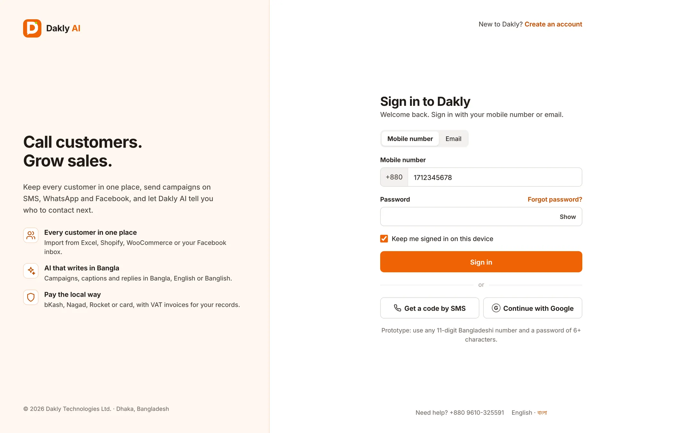

# Account, stores and team

|           |                                                                                                       |
| --------- | ----------------------------------------------------------------------------------------------------- |
| Release   | 1                                                                                                     |
| Status    | Not started                                                                                           |
| Extension | Core                                                                                                  |
| Code      | `packages/core/src/{auth,stores,team,sessions}/`, `apps/web/src/features/{auth,team,store-settings}/` |
| Tasks     | ACC-1 to ACC-8                                                                                        |

## Purpose

Lets a shop owner sign up with a mobile number, create a store, invite staff with roles, and keeps every request tied to one verified store. Every other feature depends on this: until it exists, every store route returns `401 STORE_REQUIRED`.

## User stories

- As a new seller, I want to sign up with my mobile number or my email, with a one-time code, a password or Google, whichever I find easiest.
- As an owner, I want to invite my chat staff by mobile number and give them access to Chats and Orders only.
- As an owner, I want to see every device signed in to my store and sign one out.
- As a member of two stores, I want to switch between them without signing in again.

## Screens

Sign-up has four steps in the prototype: register, verify code, business details ("How do you sell?"), plan. The dashboard asks "How do you sell?" a second time; drop the second ask. The Mobile number and Email tabs, Get a code, password and Continue with Google all ship in release 1 (D20).

Team lists members with role, status and last active, and a roles table. The prototype's areas miss Products, Shop sales and Due book, and call Chats "Inbox"; use the area list below.

## How it works

Sign-up and sign-in

Release 1 has five ways in (D20). All of them end at step 5 below.

| Method             | How                                                                                  |
| ------------------ | ------------------------------------------------------------------------------------ |
| Phone and code     | 6-digit code by SMS through the `SmsDriver`                                          |
| Email and code     | 6-digit code by email through the `EmailDriver`                                      |
| Phone and password | Password set at sign-up or later in Settings                                         |
| Email and password | Same; the email must be verified by a code once before the password works            |
| Google             | OpenID Connect with Google; Dakly keeps the Google subject id and the verified email |

1. Phones are normalised to `01XXXXXXXXX` with `bdMobileSchema` from `packages/contracts/src/phone.ts`. Emails are trimmed and lower-cased.
2. Codes are stored hashed, live 10 minutes and allow 5 tries. Sends are limited to 5 per phone or email and 20 per IP per hour (Valkey counters).
3. Passwords are hashed with Argon2id. Wrong passwords are limited to 10 per account per hour, then a code is required. "Forgot password" sends a code to the phone or email on the account.
4. On sign-up, Dakly creates the user, store, Owner membership, trial subscription and default settings in one transaction. Sign-in creates nothing. A Google sign-in whose verified email matches an existing user signs that user in; it never creates a second user for the same email.
5. The API issues an opaque session token (32 random bytes) in an `HttpOnly`, `Secure`, `SameSite=Lax` cookie. Only its SHA-256 hash is stored, with the user, active store, IP, user agent and expiry (30 days sliding; 12 hours idle for members with the refund flag).
6. Each request loads the session (Valkey cache, then Postgres), checks the membership is active, and sets `request.storeId`, `request.userId` and `request.permissions`. `StoreGuard` and `@RequirePermission('orders.edit')` read them.

Switching store: the session's active store changes through `POST /session/store`. The store id never comes from the client any other way.

Team: an invite is a membership with status `invited` and a hashed token sent by SMS, WhatsApp or email, valid 7 days. Accepting with a phone or email that already has a user adds a membership, not a user. Removing a member deletes all their sessions for that store at once.

Roles: five built-in roles live in code (`team/built-in-roles.ts`, pending review; the original spec stored them as rows). Custom roles are rows per store. A role maps each area to `none`, `view` or `edit`, plus the flags `seeFullPhone`, `exportLists`, `refund`. One pure function, `team/permissions.ts`, answers "can this member do this", and is unit-tested against the role table.

Areas: `dashboard`, `chats`, `customers`, `segments`, `orders`, `products`, `campaigns`, `automations`, `social`, `analytics`, `storeSettings`, `team`, `billing`, `shopSales` (R2), `dueBook` (R2).

Password and 2-step: a password is optional (Argon2id). TOTP is optional for everyone and required for Owners before connecting a payment gateway.

## Rules

1. Exactly one Owner per store. Transfer needs the new owner to accept and the old owner's code.
2. An Owner cannot remove themselves. An Admin cannot change an Owner.
3. A removed member's sessions stop working on the next request.
4. Every change to roles, members, 2-step settings and sessions writes the audit log.
5. Turning an extension off hides its pages and nav entries and keeps all its data.

## Permissions

Team: `team.edit` to invite, change roles, remove. Store settings: `storeSettings.edit`. Extensions: Owner and Admin only.

## Events

Emits `member.invited`, `member.joined`, `member.removed`, `store.created`, `extension.toggled`.

## Data

`users` (phone, email, verified times, password hash, Google subject id), `stores`, `memberships`, `roles` (custom only), `sessions`, `store_settings`, `audit_log`. OTP challenges move to Valkey if the schema review is accepted (pending review).

## Edge cases to test

- Number or email already registered goes to sign-in.
- Google account whose email belongs to an existing user signs in that user.
- Password sign-in with an unverified email is refused until the email is verified.
- A used code cannot be used again.
- Invite accepted by a number that is already in another store.
- The last Owner tries to leave.
- A session used after the member was removed returns 401.

## Acceptance

- Given a new number, when the person enters the right code, then a store exists with them as Owner and a 14-day trial.
- Given a Support agent, when they open Campaigns, then the page says they have no access, and the API returns `403 PERMISSION_DENIED` for campaign routes.

## Open questions

Q3 (extra stores), Q11 (organisation above stores).
