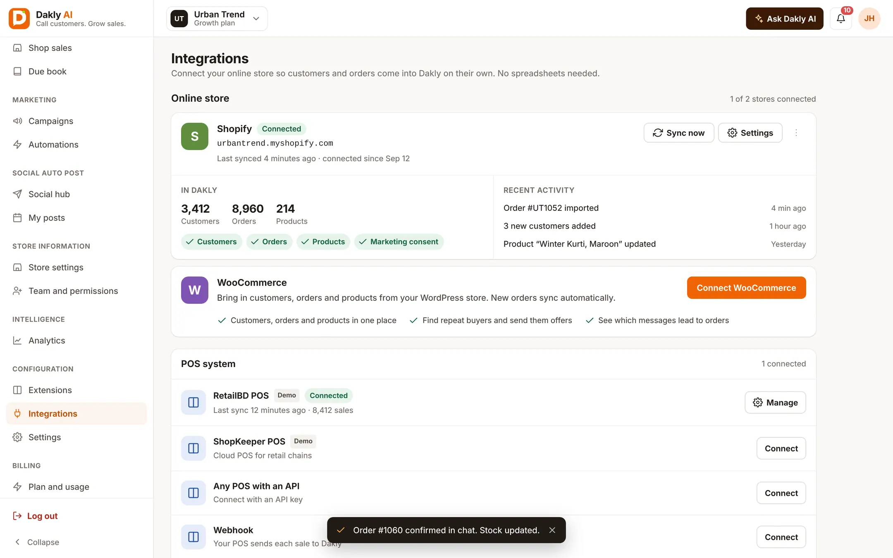

# Channel connections and webhook intake

|           |                                                                                                                                        |
| --------- | -------------------------------------------------------------------------------------------------------------------------------------- |
| Release   | 1                                                                                                                                      |
| Status    | Not started                                                                                                                            |
| Extension | Core                                                                                                                                   |
| Code      | `packages/core/src/channels/`, `packages/providers/src/channel/{messenger,instagram,whatsapp}/`, `apps/web/src/features/integrations/` |
| Tasks     | CHN-1 to CHN-5                                                                                                                         |

## Purpose

Connects a shop's Facebook Page, Instagram professional account and WhatsApp number to Dakly, and receives their messages, comments and delivery receipts safely and quickly.

## Screens

The prototype's WhatsApp connect is a one-click stub. The real flow is Meta Embedded Signup, which is not designed yet. POS cards show demo partners; release 1 is CSV only (D6).

## How it works

Messenger and Instagram

1. Facebook Login for Business returns a user token. Dakly lists the user's Pages and linked Instagram accounts.
2. The owner picks which to connect. Dakly stores the long-lived Page token (encrypted) and subscribes the Page to `messages`, `messaging_postbacks` and `feed`.

WhatsApp

1. Embedded Signup through the BSP (Q2) returns the WABA id and phone number id. Dakly registers the number and stores the system user token.
2. Only the official Business API. Never QR or linked-device sessions.

Every connection is a `channel_connections` row: kind, external account id, encrypted token, status (`active`, `needs_reconnect`, `disconnected`), expiry.

Webhook intake

1. `POST /webhooks/meta` checks `X-Hub-Signature-256` against `request.rawBody` with `timingSafeEqual`. A bad signature returns 401 and logs a security event.
2. The handler saves the raw payload to `webhook_events` (unique on provider and external event id), enqueues `process-webhook-event`, and returns 200. Nothing else runs in the request.
3. The job parses with the driver, finds the store with the `store_id_for_channel_account(kind, externalId)` database function, and calls `ChatsService.receiveInboundMessage(storeId, ...)` or `SocialService.receiveComment(storeId, ...)`. A duplicate hits the unique key and is skipped.

Token health: a daily job checks tokens and warns 7 days before expiry. A send that fails with an auth error marks the connection `needs_reconnect` and shows a banner.

## Rules

1. One external account belongs to one store (unique on kind and external account id across all stores).
2. Connecting and disconnecting needs Owner or Admin.
3. Disconnecting keeps all chats and messages.
4. Webhook handlers never do work inline; Meta retries if we answer slowly.
5. Raw webhook payloads are kept 7 days (pending review), then deleted.

## Events

Emits `channel.connected`, `channel.needs_reconnect`, `channel.disconnected`.

## Data

`channel_connections`, `webhook_events` (global, no `store_id`; read only by the intake job). The lookup function is `SECURITY DEFINER` with `search_path` set and `EXECUTE` granted only to the app role (pending review must-fix).

## Edge cases to test

- The same webhook delivered twice stores one event.
- A Page already connected to another store cannot be connected again.
- A webhook for a disconnected Page is stored and ignored.
- A signature computed over re-serialised JSON fails.

## Acceptance

- Given a connected Page, when a customer sends a message, then it shows in Chats within 5 seconds.
- Given an expired Page token, when a send fails, then the Integrations card and the Chats header show Reconnect.

## Open questions

Q2 (WhatsApp BSP).
