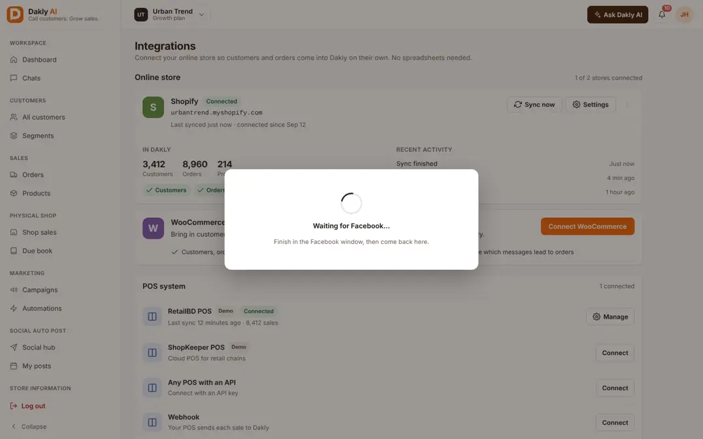
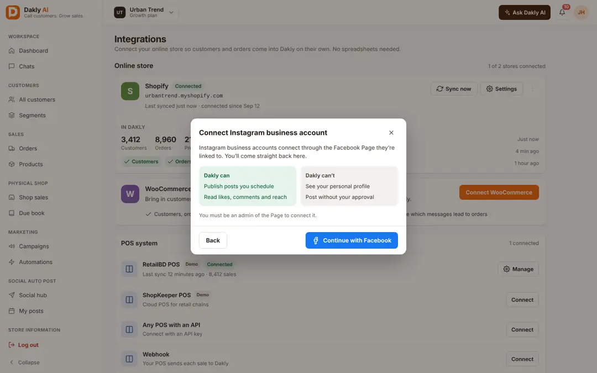
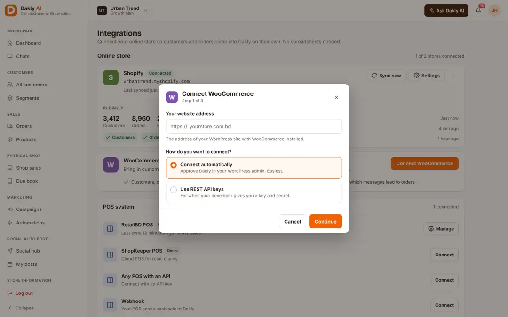
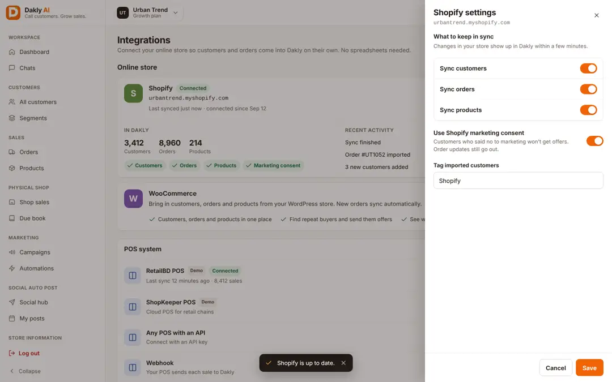
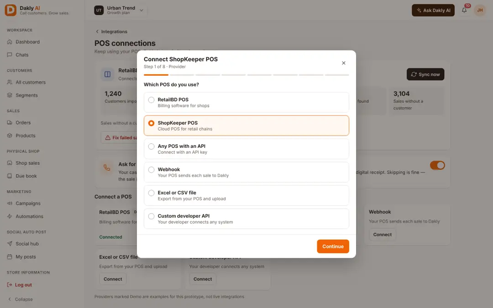
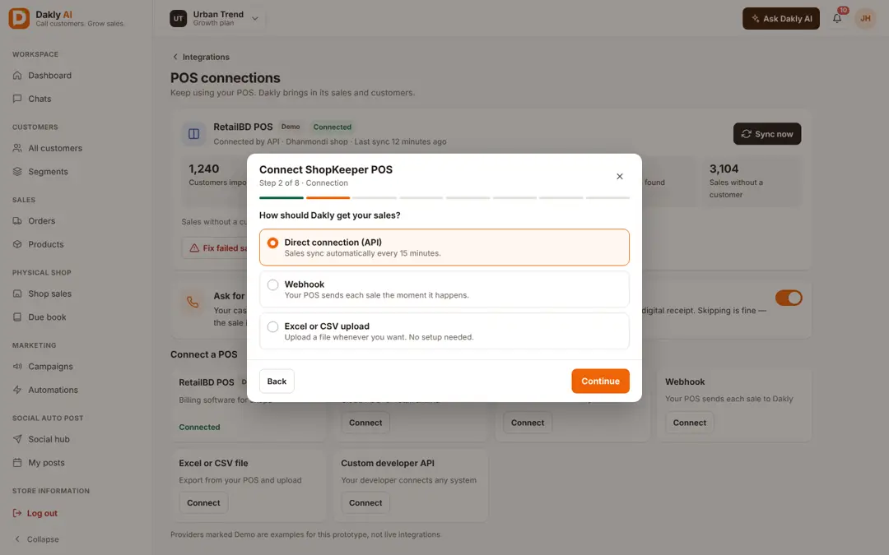

# Channel connections and webhook intake

|           |                                                                                                                                        |
| --------- | -------------------------------------------------------------------------------------------------------------------------------------- |
| Release   | 1                                                                                                                                      |
| Status    | Not started                                                                                                                            |
| Extension | Core                                                                                                                                   |
| Code      | `packages/core/src/channels/`, `packages/providers/src/channel/{messenger,instagram,whatsapp}/`, `apps/web/src/features/integrations/` |
| Tasks     | CHN-1 to CHN-6, CHN-8                                                                                                                  |

## Purpose

Connects a shop's Facebook Page, Instagram professional account and WhatsApp number to Dakly, and receives their messages, comments and delivery receipts safely and quickly.

## Decisions that change the PRD

The product requirements below are the PRD text from 12 November 2026. Where a later decision changed it, the decision wins:

- D44 (changes D9 for release 1): each shop connects WhatsApp directly to Meta's Cloud API through Dakly's Meta app and pays Meta with its own card. A BSP with a prepaid ৳ balance comes after release 1 (Q2 names it).
- Coexistence lets a shop keep using the WhatsApp Business app on its phone while Dakly uses the same number. Unofficial QR tools that act like WhatsApp Web are banned: they break WhatsApp's terms and get numbers blocked.
- D20: the Email settings tab stays hidden because email campaigns are later; transactional email needs no shop setting.
- D21: courier connections are not in release 1, so Integrations shows no courier section.

## Product requirements

### From the account and settings tab

#### WhatsApp connection (Store settings › WhatsApp)

1. Connect WhatsApp opens Meta's embedded signup in a pop-up: log in to Facebook, pick or create the Meta business, add the phone number (new number, or the existing WhatsApp Business app number through Coexistence), verify by code.
2. Dakly receives the WABA ID and phone number ID, subscribes to webhooks, syncs approved templates, and shows: number, display name, Meta messaging limit tier (for example 1,000 people a day), quality rating, today's sends.
3. Template list with filters All / Approved / In review / Rejected; Rejected shows Meta's reason in plain words and a Fix button that opens the template in the builder.
4. Quiet hours (default 21:00–09:00) and daily limit (default on, 1,000) protect quality rating; big campaigns spread over several days when on.
5. Disconnect asks for confirmation and pauses all WhatsApp sends and AI replies on WhatsApp.

#### SMS settings

Balance and "about N Bangla messages"; sender choice between the shared number and approved brand sender IDs; Request a sender ID (3 to 11 English letters, numbers or spaces; upload trade licence and NID; status Requested → Approved or Rejected, typically about 7 days); test SMS; quiet hours (default 21:00–09:00); daily limit (default 2,000).

CHN-7 builds the SMS sender screen at `/settings?tab=sms` (Store settings, SMS settings): a Sender name card that lists every request, newest first, with its status badge, the rejection reason and, for an approved name, Send test SMS; the shared sender row stays below and is highlighted while no brand name is approved. Request a sender name opens a dialog with the name, the trade licence and NID uploads (PDF, JPEG or PNG up to 5 MB, uploaded straight to storage on choosing the file) and the ownership tick; it is disabled while a request is requested, in review or approved. Members without `storeSettings.edit` see the list without buttons. Differences from the prototype: the dialog gains the two uploads the prototype leaves out; the name hint follows the contract (spaces are allowed); the review time reads about 7 days, not 2 to 3 working days; there are no radio buttons, because the approved name is used automatically and no API picks between the shared sender and a brand name; the Sending rules card (night pause and daily limit) and the balance line wait for their own task.

#### Connection screens

| Screen         | Elements                                                                                                          |
| -------------- | ----------------------------------------------------------------------------------------------------------------- |
| Store settings | Tabs Store information, SMS settings, WhatsApp settings (Email settings hidden until email campaigns ship).       |
| Integrations   | Online store (Shopify, WooCommerce), POS system, Messaging and social (Facebook Pages, Instagram, WhatsApp, SMS). |

#### Meta token expiry

- Meta token expired: show a banner on every affected page (Chats, Social, Integrations) 7 days before expiry and again after, with Reconnect.

## Prototype screens

Captured from the prototype on 13 Nov 2026 by opening each button, tab and dialog. Layout only: the numbers, names and some flows are sample data (see the next section).

**Connect Facebook Page**

**Waiting for Facebook**

**Connect Instagram**

**Reconnect Instagram**

**Connect WooCommerce, step 1**

**Shopify sync settings**

**Connect POS, step 1**

**Connect POS, step 2**

**Connect POS, step 3**

**Store settings: SMS**

**Store settings: WhatsApp**

## Where the prototype is wrong or missing

The prototype is a concept with sample data. Build from this doc, not from the prototype, where they differ.

### Missing design: WhatsApp onboarding and template manager

**Why it's needed.** WhatsApp is Dakly's main channel (67% of marketing money in the mock), but the design only shows a number that's already connected and verified by Meta. Getting there is the hardest step for a shop owner. They need a Meta Business account, a phone number that isn't already on the WhatsApp app, display-name approval and business verification. Every marketing message also needs a Meta-approved template.

**What to design.**

- **Connect WhatsApp wizard** (Meta embedded signup): explain what's needed up front; choose a new number or move an existing one (warn that it will stop working in the WhatsApp app); verify by SMS or call; set display name and business profile (logo, address, hours); show approval status.
- **Connection health**: quality rating (green, yellow, red), messaging tier (1,000 / 10,000 / 100,000 a day) and how to grow it, display-name status, and alerts when quality drops.
- **Template manager**: list of templates with category (marketing, utility, authentication), language (Bangla, English), status (approved, pending, rejected with Meta's reason), last used; create or edit with header image, body with {{variables}}, buttons; preview; submit for approval.
- **In the campaign builder**: only approved templates are selectable; a new AI-written message shows "Needs Meta approval, usually a few minutes to 24 hours" and the campaign waits.

**States.** Number already used on WhatsApp app; Meta business verification pending; display name rejected; template rejected (show reason and a "Fix with AI" option); quality rating dropped and sending paused; number disconnected.

## Engineering

### Screens in release 1

CHN-5 builds the Messaging and social part of this screen at `/integrations`: a Messenger card and an Instagram card that list the connected accounts with Connect, Reconnect and Disconnect, a WhatsApp card that reads "Waiting for setup", and an SMS sender card that shows the latest request from `GET /sms-sender-ids`. The sections for Shopify, WooCommerce and POS are left out: nothing sits behind them in release 1 (D6, D21).

Connect opens the Facebook window from the URL that `POST /channel-connections/meta/start` returns. Facebook sends the window back to `/integrations/meta`, which hands the code and state to the Integrations tab and closes. The tab lists the accounts, the shop ticks the ones to connect, and `POST /channel-connections/meta` saves them. Reconnect runs the same flow for an account in `needs_reconnect` or whose access ends within 7 days, with that account ticked. Disconnect asks for confirmation first and keeps all chats. Members without `storeSettings.edit` see the cards without buttons. Development and browser tests set `META_CHANNEL_DRIVER=fake` and `META_OAUTH_REDIRECT_URI` to this page.

Left out until their tasks land: WhatsApp connect (CHN-3), and the expiry banner on Chats and Social (their screens).

The prototype's WhatsApp connect is a one-click stub. The real flow is Meta Embedded Signup, which is not designed yet. POS cards show demo partners; release 1 is CSV only (D6).

### How it works

Messenger and Instagram

1. `POST /channel-connections/meta/start` returns the Facebook Login for Business URL. An Owner or Admin can start this flow. The login state can be used once in the same store and session, within 10 minutes.
2. The Integrations screen passes the returned code and state to `POST /channel-connections/meta/accounts`. The API exchanges them and lists Pages the member can manage and their linked Instagram accounts. The response includes an opaque selection id. The credential stays encrypted in Valkey for up to 10 minutes, bound to the same store, member and session.
3. Graph login uses a User access token configuration with `pages_show_list`, `pages_manage_metadata`, `instagram_basic` and `pages_read_engagement`. Add `business_management` for Pages linked to a Meta business account. The member must have a role on that business. Meta lists `ads_read` or `ads_management` for Instagram user fields when the Page role was granted through Business Manager. Credentials for Graph login alone leave webhook intake disabled. [Page discovery requirements](https://developers.facebook.com/docs/graph-api/changelog/non-versioned-changes/nvc-2023#september-15-2023) · [Instagram user requirements](https://developers.facebook.com/docs/instagram-platform/instagram-graph-api/reference/ig-user/v21.0/)
4. `POST /channel-connections/meta` accepts the selection id and chosen account ids. Dakly rechecks access and store ownership, subscribes each Page to `messages`, `messaging_postbacks`, `feed` and the receipt fields below, and saves the selected connections with encrypted long-lived Page tokens. Add `pages_messaging` to the Meta configuration for the Page message subscription. Dakly clears the OAuth grant after saving or a final rejection. [Page webhook requirements](https://developers.facebook.com/docs/graph-api/webhooks/getting-started/webhooks-for-pages)
5. `GET /channel-connections` lists the store’s connections with status and dates. Use `cursor` and `limit` to page through the list. An Owner or Admin can disconnect at `DELETE /channel-connections/:channelConnectionId`. Disconnect clears the saved token and keeps the conversation history.

WhatsApp

1. Embedded Signup through the BSP (Q2) returns the WABA id and phone number id. Dakly registers the number and stores the system user token.
2. Only the official Business API. Never QR or linked-device sessions.

Every connection is a `channel_connections` row: kind, external account id, encrypted token, status (`active`, `needs_reconnect`, `disconnected`), expiry.

Webhook intake

1. `GET /webhooks/meta` returns the challenge as plain text when the subscription token matches `META_WEBHOOK_VERIFY_TOKEN`.
2. `POST /webhooks/meta` checks `X-Hub-Signature-256` against the exact request bytes using `META_APP_SECRET`. A bad signature on a valid JSON request returns 401 and logs a security event. Fastify refuses malformed JSON and bodies over 1 MiB.
3. The handler saves one payload per signed delivery in `webhook_events`. Its external id is the SHA-256 hex digest of the verified bytes. The handler queues one `process-webhook-event` job by row id and returns 200. An identical retry restores a missing job for an unprocessed row.
4. The worker parses Messenger and Instagram messages with the driver and looks up each connected store through `store_id_for_channel_account(kind, externalId)`. It passes text messages for known accounts to `MessagingService.receiveInboundMessage`. Messaging checks when Dakly received the delivery and when Meta sent the message against the current connection’s start time. It ignores messages in the first minute of a connection to cover clock skew and keep a previous shop’s messages private after a transfer. The worker records a result and clears the payload. A tap on a button the shop sent arrives as a postback. The worker passes it to `MessagingService.receivePostback`, which finds the contact and chat by the sender's Page-scoped id and emits `message.postback_received` with the button's payload string. A tap is not stored as a message, but it counts as the customer acting: it moves the last inbound time and the 24-hour window like a message does. A tap from someone with no chat on that Page is ignored. CHAT-2 adds receipt handling. CHAT-7 adds stored media and attachment-only messages before live intake.

Enable `message_deliveries`, `message_reads` and `message_echoes` for the Page object and `messaging_seen` for the Instagram object in the Meta app's Webhooks settings. Messenger Pages subscribe to the three Page fields on connect. Reconnect any staging Page linked before those fields were added.

For Instagram messaging, add `instagram_manage_messages` to the Facebook Login configuration so the Page token carries that permission. Turn on **Allow Access to Messages** under **Connected Tools** in the Instagram account's message controls, then reconnect the staging account to grant the updated permission. [Meta Instagram Messaging setup](https://developers.facebook.com/documentation/business-messaging/instagram-messaging/get-started)

A crash or later failure during selection can leave a Page subscribed at Meta without a Dakly connection. The routing worker ignores deliveries for those Pages. `POST /channel-connections/meta` saves the Page token encrypted in `meta_page_subscriptions` before it calls Meta, and deletes that record in the same transaction that saves the connections. A record that is still there therefore means Dakly subscribed the Page and no connection backs it.

An Instagram connection stores the Page it messages through in `linked_page_external_id`, set when the shop picks the account. Instagram messages reach Dakly through that Page's subscription, so the Page stays subscribed while a Messenger connection or a linked Instagram connection for it is live.

Disconnecting a Messenger or Instagram connection moves its Page token into `meta_page_subscriptions` in the disconnect transaction, then runs the same check as the daily job at once. The disconnect succeeds even when Meta fails.

Every day, `reconcile-meta-page-subscriptions` goes through records older than one hour, so a selection still in progress is left alone. For each record it checks, across all stores through `meta_page_is_connected`, whether a Messenger connection or a linked Instagram connection that is not disconnected exists for the Page. If one does, it deletes the record and leaves the Page subscribed. If none does, it calls Meta to unsubscribe the Page, outside any transaction, and deletes the record once Meta accepts. A Meta error leaves the record for the next run. If Meta rejects the token and the record is older than 30 days, the shop most likely removed the app or lost the Page, so the record is deleted with one warning. Other errors keep retrying daily.

Every minute, the worker checks Meta deliveries received more than one minute ago that still need processing. If a delivery’s Valkey job is missing, the worker queues it again with the same row id as its job id. If the final processing attempt fails, the worker marks the delivery as failed and keeps its payload until the daily purge.

The daily token sweep queues one job per store with an active Meta connection that has no fixed expiry or expires within seven days. The worker checks Meta outside the database transaction. A valid credential with a known expiry gets one warning for that expiry date. An invalid credential moves to `needs_reconnect` and notifies members with permission to edit store settings once per connection and UTC day.

SMS sender name (CHN-6)

1. Until a store's own sender name is approved, every SMS goes from Dakly's shared sender. `MessagingService.send` reads the store's approved name from `SmsSendersService` and passes it to the SMS driver; without one the driver uses the shared sender.
2. `POST /sms-sender-ids` (`storeSettings.edit`) requests a name of 3 to 11 English letters, numbers or spaces, with the ids of two confirmed documents: `tradeLicenceFileId` and `nidFileId`. Each must be a different file of this store with purpose `sms_sender_document`; anything else returns `422 SMS_SENDER_DOCUMENT_INVALID`. It saves an `sms_sender_ids` row as `requested` with the member who asked. A store has one sender at a time: a second request while one is requested, in review or approved returns `409 SMS_SENDER_ID_ALREADY_ACTIVE` (partial unique index `sms_sender_ids_store_id_active_key`). After a rejection the store can request again.
   Documents (CHN-7). `POST /sms-sender-ids/documents/upload-url` (`storeSettings.edit`) takes a PDF, JPEG or PNG up to 5 MB and returns a `fileId` and a presigned upload URL under `stores/<storeId>/sms_sender_document/<fileId>`; the browser sends the file straight to storage. `POST /sms-sender-ids/documents/confirm` checks the stored object's type and size against what the browser said and writes the `files` row as `ready`, with `expires_at` one day ahead so a document nobody attaches is purged. Nothing in the API lists or downloads a document: only staff review them, and the staff view comes with ACC-14. When staff decide a request, the same transaction clears both file references and sets `expires_at` to the decision time, so the purge job deletes the files and their objects (feature 12, retention).
3. `GET /sms-sender-ids` (`storeSettings.view`) lists the store's requests, newest first, with status, rejection reason and decision time.
4. Super admins and ops staff (feature 12) see undecided requests from every store at `GET /admin/sms-sender-ids`, oldest first, through the `open_sms_sender_ids` `SECURITY DEFINER` function. They approve or reject one at `POST /admin/stores/:storeId/sms-sender-ids/:smsSenderIdId/approve` or `/reject` with a reason of at least 10 characters. The service checks the live staff session and conflict of interest, writes the staff audit row and the shop's audit row, then moves the request from `requested` or `in_review` to `approved` or `rejected`, all in one store transaction. A store id that does not exist returns `404 STORE_NOT_FOUND` before anything is written. A rejection's reason is shown to the shop. A request is decided once; a second decision returns `409 SMS_SENDER_ID_ALREADY_DECIDED`. Staff register the name with the operators by hand before they approve it, so approved means registered and live. The `in_review` step and revoking an approved name come with CHN-7; until then a store keeps one active name, and staff revoke the old one before a new request.
5. `POST /sms-sender-ids/:smsSenderIdId/test` (`storeSettings.edit`) sends a test SMS from an approved name to the signed-in member's own verified phone, never to a customer. An unapproved name returns `409 SMS_SENDER_ID_NOT_APPROVED`; a member without a verified phone gets `409 SMS_SENDER_TEST_PHONE_REQUIRED`. A store can send 5 test SMS an hour (`sms-sender-test:<storeId>` in the Valkey limiter); the sixth returns `429 SMS_SENDER_TEST_RATE_LIMITED`.
6. Development and CI send through Mailpit, which shows the store's sender as the From name. Registering the name with the operator, the trade licence and NID uploads, and the status screen come with CHN-7.

### Rules

1. One external account belongs to one store (unique on kind and external account id across all stores).
2. Connecting and disconnecting needs Owner or Admin.
3. Disconnecting keeps all chats and messages.
4. Webhook handlers never do work inline; Meta retries if we answer slowly.
5. The worker clears each webhook payload as soon as it processes or ignores the delivery. The daily purge deletes finished webhook rows received more than seven days ago in batches. Rows still waiting for processing stay available for recovery (D39).

### Events

Emits `channel.connected`, `channel.needs_reconnect`, `channel.disconnected`.

### Data

`channel_connections` (posting schedule and WhatsApp ids in `settings`), `sms_sender_ids`, `webhook_events` (global, no `store_id`). The webhook finds its store through `store_id_for_channel_account`, a hardened `SECURITY DEFINER` function ([ADR 0005](../adr/0005-cross-store-access-through-functions.md)). Full design: [docs/data](../data/README.md).

### Edge cases to test

- The same webhook delivered twice stores one event.
- A Page already connected to another store cannot be connected again.
- A webhook for a disconnected Page is stored and ignored.
- A signature computed over re-serialised JSON fails.

### Acceptance

- Given a connected Page, when a customer sends a message, then it shows in Chats within 5 seconds.
- Given an expired Page token, when a send fails, then the Integrations card and the Chats header show Reconnect.

## Open questions

Q2 (WhatsApp BSP).
