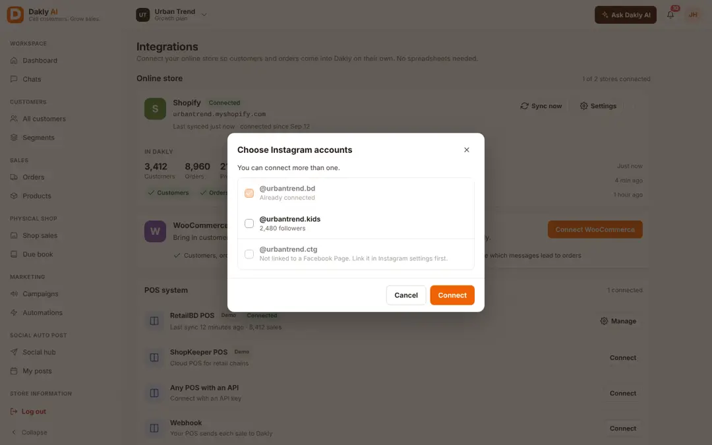
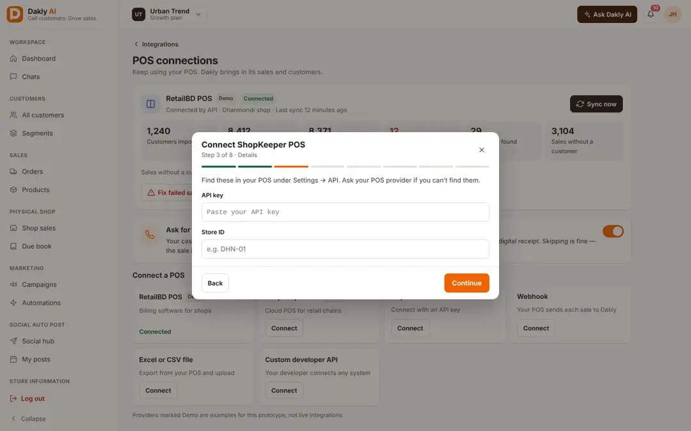
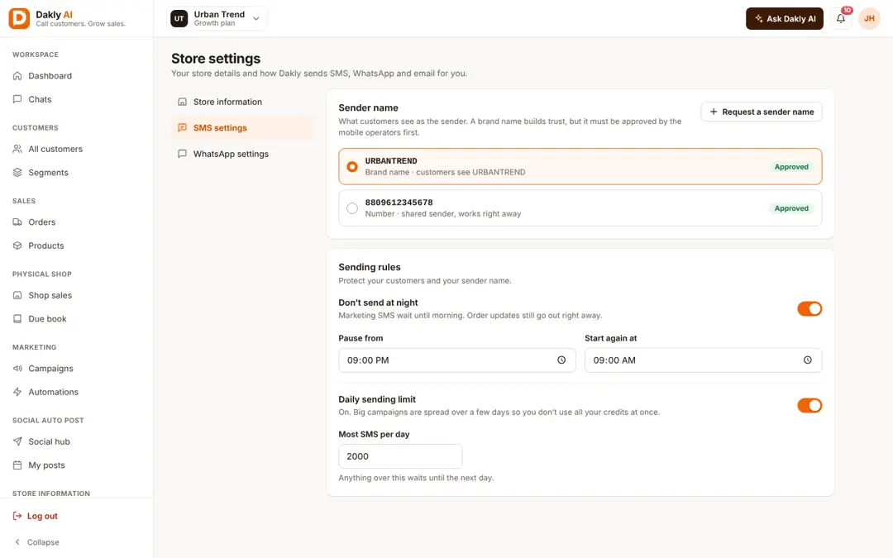
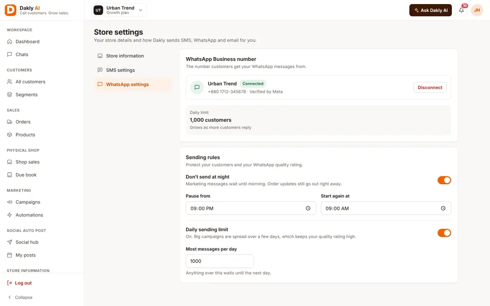

# Channel connections and webhook intake

|           |                                                                                                                                        |
| --------- | -------------------------------------------------------------------------------------------------------------------------------------- |
| Release   | 1                                                                                                                                      |
| Status    | Not started                                                                                                                            |
| Extension | Core                                                                                                                                   |
| Code      | `packages/core/src/channels/`, `packages/providers/src/channel/{messenger,instagram,whatsapp}/`, `apps/web/src/features/integrations/` |
| Tasks     | CHN-1 to CHN-6                                                                                                                         |

## Purpose

Connects a shop's Facebook Page, Instagram professional account and WhatsApp number to Dakly, and receives their messages, comments and delivery receipts safely and quickly.

## Decisions that change the PRD

The product requirements below are the PRD text from 12 November 2026. Where a later decision changed it, the decision wins:

- D9: WhatsApp goes through a BSP with a prepaid ৳ balance per shop (Q2 names the BSP).
- Coexistence lets a shop keep using the WhatsApp Business app on its phone while Dakly uses the same number. Unofficial QR tools that act like WhatsApp Web are banned: they break WhatsApp's terms and get numbers blocked.
- D20: the Email settings tab stays hidden because email campaigns are later; transactional email needs no shop setting.
- D21: courier connections are not in release 1, so Integrations shows no courier section.

## Product requirements

### From the account and settings tab

#### WhatsApp connection (Store settings › WhatsApp)

1. Connect WhatsApp opens Meta's embedded signup in a pop-up: log in to Facebook, pick or create the Meta business, add the phone number (new number, or the existing WhatsApp Business app number through Coexistence), verify by code.
2. Dakly receives the WABA ID and phone number ID, subscribes to webhooks, syncs approved templates, and shows: number, display name, Meta messaging limit tier (for example 1,000 people a day), quality rating, today's sends.
3. Template list with filters All / Approved / In review / Rejected; Rejected shows Meta's reason in plain words and a Fix button that opens the template in the builder.
4. Quiet hours (default 21:00–09:00) and daily limit (default on, 1,000) protect quality rating; big campaigns spread over several days when on.
5. Disconnect asks for confirmation and pauses all WhatsApp sends and AI replies on WhatsApp.

#### SMS settings

Balance and "about N Bangla messages"; sender choice between the shared number and approved brand sender IDs; Request a sender ID (max 11 letters and numbers; upload trade licence and NID; status Requested → Approved or Rejected, typically about 7 days); test SMS; quiet hours (default 21:00–09:00); daily limit (default 2,000).

#### Connection screens

| Screen         | Elements                                                                                                          |
| -------------- | ----------------------------------------------------------------------------------------------------------------- |
| Store settings | Tabs Store information, SMS settings, WhatsApp settings (Email settings hidden until email campaigns ship).       |
| Integrations   | Online store (Shopify, WooCommerce), POS system, Messaging and social (Facebook Pages, Instagram, WhatsApp, SMS). |

#### Meta token expiry

- Meta token expired: show a banner on every affected page (Chats, Social, Integrations) 7 days before expiry and again after, with Reconnect.

## Prototype screens

Captured from the prototype on 13 Nov 2026 by opening each button, tab and dialog. Layout only: the numbers, names and some flows are sample data (see the next section).

**Connect Facebook Page**

**Waiting for Facebook**

**Connect Instagram**

**Reconnect Instagram**

**Connect WooCommerce, step 1**

**Shopify sync settings**

**Connect POS, step 1**

**Connect POS, step 2**

**Connect POS, step 3**

**Store settings: SMS**

**Store settings: WhatsApp**

## Where the prototype is wrong or missing

The prototype is a concept with sample data. Build from this doc, not from the prototype, where they differ.

### Missing design: WhatsApp onboarding and template manager

**Why it's needed.** WhatsApp is Dakly's main channel (67% of marketing money in the mock), but the design only shows a number that's already connected and verified by Meta. Getting there is the hardest step for a shop owner. They need a Meta Business account, a phone number that isn't already on the WhatsApp app, display-name approval and business verification. Every marketing message also needs a Meta-approved template.

**What to design.**

- **Connect WhatsApp wizard** (Meta embedded signup): explain what's needed up front; choose a new number or move an existing one (warn that it will stop working in the WhatsApp app); verify by SMS or call; set display name and business profile (logo, address, hours); show approval status.
- **Connection health**: quality rating (green, yellow, red), messaging tier (1,000 / 10,000 / 100,000 a day) and how to grow it, display-name status, and alerts when quality drops.
- **Template manager**: list of templates with category (marketing, utility, authentication), language (Bangla, English), status (approved, pending, rejected with Meta's reason), last used; create or edit with header image, body with {{variables}}, buttons; preview; submit for approval.
- **In the campaign builder**: only approved templates are selectable; a new AI-written message shows "Needs Meta approval, usually a few minutes to 24 hours" and the campaign waits.

**States.** Number already used on WhatsApp app; Meta business verification pending; display name rejected; template rejected (show reason and a "Fix with AI" option); quality rating dropped and sending paused; number disconnected.

## Engineering

### Screens in release 1

The prototype's WhatsApp connect is a one-click stub. The real flow is Meta Embedded Signup, which is not designed yet. POS cards show demo partners; release 1 is CSV only (D6).

### How it works

Messenger and Instagram

1. Facebook Login for Business returns a user token. Dakly lists the user's Pages and linked Instagram accounts.
2. The owner picks which to connect. Dakly stores the long-lived Page token (encrypted) and subscribes the Page to `messages`, `messaging_postbacks` and `feed`.

WhatsApp

1. Embedded Signup through the BSP (Q2) returns the WABA id and phone number id. Dakly registers the number and stores the system user token.
2. Only the official Business API. Never QR or linked-device sessions.

Every connection is a `channel_connections` row: kind, external account id, encrypted token, status (`active`, `needs_reconnect`, `disconnected`), expiry.

Webhook intake

1. `POST /webhooks/meta` checks `X-Hub-Signature-256` against `request.rawBody` with `timingSafeEqual`. A bad signature returns 401 and logs a security event.
2. The handler saves the raw payload to `webhook_events` (unique on provider and external event id), enqueues `process-webhook-event`, and returns 200. Nothing else runs in the request.
3. The job parses with the driver, finds the store with the `store_id_for_channel_account(kind, externalId)` database function, and calls `ChatsService.receiveInboundMessage(storeId, ...)` or `SocialService.receiveComment(storeId, ...)`. A duplicate hits the unique key and is skipped.

Token health: a daily job checks tokens and warns 7 days before expiry. A send that fails with an auth error marks the connection `needs_reconnect` and shows a banner.

### Rules

1. One external account belongs to one store (unique on kind and external account id across all stores).
2. Connecting and disconnecting needs Owner or Admin.
3. Disconnecting keeps all chats and messages.
4. Webhook handlers never do work inline; Meta retries if we answer slowly.
5. Raw webhook payloads are kept 7 days (pending review), then deleted.

### Events

Emits `channel.connected`, `channel.needs_reconnect`, `channel.disconnected`.

### Data

`channel_connections` (posting schedule and WhatsApp ids in `settings`), `sms_sender_ids`, `webhook_events` (global, no `store_id`). The webhook finds its store through `store_id_for_channel_account`, a hardened `SECURITY DEFINER` function ([ADR 0005](../adr/0005-cross-store-access-through-functions.md)). Full design: [docs/data](../data/README.md).

### Edge cases to test

- The same webhook delivered twice stores one event.
- A Page already connected to another store cannot be connected again.
- A webhook for a disconnected Page is stored and ignored.
- A signature computed over re-serialised JSON fails.

### Acceptance

- Given a connected Page, when a customer sends a message, then it shows in Chats within 5 seconds.
- Given an expired Page token, when a send fails, then the Integrations card and the Chats header show Reconnect.

## Open questions

Q2 (WhatsApp BSP).
