# Customers, consent and segments

|           |                                                                                                  |
| --------- | ------------------------------------------------------------------------------------------------ |
| Release   | 1                                                                                                |
| Status    | In progress (CUS-1 contacts, CUS-2 consent)                                                      |
| Extension | Core                                                                                             |
| Code      | `packages/core/src/{contacts,consents,segments}/`, `apps/web/src/features/{customers,segments}/` |
| Tasks     | CUS-1 to CUS-14                                                                                  |

## Purpose

One list of people per shop, built from chats, orders and imports, keyed on phone number. Records who agreed to hear from the shop on which channel, and groups people into segments for campaigns.

## Decisions that change the PRD

The product requirements below are the PRD text from 12 November 2026. Where a later decision changed it, the decision wins:

- Q13: Shopify and WooCommerce sync is not built until Asif confirms it is in release 1.
- Schema review (pending review): contacts are merged automatically only on a verified phone number. Name or email matches only suggest a merge.
- D20: email addresses are stored and verified, but email marketing consent is not offered until email campaigns ship.
- D26: another person's delivery details belong to the order. They do not replace the buyer profile, merge contacts or move purchase history. No OTP is required.
- D27: self-delivery also saves the buyer's own phone on their profile, subject to the rules below. Saving a phone is separate from verification, merging and marketing consent.

## Built so far

The `contacts/` feature in `packages/core` owns the `contacts` table. The FND-1
`customers` example moved into it: migration 0030 copied each `customers` row into
`contacts` with the same id (source `manual`, kind `customer`), and 0031 dropped the
`customers` table.

- `POST /contacts` (`customers.edit`) adds a contact with a name and phone. A staff
  add is an intentional customer, so it saves with source `manual` and kind `customer`.
  The create publishes `contact.created` (the contact id only) in the same store
  transaction, so the event and the contact commit or roll back together.
- `GET /contacts` (`customers.view`) lists the store's contacts, newest first, with
  `cursor` and `limit` (default 50, at most 100). Filters: `kind`, one `tag`, and
  `search`. Deleted contacts are never listed.
- `GET /contacts/:contactId` (`customers.view`) returns one contact with its channel
  identities (channel, connection and profile name), read only. A deleted contact
  reads as not found.
- `PATCH /contacts/:contactId` (`customers.edit`) changes the name, phone or tags. A
  changed phone clears its WhatsApp verification, because a typed phone proves nothing.
- `DELETE /contacts/:contactId` (`customers.edit`) soft deletes the contact: it is
  gone from the list and the profile, and its phone can be saved on another contact.
- A phone the store already has on another contact fails with `409 CONTACT_PHONE_TAKEN`,
  on create and on edit. The error never names or links the other contact, because the
  member may not be allowed to see who has the number.
- A contact without a phone returns `phone: null`.
- The support read and create screens call `ContactsService`, with full phones as before.

Search rules:

- A name matches anywhere in the contact's name, for every member.
- A name search needs at least 3 characters (`CONTACT_SEARCH_TOO_SHORT`, 422). Digits
  are a phone search and have no minimum.
- A full phone number, in any form the phone schema accepts, finds the contact with
  that exact number, for every member. Results stay masked without "See full phone
  numbers".
- Partial phone search needs "See full phone numbers": for those members, digits that
  are not a full number match the start of stored numbers. For anyone else a partial
  number finds nothing, and only an exact full number finds the contact.

The `consents/` feature owns the `consents` table. `ConsentService.record(storeId, change, actor)`
appends one row per answer, with its channel, status, source, evidence and the member who
recorded it, and publishes `consent.changed` in the same store transaction. The app never
changes or deletes a row; its role has no UPDATE or DELETE on the table. The contact must exist
in the store, checked through `ContactsService`. `ConsentService.current(storeId, contactIds,
channel)` reads only the `contact_consent_current` view, where the latest row per contact and
channel wins, so a new opt-in after a withdrawal reads as granted. A contact that never answered
on a channel has no row there. `current` takes at most 100 contact ids per call; more fails
with `400 CONSENT_CONTACTS_TOO_MANY`.

- `POST /contacts/:contactId/consents` (`customers.edit`) records a staff answer through
  `ConsentService.recordStaffAnswer` with `channel`, `status` and a required `note` saying how
  the customer agreed or refused. It saves with source `manual` and the note as evidence. Staff may record an opt-in only for WhatsApp and SMS; a
  Messenger or Instagram opt-in has to come from the customer, so `granted` there fails with
  `400 CONSENT_OPT_IN_NEEDS_CUSTOMER`. A withdrawal is accepted on every channel except email. Email is not accepted (D20). A contact that is
  missing or in another store returns `404 CONTACT_NOT_FOUND`.
- STOP keywords on WhatsApp and Messenger are not handled yet: core messaging (CHAT-1) will call
  `ConsentService.record` when it receives them.

The shared phone schema accepts `01712345678`, `1712345678`, `+8801712345678`,
`8801712345678`, spaces, hyphens and Bangla digits. All forms become the ASCII
`01XXXXXXXXX` format before API or form validation finishes.

Validation failures return `VALIDATION_FAILED` with `error.fields`, a list of
`{ path, message }` entries for every invalid field. Paths use dots for nested
fields and array indexes. The response contains no submitted values. Other
business errors keep their code and message without field details. The web
client retains these details for forms.

The web client sends credentials to `/api/contacts` on the web origin. Next.js
forwards `/api/*` to `http://localhost:4000/*` in local development; production
routes that prefix to the API through the load balancer. No CORS is needed.
The contacts API still requires a verified store session.

The contacts and member APIs mask restricted phone values as `01712-XXX678` with
`maskPhone` from the shared phone contract, keeping the first five and last three
digits, as the glossary shows. WEB-4 does not change that permission policy. The support
customer read screen uses `formatPhone` to show full values as `01712-345678`; masked
values arrive already grouped and pass through unchanged. The formatter only groups the supplied
11-character display value; unsupported values pass through unchanged. Input
normalization remains in the shared phone schema.

## Product requirements

### What it is for

One clean list of every person who buys from the shop, wherever they bought, with the history and consent needed to message them well. Segments group them; Customer insights explain them. Release 1 (Khata Scanner import in release 2, tab 9).

### User stories

- As an owner, I want customers from Facebook chats, Shopify, WooCommerce, my POS and Excel in one list without duplicates, so I see each person once.
- As an owner, I want to add a customer by speaking in Banglish, so it's as fast as writing in my notebook.
- As an owner, I want to see one customer's orders, messages and notes on one page and call or WhatsApp them in one tap.
- As a marketer, I want to describe a group in words ("bought more than twice but not in 45 days") and get editable rules, so I don't need to learn filters.
- As an owner, I want Dakly to tell me patterns I wouldn't spot (best first product, best time, who is due to reorder), each with one thing to do.

### Screens

| Screen                | Elements                                                                                                                                                                                                                                                                                                                                                                                                                                                                                                                                                                                                                                                                          |
| --------------------- | --------------------------------------------------------------------------------------------------------------------------------------------------------------------------------------------------------------------------------------------------------------------------------------------------------------------------------------------------------------------------------------------------------------------------------------------------------------------------------------------------------------------------------------------------------------------------------------------------------------------------------------------------------------------------------- |
| All customers         | Header with totals ("2,486 customers · 1,124 bought more than once · 2,203 can receive marketing messages"); Export, Add by voice, Add customers; quick tabs with counts (All, Leads from chats, New, Returning, VIP, Inactive, High-value, At-risk); filters (source, consent channel, spend band, last purchase band); sort (last purchase, total spent, orders, name); Columns picker (Customer, Phone, WhatsApp, Email, Location, Type, Orders, Spent, Last purchase, Source, Tags, Consent); search by name, phone, email, tag; row checkboxes with bulk bar (Add tag, Add to segment, Message selected, Export selected, Delete); paging; consent legend. Phone: card list. |
| Customer profile      | Header (avatar, name, type, tags, contact line), Edit, Create campaign; stats (total spending, orders, average order value, last purchase, first purchase, lifetime value); tabs Overview, Orders, Activity, Campaign history, Notes, Marketing preferences; Contact card (Call, WhatsApp, SMS, last contact); Follow-up (Tomorrow, In 3 days, In 1 week, pick date); Segments chips; Due balance if any (release 2); Return risk badge.                                                                                                                                                                                                                                          |
| Add customers chooser | Type one customer's details; Say the details (voice); Import a file; Scan your khata (release 2); Connect your store; Connect your POS.                                                                                                                                                                                                                                                                                                                                                                                                                                                                                                                                           |
| Add manually          | Name\*, phone\*, WhatsApp number (same as phone by default), email, address, district, birthday (day and month), gender, tags, notes, marketing permission per channel (WhatsApp, SMS; Email consent is stored when imported but unused until the email release) with the consent wording shown.                                                                                                                                                                                                                                                                                                                                                                                  |
| Add by voice          | Language chips (Bangla, English, Mixed); mic permission state; recording with live words and timer; processing; review form with each field marked Heard clearly / Check this; Save. States: mic blocked, couldn't understand.                                                                                                                                                                                                                                                                                                                                                                                                                                                    |
| Import (7 steps)      | Upload (download template, drag file, .xlsx/.csv up to 10 MB, 50,000 rows) → Detect (rows, columns, size) → Map fields (auto-matched, editable) → Preview (first 10 rows: Ready, Already in Dakly, Invalid) → Validate (duplicates choice; consent confirmation checkbox) → Confirm ("Import N customers") → Results (added, updated, skipped with downloadable error report).                                                                                                                                                                                                                                                                                                    |
| Segments              | AI box "Describe the customers you want to target" + Generate rules; cards for 8 ready-made and custom segments (name, rule in words, count, change, total spent, View, Edit, Create campaign); Create segment.                                                                                                                                                                                                                                                                                                                                                                                                                                                                   |
| Segment builder       | Name; match ALL or ANY; condition rows (field, operator, value) in groups; live "N customers match" and reachable per channel (WhatsApp, SMS, Messenger, Instagram); preview of 10 matching customers; Save; when created by AI, shows the original sentence.                                                                                                                                                                                                                                                                                                                                                                                                                     |
| Customer insights     | Source filter (All, Shopify, Facebook, store); period; 4 KPI cards (Buy again %, usual gap, average spend per customer, orders); insight tabs (Top, Buying habits, Products, Loyalty, Places); insight cards with chart, FACT, AI TIP, action button, See details, How Dakly knows, Not useful.                                                                                                                                                                                                                                                                                                                                                                                   |

### How it works

**Identity and merging**

1. Normalise a person's own phone to 11 digits when supplied, and apply the identity-matching rules below before linking an existing contact. A chat contact may have no phone. Another recipient's phone belongs only to the order and is excluded from buyer matching (D26). For self-delivery, also save the supplied own phone on the buyer profile under D27; the order keeps its snapshot.
2. Merge rule for conflicting fields: keep the existing value unless it's empty; names from a store sync or the owner's own edits win over names from a chat profile; addresses keep the most recent; tags and consents are combined (a consent "no" from any source wins over "yes").
3. Chat contacts without a phone remain linked to their Messenger PSID or Instagram ID. An own-phone match follows the identity rules below; a typed phone alone suggests a match for staff. Sharing another person's delivery details never links or merges that person with the chat buyer (D26).
4. Possible duplicates (same name and district, phone differs by 1 digit, or same email) are listed in a "Possible duplicates" view for manual Merge or Keep separate. Merging keeps the older record's ID and moves all orders, chats and notes.

**Merge and undo contract (D29)**

Each requested merge gets an opaque `operationKey`, carried unchanged by every job retry. The permanent `(store_id, operation_key)` key survives undo and customer erasure. Retrying an undone or redacted operation returns its recorded result without moving records again; an intentional new merge uses a new key.

The merge transaction locks both contacts in ID order, validates that they still belong to the store, and records before-images in `replaced_fields`, moved row IDs in `moved_rows`, and corresponding after-values and row versions in `after_state`. Undo within seven days restores only fields and row ownership that still match that after-state. Preserve later edits, new relationships and a phone now owned elsewhere. Record conflicting field paths and row IDs in `undo_conflicts`, without copying personal values into the conflict log. Block the undo while a later active merge depends on either contact; undo dependent merges in reverse order. Legacy records without reliable after-state need staff review, never a blind restore.

Consent rows keep their original contact and are never reassigned or rewritten. Merge appends the effective conservative consent decision to the kept contact, with the operation key and source evidence. Undo appends withdrawals to both restored contacts where either has withdrawn since merge, and never grants consent from a before-image. Later explicit opt-in is a separate recorded action. Merge and undo invalidate both customer memories and their conversation checkpoints; an older model response must fail its version guard.

Customer erasure is a privileged transaction: stop pending work, clear memories, delete chats and their dependent messages, remove or redact comments and tasks that expose the person, and delete consent, identity, stats, match-suggestion, campaign-recipient, tracked-link and workflow data tied to that contact. Redact merge `moved_rows`, `replaced_fields`, `after_state` and `undo_conflicts`, set `evidence_redacted_at`, and detach the erased contact references. Keep the merge operation key to reject old retries; no undo is available after redaction. Redact personal data in audit/outbox/job payloads and stored files under the same erasure policy. Orders retain `buyer_name`, independent recipient snapshots and financial history; their contact and conversation links become null. Unknown buyer names stay null and are never inferred from the recipient. The purge service and its access checks are still planned work.

**Saving the buyer's own phone (D27)**

Self-delivery is the default. Save a valid own phone on the current buyer contact when it is supplied in chat or the order form, even before an order is created. The buyer must be identified separately as described below. Fill an empty profile phone, or retain it when the normalised value already matches. Replacing a different profile phone needs an explicit profile edit; changing delivery fields alone does not replace it.

If another contact in the same store already has the normalised phone, leave both profiles and the buyer link unchanged. Keep the supplied phone in the draft or order snapshot and show a possible match to staff. Apply this rule even if the conflict appears during a concurrent save. Staff may resolve the suggestion through the existing merge workflow; the conflict does not block ordering, confirmation or delivery and gives the buyer no access to the other contact's history.

A saved own phone is self-reported, not proof of ownership. It does not trigger a merge or add marketing consent. A chat contact with that phone and zero orders qualifies as a Lead under the glossary; a conflicting phone kept only on a draft does not qualify that contact. Existing identity-matching rules remain separate. For delivery to someone else, save the recipient's phone only on the draft or order.

**Consent**

Consent is stored per channel with source and time ("WhatsApp: yes, from Shopify checkout, Sep 12, 2026"). Sources: store checkout checkbox, chat opt-in button, manual entry with the owner's confirmation, import with the owner's confirmation, POS checkbox. Replying STOP (or বন্ধ) on WhatsApp or Messenger, tapping the opt-out link in an SMS, or blocking the Page sets that channel to no immediately. Bangladesh A2P SMS cannot receive replies, so SMS opt-out is by link only. Transactional messages (order confirmation, delivery updates, receipts, due reminders) do not need marketing consent but do respect "blocked".

**Voice add**

Audio is streamed to a speech-to-text service that handles Bangla and Banglish, then a language model extracts name, phone, WhatsApp, email, address, district, notes and tags into the review form. Spoken digits ("zero one seven one two…") are converted to numbers. Each field gets a confidence mark; nothing is saved without the review screen.

**Segments**

Conditions available: Number of orders, Total spent (৳), Days since last order, Last purchase date, First purchase date, City or district, Usually buys (category), Bought product, Customer type (lifecycle stage), Source, Tag, Marketing consent (per channel), Birthday month, Return risk, Has due (release 2). Operators per type: number (is, is more than, is less than, between), text/list (is, is not, is any of), date (before, after, in the last N days). Groups combine with AND/OR. Counts are computed live against the database (not a sample) and cached for 60 seconds.

Also in release 1, from the market study: event conditions (did an event N times in a period, with a property, or did not do it: ordered, tapped a campaign link, replied, received a campaign), chat window open now per channel, and lead temperature (Hot, Warm, Cold). Up to 20 conditions in two levels of groups and 200 saved segments a store. The preview explains why a person matches. "Enters a segment" as a workflow trigger is release 2, because it needs stored membership.

**AI segment rules**

The sentence goes to the language model with the list of allowed fields and operators; it must return only valid conditions. Dakly shows the rules in plain words, the count and "Data used". If the sentence can't be mapped ("customers who like blue"), it says which part it couldn't use.

**Customer insights**

Computed nightly from orders. Each insight type has a fixed calculation, then the language model writes the FACT and AI TIP sentences from the numbers (it may not add numbers of its own):

| Insight                             | Calculation                                                                          | Action                                        |
| ----------------------------------- | ------------------------------------------------------------------------------------ | --------------------------------------------- |
| First product that creates regulars | For each category of first order, share of customers who bought again within 90 days | Promote that product to new followers         |
| Due to reorder                      | Customers whose days since last order are within ±5 days of their usual gap, by week | Send a reminder (campaign to that list)       |
| Best time                           | Orders by weekday and hour; top 2 evening slots                                      | Use this time for next campaign               |
| Loyalty steps                       | Share reaching 2nd, 3rd and 5th+ order                                               | Set up a follow-up 7 days after first order   |
| Places                              | Orders and repeat rate by district                                                   | Target top district or adjust delivery charge |

An insight is shown only with at least 100 orders in the period; otherwise "Insights appear after 100 orders". "Not useful" hides it and is logged.

### Business rules

| ID     | Rule                                                                                                                                                                                           |
| ------ | ---------------------------------------------------------------------------------------------------------------------------------------------------------------------------------------------- |
| CUS-R1 | Phone is unique per store. Saving a contact with a phone the store already has fails with `409 CONTACT_PHONE_TAKEN`, which names and links no one.                                             |
| CUS-R2 | Deleting customers removes profile, notes and message history from Dakly; orders stay with the customer name only, for sales reports. Requires confirmation and the Edit Customers permission. |
| CUS-R3 | Export downloads the current filter as .xlsx; phone numbers are included only for roles with "Download customer lists" and "See full phone numbers". Every export is logged.                   |
| CUS-R4 | Import requires the owner to tick "These customers agreed to hear from my shop" before any consent is set to yes; otherwise imported consents are no.                                          |
| CUS-R5 | Duplicate handling on import: Update their details (default), Leave existing customers as they are, or Create a second record (warns "You may message them twice").                            |
| CUS-R6 | Birthday is stored as day and month (year optional) so the Birthday automation can run.                                                                                                        |
| CUS-R7 | Follow-up reminders appear in Smart notifications on the chosen date and in the customer's Activity.                                                                                           |
| SEG-R1 | Ready-made segment rules are editable but can be reset to default. Deleting is allowed only for custom segments.                                                                               |
| SEG-R2 | A segment used by an active automation or a scheduled campaign can't be deleted; show where it is used.                                                                                        |

### States and edge cases

- Empty store: list shows the Add customers chooser inline.
- Customer without phone (Instagram-only): shows "No phone yet" and only Instagram as a channel.
- Import file with Bangla digits (০১৭১২…): converted to Latin digits.
- Import file with 2 phones in one cell: first is phone, second becomes WhatsApp number if it differs.
- Over plan limit: rows beyond the limit are imported but marked "Over plan limit" (tab 1, ACC-R8).

### Permissions

View Customers: list, profile, segments, insights. Edit Customers: add, edit, import, tag, delete, follow-ups, segment create and edit. Phone masking shows 01712-•••903 everywhere (list, profile, chats, orders, exports) for roles without "See full phone numbers".

### Events

customer.created, customer.updated, customer.merged, customer.consent_changed, customer.stage_changed (used by automations and notifications), segment.entered, segment.exited, import.completed.

### Acceptance criteria

- Given an existing customer has phone 01712-458903, when a Messenger buyer enters that phone as a delivery recipient, then the order stays with the Messenger buyer and the existing customer is not merged or assigned the purchase (D26).
- Given a Messenger contact with no phone and zero orders supplies an unused phone for self-delivery, then save it on that contact and the draft, show Lead before order creation, and leave verification and marketing consent unchanged.
- Given a self-delivery phone already belongs to another contact, then retain it only on the draft or order, show a possible match to staff, preserve both profiles and purchase histories, and allow the order to proceed without merging.
- Given the buyer profile already has a different phone, then saving or editing delivery details preserves that profile phone until an explicit profile edit.
- Given the owner types "customers who bought more than twice but haven't ordered in 45 days", then the builder shows Number of orders is more than 2 AND Days since last order is more than 45, with a live count.
- Given a customer replies STOP to an SMS campaign, then their SMS consent becomes no within 1 minute and they are excluded from the next SMS send.
- Given an import of 1,248 rows with 12 invalid phones, then results show 12 skipped and the error report lists each row and reason.

### Beyond the prototype

The prototype's customer list, segment counts and insight charts use sample data. These additions come from Klaviyo, respond.io and Nabik.

| Addition                                                                                                                                                                                           | Why                                                                           | Release |
| -------------------------------------------------------------------------------------------------------------------------------------------------------------------------------------------------- | ----------------------------------------------------------------------------- | ------- |
| Identity resolution: one profile joins phone, Messenger PSID, Instagram id, WhatsApp id, email and store ids; suggested merges when a name and similar phone match; merge is reversible for 7 days | Facebook sellers meet the same buyer on 3 channels (Nabik links these)        | 1       |
| Consent ledger per channel with source and proof, shown on the profile and exportable                                                                                                              | Needed to defend sends to Meta and regulators                                 | 1       |
| Customer timeline: chats, orders, deliveries, returns, campaigns received, taps, notes, tasks in one feed                                                                                          | respond.io and Nabik both centre the profile on a timeline                    | 1       |
| Tasks and reminders on a customer ("call back Friday") assigned to staff                                                                                                                           | Simple follow-up without a full sales pipeline                                | 1       |
| RFM grid in Customer insights (recency × frequency) with one-tap segments                                                                                                                          | Easier to understand than abstract charts for small owners                    | 1       |
| Predicted next order date, predicted lifetime value and churn risk, always labelled "Predicted" and only with enough history                                                                       | Klaviyo's predictive analytics; powers "remind before the usual reorder time" | 2       |
| Imports from Daraz seller exports and Google Sheets                                                                                                                                                | Common sources in Bangladesh (Nabik supports both)                            | 2       |
| Address book per customer normalised to district, thana and area, matching courier zones                                                                                                           | Cuts failed deliveries                                                        | 1       |

**Do not copy from the prototype:** sample customers and their totals, the segment counts, the 1.35× lifetime value multiplier, and insight charts. All use the Glossary definitions.

## Prototype screens

Captured from the prototype on 13 Nov 2026 by opening each button, tab and dialog. Layout only: the numbers, names and some flows are sample data (see the next section).

**Add customers: choose a way**

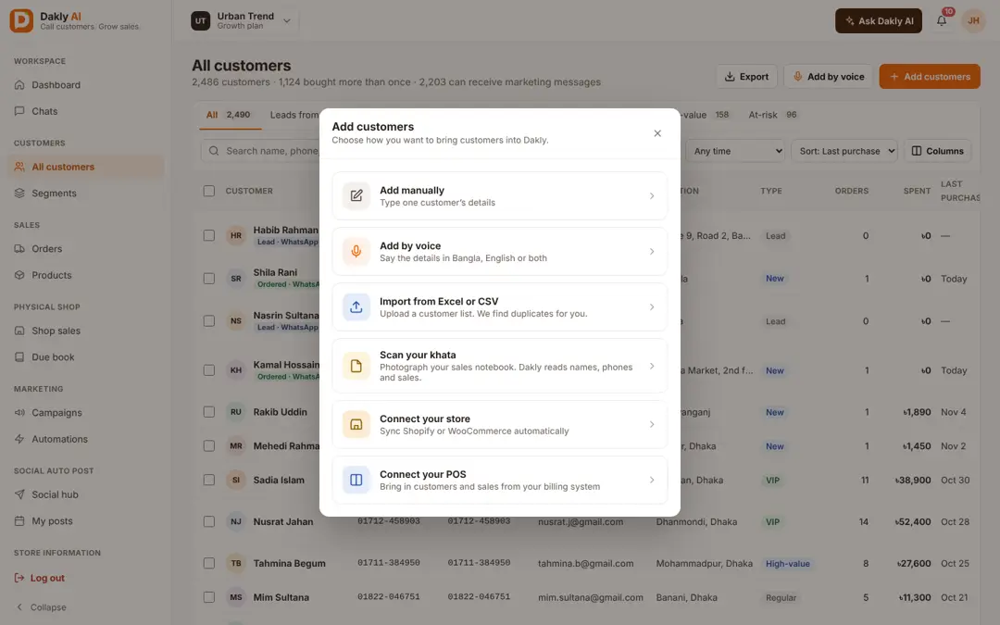

**Add one customer by hand**

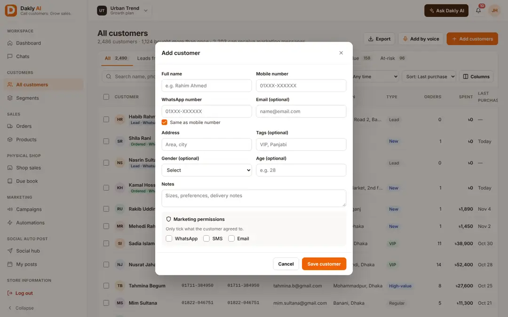

**Import from Excel, upload step**

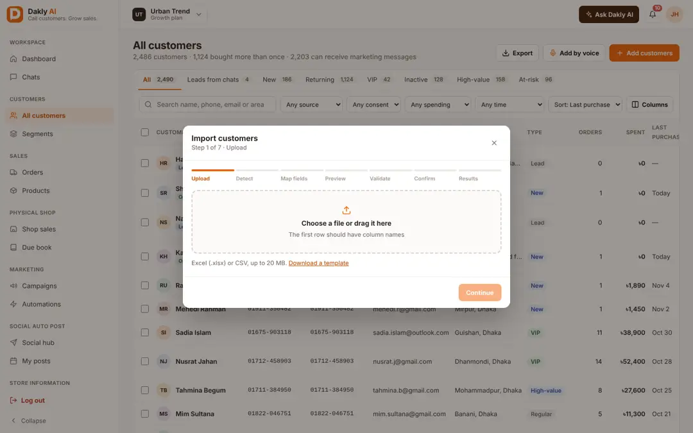

**Add by voice**

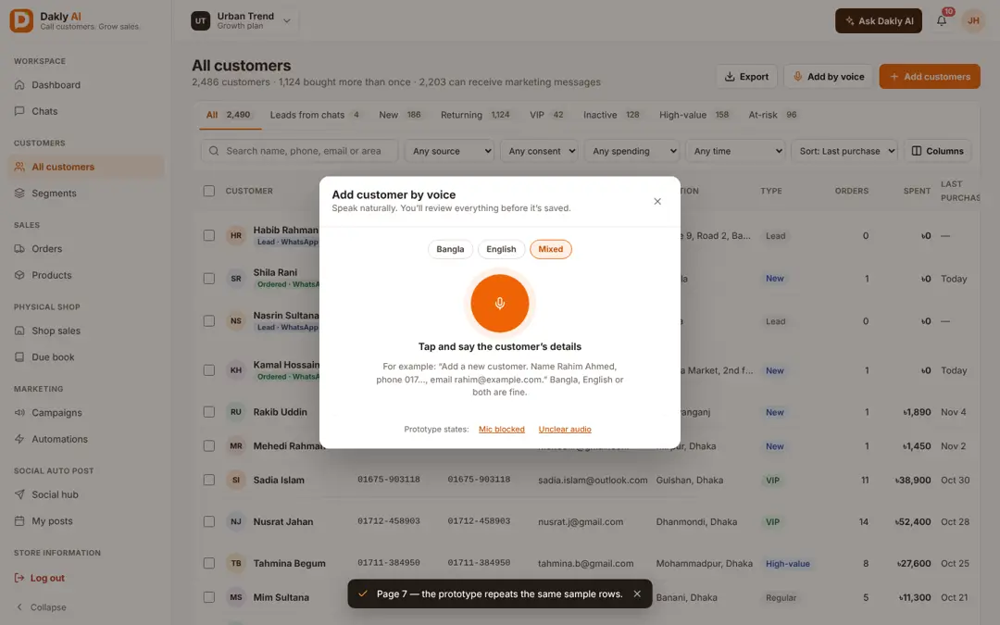

**Add by voice, review**

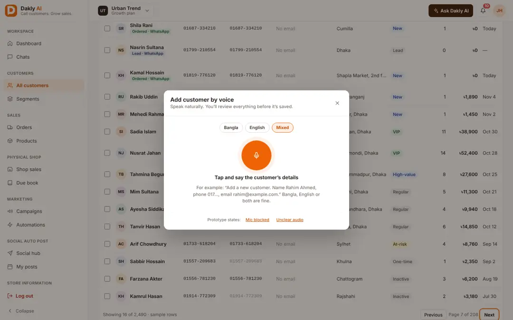

**Leads from chats tab**

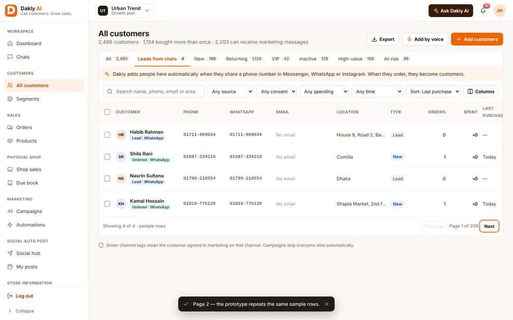

**Choose columns**

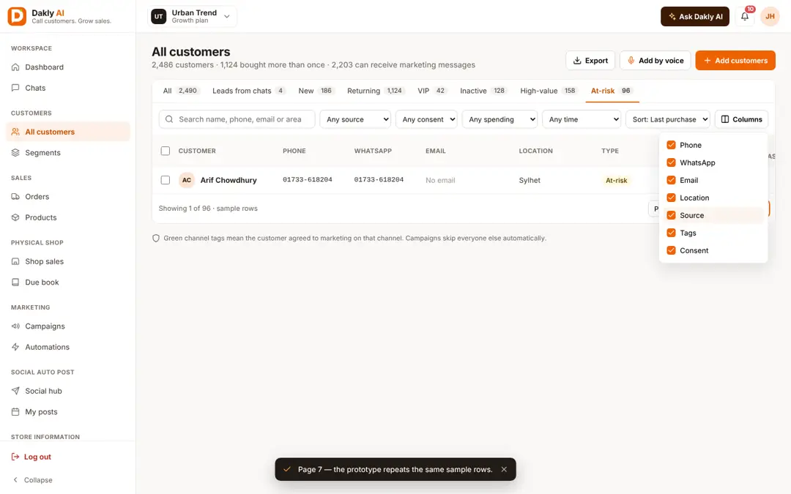

**Export**

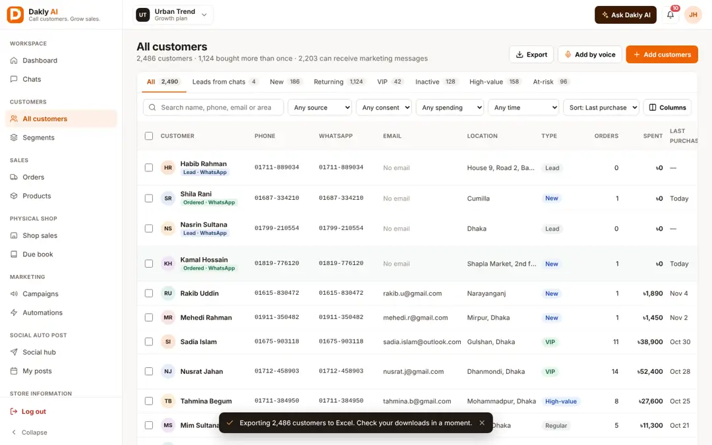

**Customer profile**

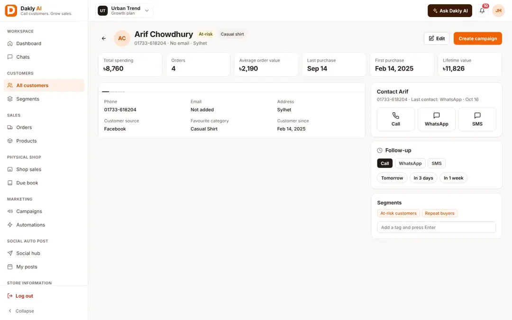

**Create segment (rule builder)**

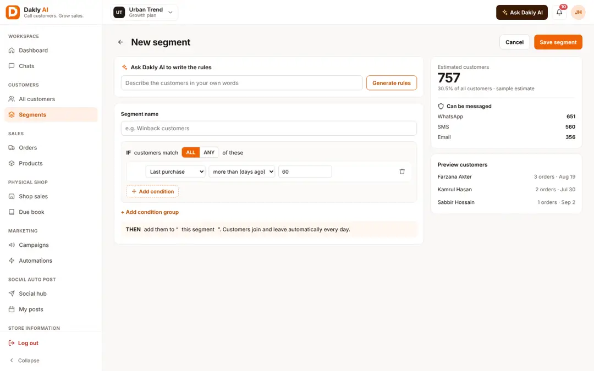

**Segment rules written from a description**

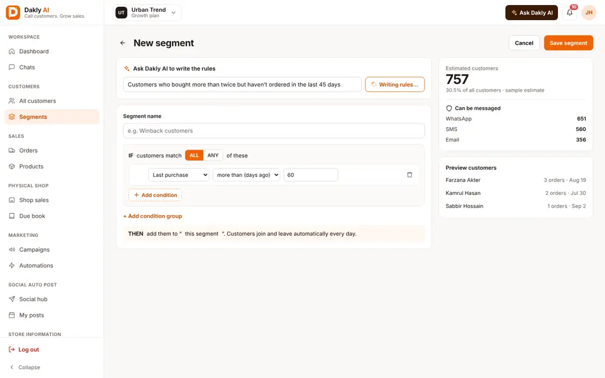

**View a segment**

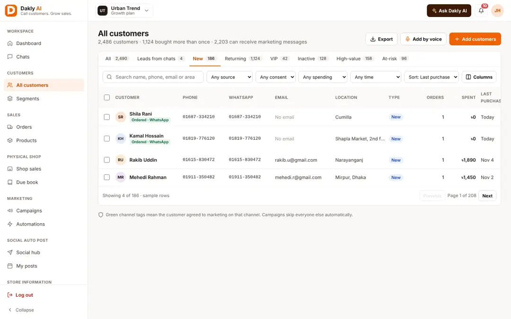

**Edit a segment**

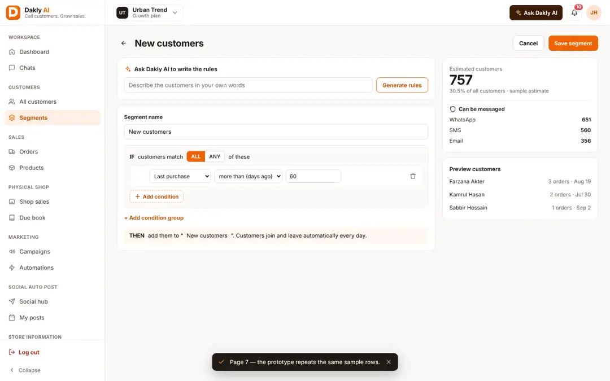

## Where the prototype is wrong or missing

The prototype is a concept with sample data. Build from this doc, not from the prototype, where they differ.

### Design review: Customers and Segments

This is the core of the product and the most complete part of the design. The customer list, profile and rule builder are build-ready. What's missing is a single, agreed definition for each customer type, because the same group gets a different count on different pages.

| Feature          | What the design shows                                                                                                                                                                                                                                            | Gaps and questions for build                                                                                                                                                                                                                                       |
| ---------------- | ---------------------------------------------------------------------------------------------------------------------------------------------------------------------------------------------------------------------------------------------------------------- | ------------------------------------------------------------------------------------------------------------------------------------------------------------------------------------------------------------------------------------------------------------------ |
| Customer list    | 2,486 customers. Quick tabs (All, New, Returning, VIP, Inactive, High-value, At-risk), filters by source, consent, spend and last purchase, 4 sort orders, column picker, 12 rows per page, consent tags per channel                                             | Search, filters and paging need server-side support from day one (208 pages). Bulk actions (tag, add to segment, message selected) are missing. Phone numbers are the identity key, so duplicates across Shopify, Facebook and in-store need merge rules.          |
| Customer profile | Spend, orders, average order, first and last purchase, lifetime value, tabs for Overview, Orders, Activity timeline, Campaign history, Notes, Marketing preferences, one-tap Call / WhatsApp / SMS, follow-up reminder (tomorrow, 3 days, 1 week), segment chips | "Lifetime value" is always 1.35 × total spend in the mock, so a real formula is needed. Bugs in the mock: Mim Sultana's "Last purchase" is blank, and Tahmina Begum shows "High-value customers" twice. Follow-ups need somewhere to appear (no task list exists). |
| Add customers    | Manually, by voice, import from Excel/CSV with duplicate detection, or connect a store                                                                                                                                                                           | Import is a 7-step wizard (upload, detect, map fields, preview, validate, confirm, results). Manual add has gender, age, notes and per-channel marketing permissions. Collect birthday rather than age, because the Birthday automation needs a date.              |
| Add by voice     | Speak details in Bangla, English or mixed, review before saving; states for mic blocked and unclear audio                                                                                                                                                        | Differentiating feature. Needs a speech-to-text provider that handles Bangla and Banglish; budget the cost per minute.                                                                                                                                             |
| Export           | Exports all 2,486 to Excel                                                                                                                                                                                                                                       | Should export the current filter, and only Owners/Admins should be able to export phone numbers.                                                                                                                                                                   |
| Segments         | 8 ready-made segments (New, Regular, VIP, Inactive, At-risk, High-value, One-time, Repeat) with count, change and total spent; View, Edit, Create campaign                                                                                                       | Ready-made segments overlap (VIP 42 sits inside High-value 158). Counts refresh daily, so state the refresh time on the page.                                                                                                                                      |
| Segment builder  | IF ALL/ANY conditions (last purchase, orders, spent, consent, location, source, product, tag), condition groups, live estimate and reachable counts per channel, preview of matching customers                                                                   | Good. "Edit" on an existing segment opens with the same 757-customer sample instead of that segment's rules.                                                                                                                                                       |
| AI segment rules | Describe customers in words, Dakly writes editable rules                                                                                                                                                                                                         | Showing the rules before saving is the right safeguard. Keep it.                                                                                                                                                                                                   |

Bugs in the mock: a segment "View" says "Showing 2 of 186" but "Page 1 of 208", and "1 orders" should read "1 order".

### Missing design: follow-ups list and bulk actions

**Why it's needed.** The customer profile lets the owner set a follow-up (Call, WhatsApp or SMS; tomorrow, in 3 days, in 1 week), but nothing shows those follow-ups afterwards. The customer list has checkboxes on every row but no actions for the selected customers.

**Follow-ups, design:**

- A **Follow-ups list** (its own page, or a tab in Notifications "To do"): due today, overdue, upcoming; customer, reason, channel, who it's assigned to.
- One-tap actions: Call, Send WhatsApp, Mark done, Snooze.
- A due-today count on the bell and a morning reminder by SMS or WhatsApp to the owner.
- Assigning follow-ups to team members (Support agents).

**Bulk actions, design:** a bar that appears when rows are selected, with Add tag, Remove tag, Add to segment, Send message (opens the campaign builder with these customers), Change consent (with the logged-change warning already used on profiles), Export selected and Delete. Include "Select all 2,486 matching this filter", not only the 12 on the page.

**Also missing on customers.** Duplicate merge (same phone from Shopify and Facebook), delete customer and data-removal requests, and the empty profile state for a customer with no orders yet.

## Engineering

### Screens in release 1

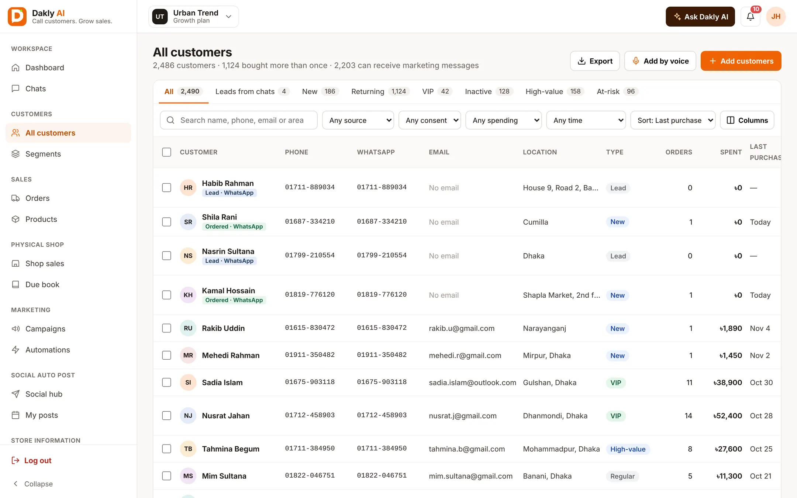

The customer counts on these pages disagree with the dashboard and Shopify in the prototype; use the glossary. Customer insights and the profile page have no sidebar entry in the prototype; they open from the list.

### How it works

Identity

1. A contact is a person in one store. It may start with no phone, known only by a channel identity (Messenger PSID, Instagram scoped id, WhatsApp id) in `contact_identities`.
2. Resolve the buyer from the chat contact or the buyer selected or recorded when creating the order. A buyer can have a channel identity without a phone. Another recipient's delivery phone is not a buyer lookup key. Self-delivery saves the buyer's supplied own phone under D27 after resolving the buyer.
3. A phone supplied as the buyer's own phone follows the existing identity-matching policy: WhatsApp sender identity may support a match; a typed phone alone is a possible match for staff. Do not treat an order confirmation or delivery as identity evidence.
4. Store the delivery recipient's name, phone and address on the order, even when the recipient is another existing customer. No recipient contact or second order is required. Do not merge the recipient with the buyer or overwrite either profile from another person's details (D26). The self-delivery own-phone save follows D27.
5. Staff may confirm the order and mark it delivered without an OTP. These status changes, and confirmation replies or links from the recipient, do not change the buyer, customer identity or access to unrelated purchase history.

Kind follows the glossary: a chat, comment or order-link contact with an own phone and zero orders is a `lead`; a contact with at least one non-cancelled order, or intentionally added as a customer, is a `customer`. A phone is not required for the order-based customer definition. Recompute after an own-phone save and order changes; `not_customer` remains an explicit staff choice. Cancelling the last order preserves a customer intentionally added by manual entry, import, store sync, POS or khata. Otherwise use `lead` only when the contact has their own phone; a phone-less chat contact returns to `chat_only`. Preserve the original intentional-add evidence when merging or undoing.

Consent

1. Consent is append-only per contact and channel; the latest row wins.
2. Sending reads only the current-consent view.
3. "STOP" or "বন্ধ" on WhatsApp or Messenger, or the SMS opt-out link, writes a withdrawal at once.

Stats: one `contact_stats` row per contact holds order count, delivered count, net spend, first and last order, usual gap and lifecycle stage. Return risk is read from orders by delivery phone (D26), and lead temperature lives on the conversation. It is recomputed for one contact on each order event and for all contacts nightly. Lists and segments read only this table.

Segments

1. A segment is a condition tree over a fixed field list (stats, tags, district, source, consent, last message), validated by a zod schema in `packages/contracts`.
2. `SegmentsService` compiles the tree to a Drizzle `where` with bound parameters, never string SQL.
3. Counts are computed on demand. Membership is frozen into campaign recipients only when a campaign is approved.

Import: CSV of customers (and POS sales, D6) with a preview, column mapping and a result report. Rows with bad phones are reported, not dropped silently.

### Rules

1. Phone is unique per store.
2. A Not a customer contact never gets AI replies, segments or campaigns.
3. Masked phones for roles without `seeFullPhone`; export only with `exportLists`.
4. A deleted contact is purged after 30 days under CUS-R2. The purge removes their profile and chats and clears customer memory immediately; retained orders keep the buyer-name snapshot and detached links.

### Permissions

`customers.view`, `customers.edit`, `segments.view`, `segments.edit`; flags `seeFullPhone`, `exportLists`.

### Events

Emits `contact.created`, `contact.merged`, `consent.changed`, `segment.saved`. Listens to `order.*` to refresh stats.

### Data

`contacts` (own phone saved under D27, unique per store; tags as a text array), `contact_match_suggestions` (possible matches for staff, including a D27 phone conflict), `contact_identities`, `consents` (append-only; read through the view `contact_consent_current`), `contact_stats` (no return risk; D26 reads it from orders by delivery phone), `segments`, `imports`, `tasks`, `customer_insights` (one row per insight and source filter, rebuilt nightly; "Not useful" sets `hidden_at`), `data_requests` (a customer's "delete my data" passed on by the shop). Exports are logged as `audit_log` rows (CUS-R3). `contact_memories` holds the AI customer memory (D30, CHAT-R11). `contact_merges` keeps each staff merge for a 7-day undo (D29); the merged contact is soft-deleted until then. Full design: [docs/data](../data/README.md).

### Edge cases to test

- Two contacts with the same phone created at the same moment.
- Merge, undo, retry the original operation: the contacts remain separate.
- Undo preserves a later address edit, reused phone and marketing withdrawal; dependent merges must be undone first.
- Purge a buyer whose recipient is a different person: retain the buyer snapshot, detach both links and redact merge evidence.
- Cancel an intentional zero-order customer's final order without turning them into a lead.
- Phone with Bangla digits or `+880`.
- A typed buyer phone alone does not merge contacts; a delivery phone never changes the buyer, including after staff confirmation or delivery (D26).
- Segment counts with 50,000 contacts return in under 2 seconds.

### Acceptance

- Given 128 people in Stopped buying and 109 with WhatsApp consent, when a campaign targets them on WhatsApp, then 109 are reachable before exclusions.
- Given a Support agent without `seeFullPhone`, when they open a customer, then the phone shows as `01712-XXX678`.

## Open questions

Q10 (schema review), Q13 (Shopify and WooCommerce sync).
