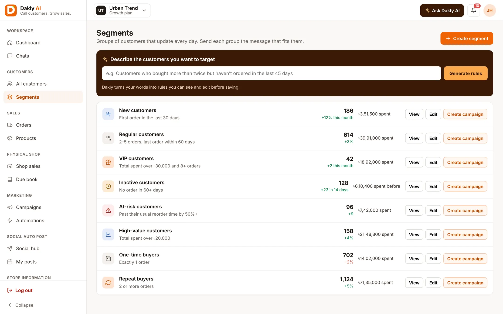

# Customers, consent and segments

|           |                                                                                          |
| --------- | ---------------------------------------------------------------------------------------- |
| Release   | 1                                                                                        |
| Status    | Building (the `customers` example feature exists)                                        |
| Extension | Core                                                                                     |
| Code      | `packages/core/src/{customers,segments}/`, `apps/web/src/features/{customers,segments}/` |
| Tasks     | CUS-1 to CUS-7                                                                           |

## Purpose

One list of people per shop, built from chats, orders and imports, keyed on phone number. Records who agreed to hear from the shop on which channel, and groups people into segments for campaigns.

## Screens

The customer counts on these pages disagree with the dashboard and Shopify in the prototype; use the glossary. Customer insights and the profile page have no sidebar entry in the prototype; they open from the list.

## How it works

Identity

1. A contact is a person in one store. It may start with no phone, known only by a channel identity (Messenger PSID, Instagram scoped id, WhatsApp id) in `contact_identities`.
2. When a phone arrives (typed in chat, on an order, from WhatsApp), `CustomersService` looks for a contact with that phone.
3. Merge rule (pending review must-fix): merge automatically only when the phone is verified, which means it came from WhatsApp itself or a confirmed order. A phone typed in a chat creates a "possible match" for staff to confirm. This stops someone typing another customer's number and then asking the AI about that person's orders.

Kind is derived by the stats job: `lead` (has a phone, no delivered order), `customer` (at least one delivered order). Only `not_customer` is set by hand.

Consent

1. Consent is append-only per contact and channel; the latest row wins.
2. Sending reads only the current-consent view.
3. "STOP" or "বন্ধ" on WhatsApp or SMS writes a withdrawal at once.

Stats: one `contact_stats` row per contact holds order count, net spend, first and last order, return count, return risk and lead temperature. It is recomputed for one contact on each order event and for all contacts nightly. Lists and segments read only this table.

Segments

1. A segment is a condition tree over a fixed field list (stats, tags, district, source, consent, last message), validated by a zod schema in `packages/contracts`.
2. `SegmentsService` compiles the tree to a Drizzle `where` with bound parameters, never string SQL.
3. Counts are computed on demand. Membership is frozen into campaign recipients only when a campaign is approved.

Import: CSV of customers (and POS sales, D6) with a preview, column mapping and a result report. Rows with bad phones are reported, not dropped silently.

## Rules

1. Phone is unique per store.
2. A Not a customer contact never gets AI replies, segments or campaigns.
3. Masked phones for roles without `seeFullPhone`; export only with `exportLists`.
4. A deleted contact is purged after 30 days; their messages are anonymised.

## Permissions

`customers.view`, `customers.edit`, `segments.view`, `segments.edit`; flags `seeFullPhone`, `exportLists`.

## Events

Emits `contact.created`, `contact.merged`, `consent.changed`, `segment.saved`. Listens to `order.*` to refresh stats.

## Data

`contacts`, `contact_identities`, `consents`, `contact_stats`, `tags`, `contact_tags`, `segments`, `imports`. `contact_merges` (undo for 7 days) is cut by the schema review (pending review).

## Edge cases to test

- Two contacts with the same phone created at the same moment.
- Phone with Bangla digits or `+880`.
- A typed, unverified phone that matches an existing customer does not merge.
- Segment counts with 50,000 contacts return in under 2 seconds.

## Acceptance

- Given 128 people in Stopped buying and 109 with WhatsApp consent, when a campaign targets them on WhatsApp, then 109 are reachable before exclusions.
- Given a Support agent without `seeFullPhone`, when they open a customer, then the phone shows as `01712-XXX678`.

## Open questions

Q10 (schema review), Q13 (Shopify and WooCommerce sync).
