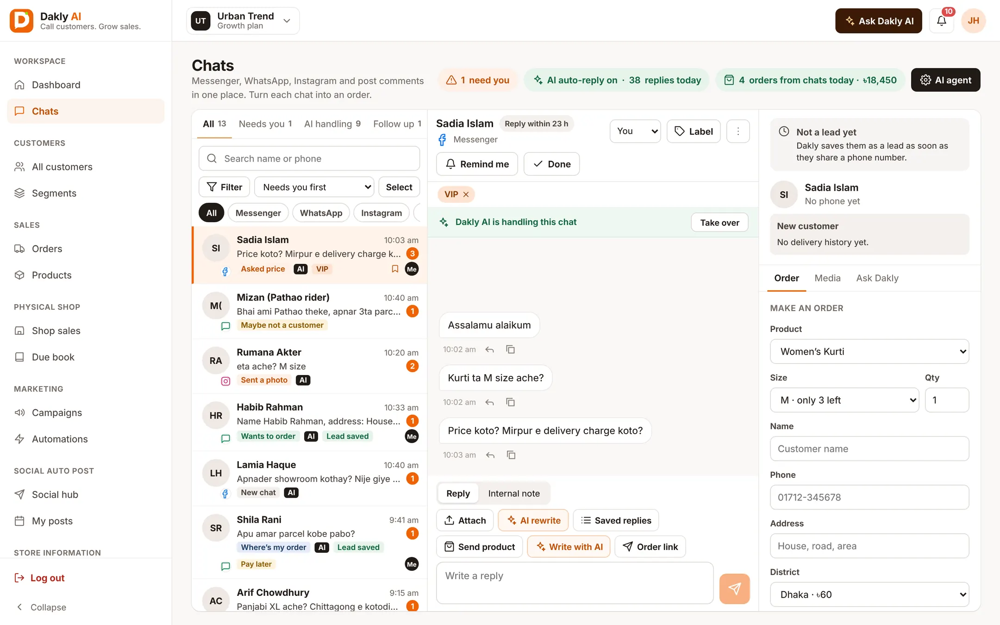

# Chats and the AI sales agent

|           |                                                                                                                      |
| --------- | -------------------------------------------------------------------------------------------------------------------- |
| Release   | 1                                                                                                                    |
| Status    | Not started                                                                                                          |
| Extension | Chats                                                                                                                |
| Code      | `packages/core/src/{chats,ai-agent,ai,usage}/`, `packages/providers/src/llm/openai/`, `apps/web/src/features/chats/` |
| Tasks     | CHAT-1 to CHAT-6, AI-1 to AI-8                                                                                       |

## Purpose

One inbox for Messenger, Instagram, WhatsApp and post comments. The AI answers price, size, stock and delivery questions in Bangla, Banglish or English, drafts orders, and hands the chat to a person when it should. The most used screen in Dakly.

## Screens

Three columns: chat list with tabs (All, Needs you, AI handling, Follow up) and channel filters; the conversation with Reply and Internal note; a side panel with the customer card and a Make an order form. The header shows "need you", AI replies today and orders from chats today (glossary numbers). The AI agent settings, knowledge and test screens open from "AI agent".

## How it works

Conversation state is three separate fields:

| Field       | Values                               | Set by                                                                                                     |
| ----------- | ------------------------------------ | ---------------------------------------------------------------------------------------------------------- |
| `status`    | `open`, `needs_you`, `later`, `done` | Hand-over sets `needs_you`; staff set `later` and `done`; a new customer message reopens                   |
| `responder` | `ai`, `human`, `paused`              | Take over or any staff reply sets `human`; the return timer or Hand back sets `ai`; Pause AI sets `paused` |
| `assignee`  | a member or none                     | Staff, or round robin among online members                                                                 |

Inbound

1. `ChatsService.receiveInboundMessage` finds or creates the identity, contact and conversation, saves the message (unique on conversation and external message id), sets the window to 24 hours from now, and emits `message.received`.
2. Voice notes are transcribed and images described; both are saved on the message so staff and the AI read the same text.
3. The AI listener schedules an `ai-reply` job keyed by conversation id with the store's debounce (default 8 s). Each new message resets it, so one reply answers a burst.

AI reply pipeline (`AiAgentService.reply`)

1. Gates, no model call: AI switched on, contact is not Not a customer, responder is `ai`, window open, allowance left, no saved reply matches (a match is sent free).
2. Classify with the fast tier: intent, language, sentiment, asks for a person, hand-over category.
3. Hand-over rules in code on that output plus keyword lists (refund, damaged, fake, ফেরত). A match sends the holding reply and stops. Hand-over always wins.
4. Build context: platform rules, store settings, delivery zones (stable, first, so the prompt cache hits), then the customer card, a summary plus the last 20 messages, and product candidates.
5. Agent call with tools, at most 4 rounds and 20 seconds.
6. Check the draft in code: every ৳ amount and stock number must appear in this run's tool results; no phone but the shop's; no link but Dakly's; under 600 characters. A failed check hands over instead of sending.
7. Send through the outbox, save the AI run id and sources on the message, consume one AI conversation unit.

No database transaction or row lock is held during a model call (pending review must-fix). Before sending, the service re-reads `responder` and drops the AI reply if a person took over meanwhile.

Agent tools take no store id, contact id or price; those come from the job. Tools: `search_products`, `get_product`, `get_delivery_charge`, `search_knowledge`, `get_my_orders`, `get_order_status`, `draft_order`, `confirm_order`, `create_payment_link`, `send_product_card`, `add_to_restock_list`, `hand_over`.

Outbound: every message (AI or staff) is saved as `queued` with an idempotency key; a `send-message` job calls the driver and moves it to `sent` or `failed`. Receipts move it to `delivered` and `read`.

Hand-over: sets `needs_you` and `human`, records the reason (asked for a person, complaint, refund, discount, angry, out of scope, ready to buy, other), sends the holding reply once, notifies the assignee or Owner. Unclaimed after 10 minutes in working hours, the chat goes back to the AI. After a person's last message the AI returns after the return timer (default 30 minutes).

Practice mode: each new channel starts with AI not live. The AI answers only the Test tab and the tester list. Go live runs the store's test questions (at least 3) and switches on only if all pass.

Comments: classified as question, positive, negative or spam. If "Answer post comments" is on, the AI posts a short public reply and one private reply with price. Spam is hidden; negative goes to Needs you. Nothing with a price, phone or address is posted publicly.

## Rules

1. The AI may reply and draft orders without approval while auto-reply is on (D7). Every AI message is labelled AI.
2. The AI never invents prices, discounts, stock or delivery times, and never asks for card numbers, PINs or codes.
3. Refunds, complaints, exchanges and discounts always go to a person.
4. No AI reply outside Meta's 24-hour window; WhatsApp outside the window needs a template.
5. When the AI allowance is used up, new chats go to Needs you; the current window finishes.
6. Changing or cancelling an order after staff approved it always goes to a person.
7. Customer messages, comments and files are untrusted data in the prompt and are labelled as such.
8. Three provider errors in a minute pause AI replies for 2 minutes; waiting chats go to Needs you.
9. Each store has a daily AI cost ceiling; passing it pauses AI for that store and alerts Dakly staff.
10. Per-store fairness: at most 3 AI jobs run at once per store (Valkey semaphore, pending Q15).

## Permissions

`chats.view`, `chats.edit` (reply, take over, assign). AI agent settings: Owner and Admin.

## Events

Emits `message.received`, `message.sent`, `conversation.handed_over`, `ai.reply_sent`. Listens to `order.created` to link the order to the chat.

## Data

`conversations`, `messages`, `saved_replies`, `ai_settings`, `knowledge_items`, `knowledge_chunks` (pgvector, exact scan per store), `ai_runs`, `usage_events`. `ai_test_cases` is deferred by the schema review (pending review).

## Edge cases to test

- Three messages in 5 seconds produce one AI reply.
- A staff reply during the debounce cancels the AI reply.
- A message after the window closes is saved and does not trigger the AI.
- The same webhook twice stores one message.
- A draft with a price not in tool results is not sent.
- A typed phone of another customer does not reveal their orders.

## Acceptance

- Given "price koto? Mirpur e delivery charge koto?" for a product in stock, when the AI replies, then the price and charge match the product and the Mirpur zone exactly.
- Given a customer writes "ফেরত দিতে চাই", then the chat moves to Needs you with reason refund and no AI answer about the refund.

## Open questions

Q7 (Inquiry), Q8 (models), Q9 (OpenAI data terms), Q15 (fairness).
