# Chats and the AI sales agent

|           |                                                                                                                      |
| --------- | -------------------------------------------------------------------------------------------------------------------- |
| Release   | 1                                                                                                                    |
| Status    | Not started                                                                                                          |
| Extension | Chats                                                                                                                |
| Code      | `packages/core/src/{chats,ai-agent,ai,usage}/`, `packages/providers/src/llm/openai/`, `apps/web/src/features/chats/` |
| Tasks     | CHAT-1 to CHAT-7, AI-1 to AI-9                                                                                       |

## Purpose

One inbox for Messenger, Instagram, WhatsApp and post comments. The AI answers price, size, stock and delivery questions in Bangla, Banglish or English, drafts orders, and hands the chat to a person when it should. The most used screen in Dakly.

## Decisions that change the PRD

The product requirements below are the PRD text from 12 November 2026. Where a later decision changed it, the decision wins:

- D17: the AI model is OpenAI through `LlmDriver` and `AiService` tiers, not the Claude API.
- D21: there is no courier API in release 1. When a customer asks where the parcel is, the AI answers from the courier name and tracking code staff recorded on the order, and hands over when there is none.
- D7: chats AI replies and drafts orders without approval, within its settings.
- D37: storing messages, sending, receipts and the 24-hour window are core messaging (`messaging/`, CHAT-1 and CHAT-2), so campaigns and automations work without this extension. The Chats extension is the inbox, assignment, notes, saved replies, comments and the AI agent.

## Product requirements

### What it is for

Facebook sellers lose orders because nobody answers "price koto?" at 11 pm. Chats puts Messenger, Instagram DMs, WhatsApp and post comments in one inbox, and the Dakly AI sales agent answers from the shop's own products and rules, collects name, phone and address, creates the order and hands anything tricky to a person. Release 1, Chats extension. Decision taken: the AI may reply and draft orders on its own while auto-reply is on; campaigns and posts still need approval.

### User stories

- As a seller, I want every Messenger, Instagram, WhatsApp and comment message in one list, so I stop switching apps.
- As a seller, I want Dakly to answer price, size, stock and delivery questions in Bangla or Banglish within seconds, day and night.
- As a seller, I want Dakly to collect name, phone and address and turn the chat into an order, so I only pack and ship.
- As a seller, I want Dakly to hand complaints, exchanges and unusual requests to me, so a bot never makes an angry customer angrier.
- As a seller, I want to teach Dakly my rules by typing a sentence like "ঢাকার বাইরে ১৫০ টাকা", so I don't fill in forms.
- As a support agent, I want to take over any chat, use saved replies, and send product cards and order links.

### Screens

| Screen                | Elements                                                                                                                                                                                                                                                                                                                                                                                                                                                                                                                                         |
| --------------------- | ------------------------------------------------------------------------------------------------------------------------------------------------------------------------------------------------------------------------------------------------------------------------------------------------------------------------------------------------------------------------------------------------------------------------------------------------------------------------------------------------------------------------------------------------ |
| Chats header          | Title and subtitle; "N need you"; AI auto-reply on/off pill; replies today; orders from chats today and their ৳ value; AI agent button.                                                                                                                                                                                                                                                                                                                                                                                                          |
| Chat list             | Tabs with counts: All, Needs you, AI handling, Follow up, Done, Not customers. Channel filter (All, Messenger, WhatsApp, Instagram, Comments). Sort (Needs you first, Unread first, Waiting longest). Select for bulk (Mark done, Assign, Label). Each row: avatar, name, time, last message, unread count, intent tag (Asked price, Asked size, Sent a photo, Wants to order, Where's my order, Exchange, Complaint, Payment, Said yes, No reply, New chat, Comments, Done), who is replying (AI or Me), "Lead saved", "Dakly is typing…".      |
| Conversation          | Header: name, channel, "Reply within N h" for Messenger and Instagram, assignee picker (You, team members, None), Label, Remind me, Done. Banner "Dakly AI is handling this chat" with Take over (or "You're replying. Hand back to AI"). Messages with AI badge on AI messages and system lines (order created, handed over, marked not a customer). Composer: Reply / Internal note toggle, attach, AI rewrite, saved replies, send product, write with AI, order link.                                                                        |
| Side panel            | Contact status (Customer under the glossary even without a phone; otherwise Lead once an own phone is saved with zero orders, or "Not a lead yet"; Open profile; a conflicting own phone shows a possible match to staff), delivery history and return risk, tabs Order / Media / Ask Dakly. Order tab = Make an order form: product, size with live stock, quantity, name, phone, address, district (sets delivery charge), "Delivery charge paid in advance", totals (product, delivery, COD), Ask customer for missing details, Create order. |
| Comments view         | Post thumbnail and caption, comment count, comments grouped by intent ("9 comments asking price"), reply under comment, send price by DM (private reply), hide comment.                                                                                                                                                                                                                                                                                                                                                                          |
| AI agent drawer       | Tabs: Settings, Knowledge, Feedback, Test.                                                                                                                                                                                                                                                                                                                                                                                                                                                                                                       |
| Settings tab          | Master switch AI auto-reply; reply language (Match customer, Bangla, English); What Dakly does (switches): Answer questions; Send product cards; Take orders; Confirm orders; Courier updates; Ask for a review; Follow up hot leads (Off, Hot leads only, All interested); Answer post comments. Hand to me (switches): Damaged, wrong or fake product; Refunds and exchanges; Special requests. Return chat to AI: after 1 hour, after 24 hours, until I hand it back. "How Dakly talks" (tone from brand profile). Teach box with examples.   |
| Knowledge tab         | Products (synced from Products, count); Shop rules (delivery inside Dhaka, outside Dhaka, delivery days, bKash number for advance, opening hours, exchange days, tone, extra rules); Questions you taught Dakly (Q, A, keywords, times used, edit, delete); Files and links (upload PDF or image such as a size chart, or a website link; status Reading → Learned N facts).                                                                                                                                                                     |
| Feedback tab          | Replies the team rated, with thumbs up or down, reason chips (Wrong information, Wrong price or stock, Too long, Not our tone, Missed the question, Should have handed to me), the fix, and "Fixed and learned". Satisfaction % at top.                                                                                                                                                                                                                                                                                                          |
| Test tab              | Type a customer message (examples: "Kurti M size koto?", "Rangamati te COD hobe?", "Kapor ki cotton?") and see Dakly's answer, its source ("Answered from your answer: …" or "From Products") or "Dakly doesn't know this yet, so it calls your team"; Not right? Change the answer.                                                                                                                                                                                                                                                             |
| Not a customer dialog | Reason (Supplier or business partner, Courier or delivery rider, Friend or family, Job seeker, Spam or scam, Other), optional Block; Dakly pre-selects a guess from the message text.                                                                                                                                                                                                                                                                                                                                                            |

### How it works

**Receiving messages**

1. Meta webhooks (Messenger, Instagram, WhatsApp Cloud API) deliver each incoming message within seconds. Dakly stores it, finds or creates the contact (tab 3), and attaches the chat to the store.
2. If the contact is marked Not a customer, the message is stored but the AI never replies.
3. The AI pipeline runs if auto-reply is on, the chat is not in human mode, and the channel's reply window is open.

**AI reply pipeline** (target: first reply within 10 seconds)

1. **Batch:** wait for more messages from the same person, then treat them as one turn. The store's debounce defaults to 8 seconds.
2. **Classify intent** into one of: greeting, price, size or stock, delivery, payment, order (sharing name, phone or address), yes or confirm, where's my order, exchange, complaint, photo, special request, other. Also detect language (Bangla script, Banglish, English).
3. **Hand-over check:** complaint (damaged, wrong, fake, refund words) → hand over if "Damaged, wrong or fake" is on; exchange or return → hand over if "Refunds and exchanges" is on; custom or bulk order → hand over if "Special requests" is on; the customer asks for a person; or the AI's confidence is low. On hand-over Dakly sends a holding reply ("একটু অপেক্ষা করুন, আমাদের টিম আপনাকে জানাবে।"), moves the chat to Needs you, records the reason and notifies the assignee or Owner.
4. **Retrieve facts:** the product the customer means (from text, a product card they tapped, the post they came from, or a photo matched against product images), its price, sale price, sizes and live stock; shop rules; taught answers; facts learned from files and links; the customer's orders and courier status.
5. **Draft the reply** with the language model in the customer's language and the store's tone, using only the retrieved facts. If a needed fact is missing (for example no price), it does not guess: it hands over and creates a Products nudge ("Leather sandal has no price. Customers asked 3 times").
6. **Act:** depending on intent and switches, the reply may include a product card (photo, price, sizes), an order summary asking for "হ্যাঁ", a courier status line, or a request for missing details.
7. **Send** through the channel API, mark the message with AI, update the chat's intent tag and counters.

**Taking an order in chat**

1. Keep the chat contact as the buyer. When delivery name, phone, address or district arrives, fill the draft order's recipient details. If the buyer orders for someone else, these details belong only to the order and do not overwrite or merge the buyer profile. For self-delivery (the default), also save the supplied own phone on the buyer contact as soon as it is captured, before order creation, following D27 and the customer rules. A phone belonging to another contact stays on the draft and shows a possible match to staff; it does not block the order. Saving does not verify ownership or add marketing consent. The buyer may remain without a profile phone when ordering for someone else or while a phone conflict is unresolved.
2. Missing fields are asked for in one message ("অর্ডার করতে নাম, ফোন আর ঠিকানা দিন।").
3. When complete, Dakly creates the order with status To confirm and sends the summary: items, size, total with delivery, COD, address, "ঠিক থাকলে 'হ্যাঁ' লিখুন।" (toast "Dakly AI took an order from Habib Rahman (#1063)").
4. If "Confirm orders" is on and the customer says yes, the order moves to To pack ("confirmed by the customer"), stock is reserved, and Dakly replies that it will be packed and sent.
5. If the customer has High return risk, Dakly asks for the delivery charge in advance by bKash (the shop's bKash number from Knowledge) instead of confirming; the order stays in To confirm until a person records the advance.
6. A team member can always edit the draft in the side panel and press Create order themselves.

**Comments**

New comments on the store's Page and Instagram posts arrive by webhook. If "Answer post comments" is on, Dakly replies publicly with a short line ("ইনবক্সে দাম জানিয়ে দিয়েছি") and sends the price and product card as a private reply in Messenger or Instagram DM, which opens a normal chat. Negative or abusive comments are not answered and are shown in Needs you.

**Teaching Dakly**

The owner types a rule in plain words. Dakly parses it into a change (for example Delivery outside Dhaka: ৳120 → ৳150), shows old and new value and a sample answer, and saves only after the owner taps Save. Free-form rules that don't map to a field are saved as "extra rules" that Dakly follows in every chat. Rating a reply thumbs down asks why and for the right answer; saving it creates a taught answer.

**Human mode**

Take over (or any reply typed by a person) switches the chat to human mode: the AI stops replying in that chat until it is handed back or the "Return chat to AI" timer passes since the last human message. While in human mode the AI still suggests replies in the composer (Write with AI) but never sends.

### Business rules

| ID       | Rule                                                                                                                                                                                                                                                                                                                                                                                                                                                                                                                                                                                                                                                                                                                                                                                                                                                                                                                                                                                                                                                                                                                      |
| -------- | ------------------------------------------------------------------------------------------------------------------------------------------------------------------------------------------------------------------------------------------------------------------------------------------------------------------------------------------------------------------------------------------------------------------------------------------------------------------------------------------------------------------------------------------------------------------------------------------------------------------------------------------------------------------------------------------------------------------------------------------------------------------------------------------------------------------------------------------------------------------------------------------------------------------------------------------------------------------------------------------------------------------------------------------------------------------------------------------------------------------------- |
| CHAT-R1  | The AI uses only: Products, shop rules, taught answers, learned facts, the customer's own orders. It never invents prices, discounts, stock, delivery times or policies.                                                                                                                                                                                                                                                                                                                                                                                                                                                                                                                                                                                                                                                                                                                                                                                                                                                                                                                                                  |
| CHAT-R2  | Messenger and Instagram: free-form replies only within 24 hours of the customer's last message. A person (not the AI) may reply up to 7 days after using Meta's human agent tag. After that the composer is locked and offers WhatsApp if a phone is known.                                                                                                                                                                                                                                                                                                                                                                                                                                                                                                                                                                                                                                                                                                                                                                                                                                                               |
| CHAT-R3  | WhatsApp: free-form replies within the 24-hour customer service window; outside it only approved templates. From Oct 1, 2026 Meta charges service messages beyond 1,000 free per number per month, so WhatsApp AI replies count toward the store's WhatsApp balance.                                                                                                                                                                                                                                                                                                                                                                                                                                                                                                                                                                                                                                                                                                                                                                                                                                                      |
| CHAT-R4  | The AI never sends marketing offers in chats unless the customer asked; follow-ups to interested leads respect the "Follow up hot leads" setting and are sent at most once, 20 to 24 hours after the last message, inside the window.                                                                                                                                                                                                                                                                                                                                                                                                                                                                                                                                                                                                                                                                                                                                                                                                                                                                                     |
| CHAT-R5  | Hand-over always wins over answering when a hand-over rule matches.                                                                                                                                                                                                                                                                                                                                                                                                                                                                                                                                                                                                                                                                                                                                                                                                                                                                                                                                                                                                                                                       |
| CHAT-R6  | Stock shown or promised by the AI is the live available quantity (stock minus reserved). The last unit is reserved for 30 minutes when an order draft is sent to a customer.                                                                                                                                                                                                                                                                                                                                                                                                                                                                                                                                                                                                                                                                                                                                                                                                                                                                                                                                              |
| CHAT-R7  | Each AI conversation (Glossary) uses one unit of the Chats AI allowance. At 0, auto-reply pauses, every new chat goes to Needs you, and the owner is notified with a top-up option.                                                                                                                                                                                                                                                                                                                                                                                                                                                                                                                                                                                                                                                                                                                                                                                                                                                                                                                                       |
| CHAT-R8  | Every AI message is stored with the facts it used, so a thumbs-down can show what it was based on.                                                                                                                                                                                                                                                                                                                                                                                                                                                                                                                                                                                                                                                                                                                                                                                                                                                                                                                                                                                                                        |
| CHAT-R9  | Phone numbers in chat are masked for roles without "See full phone numbers", but the order can still be created.                                                                                                                                                                                                                                                                                                                                                                                                                                                                                                                                                                                                                                                                                                                                                                                                                                                                                                                                                                                                          |
| CHAT-R10 | Not a customer: the AI stops, the contact is excluded from leads, customers and campaigns; Block also blocks on the channel where the API allows.                                                                                                                                                                                                                                                                                                                                                                                                                                                                                                                                                                                                                                                                                                                                                                                                                                                                                                                                                                         |
| CHAT-R11 | Customer memory (D30): after a conversation goes quiet, the fast tier updates one memory per customer per store with facts the customer stated or their own orders show (sizes, colours, styles, budget, language and tone, past issues, usual delivery area from self-delivery orders) and a summary under 600 characters. Never another recipient's details (D26), never health, religion, politics or payment details. A fact staff typed is never overwritten by the model. Staff with Edit Customers can edit or clear it; a deletion request clears it at once. The AI reads it as context, never as a source for prices, stock or charges. Cost controls: the memory update is part of the existing conversation summary call, not a new call; it runs only when the classify step flagged a new fact; stored memory is capped at 600 summary characters, 40 bounded facts and 16,384 serialized UTF-8 bytes; rendered context has separate hard limits of 300 measured tokens and 1,200 UTF-8 bytes; it sits right after the cached store prefix so later replies in the same chat read it from the prompt cache. |

### States and edge cases

- Customer writes only a photo: the words the vision tier read from the photo (see Inbound attachments) are matched to the shop's products by name, alias and meaning. The match is sure only when one product is named clearly and no other comes close; then the AI answers as that product, and as a size or colour when the photo text names exactly one in stock. When it is not sure, the AI asks "কোন প্রোডাক্টটি চাচ্ছেন?" with up to 3 product cards, in-stock products only. A photo of a product with no stock gets "no stock" and no offer (alternatives are AI-12). A photo that fits nothing gets a request for the product name. For a sure match the colour the vision tier read in the customer's photo is compared with the colour tagged on each of the product's photos (PROD-8), in Bangla, Banglish or English. A colour with one tagged photo gives that photo and its variant for the card. A colour whose variant has no stock is said to be out of stock and never offered. A colour no photo of the product has gets a card without a photo, so another colour is not shown as the one asked for. The pixels of the two photos are not compared; the tags are.
- Out-of-stock size: say so, offer other sizes in stock, offer "নতুন স্টক এলে জানাবো?" and add them to the product's restock waiting list.
- Out-of-stock product or photo match: `find_alternatives` returns up to 3 in-stock products of the same category, ordered by shared words in the name or description (a colour, a style) and then by closest price. A product with another size in stock gets no other products, only its sizes. A product with no category gets none, and another category is never offered. The AI offers only what the tool returns, then asks "নতুন স্টক এলে জানাবো?". `join_restock_list` runs only after the customer says yes and only in a real chat; it calls `RestockRequestsService.addToWaitingList`, so asking twice keeps one row and a size with stock is refused. A photo match that is sold out carries the alternatives in the same result. The reply prompt is `chat-reply.v4`.
- Two team members reply at once: second one sees "Rafiq is replying" and a warning before sending.
- Meta token expired: all chats on that channel show a banner; incoming messages may be missed until reconnect.
- AI provider down: auto-reply pauses, chats go to Needs you, banner "AI replies are paused. We're on it."
- Customer in a different store's chat (two Pages): each Page belongs to one store; the chat appears only in that store.

### Permissions

View Chats: read all chats. Edit Chats: reply, take over, assign, label, create orders, mark not a customer. Owners and admins change AI agent settings. Knowledge uses the store settings permission area.

### Events

chat.message\_received, chat.ai\_replied, chat.handed\_over, chat.taken\_over, chat.lead\_saved, chat.order\_created, chat.marked\_not\_customer, agent.rule\_taught, agent.reply\_rated.

### Acceptance criteria

- Given auto-reply is on and Women's Kurti M has 3 in stock at ৳1,850, when a customer writes "Kurti ta M size ache? price koto?", then within 10 seconds Dakly replies in Banglish or Bangla with the price, that M is in stock, the delivery charge for Dhaka and how to order.
- Given "Damaged, wrong or fake product" is on, when a customer writes "kapor chera ashche", then Dakly sends the holding reply, the chat moves to Needs you with reason "Complaint", and the AI sends nothing more.
- Given Rahim supplies his own unused phone for self-delivery before placing an order, then save it on his chat contact and the draft; with zero orders he appears in Leads from chats. Marketing consent stays unchanged.
- Given that own phone already belongs to another contact, then show staff a possible match, keep Rahim as the buyer, and allow the draft and order without revealing the other contact's orders.
- Given Rahim shares Karim's name, phone and address for delivery, when the order is complete, then it appears in Orders › To confirm with source Messenger under Rahim's chat contact and keeps Karim's details on that order. Karim's profile and purchase history do not change (D26).
- Given the owner types "ঢাকার বাইরে ১৫০ টাকা" and saves, when a customer from Sylhet asks the delivery charge, then Dakly says ৳150.
- Given a Messenger chat whose last customer message was 26 hours ago, then the AI does not reply and a person can still reply with the human agent tag.

### Beyond the prototype

The prototype's chats and AI replies are scripted. A production AI sales agent needs the controls that Intercom Fin, Gorgias, respond.io and Nabik have built.

| Addition                                                                                                                                                                                      | Why                                                                             | Release |
| --------------------------------------------------------------------------------------------------------------------------------------------------------------------------------------------- | ------------------------------------------------------------------------------- | ------- |
| Train the AI by chatting: owner sends a correction, photo, document or voice note; the AI proposes the knowledge change and saves it only after the owner confirms                            | Owners won't fill forms; Nabik trains this way                                  | 1       |
| Test suite before going live: a list of sample customer questions with expected answers; the AI must pass them before auto-reply can be switched on, and re-runs after every knowledge change | Fin and Gorgias require testing before launch; prevents wrong prices going live | 1       |
| Procedures for common jobs (take an order, exchange, delivery delay, "where is my parcel") written in plain language, each with allowed tools and hand-over rules                             | Gives owners control without code                                               | 1       |
| Product search from a customer's photo or screenshot ("ei dress ta ase?") matched against product images                                                                                      | The most common F-commerce question                                             | 1       |
| Bangla voice note transcription, so the AI and staff can answer voice messages                                                                                                                | Many buyers send voice notes                                                    | 1       |
| Parcel tracking answers from the courier status                                                                                                                                               | Second most common question after price                                         | 1       |
| Comment to DM: reply publicly ("Inbox e details dilam") and send the price privately, once per person per post                                                                                | ManyChat pattern; keeps prices off public comments                              | 1       |
| Round-robin assignment, working hours, SLA timers and "waiting longer than 5 minutes" alerts                                                                                                  | respond.io basics for teams                                                     | 1       |
| AI performance: resolution rate, hand-over reasons, conversion from chat to order, first reply time, cost per resolved chat                                                                   | Owners must see whether the AI earns its cost                                   | 1       |
| Click-to-Messenger and Click-to-WhatsApp ad referral captured on the chat (which ad started it)                                                                                               | Lets Analytics credit ads later                                                 | 2       |

**Do not copy from the prototype:** the sample conversations, AI reply wording and the "orders from chats" numbers. Hand-over and approval behaviour follow D7 and the security tab.

**Also from AiPraktor (release 1):**

- **Claim and return.** When the AI hands over, staff get a push notification and claim the chat in one tap. If nobody claims it within the store's timer (default 10 minutes), the chat goes back to the AI. The timer runs at any hour until working hours exist; their home is the round-robin, working hours and SLA row of the "Beyond the prototype" table above. When a person finishes, the chat goes back to the AI after 30 minutes of no staff reply. Both times can be changed or switched off.
- **AI summary** on every chat and customer profile: what they asked, what they ordered, and anything open.
- **Lead temperature** (hot, warm, cold), set from intent signals: asked price or size, gave phone or address, or went quiet. Follow-ups are sent inside the 24-hour window.
- **WhatsApp connects only through Meta's official Business API.** Dakly never uses QR-code linked-device sessions, because they risk the shop's number being banned and break Meta's terms.

### Verified details from AI agent products (12 Nov 2026)

From the help centres of AiPraktor, Nabik, Intercom Fin, Gorgias, respond.io and ManyChat. Each row is now a Dakly requirement unless marked otherwise.

#### Going live safely

- **Practice mode before going live.** AiPraktor's AI replies only to test messages (from the agent desk or a "test" code sent to the Page) until the owner presses Go live, which first runs 3 test questions. Fin offers simulations, batch tests from real conversations, answer rating and preview. **Dakly:** practice mode on every new channel; Go live requires the test suite to pass; batch test with the shop's last 50 real chats before switching AI on for an existing Page.
- **Show why the AI said it.** Fin's answer inspection shows which sources and settings shaped an answer. **Dakly:** every AI reply has "Why this answer" listing the knowledge items, products and rules used.
- **Draft, test, publish for instructions.** AiPraktor turns plain-language instructions ("we're closed Fridays") into a draft, tests it in a side chat and publishes with undo; the log shows who taught what. **Dakly:** same, with version history.
- **Fixed platform rules the shop can't override:** never invent discounts or prices, never change an order after staff approved it, never ask for card numbers, OTPs or passwords, never promise outcomes (visa, cures). Fin always hands off jailbreak attempts and high-risk topics.

#### Replying

- **Wait before answering.** Customers split one question into several messages. AiPraktor waits 0–15 seconds per channel (default about 15 s on Messenger) before replying. **Dakly:** wait 8 seconds by default on Messenger, Instagram and WhatsApp (editable 0–20 s), resetting on each new customer message, so one reply answers the whole thought.
- **Saved replies that answer automatically, free of AI cost.** AiPraktor matches customer phrasings and keyword pairs ("delivery + charge"), ignores punctuation, emojis and greetings ("bhai", "apu"), fills placeholders from records, and won't fire when several replies match, the message has several questions, or a person holds the chat. **Dakly:** staff choose saved replies by hand in release 1. The AI agent handles automatic answers (D43).
- **Comments.** Reply publicly using the customer's name, never with phone, address or price details; send the details by private reply. Meta allows one private reply per comment, within 7 days of the comment. Delete clear spam or abuse automatically; hide uncertain ones for the team.
- **Follow-ups and Messenger broadcasts inside the window.** AiPraktor sends one follow-up per hot or warm lead within 24 hours of the last message, and broadcasts only to people who messaged in the last 23 hours, skipping anyone broadcast to in the last 24 hours. **Dakly:** same limits for Messenger and Instagram; anything outside the window uses approved templates only.

#### Orders and actions

- **Actions with guardrails.** Gorgias's AI Agent runs actions like cancel order or edit address only when conditions pass (for example the order isn't fulfilled) and confirms the change with the shopper first. **Dakly:** the AI may change name, phone, address, items or delivery charge, or cancel, only before the order is approved; after approval it records the request and hands over. Refunds, complaints and exchanges always go to a person.
- **Handover reasons** are recorded from a fixed list: asked for a person, complaint, refund, discount request, angry, out of scope, ready to buy, other.

#### Hand-over and team

- **Take over with a timer.** AiPraktor: take over for 30 min, 1 h, 6 h or permanently; the AI returns when the timer ends (default 1 h). Staff can also send "." from the Messenger or WhatsApp app to take over and "." again to return. **Dakly:** same timers; the shortcut is a configurable keyword that isn't sent to the customer where the channel allows.
- **Pause AI** per chat, per channel or for the whole shop, for a set time or until switched on; messages keep arriving.
- **Assignment strategies** (respond.io): round robin, round robin among online staff only, or fewest open chats; unassign when closed. **Dakly:** all three, per team.
- **Inbox tabs:** Open, Later and Done; Done reopens when the customer writes again.

#### Measuring and billing the AI

- Fin bills $0.99 per outcome, at most once per conversation; an "assumed resolution" is counted when the customer stops for 24 hours after Fin's answer, and a greeting alone is not an answer. Gorgias counts an interaction as automated if no human is needed within 72 hours. AiPraktor charges more for photos, voice notes and big lookups, and nothing for team replies, saved replies or human-held chats. Nabik charges at cost plus a margin and sends chats to "Needs you" when credits run out.
- **Dakly:** keep the Glossary unit (one AI conversation = one contact, one 24-hour window, at least one AI reply). Report resolution rate as "chats with no human reply within 24 hours after the AI's last answer". Saved replies and human-held chats are free. When AI conversations run out, chats go to the team as "Needs you" and nothing is lost.

Sources: [AiPraktor help](https://www.aipraktor.com/help), [Nabik pricing](https://nabik.ai/pricing), [Fin explained](https://www.intercom.com/help/en/articles/7120684-fin-ai-agent-explained), [Fin outcomes](https://fin.ai/help/en/articles/13975800-fin-pricing-outcomes), [Gorgias AI Agent actions](https://docs.gorgias.com/en-US/create-an-action-for-ai-agent-567325), [respond.io assignment](https://respond.io/help/convert-leads/assignment-strategy-automatic-contact-distribution-load-balancing), [ManyChat comments tool](https://manychat.com/blog/comment-growth-tool/)

## Prototype screens

Captured from the prototype on 13 Nov 2026 by opening each button, tab and dialog. Layout only: the numbers, names and some flows are sample data (see the next section).

**AI agent: Settings tab**

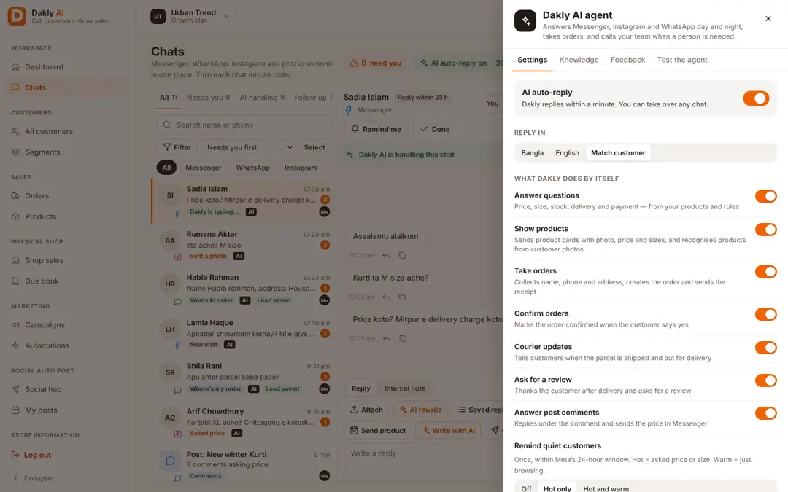

**AI agent: Knowledge tab**

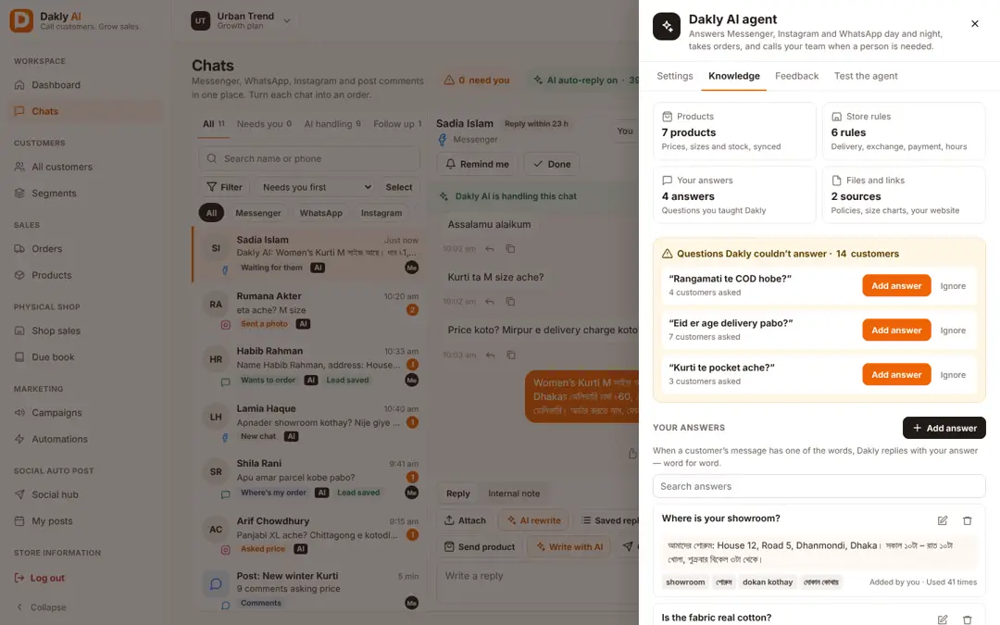

**AI agent: Feedback tab**

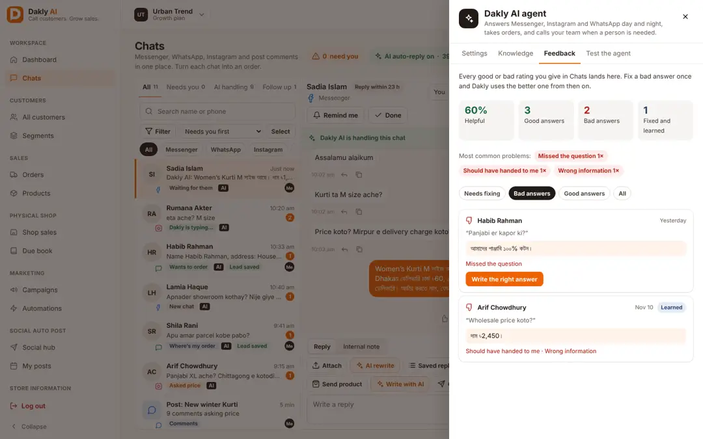

**AI agent: Test the agent**

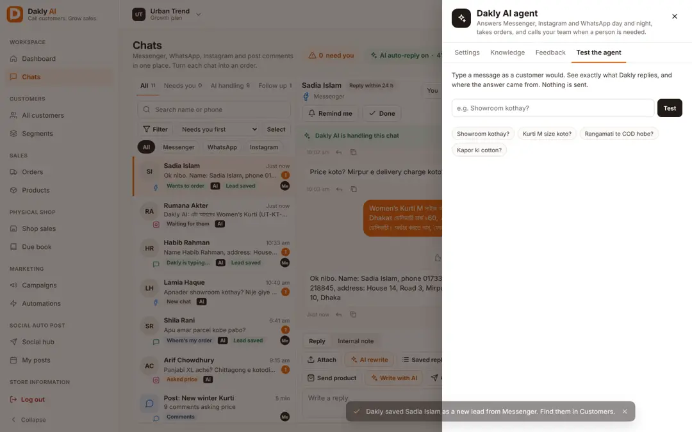

**AI handling tab**

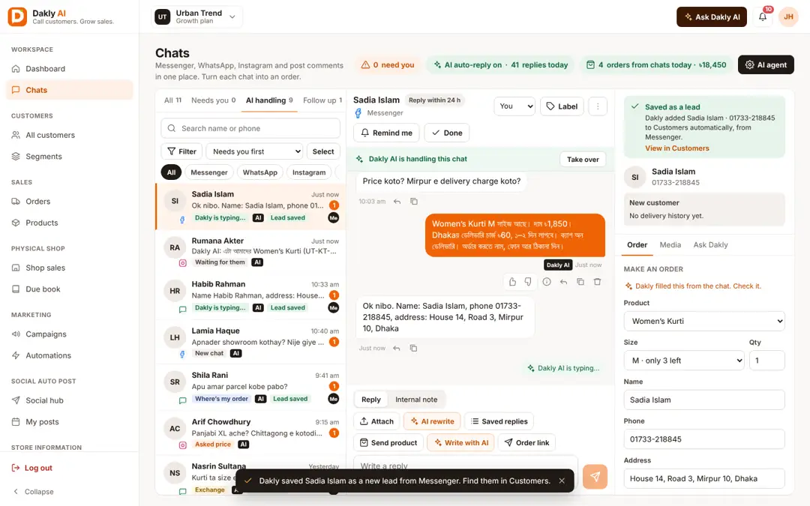

**Follow up tab**

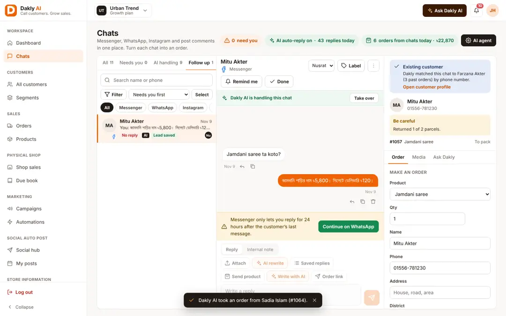

**Filter**

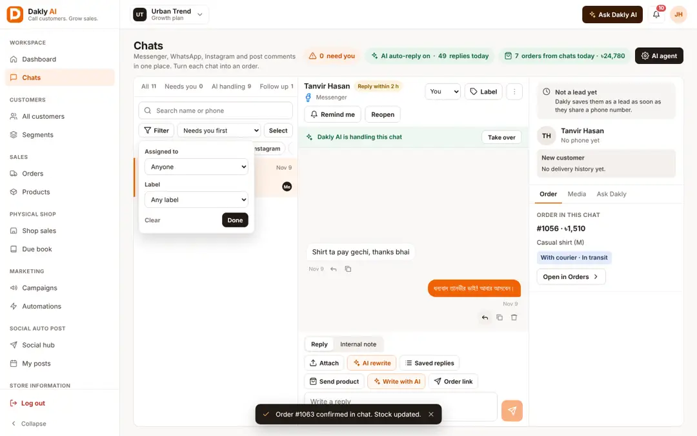

**Take over from the AI**

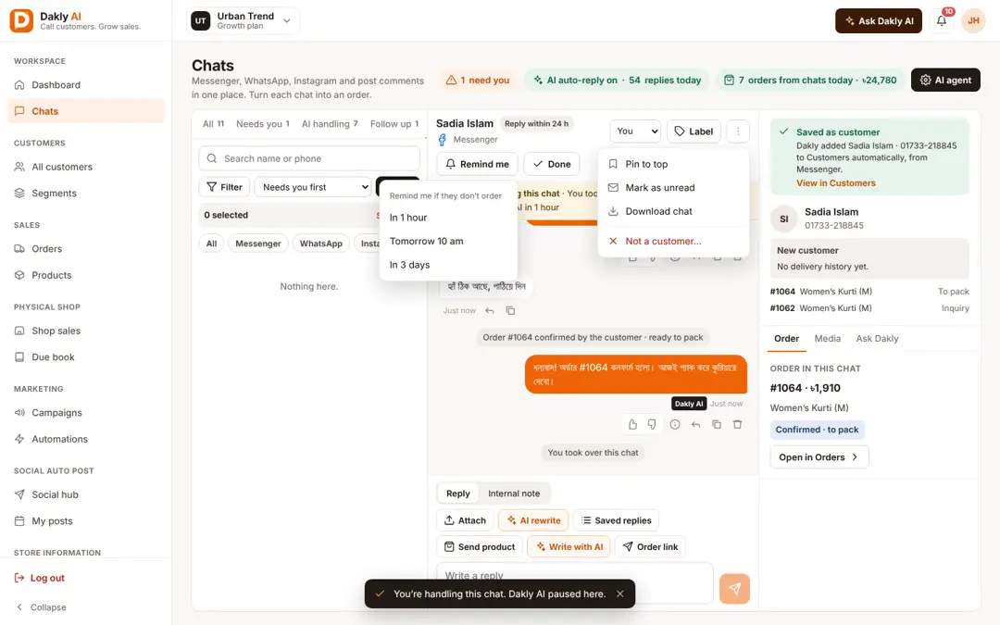

**Internal note**

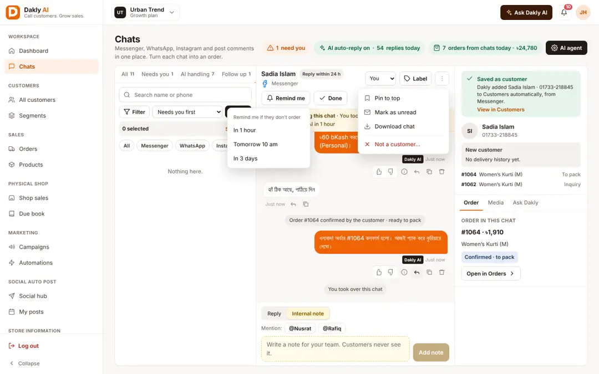

**Ask Dakly about this chat**

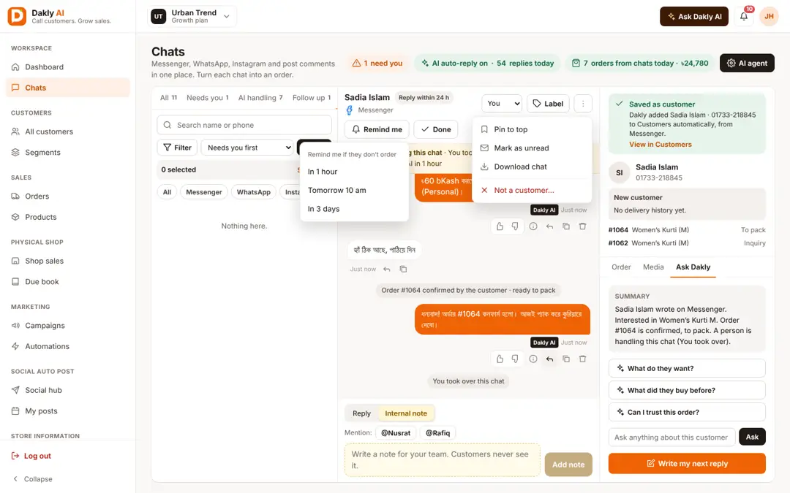

**Create order from the chat**

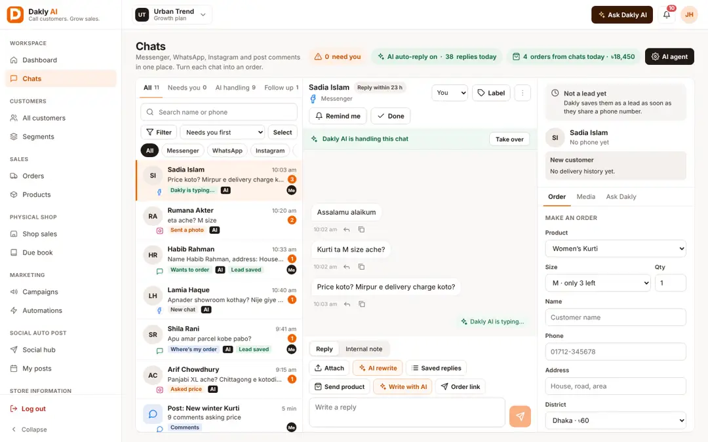

**Send product**

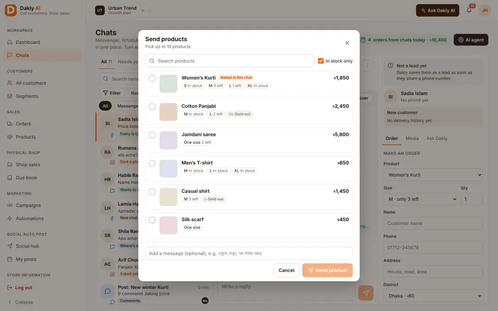

**Saved replies**

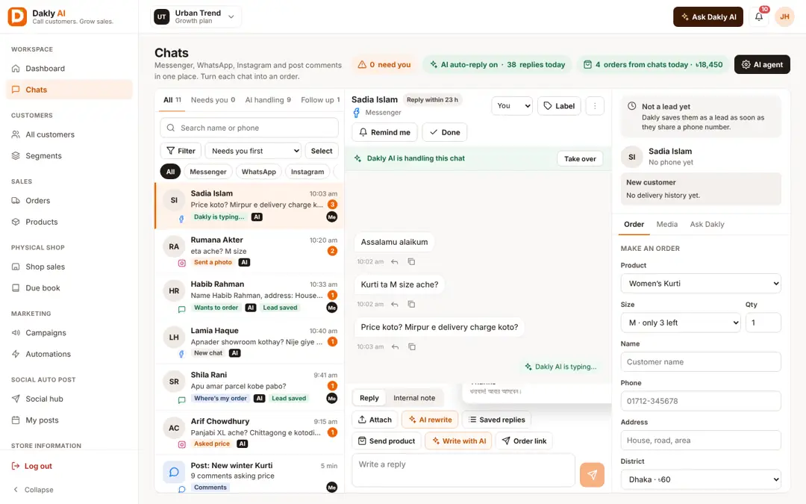

## Where the prototype is wrong or missing

The prototype is a concept with sample data. Build from this doc, not from the prototype, where they differ.

### Missing design: inbox and approvals queue

**Why it's needed.** The design assumes an Inbox in three places: an "Inbox" permission in every role, a "Support agent" role that "replies to customers in Inbox", and a notification "3 customers are waiting for a reply · Reply now". When a campaign goes out on WhatsApp, customers reply ("price koto?"), and today those replies have nowhere to land. The Dashboard also shows a winback that "Needs your OK", with no place that lists everything waiting for approval.

**Decision first.** Either build a shared inbox, or remove Inbox from roles and notifications and say that replies go to the WhatsApp Business app. A shared inbox is a large module, close to a product of its own.

**If the Inbox is in scope, design:**

- **Conversation list**: one row per customer across WhatsApp, Messenger, Instagram DM and SMS replies, with channel icon, last message, time, unread badge, assigned agent; filters Unassigned, Mine, Waiting, Closed.
- **Conversation view**: message thread, customer card on the side (spend, last order, tags, segments, consent), quick replies, AI-suggested reply in Bangla or English, attach product or photo, assign, close.
- **WhatsApp 24-hour rule**: after 24 hours without a customer message, only approved templates can be sent. Show a clear banner and a template picker.
- **Notifications**: new message alerts, and an "unanswered for 1 hour" reminder.

**Approvals queue (needed either way).** A To-do list, either a tab in Notifications or its own page, that shows every item waiting for the owner: campaigns that need an OK, AI-drafted automations, posts flagged "Needs attention", and Marketer drafts waiting for Owner approval. Each item gets Review, Approve and Reject with a note. Decide whether Marketers can send without approval.

## Engineering

### Screens in release 1

Three columns: chat list with tabs (All, Needs you, AI handling, Follow up) and channel filters; the conversation with Reply and Internal note; a side panel with the customer card and a Make an order form. The header shows "need you", AI replies today and orders from chats today (glossary numbers). The AI agent settings, knowledge and test screens open from "AI agent".

### How it works

Conversation state is three separate fields:

| Field       | Values                               | Set by                                                                                                     |
| ----------- | ------------------------------------ | ---------------------------------------------------------------------------------------------------------- |
| `status`    | `open`, `needs_you`, `later`, `done` | Hand-over sets `needs_you`; staff set `later` and `done`; a new customer message reopens                   |
| `responder` | `ai`, `human`, `paused`              | Take over or any staff reply sets `human`; the return timer or Hand back sets `ai`; Pause AI sets `paused` |
| `assignee`  | a member or none                     | Staff, or round robin among online members                                                                 |

Inbound

1. `MessagingService.receiveInboundMessage` uses the Page-scoped identity to find or create a contact and conversation. It saves each message once per connection and external message id. A newer inbound message moves the window to 24 hours from its sent time. A delayed message cannot shorten the window. The service emits `message.received`, plus `conversation.started` for a new conversation. This runs with the Chats extension off.
   A message may carry text, attachments or both; an attachment-only message previews as Photo, Voice message, Video or File. Each attachment is saved on the message as `pending` with Meta's link, and `message.attachments_requested` is published in the same transaction. `CopyMessageAttachmentsJob` on `inbound` downloads each one with the connection's token outside any transaction and writes it to file storage at `stores/<storeId>/messages/<messageId>/<index>`. The attachment becomes `stored` (key, type, size) or `failed` with a reason: `expired`, `too_large`, `type_not_allowed`, `unavailable`, `rejected` or `connection_unavailable`. A Meta outage is retried by the queue, and the last attempt records `unavailable`. An expired link is not retried. Limits follow the platforms' own: Instagram accepts images up to 8 MB and video up to 25 MB, Messenger files up to 25 MB, and WhatsApp audio up to 16 MB. Dakly uses images 8 MB (JPEG, PNG, GIF, WebP), voice notes 16 MB, video 25 MB and files 25 MB (PDF, Word, Excel, plain text). WhatsApp documents can be up to 100 MB, so when CHN-3 adds WhatsApp media, a file over 25 MB must show in the inbox as a "File too large, open in the app" row, never a silent drop. A 403 from Meta's media host counts as an expired link only when the link's own expiry (`oe`) has passed; otherwise it is a fetch failure that the queue retries and then records as `unavailable`. Shares, reels, story mentions and locations are not saved. Messenger and Instagram only; WhatsApp media comes with CHN-3.
2. Once a copy is stored, the same job reads it. A voice note goes to the transcription model (`AI_TRANSCRIBE_MODEL`, an `ai_runs` row with tier `transcribe`) with a hint that the speech is Bangla, Banglish or English, so Bangla stays in Bangla script and English words stay as spoken. A photo goes to the `vision` tier, which returns a plain English description, up to 12 search words written in English and Bangla (such as `saree, শাড়ি, red, লাল`), whether it shows a product or a payment screenshot, and any printed text such as a transaction id. Both are saved on the message in `media_text` as `Voice note: …`, or `Photo: …` (`Payment screenshot: …` when the photo shows a payment screen), `Search words: …`, `Text in photo: …`, so staff and the AI read the same text, and product search (AI-11) matches on the search words. The attachment is marked `read: 'done'` or `'failed'`; a retry never adds the text twice. A model outage is retried by the queue and the last attempt marks it `failed`. Photos and voice notes only: video and files are not read. Each photo or voice note read uses one unit of the Chats AI allowance (`ai_conversation`), charged after the model returns, with the reference `media:<messageId>:<index>` so a retry is free. With no allowance left the file is not read and is marked `failed` without a model call, since auto-reply is paused too. A failed model call is not charged.
   The reply job holds back while a photo or voice note from this burst is still unread, checking again every 3 seconds for at most 3 minutes after it arrived, then answers with what it has. The classifier and the sales agent see `media_text` after the message text.
3. The AI listener schedules an `ai-reply` job keyed by conversation id with the store's debounce (default 8 s). Each new message resets it, so one reply answers a burst.

Inbound messages keep the exact sender identity in the same store. A reply can address the account that sent the message even when one contact has several identities.

AI reply pipeline (`AiAgentService.reply`)

1. Gates, no model call: AI switched on, contact is not Not a customer, responder is `ai`, window open, allowance left.
2. Classify with the fast tier: intent, language, sentiment, asks for a person, hand-over category.
3. Hand-over rules in code on that output plus keyword lists (refund, damaged, fake, ফেরত). A match sends the holding reply and stops. Hand-over always wins.
4. Build context: platform rules, store settings, delivery zones (stable, first, so the prompt cache hits), then the customer card, the customer memory (CHAT-R11), a summary plus the last 20 messages, and product candidates.
5. Agent call with tools, at most 4 rounds and 20 seconds.
6. Check the draft in code: every ৳ amount and stock number must appear in this run's tool results; no phone but the shop's; no link but Dakly's; under 600 characters. A failed check hands over instead of sending.
7. Send through the outbox, save the AI run id and sources on the message, consume one AI conversation unit.

AI-4 runs the first three steps for Messenger and Instagram. Each delayed job reads the current chat, checks consent and classifies the new messages from the latest sender. Internal notes stay outside the model input. If hand-over is needed, Dakly saves the reason, queues a fixed holding reply to that sender and notifies the assignee or Owner. A normal classification ends the job. AI-5 adds generated replies and the rest of the pipeline.

AI-5 part 2 adds steps 4 to 7 for Messenger and Instagram. `SalesAgentService` builds the context (shop name, phone and district first, then the last 20 messages of the chat without internal notes, then product candidates from a search on the customer's own words) and runs at most four model rounds in 20 seconds. After each round it runs the requested tools and appends their results to the next input in a labelled block. A `hand_over` call, a failed call, an exhausted loop or a failed fact check hands over; the fact check hands over as out of scope. Delivery zones reach the model only through `get_delivery_charge`, so every charge it quotes is a tool result. `send_product_card` cards go out before the reply. The reply and cards are saved as AI messages with the AI run id, and the reply keeps the tools it used as sources. One AI conversation unit is consumed for the first AI reply to a contact in a 24-hour span, and later replies in that span use the same reference. A span that holds a unit finishes even when the allowance is used up. A retried job that finds its reply already saved sends nothing more.

The model call runs outside the transaction. Before a hand-over, the service checks the responder, conversation version, latest inbound message and current send eligibility again. The hand-over, queued holding reply and notification are saved together. Holding replies are free.

AI-5 part 3 adds `draft_order` and `confirm_order`. `draft_order` takes variant ids with quantities, the recipient name, the customer's own mobile number, the address and an area name. The area must match one place exactly or be the only match, otherwise the tool answers `DELIVERY_AREA_INVALID` and the model asks the customer. The customer's own phone goes through `ContactMatchSuggestionsService.captureOwnPhone` first, with the conversation as the source, so a number held by another contact shows staff a possible match and never blocks the order. `ChatOrdersService.draft` then creates the order in To confirm with the chat's contact as buyer and recipient, the channel as its source and the creator type `ai`. Prices, the delivery charge and the total come from the order service, and the tool result gives them in taka for the summary. The same chat with the same details returns the order already made. An order for another person is a hand-over. `confirm_order` moves the customer's own order from To confirm to To pack with the confirmation method `chat_reply`. When the delivery phone has a high return risk it answers `ORDER_ADVANCE_REQUIRED` and the model hands over, because a person records the advance first. A practice question has no chat, so both tools answer with an error there. The reply never repeats the customer's own number, because the fact check allows only the shop's.

AI-10 product search (`ProductSearchService`, used by `search_products`): the customer's words are reduced to consonant keys, so "kurti", "kurtii" and "কুর্তি" match, plus a small table of colour and garment words in Bangla, Banglish and English, and a one-edit typo allowance. Price words ("১৩০০ টাকার নিচে", "under 1500", "500 er moddhe") filter by size price. Embedding rank is fused with the word rank; a product both find wins, and one the meaning finds alone must be within a set distance. If the AI call fails, spelling alone answers. Products with stock come before sold-out ones, and each result carries stock per size. The embedding is rebuilt from name, aliases, category, options and description by a job on `product.updated`. The gate is the eval set in `packages/core/src/product-search/product-search-eval-set.ts` (Bangla, Banglish, English and mixed queries, 95 percent first-result rate and no result for products the shop does not sell). AI-11 and AI-12 call the same service.

Agent tools take no store id, contact id or price; those come from the job. Tools: `search_products`, `get_product`, `get_delivery_charge`, `search_knowledge`, `get_my_orders`, `get_order_status`, `draft_order`, `confirm_order`, `create_payment_link`, `send_product_card`, `add_to_restock_list`, `hand_over`.

Each tool is described for the model in `packages/contracts/src/ai-agent-tools.ts` with the words customers use in Bangla, Banglish and English, the unit of every number and the allowed values. Tool results give money in taka, converted from poisha, and stock as a count (null when the shop does not count stock). Product tools return only active products shown in chats. `get_my_orders` and `get_order_status` read only orders whose buyer is the chat's own contact; an order number that belongs to someone else is answered as not found, and no tool looks an order up by phone. `get_delivery_charge` returns up to three areas that start with the typed name. Only when none match, it returns the shop's delivery zones instead, because the area table stops at upazilas and a Dhaka locality has no match of its own. The reply names the place the charge is for. `send_product_card` returns the card text built in code from the product. `hand_over` takes only the reasons the model may choose.

`MessagingService.queueChannelMessage` queues Messenger and Instagram replies and transactional messages. One operation key in a store creates one message and one `message.send_requested` event in the same transaction. The outbox relay queues `SendMessageJob`. The worker checks the selected identity and rereads the deadline after taking the contact lock. Inbox replies require the Chats extension. Only a reply written by a person can use the Human Agent tag in the seven-day window. Marketing sends need the campaign sender's scheduling and frequency accounting.

The worker saves a pending attempt before calling Meta outside the transaction. Acceptance records the provider ID and emits `message.sent`. A known rejection records a failure and emits `message.failed`. An uncertain attempt stays queued with `send_unconfirmed` for reconciliation. A signed Messenger echo from the configured Meta app can confirm an attempt when it matches the stored message ID and recipient. The worker never resends an unconfirmed attempt.

Signed Messenger delivery and read receipts and Instagram seen receipts apply to the matching recipient in the connected shop. A late delivery records its first delivery timestamp and leaves a read message in the read state. If a receipt reaches an attempt before the send result is saved, the webhook job retries within its existing attempt limit. A receipt with a Meta message ID matches the exact send. A Messenger watermark applies through the confirmed send time, using the signed echo timestamp when the echo confirmed the send.

The outbound message schema keeps the chosen recipient identity and the category used by the send gate. The identity belongs to the same store as the message. The Meta transport uses the selected connection's encrypted credentials and checks that the credential is still current before marking a rejected connection for reconnection.

Hand-over: sets `needs_you` and `human`, records the reason (asked for a person, complaint, refund, discount, angry, out of scope, ready to buy, other), sends the holding reply once, notifies the assignee or Owner. Unclaimed after the claim timer (default 10 minutes, any hour until working hours exist), the chat goes back to the AI. The claim timer and the return timer are `claim_timeout_minutes` and `return_to_ai_minutes` in `ai_agent_settings`; null switches each off. A hand-over sets the conversation's `ai_resumes_at` to the claim timer, and a person who takes over replaces it with their own choice, so a claimed chat stays with people. A person's reply puts the chat with people and moves `ai_resumes_at` to the return timer (default 30 minutes), unless the person took over until they hand back or a longer take-over timer is running. The existing minute sweep returns due chats. A reply that fails the fact check records `failed_check` and the failure kind (`amount`, `stock`, `phone`, `link`, `too_long`, `empty`) on its AI run; a saved reply records `sent`.

Practice mode: each new channel starts with AI not live (`channel_connections.is_ai_live`). A customer chat gets an AI reply, or an AI hand-over holding reply, only when the store's auto-reply switch is on and either the channel is live or the customer's contact is on the store's tester list (`ai_agent_settings.testers`, contact ids). The tester list is saved with `PUT /ai-agent/testers` (up to 20 contacts of this store, audited as `ai_agent.testers_changed`). Nothing is drafted for staff to approve. A channel connected after the shop went live starts in practice and needs its own Go live.

Test questions are `{question, expectedAnswer}` pairs saved on the store (`PUT /ai-agent/test-questions`, up to 5). `POST /ai-agent/test` answers one question the way the live agent would, with the same classification, hand-over rules, tools and fact check, without a conversation. It saves no message, queues nothing and uses no AI conversation unit. The order tools find nothing because the question has no contact.

`POST /ai-agent/channel-connections/:id/go-live` refuses, with the code of the first failed check, until the channel is active, Knowledge has an active item, a product is shown in chats, hand-over rules are saved and there are at least 3 test questions. It then runs every test question one after another. A question passes when the agent gives a reply and not a hand-over, the reply passes the fact check, and a fast-tier grader call (run purpose `grade_test`) says it agrees with the expected answer in meaning. The grader judges meaning because Bangla, Banglish and English write prices and places in many forms. If any question fails, the response is `GO_LIVE_TESTS_FAILED` with the failed positions and the channel stays in practice. When all pass, the channel goes live and an audit entry `channel_connection.ai_went_live` records the user.

AI agent settings: `GET /ai-agent/settings` and `PUT /ai-agent/settings` (`storeSettings.view` and `storeSettings.edit`) read and save the auto-reply switch, reply language, the ability switches, the three hand-over rules, the return-to-AI timer (1 hour, 24 hours or until a person hands back) and extra rules. A shop that never saved gets the defaults with `version` 0 and `handoverRulesSaved` false. A save carries the version the person loaded and is refused with `AI_AGENT_SETTINGS_CHANGED` when it is stale. Each save writes an `ai_rule_changes` row with the old and new values and an `ai_agent.settings_changed` audit entry that lists only the field names.

Rating an AI reply: `PUT /ai-replies/:messageId/rating` (Chats edit) saves `good`, or `bad` with one reason (`wrong_information`, `wrong_price_or_stock`, `too_long`, `not_our_tone`, `missed_the_question`, `should_have_handed_over`) on the AI message (`messages.ai_rating`, `ai_rating_reason`, `rated_by_user_id`, `rated_at`). Only the rating and the reason are saved; the reply and the customer's words stay in the chat. Rating again replaces the earlier rating, and each rating is audited as `ai_reply.rated` with the state. `GET /ai-replies/feedback?filter=needs_fixing|bad|good|all` (Chats view) returns the summary (helpful percent, good, bad and fixed counts, common problems) and the newest 50 rated replies with the customer's name, the customer's last message before the reply, the reply text and when it was fixed. `POST /ai-replies/:messageId/fix` (Chats edit) takes the customer's question, the right answer and optional keywords for a reply rated bad, saves them as a taught answer through the Knowledge feature, sets `messages.ai_fixed_at` and audits `ai_reply.fixed`; the answer is indexed like any taught answer, so Bangla, Bangla in English letters and mixed text are kept as typed. A reply that is not rated bad or is already fixed answers 409, so one reply teaches one answer. The thumbs buttons in a conversation belong to the Chats screen (CHAT-5).

The AI agent drawer opens from the AI agent button on Chats (`/chats?agent=settings`; the tab is in the URL). The Settings tab edits the fields above with one Save changes button. A stale save shows the error and a Load latest settings button. Under the settings the Go live panel shows the checks the screen can know (hand-over rules saved, 3 test questions saved), the test questions editor (3 to 5 pairs, saved with `PUT /ai-agent/test-questions`), and each chat channel with a Practice or Live badge (`isAiLive` on `GET /channel-connections`) and a Go live button for active channels in practice. Go live is one long request, so the button turns into a progress line ("Dakly is answering your test questions. This can take a minute"), the web proxy waits up to 180 seconds (`experimental.proxyTimeout`), a `GO_LIVE_TESTS_FAILED` answer marks the failed questions, and a cut-off request shows Check again, which reloads the channels instead of sending a second Go live.

The Knowledge tab (`?agent=knowledge`) lists answers and files from `GET /knowledge-items`. Four cards count what Dakly reads: Products (active products shown in chats) and Store rules (each delivery zone, plus one when the shop has saved extra rules) come from `GET /ai-agent/knowledge-summary`; Your answers and Files and links are counted from the list, where a source is a file or a website link. Add answer opens a dialog, "Teach Dakly an answer", with When a customer asks, Dakly replies and Also use it for these words (comma separated, up to 10). It saves a policy item (`POST /knowledge-items`); the dialog asks for both the question and the reply, though the API accepts a reply alone for older items. Each answer card shows the question, the reply, up to four keywords and "Added by you · Used N times" (or "Not used yet"), with Edit (`PATCH`) and a confirmed Delete. The search box filters answers by question, reply and keywords in the browser. Files upload as PDF or text up to 10 MB through a presigned URL (`POST /knowledge-items/uploads` with the file name, a `PUT` to the returned URL, then `POST /knowledge-items` with `kind: file`). The Files and links list shows the file name or the link, and the tab looks again every 4 seconds while any item is Reading, then shows Learned N facts or the reason it failed.

The question and keywords are indexed with the reply, so a customer's wording finds the answer. Times used counts each Knowledge lookup the agent makes in a real chat, once for every item the lookup returned; a practice question or a test does not count. The file name is saved on the file row at upload time and returned as `fileName`.

Differences from the design image, because the API has nothing behind them: adding a website link (reading a page needs a page fetcher that refuses private addresses, which is not built, so a link item shows only if one exists), Polish with AI in the dialog, picking keywords from the question when the field is empty, and the Questions Dakly couldn't answer list (that comes with the Feedback part of AI-8). Store rules counts what the shop has saved in Dakly; exchange days, payment number and opening hours are not separate settings yet, so the card says "Delivery charges and your extra rules" where the design says "Delivery, exchange, payment, hours".

The Test the agent tab (`?agent=test`) has a message box and four example questions. Test and each example call `POST /ai-agent/test`, which can take several seconds, so the tab shows "Dakly is working on a reply…" until it answers. The result is a small chat: the customer's message on the left, Dakly's reply on the right, and a line under it saying where the answer came from: "Answered from your answer: “question”", "Answered from <file name>", "Answered from Products and stock", "Answered from Store rules" or "General reply". The reply carries `source` for this: an answer or file found by the Knowledge lookup wins over a product found by search, and a product wins over a delivery charge lookup. A hand-over shows "(Dakly stops and calls your team: reason)" with "Hand-off rule" under it, or, when nothing in Knowledge answers, "Dakly doesn’t know this yet, so it calls your team." in red. Only people who can edit store settings can test, so others see a note instead of the box. The design's "Not right? Change the answer" and "Teach Dakly the answer" buttons are not built.

The Feedback tab (`?agent=feedback`, filter in `&feedback=needs_fixing|bad|good|all`, Bad answers by default) reads `GET /ai-replies/feedback`. It shows the helpful percent with the good and bad counts, the most common problems as chips, a filter, and one card per rated reply: the customer's name, what the customer last wrote, Dakly's reply and the reason. The "Fixed and learned" count, the Needs fixing filter and the Learned badge show what the team already fixed. "Write the right answer" opens a form with the customer's words and Dakly's reply filled in; saving teaches the answer, and the answer appears in the Knowledge tab. People who cannot edit Chats do not see the button. The thumbs buttons that create ratings belong to the conversation screen (CHAT-5), so until it lands the tab only shows ratings made through the API.

Waits on other tasks: the remaining screens (AI-8), the batch test on the last 50 real chats (not in the rules) and re-running the tests after a knowledge change (AI-7).

Comments: classified as question, positive, negative or spam. If "Answer post comments" is on, the AI posts a short public reply and one private reply with price. Spam is hidden; negative goes to Needs you. Nothing with a price, phone or address is posted publicly.

### Model driver

The OpenAI driver sends one Responses API request per call with `store: false`.
It sends a strict JSON Schema from the caller's Zod schema. Use nullable fields
when a value can be missing. The driver returns the output or the model's tool
calls, along with input, cached input and output token counts. The caller runs
the tools after checking their arguments. The timeout and caller cancellation
both end the request.

Local development can select `LLM_DRIVER=fake` and supply scripted responses.
Production rejects the fake driver. Selecting `LLM_DRIVER=openai` requires
`OPENAI_API_KEY`. Tests use saved Responses API fixtures and make no network calls.

### Golden-set eval

`GoldenEvalService` runs golden cases through a responder and scores them: any amount in a reply that the case does not allow is a wrong price (must be 0), and a case that expects a hand-over must be handed over with the same reason (at least 90%). Unneeded hand-overs are reported but do not fail the run.
The live responder asks the real practice pipeline of the shop in `AI_EVAL_STORE_ID`, which holds the catalog the cases assume. The nightly `run-golden-eval` job (20:00 UTC) calls `GoldenEvalService.runNightly()`. When the thresholds are missed it logs the report and sends a Slack staff notice, and it returns normally, because a thrown job is retried and would run the whole eval again. Only real errors throw. It does nothing when the variable is unset.
CI replays saved outcomes and makes no network call. The starter set is in `ai-eval/golden-set.sample.ts`; the 200 beta chats replace it at M7.

The Bangla and Banglish set is in `ai-eval/golden-set.bangla.ts`: product search ("kurti" must find "কুর্তি"), photo match, out-of-stock replies and Banglish hand-overs. Its header lists the exact catalog the eval shop must hold. A case may carry `mentionsAnyOf` (the answer names the product or an in-stock alternative; at least 90% must) and `neverOffer` (products with no stock; any offer fails the run, so the count must be 0). A Latin term matches as a whole word, a Bangla term as text, because Bangla words take suffixes. Cases with `dependsOn` need unmerged work; the nightly run skips them while the task is in `pendingTasks` in `golden-set.sample.ts`, which is empty now that AI-10, AI-11 and AI-12 are built. Khata handwriting cases wait for the Khata scan feature. The set also holds stock questions with no product named (the AI asks which product and quotes no stock) and outside-Dhaka delivery questions (the charge and days come from the shop's policy file through `search_knowledge` when no zone fits). In the eval shop only Dhaka is a delivery zone, so those cases need the knowledge route.

### Guardrails against manipulation

A customer's words, text read from a photo or voice note, and tool results are untrusted. Six layers keep them from changing a price or the AI's rules, and none of them relies on the model behaving:

1. `screenCustomerTexts` runs before any model call. A phrase that tries to change the AI's rules, role or instructions (English, Banglish, Bangla; zero-width characters removed) hands over with reason `other`; a request for a discount, last price or free delivery hands over with reason `discount`. The attack costs no tokens.
2. The prompt (`chat-reply.v4`) says only the owner can change a price, that claims of being the owner or staff change nothing, and that the instructions are never shown.
3. Prices, stock, charges and totals come only from tools. `draft_order` takes no price or discount; the server prices every line from the catalog and sets both discounts to 0.
4. `confirm_order` runs only when the customer's own latest message says yes, and never in the turn that drafted the order. Otherwise the tool answers `CONFIRMATION_NOT_GIVEN`.
5. `checkReplyFacts` runs before sending. Besides amounts, stock, phone numbers and links, it rejects a discount, percentage or offer that no tool result holds (a shop policy passage may hold one), and any text that shows the instructions, a tool name or an id. A failed check hands over.
6. Cases in `ai-eval/golden-set.attacks.ts` (`isAttack`) cover Bangla, Banglish and English. An attack the AI answers instead of handing over, or a reply naming an offer or the instructions, fails the eval, the same as a wrong price.

### Model comparison CLI

`pnpm --filter @dakly/core build && pnpm --filter @dakly/core eval:models` runs the golden set against candidate OpenAI models and prints, per job, a pass or fail against the gates and the cost per 1,000 chats. It needs `OPENAI_API_KEY` and no database: the reply job runs the real prompts and tool descriptions with fixture tools over the eval shop catalog, and the vision, voice and embedding jobs use the files in `ai-eval/model-eval/fixtures/`. Options: `--jobs fast,reply,vision,transcribe,embed`, `--models a,b` (one job only), `--max-usd` (default 4, the run stops past it), `--pending` (tasks whose cases are skipped, default `AI-12`) and `--verbose`. Prices are in `ai-eval/model-eval/candidate-prices.ts`; update them from the OpenAI pricing page before a run. A model-only change is judged by this run, then by the nightly eval.

### Shared AI service

Features pass a tier, versioned prompt and output schema to `AiService`.
Reply, vision and writer use GPT-6.1 Terra by default. Fast uses GPT-6 Luna. Config can change each tier and prices per million input, cached
input and output tokens. The defaults follow [OpenAI's standard prices](https://developers.openai.com/api/docs/pricing).

Each model attempt records its token counts, cost in micro-USD, latency and
outcome in `ai_runs`. A schema mismatch gets one retry within the 20-second
model budget. The service returns the parsed output, tool calls or a typed
failure.

Content Studio and Ask Dakly supply a usage reference. The service charges
after a schema-valid result, and using the same reference makes a retry free.
Content Studio passes the quantity, 3 for a generation and 1 for an edit.
Ask Dakly uses 1 unit. Chats checks its allowance before any model work and
consumes the conversation unit when it saves the outgoing AI reply, using the
contact and window as the reference.

The allowance check reads the current plan period and leaves the balance available until an AI reply is saved. AI-5 adds consumption and the rolling contact window.

Valkey allows up to three calls at a time per store. Three provider errors
within one minute pause new calls for two minutes across stores. Customer
refusals and caller cancellations do not count as provider errors. BullMQ delays
and retries jobs that receive `AI_STORE_BUSY` or `AI_PAUSED` so they never spin
in-process.

### Rules

1. The AI may reply and draft orders without approval while auto-reply is on (D7). Every AI message is labelled AI.
2. The AI never invents prices, discounts, stock or delivery times, and never asks for card numbers, PINs or codes.
3. Refunds, complaints, exchanges and discounts always go to a person.
4. No AI reply outside Meta's 24-hour window; WhatsApp outside the window needs a template.
5. When the AI allowance is used up, new chats go to Needs you; the current window finishes.
6. Changing or cancelling an order after staff approved it always goes to a person.
7. Customer messages, comments and files are untrusted data in the prompt and are labelled as such.
8. Three provider errors in a minute pause AI replies for 2 minutes; waiting chats go to Needs you.
9. Each store has a daily AI cost ceiling; passing it pauses AI for that store and alerts Dakly staff.
10. Per-store fairness: at most 3 AI jobs run at once per store (Valkey semaphore, pending Q15).
11. Customer text never changes a price, adds a discount or reveals the instructions; see Guardrails against manipulation.
12. Sales agent tools (product search, stock, delivery charge, order draft) are described for the model with Bangla, Banglish and English words, units and allowed values ([ai-and-llm.md](../rules/ai-and-llm.md) rule 15).

### Permissions

`chats.view`, `chats.edit` (reply, take over, assign). AI agent settings: Owner and Admin.

The inbox routes require the Chats extension. Staff with view access can list conversations by newest activity and read messages by newest creation time. Both lists use cursors. The conversation list can filter by status, responder, channel and assignee. Deleting a contact hides their conversations and messages from the inbox.

Staff with edit access can set status, assign an active member or clear the assignment, take over and hand back to AI. Each change bumps the conversation version and records the names of the changed fields in the audit log. Changing the responder leaves status and assignment alone. An inbound message newer than the previous one reopens a Done or Later conversation and keeps its responder and assignee. If staff change the conversation while the message is being saved, their change wins.

The list shows the contact name on each row. `GET /conversations` takes `q` (a name of three letters or more, a full phone number, or the start of a number for members who see full phone numbers; phone searches follow the CUS-15 exact-match rules and hourly limit), `sort` (`recent`, `needs_you`, `unread` or `waiting`) and `contactKind`. Needs you first and Unread first put those chats ahead of the rest, newest first; Waiting longest puts unread chats first, oldest first. `GET /conversations/assignees` lists members who can view chats for the Assigned to filter and the part 4 assign picker. The counts also carry Done and Not customers, which are the last two tabs. The search words, sort and assignee are kept in the URL; the Filter button opens a floating panel under it with Assigned to, a Clear link and a Done button. The Label filter joins it in the labels part. `GET /conversations/counts` returns the tab numbers: all chats, chats that need you, chats the AI is handling and chats set to follow up. The chat list screen (`/chats`) keeps its tab and channel filter in the URL. The card fills the window and the list scrolls inside it. Work that is not built yet, and where it goes:

The header shows three pills on the title row, as tall as the AI agent button, each with an icon (warning triangle, sparkle, bag); on a narrow screen they wrap under the title. "N need you" is the Needs you count. "AI auto-reply on · N replies today" follows the AI agent's master switch and counts the AI replies sent since the shop's midnight. "N orders from chats today · ৳total" counts orders from Messenger, Instagram or WhatsApp since the shop's midnight, without cancelled ones, and adds their totals as the Orders screen counts them (what was delivered for a partly delivered order); it shows only to members who can view orders. `GET /conversations/summary` (View Chats) returns the two numbers; a pill that cannot load is left out. The Select button (Edit Chats) turns the rows into tick boxes and shows "N selected" with Mark done and Assign, which send one `PATCH /conversations/:id` per chat; if some fail, those chats stay selected and the bar says how many. Label in the bulk bar arrives with the labels PR.

- Labels (VIP and the Label button): this doc names Label in the screens and in Edit Chats permission but gives no data model, so labels need an owner decision before a CHAT-5 part 5.
- Intent tags, "Lead saved" and "Dakly is typing": AI-5 shows them from the AI pipeline.

Comments on the shop's Facebook Page posts and Instagram media arrive through the Meta webhook as `feed` and `comments` changes and are stored in `social_comments`, once per comment. Comments made before the Page connected, and the shop's own comments, are ignored. `GET /comments` lists them newest first with cursors and filters by status, classification and post. Staff with edit access can reply publicly (`POST /comments/:id/reply`, once per comment), reply privately (`POST /comments/:id/private-reply`), and hide or unhide (`POST /comments/:id/hide` and `/unhide`). Every action goes to Meta first and the comment changes only after Meta accepts it. Meta allows one private reply per comment, within 7 days of the comment: the first request claims it, a refusal gives it back, and an outage keeps it claimed because the reply may have gone out. A private reply to a comment whose author is already a contact goes through the send policy as a staff reply. Hiding a hidden comment does nothing and does not call Meta. Replies are recorded in the audit log. The AI classification and the AI's own comment replies are not built yet (they need a task of their own).

The Comments channel chip on `/chats` (`channel=comments`, with `post` for the open post) replaces the chat list with the posts that have comments, newest first, each showing its caption, how many comments it has and how many still wait for an answer. Opening a post shows its comments oldest first. Each comment has Reply, Send price by Messenger or DM, and Hide comment or Show comment. Reply and Send price open a small form under the comment. Send price is off once the private reply was used or Meta's 7 days passed. On a phone the post list and the post open one at a time. Post thumbnails and grouping by intent wait for the AI classification. The design is the prototype's comments view; there is no screenshot of it.

The chat thread opens beside the list (`chat` in the URL; on a phone it replaces the list, with a back arrow). It shows messages oldest first, loaded 50 at a time with Show earlier messages, and marks the chat read through `POST /conversations/:id/read`, which sets the unread count to 0 without a new version. `POST /conversations/:id/replies` (Edit Chats) takes `body` and a per-press `operationKey` and queues a Messenger or Instagram reply as a staff reply through `queueChannelMessage`, so the same key never sends twice. It refuses a closed window (`CONVERSATION_REPLY_BLOCKED`) and WhatsApp (`CONVERSATION_REPLY_UNSUPPORTED`). The reply window pill reads "Reply within N h" for 24 hours after the customer's last message; after that staff can still reply for 7 days through Meta's Human Agent tag, and the composer says so; after 7 days the box is off. The composer has Reply and Internal note, and a Saved replies picker that fills the box when a person chooses one (D43). The notification event stream refreshes the inbox when it delivers a notification; there is no polling. Messages show as white bordered bubbles with the theme's largest radius from the customer and orange bubbles from the shop, each with its time and a Copy icon; the design's per-message Reply icon is not built because the send path has no reply-to. The header has an Assigned to picker (You, the team, Nobody) through `PATCH /conversations/:id`, and Remind me, Done and Reopen, which set the chat to `later`, `done` or `open`; they show only to people with Edit Chats. Remind me has no timer yet, so the design's 1 hour, tomorrow and 3 days choices are not built, and a chat set to later waits in Follow up until someone reopens it or the customer writes. A banner under the header says "Dakly AI is handling this chat" with Take over (`POST /conversations/:id/take-over`, until staff hand back), or "Your team is handling this chat" with Hand back to Dakly AI (`POST /conversations/:id/return-to-ai`). Each shows a toast: "You're handling this chat. Dakly AI paused here." and "Dakly AI is handling this chat again." The design's system lines in the thread ("You took over this chat") are not built: they need a system message type written on take over and hand back, and a rule that keeps them out of the AI's chat context. Label is built in a later CHAT-5 PR. Pin to top, Mark as unread, Download chat and Not a customer in the menu are not built. Attach, AI rewrite, Send product, Write with AI and Order link are not built.

The customer panel opens beside the thread (`panel=customer` in the URL; the Customer link in the thread header toggles it). It shows the customer's status, name, phone (masked unless the person may see numbers), an Open profile link, and the Make an order form. Under the contact, a card says "New customer / No delivery history yet" or lists their latest three orders with their stage (`GET /orders` takes `buyerContactId`; it shows to members who can view orders). The Order tab is active above the form; the Media and Ask Dakly tabs are shown off until the chat media and Ask Dakly about this chat work lands. The form uses the same product, size, address and area fields as staff order entry (ORD-5). Sizes read "M · only 3 left" and a sold-out size cannot be picked. The area picker keeps ORD-5's Division then District choice instead of the design's single District list with the delivery charge, because areas are a three-level tree and the charge depends on the zone; the charge shows in the order total once the district is chosen. `POST /conversations/:id/orders` (Create orders) places the order for the chat's contact with the chat's channel as the order source, through `ChatOrdersService.placeByStaff`, and honours the idempotency key.

Staff can add internal notes to the inbox thread. A note records its author and time, stays inside Dakly, and leaves the customer preview, reply window and unread count as they were.

Staff can take over until they hand back, or choose a return after 30 minutes, one hour or six hours. The worker checks for due returns every minute in stores with Chats enabled. It checks the extension and reads the current deadline again when it handles the job. Turning off Chats keeps the deadline, and an extended takeover keeps its new deadline even if a job has already been queued.

### Events

Emits `message.received`, `message.sent`, `conversation.handed_over`, `ai.reply_sent`. Listens to `order.created` to link the order to the chat.

### Knowledge items

Knowledge supports typed policies and PDF or plain text files. Reads require
`storeSettings.view` and changes require `storeSettings.edit`. Owner and Admin
have edit access by default. Images and URLs are for later work.

A policy has an optional `question` and up to 10 `keywords`. Every item returns
`timesUsed`, `sourceUrl` and, for a file, `fileName` (from `files.file_name`,
which `POST /knowledge-items/uploads` requires). `GET /ai-agent/knowledge-summary`
returns `productsCount` and `storeRulesCount` for the Knowledge tab.

`POST /knowledge-items/uploads` creates a pending file and returns a signed
PUT URL. Upload the file before creating or changing the knowledge item.
The worker indexes one item per job. It reads no more than 10 MiB per file
and rejects PDFs over 100 pages or files with more than 200,000 characters
of extracted text. A rejected file records the reason and produces no
chunks. The worker saves the SHA-256 of the bytes it read. Typed and extracted
text is untrusted data. The worker extracts only PDF text and disables PDF.js
font faces and evaluation.

Indexing uses 512-dimension embeddings in groups of up to 64 chunks.
`AI_EMBEDDING_MODEL` defaults to `text-embedding-3-large`, at the same 512
dimensions as the table column. Search only reads chunks made by the configured
model, so after a model change an item answers again once it is saved or its index is
queued again. An OpenAI model
override needs a matching entry in `AI_MODEL_PRICES`. The worker needs the same
AI settings as other AI callers. The local fake driver uses a fixed vector by
default so local indexing needs no vendor key.
A change marks the item processing and queues a new index. The job only
replaces chunks for the revision that requested the job. Indexing
retries with an initial 60-second delay. If AI still fails on the last attempt,
the item shows a failure reason and can be saved again to retry.

The worker uses `KnowledgeSearchService.search` to embed the query with the
configured model and combine the exact vector rank and Postgres full-text
rank with reciprocal rank fusion.
Search returns passages from active items in the same store and embedding model.
It skips items whose file was rejected. Full-text search normalizes equivalent
Unicode spellings before matching.

### Data

`conversations` (with `version` for the AI write check), `messages`, `social_comments`, `saved_replies`, `ai_agent_settings` (go-live test questions included), `ai_rule_changes` (before and after of every taught rule or settings save, for undo), `knowledge_items`, `knowledge_chunks` (pgvector, 512 dimensions, exact scan per store, with the embedding model), `ai_runs` (partitioned by month, kept 13 months), `assistant_messages`; customer memory is `contact_memories` in Customers. Its progress belongs to each conversation: `memory_built_through_message_id`, its paired `memory_built_through_message_at`, and `memory_version`. `contact_memories.version` guards concurrent changes across conversations and staff edits; `cleared_at` prevents old evidence from repopulating cleared memory. Photo questions compare a vision-tier description of the customer's photo, embedded, against `products.image_embedding`. Usage goes to `usage_events`. Full design: [docs/data](../data/README.md).

### Saved replies

Staff with `chats.view` can list saved replies and read their text for the composer. Staff with `chats.edit` can create, change and delete replies. These routes require the Chats extension. Shortcuts are optional and unique within a store. Each write records the staff member in the audit log. Create and update also record the submitted field names.

### Customer memory processing

These are implementation requirements for CHAT-8. The schema and contracts define the stored memory and its validation.

- Both staff edits and model output use `contactMemorySchema` from `packages/contracts/src/contact-memory.ts`. Facts have an allowed kind, a value of at most 160 characters, a source (`customer_message`, `own_order` or `staff`), a UUID source id and an ISO timestamp. Unknown fields are rejected. A source id must belong to this customer and store; a model cannot label its own output as `staff`.
- Read the contact memory version, this conversation's memory version and checkpoint, and a fixed final message id. Only process messages after that conversation's checkpoint and the retained clear cutoff. Use `(created_at, id)` ordering; retain both checkpoint values so message retention does not erase the covered timestamp. A delayed insert earlier than the checkpoint invalidates that conversation's checkpoint and queues a guarded rebuild respecting the clear cutoff. Never compare checkpoints from different conversations. Skip repeated completed checkpoints. Do not advance to a later message that arrived during the model call.
- Call the fast tier outside the transaction. Update the ordinary conversation summary even when classification found no durable fact. When there is no new durable fact, advance only that conversation's memory checkpoint without changing facts. New facts share the existing summary call.
- Save memory and its checkpoint in one short transaction guarded by the original contact version, conversation memory version/checkpoint and unchanged contact ownership. Increment both versions. A conflict discards stale output and schedules a fresh read; never overwrite a staff edit or advance the failed writer's checkpoint. Preserve all staff-authored facts and an explicitly staff-edited summary; never silently evict them to fit the fact limit.
- Clear empties summary and facts, sets `cleared_at`, increments the contact version and every associated conversation memory version, and advances each conversation's checkpoint to its latest message in the same transaction. Queued model results then fail their guards. Future extraction only uses evidence after `cleared_at`, including order evidence; a replay or new conversation must not rescan old history. Contact deletion also prevents later jobs from recreating memory.
- Merge and undo invalidate both affected memories and conversation generations in the same transaction as ownership changes. Remove derived summaries/facts immediately, retain correctly owned staff facts, and enqueue a rebuild through the outbox. Rebuild from each contact's resulting conversations and own orders only, retaining the strictest applicable clear cutoff. Undo must remove facts learned from the other buyer. Never learn recipient details from a gift or another person's delivery address; delivery facts require explicit self-delivery evidence.
- Before a reply, render selected facts and summary into at most 1,200 UTF-8 bytes and 300 tokens counted by the configured model's tokenizer. Validate the measured result with `renderedContactMemorySchema`. Drop whole low-priority model facts first and shorten the summary if needed; keep stored staff facts intact. Storage limits are not a token estimate. If a tokenizer is unavailable, omit memory context rather than bypass the cap.

### Edge cases to test

- Three messages in 5 seconds produce one AI reply.
- A staff reply during the debounce cancels the AI reply.
- A message after the window closes is saved and does not trigger the AI.
- The same webhook twice stores one message.
- A draft with a price not in tool results is not sent.
- A typed phone of another customer does not reveal their orders.
- Alternate Messenger and WhatsApp memory jobs, then replay each: neither repeats processed facts.
- Clear or edit memory while a model call runs: stale output cannot overwrite the edit or recreate old facts. A later new message cannot resurrect pre-clear order evidence.
- Merge then undo: both memories rebuild for the resulting owners, preserve staff edits and clear cutoffs, and exclude the other buyer and delivery recipient.
- Forty multibyte facts exceed the serialized byte limit; the prompt context still respects both rendering limits.

### Acceptance

- Given "price koto? Mirpur e delivery charge koto?" for a product in stock, when the AI replies, then the price and charge match the product and the Mirpur zone exactly.
- Given a customer writes "ফেরত দিতে চাই", then the chat moves to Needs you with reason refund and no AI answer about the refund.

## Open questions

Q7 (Inquiry), Q9 (OpenAI data terms), Q15 (fairness).
