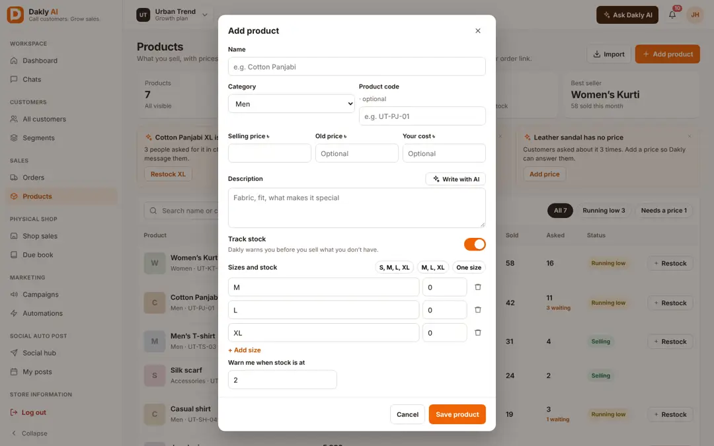
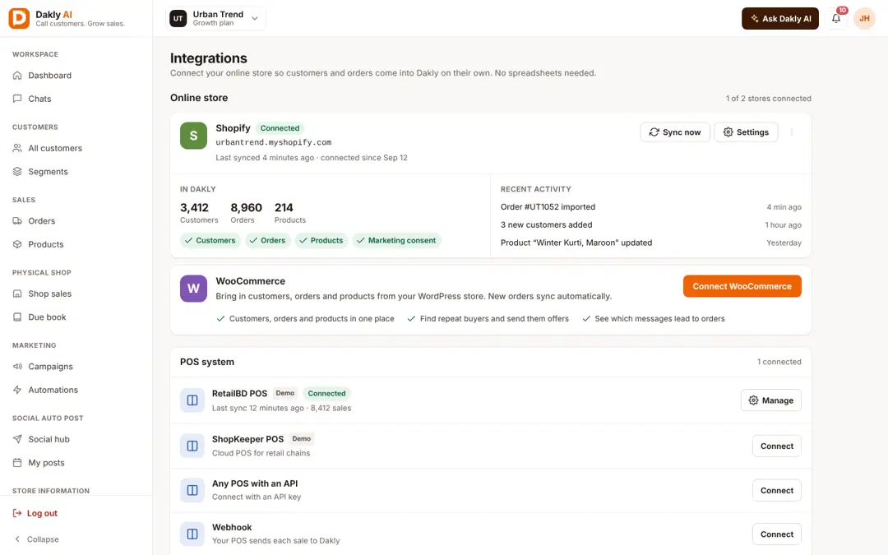
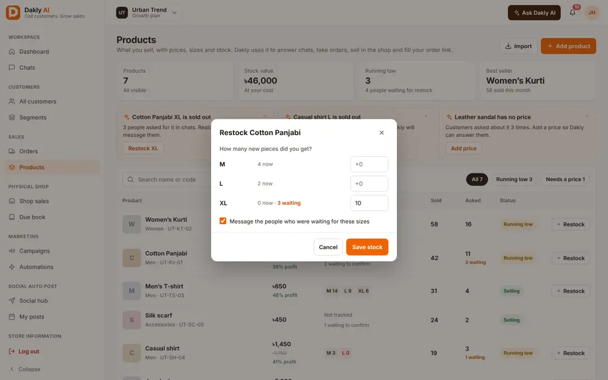
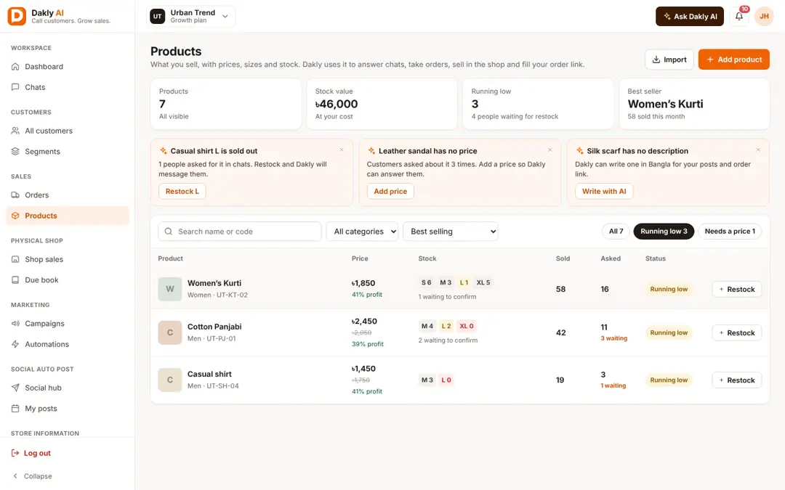

# Products and stock

|           |                                                                  |
| --------- | ---------------------------------------------------------------- |
| Release   | 1                                                                |
| Status    | In progress                                                      |
| Extension | Sales                                                            |
| Code      | `packages/core/src/products/`, `apps/web/src/features/products/` |
| Tasks     | PROD-1 to PROD-6                                                 |

## Purpose

The shop's catalogue with sizes and colours, live stock, and the names customers use for each product, so the AI and the order form always quote the right price and stock.

## Decisions that change the PRD

The product requirements below are the PRD text from 12 November 2026. Where a later decision changed it, the decision wins:

- D1: Shop sales (the physical counter) is release 2, so stock is only changed by orders, imports and edits in release 1.
- D6: POS stock sync is release 2.

## Product requirements

### What it is for

Products holds prices, sizes and stock so chats, the shop counter and the order link all quote the same numbers. Release 1, Sales extension.

### User stories

- As a seller, I want stock to update itself when I confirm, ship, cancel or get a return, and to message the people who asked when I restock.
- As a seller, I want to see which products customers ask about but can't buy (no price, sold out), so I fix what loses sales.

### Screens

| Screen                  | Elements                                                                                                                                                                                                                                                                                                                                                                                                                                                                                                                                                                        |
| ----------------------- | ------------------------------------------------------------------------------------------------------------------------------------------------------------------------------------------------------------------------------------------------------------------------------------------------------------------------------------------------------------------------------------------------------------------------------------------------------------------------------------------------------------------------------------------------------------------------------- |
| Products                | Header stats: product count, stock value at cost, running low (and people waiting), best seller this month; nudge cards (sold-out size with people waiting → Restock; asked about but no price → Add price; no description → Write with AI); filters category, status; sort (best selling, most asked in chats, lowest stock, highest price, name); table: product (name, category, SKU), price (and sale price, profit %), stock per size or Not tracked, waiting to confirm, sold, asked, status (Selling, Running low, Needs a price, Hidden), Restock. Import, Add product. |
| Product detail and edit | Photos (up to 10), name, category, SKU, price, sale price, cost price, description (Write with AI), variants (size list with stock each), track stock on/off, where it appears (Chat replies, Shop sales, Order link), Hide product; sales by channel; times asked in chats; restock waiting list; share (Copy for chat, Copy order link, Post on Facebook).                                                                                                                                                                                                                    |

### How it works

#### Stock

- Available = stock − reserved. Reserved = quantities in To confirm and To pack orders.
- Creating an order reserves stock; shipping deducts it from stock and releases the reservation; cancelling releases it; a return adds the units back to stock.
- Shop sales (tab 9) deduct immediately.
- Untracked products never block an order.
- When a sold-out size is restocked and people are on its waiting list, Dakly offers to message them (WhatsApp within window or template, else SMS) with the product card.

### Business rules

| ID      | Rule                                                                                                                                                         |
| ------- | ------------------------------------------------------------------------------------------------------------------------------------------------------------ |
| ORD-R3  | A tracked item's quantity can't exceed available stock unless a person ticks "Allow even though out of stock". The AI can never oversell.                    |
| PROD-R1 | Prices must be greater than 0 to appear in chats, shop sales or the order link. Products without price are "Needs a price" and the AI hands over when asked. |
| PROD-R2 | Profit % = (price − cost) ÷ price, shown only when cost is set. Stock value = sum of stock × cost.                                                           |
| PROD-R3 | Running low = any tracked size with 3 or fewer available (threshold editable).                                                                               |
| PROD-R4 | Hiding a product removes it from chats, shop and order link; past orders keep it.                                                                            |

### States and edge cases

- Product deleted while in an open order: deletion blocked; offer Hide instead.

### Permissions

Edit Products: change prices, stock and visibility (Owner, Admin; others View).

### Events

product.stock\_changed, product.restocked, product.price\_missing.

### Acceptance criteria

- Given Cotton Panjabi L has 2 available, when an order for 2 is created, then available shows 0 and the AI tells the next customer L is sold out.

### Beyond the prototype

| Addition                                                                        | Why                                               | Release                   |
| ------------------------------------------------------------------------------- | ------------------------------------------------- | ------------------------- |
| Stock movement ledger (sale, return, adjustment, import) and stock per location | Explains why stock changed; needed for 2+ outlets | 1 (ledger), 2 (locations) |

### Verified details from Nabik and AiPraktor (12 Nov 2026)

| Topic     | What they do                                                                                                                                                                                                                                                                      | Dakly rule                                                                                                                   |
| --------- | --------------------------------------------------------------------------------------------------------------------------------------------------------------------------------------------------------------------------------------------------------------------------------- | ---------------------------------------------------------------------------------------------------------------------------- |
| Inventory | Nabik: one live stock count across channels, variants, SKUs, barcodes, a movement ledger, low-stock alerts, unlimited warehouses. AiPraktor: up to 5 option types per product, unoffered combinations marked "not made", product status labels (No price, Needs a photo, Hidden). | Add product readiness labels and "what the AI will say" preview on each product; variants up to 3 option types in release 1. |

## Prototype screens

Captured from the prototype on 13 Nov 2026 by opening each button, tab and dialog. Layout only: the numbers, names and some flows are sample data (see the next section).

**Add product**

**Import products**

**Product detail (needs a price)**

**Restock**

**Running low filter**

## Engineering

### Screens in release 1

List with readiness labels (Needs a price, Needs a photo, Hidden, Running low) and stock per variant. Chat inquiry counts are omitted until chats provide the data, so the prototype's "1 people asked" copy is not shown.

### How it works

1. A product has 0 to 3 option types (Size, Colour, Fabric) and one or more variants. A product with no options has one default variant, so an order always points at a variant.
2. Stock lives on the variant: on hand and reserved. Available = on hand − reserved.
3. Stock changes only through `ProductsService.moveStock(storeId, variantId, { kind, quantity, reference })`. It runs one guarded `UPDATE ... WHERE on_hand - reserved >= quantity` and writes a `stock_movements` row in the same transaction. Zero rows updated throws `STOCK_NOT_AVAILABLE`.
4. Movement kinds: `reserve`, `release`, `ship`, `return`, `adjust`, `import`.
5. Products with stock tracking off skip all of this and never block an order.
6. Readiness labels are computed, not stored. Running low is any tracked variant at or under the store threshold (default 3).
7. Each product has AI aliases ("kurti", "কুর্তি", "three piece") stored as a list. The search embedding rebuild job waits for AI-3.
8. Restock: when a variant goes from 0 to available and people are on its waiting list, the owner is prompted to notify them. Sending is never automatic.

Photos upload straight to R2 with a presigned URL; the API never streams files.

PROD-1 adds product create, view, list, edit, hide and archive routes. Product edits preserve
omitted fields; changes to options include the complete variant list. Variant ids
keep their stock and ledger identity; omitted variants are archived. Products without options keep one
default variant. Prices use the variant override when set, and the
product price otherwise. Lists search names and filter missing prices, missing
photos or hidden products. Pages use descending UUID v7 ids, and each read loads
product details and variants in one database snapshot. Stock labels and adjustments are covered below.

PROD-2 adds the stock ledger and staff stock-adjustment route. The adjustment
quantity is a signed change, with a required reason. Each tracked movement uses
one guarded counter update and one ledger row in the store transaction, alongside
its outbox events. Shipping records a negative on-hand quantity; reservations and
releases record their positive reserved-unit quantity. Untracked products skip
counter, ledger and event writes.

Readiness labels are computed from the effective variant prices, confirmed photo
ids, visibility and available stock. `settings.stock.lowStockThreshold` defaults to
3 and can be changed through Store settings. Lists accept the `running_low` filter.
A `variant.restocked` event means availability crossed from zero or less to positive;
notification sending still waits for PROD-6.

PROD-3 adds photo upload, confirmation, reorder and removal. Upload URLs last five
minutes and sign the declared content type and exact byte length. Only JPEG, PNG
and WebP are accepted, up to 5,242,880 bytes. Keys are
`stores/<store_id>/products/<uuid>`.

Confirmation checks the object size and type before opening a store transaction.
It then records a ready `files` row and appends the photo to the product together
with `product.updated`. Photo changes are serialized per store, including the
limit of ten photos. Reordering includes every current photo id once. Removing a
photo detaches it and sets its file expiry for later object cleanup; this task
does not run the object purge. Unconfirmed uploads have no file row; their object
cleanup is also unimplemented. Scanning and image re-encoding wait for OPS-4.

Product detail and list responses include ordered `photos` with signed download
URLs lasting fifteen minutes. File metadata, product details and variants are
read in one SQL snapshot; rows from another store or file purpose are excluded.
The API requires the four `R2_*` values listed in `.env.example`.

PROD-4's first web slice adds `/products`: search and readiness filters in the
address, cursor pages, available stock per variant and signed photo thumbnails.
The selected stock adjustment is in the address too; counts stay in the query
cache while form input stays in React Hook Form.
Members with product edit access can adjust a variant with a signed quantity and
reason. Product view access is checked by the page and after shop changes.
The editor and photo controls remain for the second PROD-4 PR.
A hidden product is how a shop keeps an unfinished product on the server.

The list omits unsupported totals, sales, chat and waiting-list counts, category
filters, best-selling order, import and promotion controls. The stock dialog
changes one variant and requires a reason; it does not offer waiting-list
messages. The shared sidebar and header are unchanged.

### Rules

1. Price is an integer in poisha. A product with price 0 cannot be ordered or quoted by the AI.
2. Every stock change has a movement row that says why.
3. Hidden products are never offered by the AI.

### Permissions

`products.view`, `products.edit`.

### Events

Emits `product.updated`, `stock.changed`, `variant.restocked`.

### Data

`products` (options as JSON; 512-dimension text and photo embeddings with the model that built them), `product_variants` (on hand and reserved; `price_override_poisha` is empty when the size sells at the product price, so a size's price is its override or else the product's `price_poisha`, and 0 means Needs a price), `stock_movements` (append-only), `restock_requests`, `files` for photos. Full design: [docs/data](../data/README.md).

Product CSV imports use `imports.kind = products_csv` with the same mapping, preview, counts and downloadable error report as customer imports. Reconciliation uses a store-scoped SKU or a supplied external identity; rows without a stable key are new products and the importer must persist the import row result before retry. Duplicate mode applies to matching rows, and stock changes write ledger entries once per import row. A failed or repeated batch must not apply an absolute stock count twice over later stock movements.

Variant external identity is `(store_id, external_source, external_account_id, external_ref)`. Source names the provider; account is its stable shop/account ID, never a display name. All three external fields are supplied together or all are null. Provider synchronization remains planned work.

The open-order guard on archive comes with ORD-1.

### Edge cases to test

- Two orders for the last unit at the same moment: one gets `STOCK_NOT_AVAILABLE`.
- Adjusting stock below reserved is rejected.
- A product with no options gets exactly one variant.
- Duplicate variant external IDs are rejected within one source/account, but accepted across distinct accounts.
- A product import retry preserves row counts and never repeats a stock adjustment.

### Acceptance

- Given size M has 3 on hand and 1 reserved, when the owner opens the product, then M shows 2 available.

## Open questions

None.
