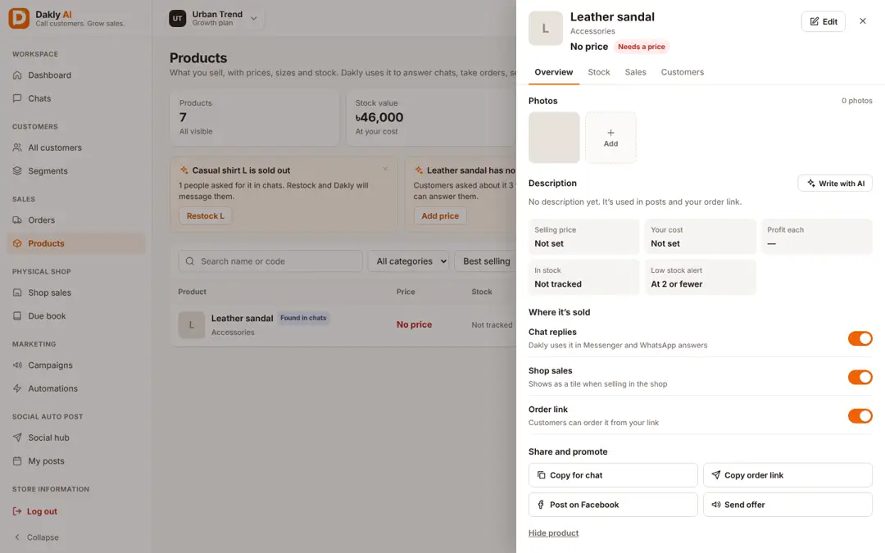
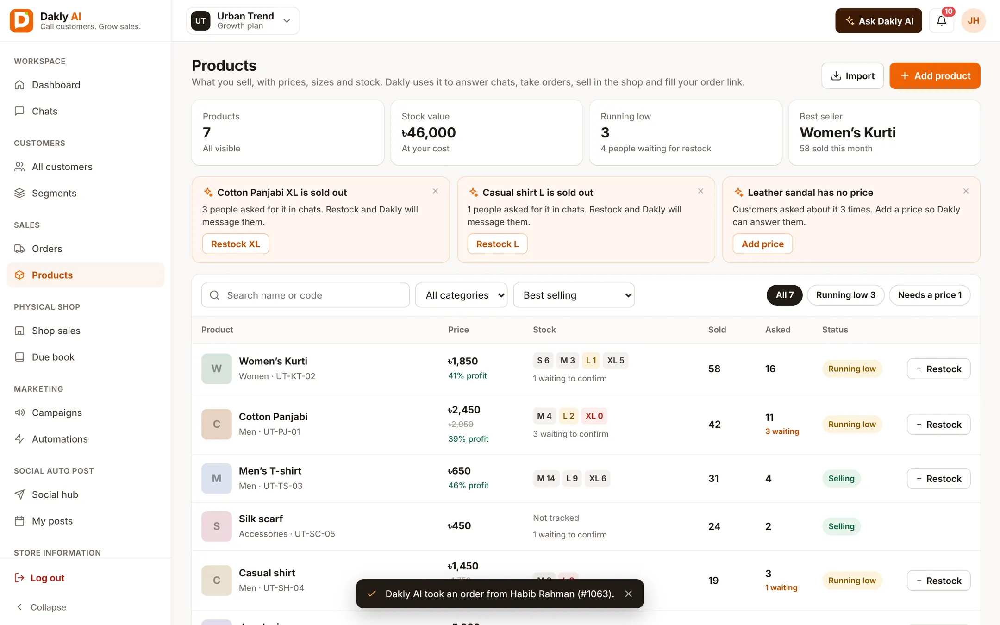

# Products and stock

|           |                                                                  |
| --------- | ---------------------------------------------------------------- |
| Release   | 1                                                                |
| Status    | In progress                                                      |
| Extension | Sales                                                            |
| Code      | `packages/core/src/products/`, `apps/web/src/features/products/` |
| Tasks     | PROD-1 to PROD-6                                                 |

## Purpose

The shop's catalogue with sizes and colours, live stock, and the names customers use for each product, so the AI and the order form always quote the right price and stock.

## Decisions that change the PRD

The product requirements below are the PRD text from 12 November 2026. Where a later decision changed it, the decision wins:

- D1: Shop sales (the physical counter) is release 2, so stock is only changed by orders, imports and edits in release 1.
- D6: POS stock sync is release 2.

## Product requirements

### What it is for

Products holds prices, sizes and stock so chats, the shop counter and the order link all quote the same numbers. Release 1, Sales extension.

### User stories

- As a seller, I want stock to update itself when I confirm, ship, cancel or get a return, and to message the people who asked when I restock.
- As a seller, I want to see which products customers ask about but can't buy (no price, sold out), so I fix what loses sales.

### Screens

| Screen                  | Elements                                                                                                                                                                                                                                                                                                                                                                                                                                                                                                                                                                        |
| ----------------------- | ------------------------------------------------------------------------------------------------------------------------------------------------------------------------------------------------------------------------------------------------------------------------------------------------------------------------------------------------------------------------------------------------------------------------------------------------------------------------------------------------------------------------------------------------------------------------------- |
| Products                | Header stats: product count, stock value at cost, running low (and people waiting), best seller this month; nudge cards (sold-out size with people waiting → Restock; asked about but no price → Add price; no description → Write with AI); filters category, status; sort (best selling, most asked in chats, lowest stock, highest price, name); table: product (name, category, SKU), price (and sale price, profit %), stock per size or Not tracked, waiting to confirm, sold, asked, status (Selling, Running low, Needs a price, Hidden), Restock. Import, Add product. |
| Product detail and edit | Photos (up to 10), name, category, SKU, price, sale price, cost price, description (Write with AI), variants (size list with stock each), track stock on/off, where it appears (Chat replies, Shop sales, Order link), Hide product; sales by channel; times asked in chats; restock waiting list; share (Copy for chat, Copy order link, Post on Facebook).                                                                                                                                                                                                                    |

### How it works

#### Stock

- Available = stock − reserved. Reserved = quantities in To confirm and To pack orders.
- Creating an order reserves stock; shipping deducts it from stock and releases the reservation; cancelling releases it; a return adds the units back to stock.
- Shop sales (tab 9) deduct immediately.
- Untracked products never block an order.
- When a sold-out size is restocked and people are on its waiting list, Dakly offers to message them (WhatsApp within window or template, else SMS) with the product card.

### Business rules

| ID      | Rule                                                                                                                                                            |
| ------- | --------------------------------------------------------------------------------------------------------------------------------------------------------------- |
| ORD-R3  | A tracked item's quantity can't exceed available stock unless a person ticks "Allow even though out of stock". The AI can never oversell.                       |
| PROD-R1 | Prices must be greater than 0 to appear in chats, shop sales or the order link. Products without price are "Needs a price" and the AI hands over when asked.    |
| PROD-R2 | Profit % = (price − cost) ÷ price, shown only when cost is set. Stock value = sum of stock × cost.                                                              |
| PROD-R3 | Running low = any tracked size with 3 or fewer available (threshold editable) while some size is still available. Out of stock = every size has none available. |
| PROD-R4 | Hiding a product removes it from chats, shop and order link; past orders keep it.                                                                               |

### States and edge cases

- Product deleted while in an open order: deletion blocked; offer Hide instead.

### Permissions

Edit Products: change prices, stock and visibility (Owner, Admin; others View).

### Events

product.stock\_changed, product.restocked, product.price\_missing.

### Acceptance criteria

- Given Cotton Panjabi L has 2 available, when an order for 2 is created, then available shows 0 and the AI tells the next customer L is sold out.

### Beyond the prototype

| Addition                                                                        | Why                                               | Release                   |
| ------------------------------------------------------------------------------- | ------------------------------------------------- | ------------------------- |
| Stock movement ledger (sale, return, adjustment, import) and stock per location | Explains why stock changed; needed for 2+ outlets | 1 (ledger), 2 (locations) |

### Verified details from Nabik and AiPraktor (12 Nov 2026)

| Topic     | What they do                                                                                                                                                                                                                                                                      | Dakly rule                                                                                                                   |
| --------- | --------------------------------------------------------------------------------------------------------------------------------------------------------------------------------------------------------------------------------------------------------------------------------- | ---------------------------------------------------------------------------------------------------------------------------- |
| Inventory | Nabik: one live stock count across channels, variants, SKUs, barcodes, a movement ledger, low-stock alerts, unlimited warehouses. AiPraktor: up to 5 option types per product, unoffered combinations marked "not made", product status labels (No price, Needs a photo, Hidden). | Add product readiness labels and "what the AI will say" preview on each product; variants up to 3 option types in release 1. |

## Prototype screens

Captured from the prototype on 13 Nov 2026 by opening each button, tab and dialog. Layout only: the numbers, names and some flows are sample data (see the next section).

**Add product**

**Import products** (differs: this capture shows the Integrations page, not an import dialog)

**Product detail (needs a price)**

**Restock**

**Running low filter**

## Engineering

### Write with AI

In the saved product editor, choose a tone and language to write three descriptions from the saved product facts. A picked option fills the description field. Save the product to keep it.

### Screens in release 1

List with readiness labels (Needs a price, Needs a photo, Hidden, Running low, Out of stock) and stock per variant. Chat inquiry counts are omitted until chats provide the data, so the prototype's "1 people asked" copy is not shown.

### Full page for add and edit (PROD-11)

Decision: [0012](../adr/0012-full-page-product-form.md). Wireframes: `docs/design/wireframes/prod-11/`. This replaces the add modal's long form and the product drawer; the screenshots above stay as layout references for the list.

Built so far (part 1): `/products/new` and `/products/[productId]` use the current form fields and options on a page with a top bar that stays in view (back, title, Save as hidden and Save and show, or Save product), photos above the fields and a Status card (Hide or Show product, readiness) beside them. Add product on the list opens the new page; a new product saves hidden or shown and moves to its page, where photos can be added. Members without Edit Products see a plain message on the page. Quick add (part 3): Add product on the list opens a modal with name, selling price, stock and one photo. Save product makes a hidden product with that stock and photo. More details opens `/products/new` with the typed name, price and stock filled in; with a photo chosen it saves the hidden product first and opens its page, because a photo cannot travel in the address. If stock or the photo fails to save, the product stays and the modal says what to add on its page. Wireframe check: `docs/design/evidence/prod-11-quick-add/`. Variants grid (part 2): the Variants card follows the rules below. Without options it shows plain stock, product code and warn-at fields with **Add options** and **Suggest options**. With options, typing values builds the grid at once, rows group by the first option and collapse, and each row edits its photo (a saved variant), price, cost, stock and code in place with the profit percent beside it. Row checkboxes open a bulk bar (set price, cost or stock, remove), a spreadsheet paste fills cells from the one in focus, and **Add missing combinations** returns removed rows. Removing a value or row archives the variant, never deletes it. Stock typed in the grid is saved as differences in the stock history with one reason asked on save. A phone shows one line per variant that opens to edit. Wireframe check: `docs/design/evidence/prod-11-variants/`. Old editor removed (part 4): the add modal (`?create=1`) and the product drawer (`?product=`) are gone. A product name on the list opens `/products/[productId]`, Add product opens the quick add, and old `?product=<id>` and `?create=1` addresses redirect to the page. Restock, Change stock and Import stay dialogs. Change stock opens from the list row and from the Status card on the page; a product with several variants asks which one first, then takes the change and a reason. The page shows **How it looks in chat** beside Status, built with `buildProductCardElement` (the AI's own builder): name, the price of sizes in stock, the first photo and the card buttons; a product with every size sold out shows no Order now button. Evidence: `docs/design/evidence/prod-11-remove-old-editor/`. Share, insights and the More menu are later parts.

Variants grid API: saving a product with fewer variants than it has now archives the missing ones, and is refused with `PRODUCT_VARIANT_IN_OPEN_ORDERS` while an order in To confirm, On hold or To pack uses one of them. `POST /products/suggest-options` takes a title and, for a saved product, reads up to three photos: sizes come from the title on the `fast` tier and colours from the photos on the `vision` tier. It returns a list of options and values, or an empty list when the model is unavailable, and it never returns a price, stock or code. A variant also has an optional `lowStockThreshold` (warn me when stock is at); blank uses the shop's level from the stock settings.

Built for the variants grid (part 2, API): saving a product with fewer variants than it has now archives the missing ones, and is refused with `PRODUCT_VARIANT_IN_OPEN_ORDERS` while an order in To confirm, On hold or To pack uses one of them. `POST /products/suggest-options` takes a title and, for a saved product, reads up to three photos: sizes come from the title on the `fast` tier and colours from the photos on the `vision` tier. It returns a list of options and values, or an empty list when the model is unavailable, and it never returns a price, stock or code. A variant also has an optional `lowStockThreshold` (warn me when stock is at); blank uses the shop's level from the stock settings.

- **Quick add** (modal): name, price, stock, one photo, **More details**. It saves a hidden product and opens the full page when More details is chosen.
- **Full page** at `/products/new` and `/products/[productId]`. The top bar stays in view: back, title, Save, Hide product. Desktop has two columns, a phone has one.
  - Left: Photos (up to 10, first one is the main photo, move earlier), Basics (name, category, description with Write with AI), Price (price, sale price, cost, live profit percent), Variants.
  - Right: Status (shown or hidden), Where it appears (Chat replies, Shop sales, Order link), Stock settings (warn me at), a preview card. The Stock history tab sits on the same page.
- **Variants grid** (research: `docs/design/wireframes/prod-11/research.md`): up to three options, typed as values or picked from suggestions (S, M, L, XL, XXL, common colours). The grid is built as values are added, with no save step in between. Rows are grouped by the first option and can be collapsed. Each row has a checkbox, image, price, cost, profit percent, stock and product code, edited in place. The bulk bar sets price, cost or stock for the chosen rows, and a paste from a spreadsheet fills the grid. A blank price uses the product price. A removed combination returns with **Add missing combinations**. Renaming an option keeps the variant ids, prices, codes and stock. Adding an option to a product that has stock moves the existing stock to the first value of the new option and says so. Stock edits in the grid are written to the stock history with one reason asked on save.
- **Suggested options**: once the product has a title or a photo, the Variants card offers **Suggest options**. Photos go to the `vision` tier and the title to the `fast` tier through `AiService` (PROD-8 already reads colour from photos). The suggestion is a list of option names and values, such as Size S to XL for a T-shirt or Colour Black and White from the photos. It is shown as chips with an Add all button and each chip can be removed first. Nothing is added without a tap, the AI never sets a price, stock or code. It follows the same allowance rule as photo tagging (PROD-8). Without a title or photo, or when the AI is unavailable, the seller still gets the plain suggestions list (S, M, L, XL, XXL and common colours).
- **No options**: most products have none. The Variants card then shows only **Add options** (with Suggest options), no grid. Stock, product code and the warn-at level sit in the Price and Stock settings cards as plain fields, so a simple product needs no variant step. Adding the first option turns the product's stock and code into the first row of the grid, as the rule above says; removing every option back to none is allowed only when one row is left.
- **Look and flow**: the page uses the app shell (sidebar, store header, Ask Dakly AI) and the tokens in [theme](../design/theme.md): `--color-action` for Save and Add, `--color-surface-muted` for table headers and group rows, `--color-ai-soft` for the suggestion box, status badges with their soft fills, 12 px card radius, forms at most 640 px wide on the quick add modal. Fields, labels and wording follow the prototype's Add product modal (Name, Category, Product code, Selling price, Old price, Your cost, Description with Write with AI, Track stock, Warn me when stock is at). Wireframes are drawn in these tokens.
- **Parcel weight**: an optional whole number of grams (1 to 100,000) on the product, in a Delivery card between Price and Variants. It is for the product, not each size, so every size of a product weighs the same; blank means not set. Orders add it up (see [orders and delivery](06-orders-and-delivery.md)).
- **How it looks in chat**: the right column shows a live preview of what a customer gets. The card has the chosen photo (the variant's own, else the first product photo), the name, the price of sizes in stock (a range when they differ; sold-out sizes are never priced), and buttons Order now, See sizes and Talk to a person. The preview uses the same builder as the AI (`buildProductCardElement`), so the page and the chat cannot differ. Name, sale price, variant titles, stock and photos feed the card; description, other names and category feed the AI's answers and search, not the card. The preview shows the saved product and refreshes after each save. Wireframe: `chat-product-card-360.png`.
- **Kept from the current editor and the prototype** (checked against the existing doc; each of these must be on the page before the drawer is removed):
  - **Other names** for the AI search ("kurti", "কুর্তি", "three piece"), one per line, in Basics.
  - **Save actions**: a new product has **Save as hidden** and **Save and show**; an existing one has **Save product** and **Hide product** or **Show product**. Removing a variant row that appears in an open order is blocked with a plain message, and Archive product is blocked while any variant is in an open order (offer Hide instead).
  - **More actions menu**: Duplicate product (copies everything except stock, photos tags and history), Archive product.
  - **Share**: Copy for chat, Copy order link, Post on Facebook.
  - **Insights on the page**: sales by channel, times asked in chats, and the restock waiting list for each size, shown on the Waiting list tab and in the right column.
  - **Photos**: up to 10 of up to 5 MB (JPEG, PNG, WebP), move earlier, remove with a confirm, photos for each variant, and a retry button when an upload fails. On a phone, **Take photo** opens the camera.
  - **Permissions**: members without Edit Products see the same page read-only, with no Save bar.
  - **Two people editing**: if the product changed since the page was opened, Save says so and offers to reload, and the typed values stay on screen.
  - **Needs a price and Needs a photo** labels, and the AI readiness line, stay on the page and the list.
- Plain validation messages on every field; a typed cost is kept when options change.
- Leaving with unsaved changes asks first. Restock and Change stock stay dialogs.
- On a phone each variant is one line (name, price, stock) that opens to edit its fields, the bulk bar stays, and the Save bar sticks to the bottom.
- A readiness line shows what the AI still lacks (photo, price, description).

### Redesign of the full page (planned)

A new design for the add and edit page and the list is planned as PROD-17, with AI price negotiation as PROD-18 ([D50](../product/decisions.md)). The plan, the design images and every correction to them are in [product-page-redesign.md](../plans/product-page-redesign.md). Until those tasks are Done, this section describes the page as built.

### Catalogue tools beside the full page (planned)

Research: `docs/design/wireframes/prod-11/research.md`. Proposed follow-up tasks, each its own PR after the full page ships; none changes the full page.

- **Categories and brands** (PROD-12). Built; see "Categories and brands" below.
- **Bulk edit on the list** (PROD-13). Select rows (or all rows for the current filters) and edit in a grid: price, sale price, cost, stock, category, brand, status. Stock changes need a reason and go to the stock history. A review step shows each old and new value before saving, and the result keeps an **Undo** for 24 hours for everything except stock, which is corrected by a new movement. A blank cell never overwrites a value.
- **Export and XLSX** (PROD-14). Export the filtered list as CSV or XLSX with the same columns the import reads, so an export edited in a spreadsheet can be imported again. The import accepts XLSX, reuses the CUS-16 reader, and gets a dry run: a preview of added, changed and rejected rows with a downloadable error report before anything is written, and an editable preview table. Images by public link are not in this task.

### Ask Dakly for product changes (PROD-15)

Today the dashboard assistant is read-only and every action opens a screen pre-filled for the owner (feature 10). This keeps that rule: the assistant proposes, the owner saves.

- **Create**: a prompt such as "add a black cotton T-shirt, 1,200 taka, S to XL, 10 of each" opens `/products/new` as a draft with the name, price, options and stock filled in. The photo is attached from the chat or the page. Nothing is saved until the owner presses Save, and the page shows which fields the assistant filled.
- **Change**: a prompt such as "raise all T-shirt prices by 50 taka" or "set Panjabi stock to 12" opens the PROD-13 review step with the old and new values for every product it matched. Nothing applies until the owner presses Apply, and Undo works as for any bulk edit.
- Tools take names and values only, never a store id or a product id the model chose by itself: the service matches products by name and shows the list it matched. A request that matches nothing or too many (more than 50) asks the owner to narrow it down. Prices and discounts from the model are always shown for review, never applied directly.
- How it is built: the assistant has two tools, `draft_product` and `change_products`, offered only to members who can edit products. They take the owner's own words as values (a name, a price in taka as a plain number, a stock count, sizes) and never an id. The model turns prices written in words or Bangla digits into numbers; the shop works out each new price from `raise_by`, `lower_by`, `raise_percent`, `lower_percent` or `set`, so the model never states a new price. The answer is a `product_draft` or `product_change` the panel opens: the draft in the address of `/products/new` (a notice names the fields it filled), the change as the bulk edit review over the products list. A price change skips a product with its own size prices and a stock change skips a product that has sizes or does not count stock; both are named to the model. A change with stock opens on the grid so the owner picks the stock reason.
- Evals before release: Bangla, Banglish and mixed prompts, prices written in words and in Bangla digits, and a check that no prompt changes a price, stock or discount without the review step. `pnpm --filter @dakly/core eval:models --jobs assistant` runs 17 prompts (the offline spec checks the case set and scoring); the review-only rule is enforced by the service having no write path, tested in `assistant-products.spec.ts`.

### Missing design: import products

The prototype capture for this screen shows the Integrations page, so there is no product import design to match. The import dialog follows the customer import dialog (CUS-8) element by element: step bar, file drop area, column mapping, preview, duplicate choice and result counts. Evidence: `docs/design/evidence/prod-5-import/`.

The Import from Excel or CSV button sits beside Add product for members who can edit products, and opens the dialog at `/products?import=1`. Steps: Upload, Map fields, Dry run, Results.

- Upload: a CSV file or the first sheet of an Excel (.xlsx) file; the browser turns the sheet into CSV before it uploads, as for customers (CUS-16).
- Mapping: Product name and Price are required. Category, description, status, SKU, cost and on hand are optional. Up to three option columns (such as Size or Colour) are named in the dialog; columns called Size, Color or Colour are suggested.
- Duplicates: update or skip, by SKU, chosen above the dry run's table. A stock count in the file replaces the shop's count and is recorded in the stock history, and a product imported without a count is not tracked for stock.
- Dry run (PROD-14): `POST /product-imports/:importId/dry-run` reads the uploaded file with the mapping and the duplicate choice and writes nothing. It returns counts of added, changed, skipped and rejected rows and up to 300 rows, rejected first, with the file's cells and a plain problem for each rejected row (a row with no change is skipped with "Nothing to change"; a changed price shows what it was). The owner can edit any cell in the table; Check the changes writes the edits into the CSV in the browser, uploads it as a new import and runs the dry run again, so what is checked is what is imported. Confirm and import starts only the checked import. Download error report saves every rejected row as a CSV.
- Results: added, updated, skipped and failed counts and the error report. There is no Undo (see the import rules above).
- A blank cell never overwrites. For a product already in the shop, the file's non-blank category, description, status and price replace the stored ones, and a blank status keeps the product as it is. A file row is matched by SKU, so renaming an option value in the file keeps the variant, its id, price and stock. Rows with no SKU are added as new products.
- A row whose option cells are all blank is a product without options, so a catalogue that mixes optioned and plain products imports in one file. Rows of one product must fill the same options.

### Categories and brands (PROD-12)

A shop keeps its own list of categories (two levels, such as `Clothing > T-shirts`) and a list of brands. A product has at most one of each, set by id: `categoryId` and `brandId` on create and edit. The response also carries `category` (the path as text, `Clothing > T-shirts`) and `brand` (the name), so search, the AI, chat cards and the export read the words and never see an id.

- **Tables.** `product_categories` (store, parent, name, sort order) and `product_brands` (store, name), both with row level security. A name is unique per parent (top level counts as one parent) and per shop, ignoring case. Products point at them with a store-checked foreign key, so a product cannot take another shop's category.
- **Migration 0098.** Each distinct old `products.category` text (ignoring case and spaces) becomes a top-level category of its shop and every product keeps pointing at it. The text column is dropped. No product changes name, price or visibility. An old text that already contains " > " (the bulk edit could write one) becomes a single top-level category with that full name, not two levels.
- **API.** `GET` and `POST` on `/products/categories` and `/products/brands`; a list item carries its product count. A category sits under one parent at most (`PRODUCT_CATEGORY_TOO_DEEP`), and a repeated name is `PRODUCT_CATEGORY_NAME_TAKEN` or `PRODUCT_BRAND_NAME_TAKEN`.
- **Form.** The Category and Brand fields are pickers with "+ New category" and "+ New brand", which add an item without leaving the form (a new category can go under a top-level one). Ask Dakly's draft picks the category only when the shop already has one of that name.
- **Bulk edit.** The Category cell takes a name or a path, finds it in the shop's list ignoring case and adds it when missing; the edit records the list's own spelling, so undo still finds it. The grid also has a Brand column that picks from the brand list.
- **Import.** The Category column accepts `Clothing > T-shirts` with the same matching. More than two levels is a row error. The import does not read brands yet.
- **Manage lists.** `/products/lists` shows both lists with product counts. Members who can edit products rename an item, move a category under another top-level category (`PATCH /products/categories/:id`, `PATCH /products/brands/:id`) and delete an item (`DELETE` on the same paths). A delete is refused with `PRODUCT_CATEGORY_IN_USE` or `PRODUCT_BRAND_IN_USE` while products use it, and a category with sub-categories cannot be deleted or moved under another. A category moves only when it has no sub-categories, so the list stays two levels.
- **Filters.** The product list has Category and Brand filters in the address (`categoryId`, `brandId`); a parent category also shows its sub-categories.
- **Not yet.** A brand column in import and export.

### Export products (PROD-14)

The Export to Excel and Export to CSV buttons on the products list download the products the search and readiness filter show, for anyone who can view products. `GET /products/export?format=xlsx|csv&search=&readiness=` writes one row per variant with the import's columns (Name, Price, Category, Description, Status, SKU, Cost, On hand) and one column per option name, so an export edited in a spreadsheet imports again. Prices are plain taka text, the CSV starts with a byte order mark so Excel reads Bangla, and a CSV cell that starts with `=`, `+`, `-` or `@` gets a leading quote. On hand is blank for a product that does not track stock. Each download is saved in the audit log with its row count.

### How it works

1. A product has 0 to 3 option types (Size, Colour, Fabric) and one or more variants. A product with no options has one default variant, so an order always points at a variant.
2. Stock lives on the variant: on hand and reserved. Available = on hand − reserved.
3. Stock changes through `ProductStockService.moveStock`. A movement takes a quantity,
   or an absolute on-hand count for an import. An import calculates the signed
   change from the locked variant count. The update guards the resulting stock
   and reservations. It writes a `stock_movements` row in the same transaction
   when stock or reservations change. A count that would put on-hand stock below
   reserved stock throws `STOCK_NOT_AVAILABLE`.
4. Movement kinds: `reserve`, `release`, `ship`, `return`, `adjust`, `import`.
5. Products with stock tracking off skip all of this and never block an order.
6. Readiness labels are computed, not stored. Running low is any tracked variant at or under the store threshold (default 3).
7. Each product has AI aliases ("kurti", "কুর্তি", "three piece") stored as a list. The search embedding is rebuilt by a job on `product.updated` (AI-10); a daily job (AI-17) also embeds products that have none and rebuilds all of a shop's when `AI_EMBEDDING_MODEL` changes, 20 products per batch with a pause between batches.
8. Restock: when a variant goes from 0 to available and people are on its waiting list, the owner is prompted to notify them. Sending is never automatic.

Photos upload straight to R2 with a presigned URL; the API never streams files.

PROD-1 adds product create, view, list, edit, hide and archive routes. Product edits preserve
omitted fields; changes to options include the complete variant list. Variant ids
keep their stock and ledger identity; omitted variants are archived. Products without options keep one
default variant. Prices use the variant override when set, and the
product price otherwise. Lists search names and filter missing prices, missing
photos or hidden products. Pages use descending UUID v7 ids, and each read loads
product details and variants in one database snapshot. Stock labels and adjustments are covered below.

PROD-2 adds the stock ledger and staff stock-adjustment route. The adjustment
quantity is a signed change, with a required reason. Each tracked movement uses
one guarded counter update and one ledger row in the store transaction, alongside
its outbox events. Shipping records a negative on-hand quantity; reservations and
releases record their positive reserved-unit quantity. Untracked products skip
counter, ledger and event writes.

Readiness labels are computed from the effective variant prices, confirmed photo
ids, visibility and available stock. `settings.stock.lowStockThreshold` defaults to
3 and can be changed through Store settings. Lists accept the `running_low` and `out_of_stock` filters.
A `variant.restocked` event means availability crossed from zero or less to positive;
PROD-6 sends the approved notification.

PROD-6 adds the restock waiting list on `restock_requests`. `POST /variants/:variantId/restock-requests`
(needs `chats.edit`) adds a contact, with the conversation it asked in. A size that still has stock is
refused, and asking again returns the same waiting row. A person who was cancelled can ask again.
`RestockRequestsService.addToWaitingList` is the call the AI tool `add_to_restock_list` and the
out-of-stock alternatives (AI-12) use; it takes the store, variant and contact from the job and
returns the waiting row. `GET /restock-requests` (status, variant and cursor filters),
`GET /products/:productId/restock-waiting` (waiting count per size) and
`DELETE /restock-requests/:id` (cancel) need `products.view` and `products.edit`.

`POST /variants/:variantId/restock-notifications` (needs `products.edit`) is the owner's approval. It
refuses a size that is still out of stock. It then queues one transactional Messenger message for each
waiting person, oldest first, up to 50 a call, through core messaging, so the consent, window and send
checks run when the message is dispatched. Each message has the key `restock-request:<id>`, and a
request is marked `notified` only after its message is queued, so a retry never sends twice. People
with no chat on a Page stay waiting. The response gives `queued` and `waiting`, and the owner approves
again for the rest. WhatsApp and SMS delivery wait for those channels' send paths.

The Restock dialog on the Products list lists every size of the product with its available stock, how many people wait for it (`GET /products/:productId/restock-waiting`) and a box for the pieces that arrived. Save stock adds each filled size with one stock adjustment (reason Restock). The "Message the people who were waiting for these sizes" box shows only when someone is waiting, starts ticked, and calls the approval route for each restocked size that has people waiting. Stock is saved first. If a later call fails, the dialog shows the error, clears the sizes already saved and keeps the rest, so saving again never adds the same pieces twice and still messages the people waiting for the saved sizes. The dialog only adds stock; lowering it is **Change stock** on the product sheet's Stock tab.

PROD-3 adds photo upload, confirmation, reorder and removal. Upload URLs last five
minutes and sign the declared content type and exact byte length. Only JPEG, PNG
and WebP are accepted, up to 5,242,880 bytes. Keys are
`stores/<store_id>/products/<uuid>`.

Confirmation checks the object size and type before opening a store transaction.
It then records a ready `files` row and appends the photo to the product together
with `product.updated`. Photo changes are serialized per store, including the
limit of ten photos. Reordering includes every current photo id once. Removing a
photo detaches it and sets its file expiry for later object cleanup; this task
does not run the object purge. Unconfirmed uploads have no file row; their object
cleanup is also unimplemented. Scanning and image re-encoding wait for OPS-4.

Product detail and list responses include ordered `photos` with signed download
URLs lasting fifteen minutes. File metadata, product details and variants are
read in one SQL snapshot; rows from another store or file purpose are excluded.
The API requires the four `R2_*` values listed in `.env.example`.

PROD-4's first web slice adds `/products`: search and readiness filters in the
address, cursor pages, available stock per variant and signed photo thumbnails.
The list's Restock button opens the Restock dialog from the address (`adjust` holds a size of the product); counts stay in the query
cache while form input stays in React Hook Form.
Members with product edit access can adjust a variant with a signed quantity and
reason from **Change stock** on the Stock tab of the product sheet. Product view access is checked by the page and after shop changes.
The editor opens from `create=1` or a product id in the address. New products
have explicit **Save as hidden** and **Save and show** actions. Existing products
use **Save product**; visibility changes use **Hide product** and **Show product**.
A hidden product is how a shop keeps an unfinished product on the server.
There is no autosave or local storage.

The form takes Taka and converts to integer poisha during submission. It uses the
existing contract rules for prices, aliases, options and variants. Other names
are entered one per line in the saved-product editor and stored as a list.
Stores edit channel visibility after saving. The editor supports up to three
option types and manual variant rows; renaming an option preserves variant ids,
prices, product codes and stock. A blank price override uses the product price. The editor for a product with no
options shows an override only if it already has one.
A background refresh keeps unsaved form input. A shop change clears it. Saving
the form updates only the edited fields. Hide and Show update visibility separately.

The product drawer shows confirmed photos through signed URLs. Members with
product edit access can add a JPEG, PNG or WebP up to 5 MB, move photos earlier
in the list, or remove a photo after confirming. The first photo appears on the
products list. Each product has room for ten photos. Browser uploads need the
[R2 bucket CORS rule](../architecture.md#files).

PROD-7 gives each variant optional photos of its own, up to ten, on `product_variants.image_file_ids`.
They use the same upload, confirm, reorder and remove steps as product photos, under
`/products/:productId/variants/:variantId/photos` (needs `products.edit`), and the same file purpose and
limits. A variant never needs a photo: with none, the product's first photo stands in, and no readiness
label depends on variant photos (`Needs a photo` still looks at the product's photos only). Product
responses carry `imageFileIds` and signed `photos` on each variant. Editing a product keeps the photos of
every variant that is kept. The order picker returns a `photoUrl` for each variant (its own first photo,
else the product's). The AI tool `send_product_card` takes an optional `variantId` and returns the
`photoFileId` to show (the variant's own, else the product's first); cards are still sent as text until the
reply sender can attach images. Photo search (AI-11) should index variant photos with their variant.

On the web, the product sheet's Overview tab shows **Photos for each variant** under the product photos
whenever the product has options. Each variant has the same add, move earlier and remove controls as the
product photos, and says that the product photos show instead while it has none. The Restock dialog shows
each size's first photo (else the product's), and the order editor shows the same thumbnail beside the
price of the chosen variant. The design images have no variant photo screen, so these follow the product
sheet's photo controls.

PROD-8 tags each photo for the AI. Confirming a product or variant photo raises `product.photo_added`;
`TagProductPhotoJob` (queue `inbound`) sends the photo to the `vision` tier with the prompt
`tag-product-photo.v1` and saves a short English description and up to 12 tags, colour first, in English
and Bangla (`red, লাল, kurti, কুর্তি`) on the `files` row (`photo_description`, `photo_tags`). The run is recorded
as `tag_product_photo` and does not use the Chats AI allowance; this is a working assumption until the
scan allowance is set. A photo that does not get tags is still shown normally. A photo that
already has tags is skipped. The AI tools list every photo of a product and its variants with its tags
(`photos` in `search_products`, `get_product` and `send_product_card`), and `send_product_card` takes an
optional `photoId`. When no photo matches the colour asked for, the AI sets `withoutPhoto` so the card goes
out as text and says that colour is unavailable. A card for an out-of-stock variant ends with
"স্টক নেই (out of stock)" and the result carries `outOfStock: true`. That is how a product with no variants but a red and a blue photo still shows the red
one when the customer asks for red. Photos uploaded before PROD-8 are tagged by PROD-10: once per queue lifetime
`StartProductPhotoTagBackfillJob` queues a `BackfillProductPhotoTagsJob` (queue `bulk`) for every store. Each run
tags up to 10 untagged product and variant photos in file id order, then queues the next run after the last
id with a ten second pause. A photo the model cannot read is passed once. A model outage fails the run and
the queue retries it from the same id. It uses the same `tag` code, tier and allowance rule as new uploads.

PROD-9 sends the chosen photo in chat. When `send_product_card` returns a `photoFileId`, the sales
agent resolves it to the stored file (`ProductsService.chatPhotoFile` accepts only a photo of a product
that is active and shown in chats) and queues the card with that image. The message keeps the image as a
stored image attachment, and the dispatcher gives Messenger or Instagram a ten-minute signed link, sending
the photo before the card text. A photo Meta refuses does not stop the text. Instagram image sending is new
for the driver; campaigns still send images on Messenger only.

Adjust opening stock after saving through the list. The low-stock threshold
belongs to the shop.

The list omits unsupported totals, sales, chat and waiting-list counts, category
filters, best-selling order, import and promotion controls. The stock dialog
changes one variant and requires a reason; it does not offer waiting-list
messages. The shared sidebar and header are unchanged.

### Rules

1. Price is an integer in poisha. A product with price 0 cannot be ordered or quoted by the AI.
2. Every stock change has a movement row that says why.
3. Hidden products are never offered by the AI.

### Permissions

`products.view`, `products.edit`.

### Events

Emits `product.updated`, `stock.changed`, `variant.restocked`.

### Data

`products` (options as JSON; 512-dimension text and photo embeddings with the model that built them), `product_variants` (on hand and reserved; `price_override_poisha` is empty when the size sells at the product price, so a size's price is its override or else the product's `price_poisha`, and 0 means Needs a price), `stock_movements` (append-only), `restock_requests`, `files` for photos. Full design: [docs/data](../data/README.md).

Product CSV imports use `imports.kind = products_csv` with the same mapping, preview, counts and downloadable error report as customer imports. The customer import repository filters every read and write on `kind = customers_csv`, so a product import never shows in the customer import report, undo or recovery. Reconciliation uses a store-scoped SKU or a supplied external identity; rows without a stable key are new products and the importer must persist the import row result before retry. Duplicate mode applies to matching rows, and stock changes write ledger entries once per import row. A failed or repeated batch must not apply an absolute stock count twice over later stock movements.

File format: one row per variant. Rows with the same product name (ignoring case) form one product, and the first valid row sets its name, category, description, status and price. A later row with a different non-blank category, description or status is a row error. A later row with a different price keeps the product price and stores its own as that variant's price override; a blank price means the same as the product. The mapping names up to three option columns (for example Size) and every row must fill each one. A product with no option columns has exactly one row. A repeated SKU or a repeated option combination in the file is a row error on the later row. Price and cost are taka with at most two decimals and are stored as integer poisha. Status is `active` or `hidden`, case-insensitive, default active. A blank on-hand cell leaves stock alone, and a product that does not track stock ignores the column. A SKU that matches a variant already in the shop updates that variant in `update` mode (price override and cost when the file gives them, then the on-hand count) and is skipped in `skip` mode. In `update` mode a product price above 0 is also written to the matched product, and a blank or repeated price leaves an existing price override as it is. A SKU that matches an archived variant or product is a row error, and so are rows of one file product whose SKUs belong to different products in the shop. New products track stock only when the mapping has an on-hand column, so a catalogue imported without counts is not shown as out of stock. When some rows of a product match existing SKUs and others do not, the rows with a new SKU are row errors, because adding a size belongs in the product editor. Each batch is written in the same transaction that saves the import's progress, so a retried batch never applies a count twice.

The API is `POST /product-imports` (upload link), `POST /product-imports/:id/start` with the mapping and duplicate mode, and `GET /product-imports/:id`; upload and start need `products.edit` and the status read needs `products.view`. Starting queues `product_import.started`, which runs `run-product-import`. The stuck-import sweep covers product imports too. Upload and size limits are the customer import's: 10 MB, 50,000 rows and 20 files an hour per kind.

Product imports have no undo in release 1. Undoing would reverse stock movements that orders may already depend on, so the report and the stock ledger show what changed instead, and the report screen has no Undo control.

Variant external identity is `(store_id, external_source, external_account_id, external_ref)`. Source names the provider; account is its stable shop/account ID, never a display name. All three external fields are supplied together or all are null. Provider synchronization remains planned work.

A product cannot be archived while any of its variants appears in an order in To confirm, On hold or To pack. This includes archived variants and products that do not track stock.

### Edge cases to test

- Two orders for the last unit at the same moment: one gets `STOCK_NOT_AVAILABLE`.
- Adjusting stock below reserved is rejected.
- A product with no options gets exactly one variant.
- Duplicate variant external IDs are rejected within one source/account, but accepted across distinct accounts.
- A product import retry preserves row counts and never repeats a stock adjustment.

### Acceptance

- Given size M has 3 on hand and 1 reserved, when the owner opens the product, then M shows 2 available.

## Open questions

None.

## Bulk edit (PROD-13)

On the products list a person selects rows with the checkboxes (up to 100, kept while paging) and the bar offers **Edit in grid**, **Hide** and **Set category**. The grid shows price, old price, cost, stock, category and status. **Review** lists each old and new value; nothing is saved until **Apply**.

- A blank cell never overwrites. Only values that differ from the product are sent, and the API ignores a value equal to the current one.
- Cost and stock belong to a size, so the grid edits them only for a product with one size and tracked stock. A product with several sizes shows them read-only; they are edited on the product.
- Price is read-only for a product where any size has its own price, because customers and the AI would not see the product price there. The API refuses it.
- A stock change asks for one reason (Restock, Recount, Damage, Other) for the whole edit and writes an `adjust` movement of the difference with that reason.
- Each apply is one transaction and stores the old and new value of every field in `product_bulk_edits`.
- **Undo** is offered for 24 hours (`POST /products/bulk-edits/:id/undo`). A value that was changed by hand since is left alone and counted as skipped. Stock is corrected by a new `adjust` movement of the opposite difference, so orders placed since keep their effect; if the stock is reserved by then, that row is skipped.
- Brand and "select all matching the filters" from the design wait for a later task.
