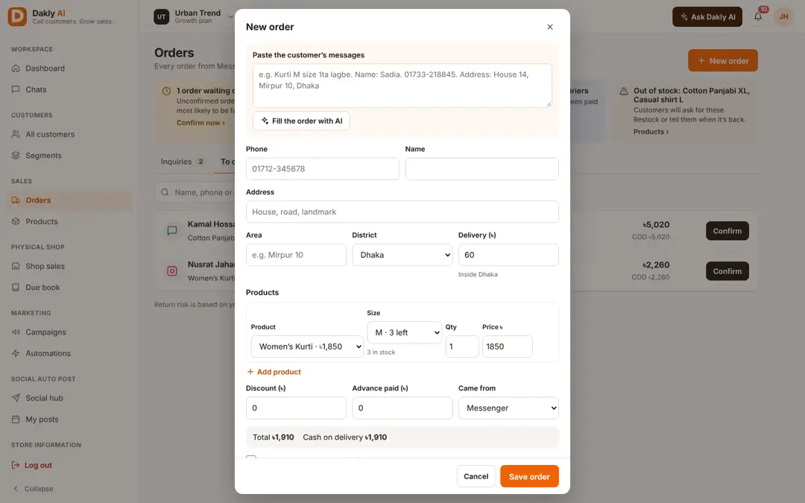
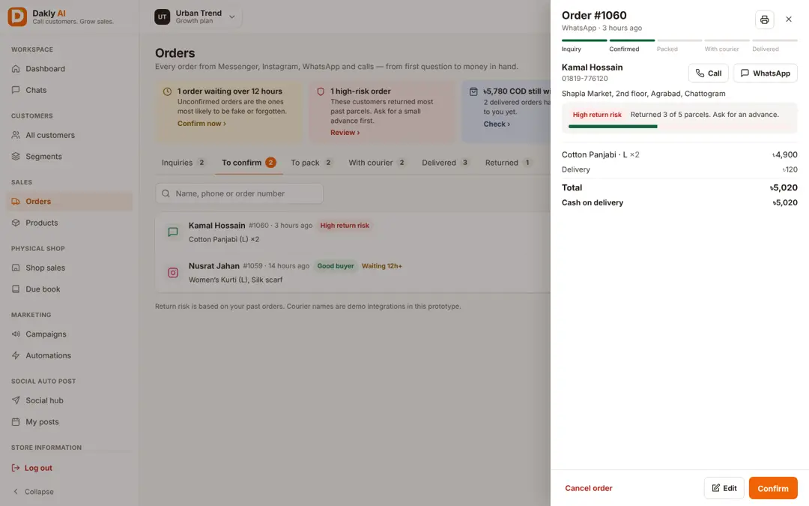
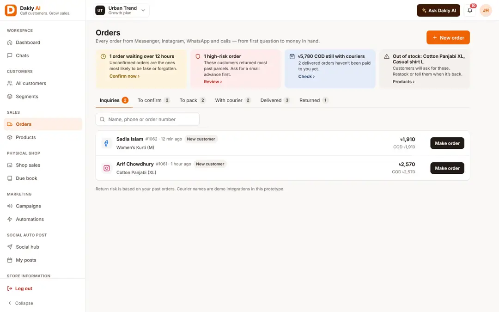
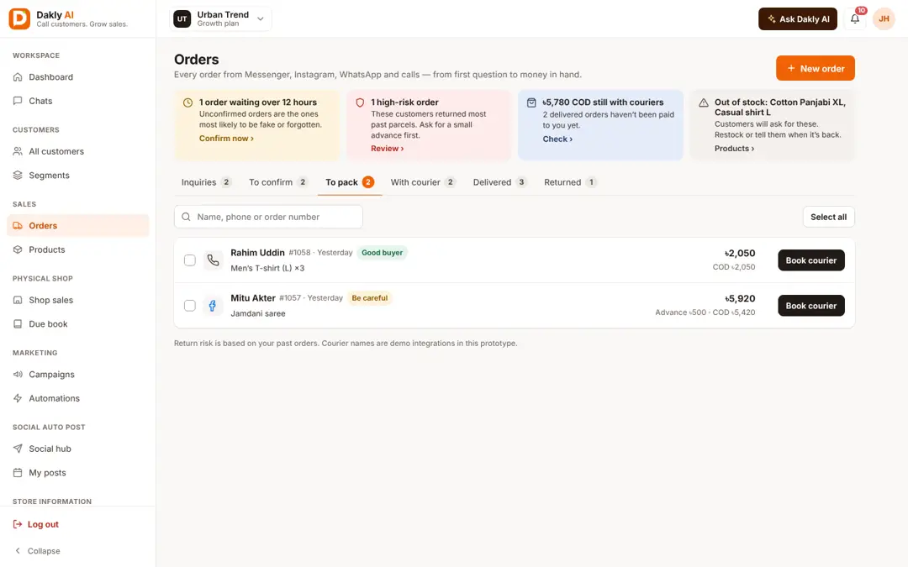
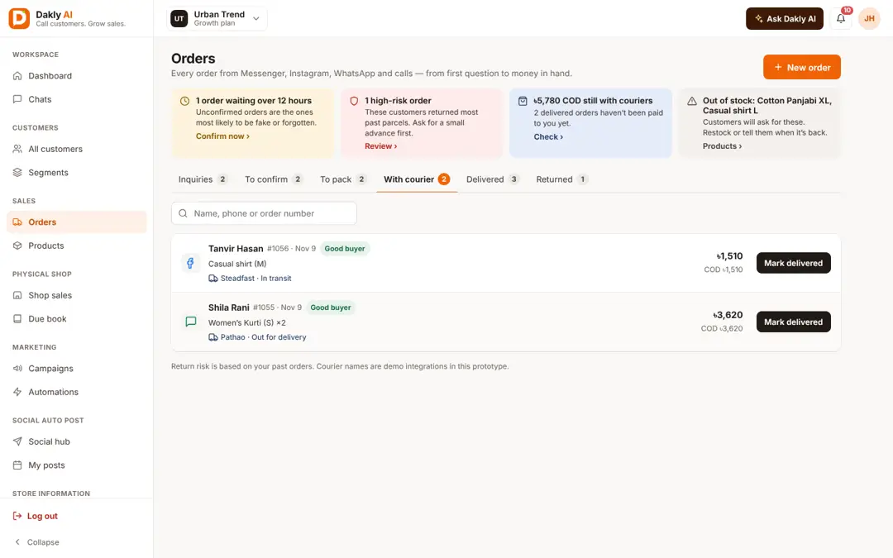
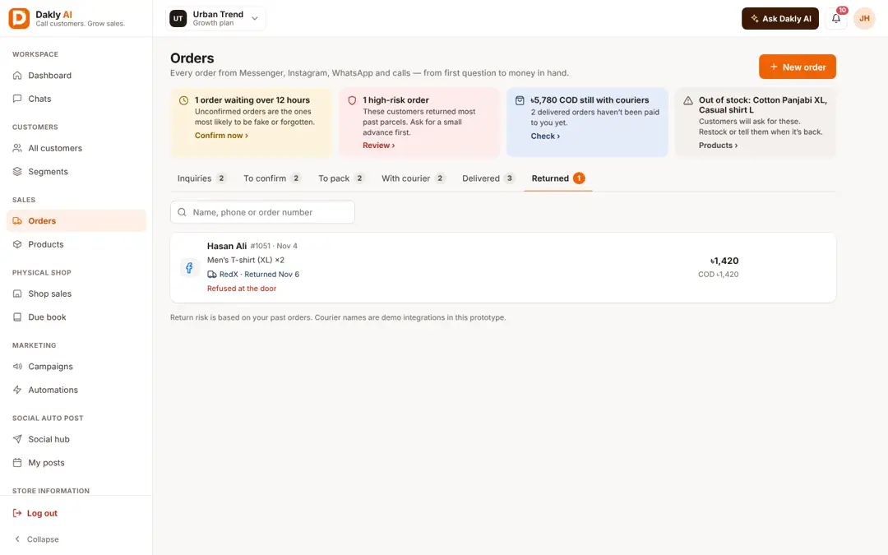
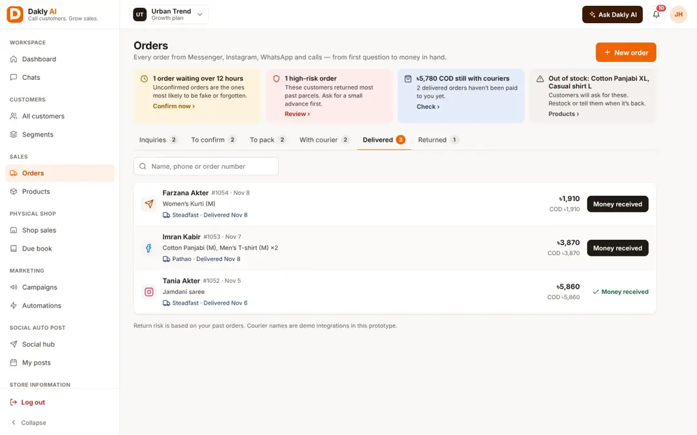
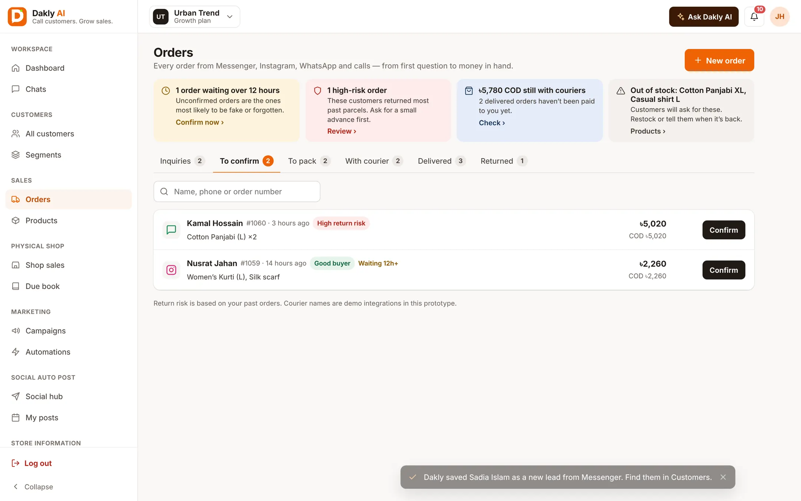

# Orders and delivery

|           |                                                                                      |
| --------- | ------------------------------------------------------------------------------------ |
| Release   | 1                                                                                    |
| Status    | In progress                                                                          |
| Extension | Sales                                                                                |
| Code      | `packages/core/src/{orders,delivery}/`, `apps/web/src/features/{orders,order-link}/` |
| Tasks     | ORD-1 to ORD-6, ORD-9, ORD-10 (ORD-7 and ORD-8 are later)                            |

## Purpose

Takes an order from a chat, the order link or a person, confirms it with the customer, and tracks it to delivery.

Courier integration (booking through courier APIs, automatic parcel status, COD reconciliation) is not in release 1 (D21). In release 1 the shop books the courier itself and records it in Dakly.

## Decisions that change the PRD

The product requirements below are the PRD text from 12 November 2026. Where a later decision changed it, the decision wins:

- D21: courier booking through courier APIs, automatic parcel status, bulk booking, courier webhooks, payout matching and courier performance are not in release 1. Staff book the courier themselves and record the courier name and tracking code on the order. The courier text below is kept so the data model does not block the later release; it is marked "Later release".
- D14: advance payment links use bKash, Nagad or City Bank card through the shop's own merchant account, not SSLCommerz.
- Q7: Inquiry is a chat flag (`buyingInterest`), not an order stage, until Asif answers. Every order starts at To confirm.
- Q13: synced Shopify and WooCommerce orders (ORD-R8) wait for Q13.
- D26: one order belongs to its buyer. Recipient name, phone and address are stored separately on that order. Confirmation and delivery do not merge contacts or replace buyer details; no OTP is required.

## Product requirements

### What it is for

Track every order from first question to money in hand, the way Bangladeshi COD sellers work: confirm, pack, book a courier, deliver, collect the COD, handle returns. Products and stock are in [05-products-and-stock.md](05-products-and-stock.md). Release 1, Sales extension.

### User stories

- As a seller, I want orders from chats, my order link, calls and my store in one pipeline, so nothing is forgotten.
- As a seller, I want to see which customers return parcels before I ship, so I can ask for an advance and stop losing delivery charges.
- Later release (D21): as a seller, I want to book Steadfast, Pathao or RedX for many orders in one tap and see tracking in Dakly.
- As a seller, I want to know how much COD the couriers still owe me (recorded by hand in release 1).
- As a seller, I want a link I can paste in any chat or post where customers place the order themselves.

### Screens

| Screen                                    | Elements                                                                                                                                                                                                                                                                                                                                                                                                                                                                                                                                                          |
| ----------------------------------------- | ----------------------------------------------------------------------------------------------------------------------------------------------------------------------------------------------------------------------------------------------------------------------------------------------------------------------------------------------------------------------------------------------------------------------------------------------------------------------------------------------------------------------------------------------------------------- |
| Orders                                    | Subtitle; New order; alert strip (orders waiting over 12 hours, high-risk orders without advance, COD still with couriers, out-of-stock items) each with a link; stage tabs with counts: Inquiries, To confirm, To pack, With courier, Delivered, Returned (Cancelled in a filter); search by name, phone or order number; filters source, courier, date; select for bulk (Book delivery, Print labels, Confirm). Order card: name, #number, age, risk label, waiting badge, items, total, payment line (COD amount or "Advance ৳X, COD ৳Y"), next action button. |
| Order detail                              | Source and time, buyer with Open profile, delivery recipient (name, phone, address, district), items, subtotal, delivery charge, discount, advance, COD to collect, stage timeline, courier and tracking ID with status, return reason, chat excerpt, actions (next stage action, Edit, Cancel, Mark returned, WhatsApp customer, Print invoice).                                                                                                                                                                                                                 |
| New or edit order                         | Paste messages box ("Paste the customer's messages with phone, product and address" → Dakly fills the form, AI-filled fields highlighted); buyer (chat contact or explicit selection/entry); recipient same as buyer by default, with a deliver-to-someone-else option; recipient name, phone, address, area and district (sets delivery charge); delivery-phone return risk kept separate from buyer history; items (product, size with stock, qty, price); discount; advance; source; Save, Save as confirmed.                                                  |
| Confirm order dialog                      | Customer, total, COD, risk label and reason; message preview (Bangla) to send by WhatsApp asking them to reply "হ্যাঁ", or by SMS with a confirm link; buttons: Send confirmation message, Mark confirmed (customer said yes by phone), Request advance by bKash, Record advance, Customer didn't confirm (cancels).                                                                                                                                                                                                                                                |
| Book delivery dialog (later release, D21) | Release 1 shows a "Sent with courier" form instead: courier (Steadfast, Pathao, RedX, own delivery, other), tracking code (optional), note. The later dialog: selected orders list (name, area, COD), courier choice with starting price (Steadfast from ৳60 in Dhaka, ৳110 outside; Pathao from ৳60 / ৳120; RedX from ৳60 / ৳115; Own delivery), pickup today, total COD, Book.                                                                                                                                                                                  |
| Order link (public page)                  | Mobile page at dakly.shop/{store}/{product} or /{store} for the catalogue: shop name and logo, product photos, price, size picker with "only N left", quantity, buyer details, recipient same as buyer by default or separate recipient name, phone, address and district (shows delivery charge), payment (COD; optional bKash advance), Place order; thank-you screen with order number. Design needed.                                                                                                                                                         |

### How it works

**Buyer and delivery recipient (D26, D27)**

The buyer is the contact who places the order. The delivery recipient may be the buyer or another person. Keep `orders.buyer_contact_id` linked to the buyer while the profile exists, snapshot their name in `buyer_name`, and store `recipientName`, `recipientPhone`, `recipientAddress` and `recipientArea` as an order snapshot. For self-delivery (the default), copy the chosen delivery details into that snapshot and save the supplied own phone on the buyer profile under D27 and the customer rules. This save happens during capture, before order creation or confirmation; it does not verify ownership, merge contacts or add marketing consent.

For a chat order, keep the originating buyer contact. For staff and public orders, identify or record the buyer separately from the delivery fields; do not use a recipient phone to resolve the buyer. If delivery is to someone else, do not fill the buyer profile with that recipient's number. If a self-delivery phone belongs to another contact, keep it on the draft or order and show staff a possible match. Leave both profiles and the buyer link unchanged and allow ordering, confirmation and delivery. An existing different buyer profile phone changes only through an explicit profile edit. Selecting delivery to someone else exposes the separate recipient fields.

Staff confirmation, confirmation replies or links, and marking delivery change the order status only. They do not merge contacts, reassign the order or overwrite profile details. No OTP is required. Later edits to the delivery snapshot leave the buyer link and profile unchanged. Later profile edits do not rewrite past delivery details.

Buyer purchase history, order counts, spend and marketing attribution use the buyer contact and count the order once. A recipient who is already a customer does not gain a purchase from receiving someone else's order. Existing parcel return-risk calculations remain scoped to the delivery phone and must be labeled separately from buyer history.

**Order stages and transitions**

| Stage        | Enters when                                                                          | Next action button                                                                            | Moves to                         |
| ------------ | ------------------------------------------------------------------------------------ | --------------------------------------------------------------------------------------------- | -------------------------------- |
| Inquiry      | A chat shows buying interest (price shared, product card sent) but no complete order | Create order                                                                                  | To confirm                       |
| To confirm   | Order created by AI, by a person, from the order link, or synced unconfirmed         | Confirm                                                                                       | To pack                          |
| To pack      | Customer confirmed (said yes, confirmed by call, or paid advance)                    | Book delivery                                                                                 | With courier                     |
| With courier | Courier booked (status Pickup requested), or own rider assigned                      | Mark delivered (by hand in release 1; automatic from courier webhooks in the courier release) | Delivered or Returned            |
| Delivered    | Courier reports delivered, or marked by hand                                         | Money received (when COD is settled)                                                          | Stays Delivered, COD marked paid |
| Returned     | Courier reports returned, or marked by hand with a reason                            | None                                                                                          | Final                            |
| Cancelled    | Cancelled before shipping (customer didn't confirm, out of stock, duplicate)         | None                                                                                          | Final                            |

Inquiry-only outcomes recorded for reporting: Lost inquiry, No response.

**Confirmation**

The confirm message is a WhatsApp utility template with order number, items, total including delivery, address and "reply হ্যাঁ to confirm". A "হ্যাঁ" (or yes, ji, ok, confirm, ঠিক আছে) reply moves the order to To pack. Without WhatsApp it goes by SMS with a one-tap confirm link instead, because Bangladesh A2P SMS cannot receive replies. No reply in 24 hours raises the "waiting over 12 hours" alert at 12 hours and suggests a call at 24.

**Return risk**

Computed from this store's own past parcels for the phone (Glossary). High return risk orders show "Ask for a small advance first"; Book delivery warns before booking a high-risk order with no advance. Cross-store or courier-network lookups are not used in release 1 (privacy decision).

**Courier booking (later release, D21)**

Release 1: staff book the parcel on the courier's own site, then use "Sent with courier" to record the courier and tracking code. Delivered, Returned and Money received are marked by hand.

1. Each courier is connected once in Integrations with the merchant's own API keys.
2. Book sends: invoice (Dakly order number), recipient name, phone, address, district/area, COD amount, weight (default 0.5 kg, editable), item description, note. Bulk booking sends one request per courier batch.
3. Dakly stores the consignment ID and tracking code, shows status Pickup requested, and polls status every 30 minutes (or receives webhooks where the courier offers them). Status maps to Dakly stages: in transit and out for delivery → With courier; delivered → Delivered; returned or cancelled by courier → Returned.
4. If "Courier updates" is on in Chats, the customer gets a message when the parcel ships and when it's out for delivery.
5. COD reconciliation: Delivered orders show COD pending until the courier's payment report (or the owner) marks them paid. The alert strip totals pending COD.

**Own delivery**

No booking; the order gets a rider name and moves to With courier; the rider or owner marks Delivered and Money received.

**Order link**

Each product with "Order link" on gets a URL. A buyer picks size and quantity, enters buyer details, and uses the same delivery details or enters a separate recipient. It arrives in To confirm with source Order link, records the buyer independently of the recipient phone, and reserves stock. Order-specific SMS or WhatsApp uses the chosen order contact details without granting access to unrelated orders. Self-delivery saves the buyer's own phone under D27; another recipient's phone remains only on the order. Rate limit 5 orders per delivery phone per day to stop spam.

### Business rules

| ID     | Rule                                                                                                                                                        |
| ------ | ----------------------------------------------------------------------------------------------------------------------------------------------------------- |
| ORD-R1 | Order numbers are per store, sequential from #1001.                                                                                                         |
| ORD-R2 | An order needs a valid phone (^01\[3-9\]\\d{8}$), a name, an address, a district and at least one item with a price.                                        |
| ORD-R3 | A tracked item's quantity can't exceed available stock unless a person ticks "Allow even though out of stock". The AI can never oversell.                   |
| ORD-R4 | Delivery charge comes from the district table in Knowledge (default ৳60 Dhaka, ৳120 outside; Gazipur, Narayanganj, Savar ৳100) and can be edited per order. |
| ORD-R5 | Items subtotal = sum of (quantity × unit price − line discount). COD to collect = items subtotal − order discount + delivery − advance, never negative.     |
| ORD-R6 | Duplicate check: same phone, same product, within 24 hours shows "Possible duplicate of #1060" before saving.                                               |
| ORD-R7 | Cancelling or returning puts stock back and records the reason; returned orders update the customer's return risk at once.                                  |
| ORD-R8 | Orders synced from Shopify or WooCommerce follow that store's status and are read-only in Dakly except courier details and notes.                           |

### States and edge cases

- Later release (D21): courier API error on booking: the order stays in To pack with "Booking failed: reason" and Retry.
- Partial delivery (marked by hand in release 1): mark Delivered with a note and a lower COD; show the difference.
- Customer changes size after confirming: Edit order re-checks stock and sends a new summary.
- Phone typed with Bangla digits or +880: normalised.

### Permissions

View Orders: see orders and history. Edit Orders: create, confirm, book, cancel, mark delivered or returned, record money.

### Events

order.created, order.confirmed, order.booked, order.status\_changed, order.delivered, order.returned, order.cancelled, cod.settled, product.stock\_changed, product.restocked, product.price\_missing. These feed automations (tab 6: Places an order, Pays for an order, Has their order shipped, Has their order canceled).

### Acceptance criteria

- Given Cotton Panjabi L has 2 available, when an order for 2 is created, then available shows 0 and the AI tells the next customer L is sold out.
- Given a customer with 3 returns out of 5 parcels, when their order is in To confirm, then it shows High return risk and the alert strip counts it until an advance is recorded.
- Later release (D21): given 3 orders in To pack, when the owner books Steadfast for all 3, then each gets a consignment ID, moves to With courier and shows Pickup requested.
- Given a delivered COD order of ৳2,510, when staff mark the COD collected, then COD with couriers drops by ৳2,510.
- Given a customer opens the order link and orders Women's Kurti S, then the order appears in To confirm with source Order link and the customer gets an SMS with the order number.

### Beyond the prototype

The prototype shows orders and courier steps with sample data. Nabik, SeloraX and Pathao Commerce show what Bangladeshi sellers expect from order operations.

| Addition                                                                                                                                                   | Why                                                       | Release |
| ---------------------------------------------------------------------------------------------------------------------------------------------------------- | --------------------------------------------------------- | ------- |
| Profit per order: product cost, delivery charge paid to the courier, COD fee and payment fees, giving net profit per order and per period                  | Sellers care about profit, not revenue (Nabik shows this) | 1       |
| Later release (D21): COD reconciliation: match each courier payout to its orders, flag missing or short payments, and show "COD with couriers" per courier | Lost COD money is a top complaint                         | 1       |
| Advance payment link (delivery charge or full amount) by bKash, Nagad or City Bank card (D14), optional per order or for high return-risk buyers           | Reduces fake orders and returns                           | 1       |
| Printable invoices and shipping labels with barcode, in bulk                                                                                               | Daily packing work                                        | 1       |
| Duplicate order detection (same phone, same items within 24 hours)                                                                                         | Buyers often order twice in chat and the order link       | 1       |
| More couriers: eCourier and Paperfly after Steadfast, Pathao, RedX and Carrybee                                                                            | Coverage outside Dhaka                                    | 2       |
| Courier recommendation per order by district success rate and price, from the shop's own history                                                           | Lowers returns                                            | 2       |
| Daraz order import                                                                                                                                         | Many shops also sell on Daraz                             | 2       |

**Do not copy from the prototype:** order numbers, return-risk labels on sample buyers, courier charges and the sample stock counts. Return risk follows D12.

### Verified details from AiPraktor, Nabik and Wati (12 Nov 2026)

| Topic               | What they do                                                                                                                                                                                                                | Dakly rule                                                                                                                                                                                                                                                              |
| ------------------- | --------------------------------------------------------------------------------------------------------------------------------------------------------------------------------------------------------------------------- | ----------------------------------------------------------------------------------------------------------------------------------------------------------------------------------------------------------------------------------------------------------------------- |
| Order stages        | AiPraktor: Pending, On hold, Approved, Processing, Ready to ship, In transit, Delivered (Payment due or Payment collected, Partial delivered), Flagged (Pending return, Returned, Damaged), Cancelled by reason.            | Keep Dakly's stages (tab 5) and add: On hold (needs a reason and optional follow-up date: pre-order, can't reach customer, waiting for advance, customer asked to wait), Partial delivered, Damaged, and payment state (due or collected) separate from delivery state. |
| Cancellation notice | AiPraktor sends one cancellation notice in the chat, but not for duplicate, fake, test or wrong orders.                                                                                                                     | Same; cancel reasons are a fixed list and the notice is skipped for those four.                                                                                                                                                                                         |
| Advance payments    | AiPraktor records bKash or Nagad advances with method, amount, transaction id and screenshot; each transaction id can be used once; payments can be cancelled with a reason, never deleted; advances are deducted from COD. | Same rules, plus Dakly payment links where the shop connects a gateway.                                                                                                                                                                                                 |
| COD collection      | Collected status comes from some couriers automatically (not Steadfast), otherwise marked by hand; totals of due and collected per courier.                                                                                 | Same, plus payout matching (tab 5).                                                                                                                                                                                                                                     |
| Delivery charge     | Inside Dhaka and outside Dhaka (Savar, Keraniganj and Tongi count as outside); the AI never guesses and staff can override.                                                                                                 | Zones per shop: Inside Dhaka, Dhaka suburbs, Outside Dhaka by default, editable; area list maps to zones; the AI quotes only from the zone table.                                                                                                                       |
| Export and hand off | AiPraktor can export orders to CSV and lock them so a shop can use another system.                                                                                                                                          | Same, for shops that keep their own order system.                                                                                                                                                                                                                       |
| Pre-dispatch check  | Staff see the buyer's purchase history and separately the delivery-phone parcel history; courier-side history only when the courier returns it.                                                                             | Return risk from the shop's own parcels (D12); courier data shown only from official courier APIs.                                                                                                                                                                      |
| WhatsApp checkout   | Wati: a customer sends a cart from the WhatsApp catalog, then gets an address request and a payment message (India, beta).                                                                                                  | Release 2: WhatsApp catalog synced from Products; cart in WhatsApp creates a draft order and the address and payment steps.                                                                                                                                             |

Sources: [AiPraktor help](https://www.aipraktor.com/help), [Nabik](https://nabik.ai), [Wati auto checkout](https://support.wati.io/en/articles/11463061-how-to-enable-auto-checkout-and-collect-payment-for-my-catalog-orders)

## Prototype screens

Captured from the prototype on 13 Nov 2026 by opening each button, tab and dialog. Layout only: the numbers, names and some flows are sample data (see the next section).

**New order with paste and fill**

**Order detail**

**Inquiries tab**

**To pack tab**

**With courier tab**

**Returned tab**

**COD still with couriers**

## Where the prototype is wrong or missing

The prototype is a concept with sample data. Build from this doc, not from the prototype, where they differ.

### Missing design: orders page

**Why it's needed.** "Orders" is a permission area in every role, the Support agent role "checks their orders", the counter-staff role "can view Orders", and the customer profile has an Orders tab. Dakly already syncs 8,960 orders from Shopify, but there is no page to see them.

**What to design.**

- **Order list**: order number, customer, items, total, payment (COD, bKash, card), status (pending, confirmed, shipped, delivered, returned, cancelled), source (Shopify, WooCommerce, Facebook, in-store), date; filters and search by order number or phone.
- **Order detail**: items with photos, delivery address, courier and tracking, payment, timeline of status changes and messages sent about this order (confirmation, shipping), link to the customer.
- **Attribution**: "This order counted for: New Kurti collection (WhatsApp, read Oct 16)", so owners can see why Analytics credits a campaign.
- **In-store and Facebook orders**: a simple "Add order" form for counter staff and orders taken in Messenger, since those don't come from Shopify. This is how offline shops get into Dakly.
- **Profile Orders tab**: the same list filtered to one customer.

**Answered by the PRD:** orders are created and edited in Dakly; only synced Shopify and WooCommerce orders are read-only (ORD-R8). The original question was: is Dakly a view of store orders (read-only, edits happen in Shopify), or can staff create and update orders? Read-only is much smaller, but in-store and Facebook orders need at least "Add order".

### Missing design: courier integration (later release, D21)

**Why it's needed.** The "Shipping confirmation" workflow promises "the courier tracking link", and "Review request" starts "when customers have their order shipped". Most Bangladeshi online shops ship with local couriers, and Shopify often doesn't know the tracking link. Without a courier connection, these workflows can't run.

**What to design.**

- **Integrations: Delivery section** with cards for the couriers the team picks (for example Pathao, Steadfast, RedX), each with connect by API key, status and last sync.
- **Status mapping**: which courier status counts as shipped, delivered, returned, so workflows can start on the right event.
- **Message variables**: {tracking\_link}, {courier\_name}, {delivery\_date} available in templates.
- **Order detail**: courier, tracking number and delivery timeline (ties to section 4).
- **New workflow triggers**: delivered, delivery failed, returned to sender. A "COD order returned" alert is valuable for shops because returns cost them money.

**States.** Courier not connected (workflow shows "Connect a courier to start"); tracking number missing on an order; courier API down.

## Engineering

### Screens in release 1

Pipeline by stage with counts and return risk badges. To confirm includes On hold, and Delivered includes Partly delivered. Each combined tab counts both stages. Cards show the order age and use the total supplied by the API.
The pipeline URL keeps the stage, search and page cursor. Search uses the buyer or recipient name, order number or exact recipient phone for staff who can see full phones. The alert strip links to orders waiting over 12 hours, high-risk unconfirmed orders with no advance, and unpaid COD on delivered parcels. Counts cover the store. The out-of-stock alert waits for the staff oversell rule, since orders currently cannot reserve stock they do not have. The list shows up to two item lines. The detail and timeline follow the pipeline.
The order link page customers see is not designed yet. Hide the prototype's courier connections and Book courier buttons in release 1; show a simple "Sent with courier" form instead.

### How it works

An order has two state fields: `stage` for fulfilment and `paymentStatus` for money.

| Stage                              | Next stages                                    | Stock effect on entering          |
| ---------------------------------- | ---------------------------------------------- | --------------------------------- |
| `to_confirm`                       | `to_pack`, `on_hold`, `cancelled`              | Reserve tracked items             |
| `on_hold` (reason, follow-up date) | `to_confirm`, `to_pack`, `cancelled`           | None                              |
| `to_pack`                          | `with_courier`, `on_hold`, `cancelled`         | None                              |
| `with_courier`                     | `delivered`, `partially_delivered`, `returned` | Ship (reserved → deducted)        |
| `delivered`, `partially_delivered` | `returned` (late return)                       | Partial: return undelivered units |
| `returned`                         | none                                           | Return units unless damaged       |
| `cancelled`                        | none                                           | Release reservations              |

`paymentStatus`: `cod_pending`, `advance_requested`, `advance_paid`, `paid`, `cod_collected`, `refund_due`, `refunded`.

The transition table is data in `orders/order-stage.ts`. The staff API supports confirming, holding, moving back to To confirm, and cancelling. ORD-9 adds dispatch and delivery actions. `OrdersService.changeStage` rejects disallowed transitions with `ORDER_STAGE_NOT_ALLOWED`. Moving a held order back to To confirm keeps its reservation. Cancellation releases the reservations recorded on the order, even if tracking has since been turned off. The stage change, audit entry (from, to, actor, reason), and event are written in the same transaction.

The order list uses an order-number cursor and returns counts for all stages. The detail includes the recipient snapshot, items, and stage history. Staff without the full-phone permission see a masked recipient number.

Create order (`OrdersService.createOrder`, one transaction)

1. Validate with the contracts schema. Resolve the buyer contact from the chat or explicit buyer fields/selection. Normalise and snapshot the recipient phone and delivery details separately; never resolve or merge the buyer using another recipient's phone (D26). For self-delivery, save the supplied own phone on the resolved buyer under D27; a uniqueness conflict becomes a staff suggestion, not an order failure or reassignment.
2. Take the next order number from the store counter (starts at 1001).
3. Resolve the delivery charge: area → zone → charge. Staff may override; the AI may not.
4. Copy prices from the variants, compute COD = items − discount + delivery − advance (never below 0), reserve stock, warn on a likely duplicate (same phone and variant within 24 hours), emit `order.created`.
5. If the store's payment rule asks for an advance (always, or when return risk is High), create a payment intent and set `advance_requested`.

Staff without full-phone access do not see the linked duplicate order. The staff out-of-stock override waits for a rule for oversold stock at reservation, dispatch and cancellation.

Staff orders use `POST /orders` with an `Idempotency-Key`. During order capture, Orders edit access allows staff to record a new buyer and fill an empty own-phone field under D27. Editing a profile separately requires Customers edit access. A retry returns the existing order. The order discount cannot exceed the item subtotal after line discounts. An advance above the total leaves zero COD. The order starts in To confirm. Order numbers come from the locked store counter. Creating an order updates the buyer's timestamp so import undo keeps that contact. Staff can record money already received by hand. Cancelling an advance-paid order sets `refund_due` in the same transaction as the cancellation audit and stock release. Payment links and `advance_requested` wait for PAY-6. Order creation from a chat waits for CHAT-1.

Staff can edit items, discounts and the delivery snapshot in To confirm, On hold, and To pack before COD is collected. The buyer stays linked and their profile stays as it was. Changes to a recipient name or address keep the phone and charge unless staff supply new values. Choosing another area quotes its charge. New lines use the current variant price. Existing lines keep the price recorded on the order. The item and stock changes, totals, duplicate hint, and edit audit are saved together. The customer summary after confirmed edits waits for ORD-4. Adding items requires enough stock to reserve.

Confirmation: a WhatsApp utility template, or an SMS with a confirm link (SMS cannot receive replies). A yes reply on WhatsApp ("হ্যাঁ", yes, ji, ok, confirm, "ঠিক আছে") moves the order to `to_pack` when it is the contact's only order in `to_confirm`; with two, the AI asks which.

Sending with a courier (release 1): staff move the order to `with_courier` and may type the courier name (from a fixed list: Steadfast, Pathao, RedX, own delivery, other) and the tracking code. Staff mark the order delivered, partly delivered or returned by hand, and mark COD collected when the money arrives. The shipping update message to the customer includes the tracking code when there is one.

ORD-9 records dispatch through `POST /orders/:orderId/courier` and records the member who sent the parcel. Dispatch deducts reserved stock. A partial delivery records a note in the order history and each delivered quantity and returns the undelivered units to stock. A late return puts back only the delivered units. Damaged returns keep the units out of stock. The stage change and stock movement commit together. ORD-4 sends the shipping update from the stage event.

Partial delivery scales each line discount by the delivered quantity divided by the ordered quantity. It scales the order discount by the delivered item subtotal divided by the ordered item subtotal. Round each discount down to a whole poisha. Apply no share of the order discount when the original item subtotal is zero. Keep the delivery charge and advance, then recompute COD with a minimum of zero. The original quantities, prices and discounts stay on the order. The delivered quantities, discounts and subtotal are saved separately.

For example, an order has three items at ৳1,250 each, a ৳10 line discount, a ৳30.01 order discount, ৳60 delivery and a ৳200 advance. Two delivered items receive a ৳6.66 line discount, leaving ৳2,493.34 in items. Their share of the order discount is ৳20. COD becomes ৳2,333.34.

Staff can record the COD amount once after delivery. Returning an order with an advance, paid balance or collected COD sets `refund_due` in the return transaction. The order list and details compute return risk from completed parcels for the recipient’s phone in the same store. A partly delivered parcel counts as delivered for risk. A single past parcel is too little for a badge.

Later release (D21), kept here so the data model does not block it: courier connections with the shop's own keys, booking as an idempotent job per order, parcel status by webhook or polling, and COD reconciliation from courier payouts matched by consignment id. Do not build any of it in release 1.

Order link: a public page per store and product (`dakly.shop/{store}/{product}`). It posts to a public endpoint that finds the store from the slug on the server, needs a Turnstile token, allows 5 orders per phone per day and 30 per IP per hour, and calls the same `createOrder`.

### Delivery zones

ORD-2 adds delivery-zone create, list, edit and delete routes under Store settings,
and a paginated area list for any store member. Charges are integer poisha.
A district or upazila can belong to one zone. A more specific area overrides its
parent district; an unlisted area uses the default zone. Changing the default and
assigning areas are serialized per store. The default zone needs a replacement
before removal, and a zone used by orders cannot be deleted.

`POST /delivery-zones/initialize-defaults` sets up an empty store with Inside Dhaka
at 6,000 poisha, Dhaka suburbs at 10,000 and Outside Dhaka at 12,000. It refuses to
replace existing zones. Dhaka district is Inside Dhaka. Gazipur district,
Narayanganj district and Savar upazila are in Dhaka suburbs. Savar's mapping takes
precedence over its parent Dhaka district. The defaults use positions 0, 1 and 2.
GET routes never initialize or change settings.

This task adds the backend only. There is no delivery-settings image in the
current design folder, and no delivery-settings screen is added here.

### Rules

1. An order always has at least one item, a phone and an address.
2. Stage changes follow the table; nothing else.
3. Money is poisha; the COD amount is computed, never typed.
4. Moving to `with_courier` records who did it; courier name and tracking code are optional.
5. Return risk uses only the shop's own parcels (D12).
6. Cancelling after an advance sets `refund_due`.

### Permissions

`orders.view`, `orders.edit`; refunds need the `refund` flag.

### Events

Emits `order.created`, `order.stage_changed`, `order.confirmed`, `order.cod_collected`.

Removing a line from an editable order deletes that `order_items` row, adjusts its stock reservation, recalculates totals and writes the audit event in one transaction. The database role permits deletion; order stage and payment checks belong to the planned OrdersService. A customer purge detaches `contact_id` and `conversation_id` while preserving `buyer_name` and order history. Unknown buyer names remain null; recipient names never fill that gap.

### Data

`orders` (buyer in `buyer_contact_id`; delivery recipient as a snapshot per D26; `is_recipient_buyer` for D27; manual `courier` and `tracking_code` in release 1; `discount_code_id` when a shop discount code was used), `order_items` (`line_discount_poisha` is the whole discount on the line), `discount_codes` (the shop's own codes from a campaign offer, a workflow step or by hand), `sms_messages` (confirmation and update SMS sent outside a chat, kept 13 months), `store_counters`, `delivery_zones` (district and upazila ids from `bd_areas`), `bd_areas` (global reference data). The stage timeline reads `audit_log` ([ADR 0006](../adr/0006-history-folded-into-parent-rows.md)). Courier tables come with the courier integration in a later release. Full design: [docs/data](../data/README.md).

### Edge cases to test

- Marking delivered an order that is still `to_pack` is refused.
- Items edited after confirmation re-reserve the difference and send a new summary.

### Acceptance

- Given Rahim orders for Karim, then the order stays under Rahim and stores Karim's delivery details. Staff may confirm and mark it delivered without an OTP; neither action merges contacts or changes either profile.
- Given Karim orders for Rahim, then the order stays under Karim and stores Rahim's delivery details. Count that purchase once under Karim.
- Given the recipient already has a customer record, then receiving the parcel does not add this purchase, spend or attribution to that record or expose its unrelated orders to the buyer.
- Given a buyer has no phone and orders for someone else, then a valid recipient phone permits delivery without being copied to the buyer profile. Changing the recipient later leaves the buyer and purchase history unchanged.
- Given a buyer with no profile phone supplies an unused own phone for self-delivery, then save it on the buyer profile and order snapshot without verification or marketing consent. Later profile edits do not change the snapshot.
- Given a self-delivery phone conflicts with another contact, including a concurrent phone save, then preserve both profiles, keep the phone on the order, show staff a possible match, and allow order creation, confirmation and delivery without merging or moving purchase history.
- Given an order for ৳1,250 with ৳60 delivery and a ৳200 advance paid, then COD is ৳1,110.
- Given an order in `to_pack`, when staff mark it sent with Pathao and tracking code DP123, then it moves to `with_courier`, stock is deducted and the customer gets the tracking code.

## Open questions

Q7 (Inquiry as a stage).
