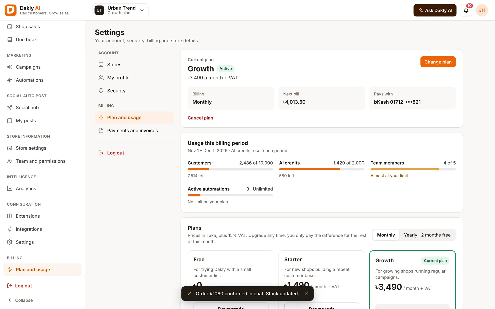

# Payments and billing

|           |                                                                                                                                                      |
| --------- | ---------------------------------------------------------------------------------------------------------------------------------------------------- |
| Release   | 1                                                                                                                                                    |
| Status    | Not started                                                                                                                                          |
| Extension | Core                                                                                                                                                 |
| Code      | `packages/core/src/{payments,billing,usage}/`, `packages/providers/src/payment/{bkash,nagad,citybank}/`, `apps/web/src/features/{payments,billing}/` |
| Tasks     | PAY-1 to PAY-9                                                                                                                                       |

## Purpose

Dakly takes money in two ways that must never mix.

| Flow             | Merchant                        | Who pays     | For                                                |
| ---------------- | ------------------------------- | ------------ | -------------------------------------------------- |
| A. Dakly billing | Dakly's own merchant accounts   | Shop owner   | Plan, Chats AI add-on, SMS packs, WhatsApp balance |
| B. Shop payments | The shop's own merchant account | The customer | COD advances and full payments for orders          |

Dakly never holds shop money (D14): collecting for others needs a Bangladesh Bank PSO licence.

## Screens

The prototype shows Rocket; release 1 has bKash, Nagad and City Bank cards only. Settings › Payment methods (flow B), the request payment drawer and the customer payment page are not in the prototype.

## How it works

Payment intent (both flows): every attempt to take money is a `payment_intents` row created before the customer sees a gateway page, with flow, store, amount in poisha, purpose, gateway, a unique merchant reference (`DK-7Q2M-01`), status and expiry.

Statuses: `created` → `pending` → `succeeded` | `failed` | `cancelled` | `expired`; after success `partially_refunded`, `refunded`, and `disputed` for cards. Status only moves forward and every change writes an event row.

1. The service creates the intent and asks the driver for a gateway URL.
2. The customer pays on the gateway's hosted page. Dakly never sees PINs or card numbers.
3. The callback (`/payments/{gateway}/callback`) trusts nothing in its parameters. It loads the intent by merchant reference, enqueues `verify-payment-intent`, and shows "Checking your payment" while the page polls.
4. The job calls the gateway's execute or query API. Only a reply with the same amount, currency and reference marks the intent `succeeded`.
5. Status updates use `UPDATE ... WHERE id = :id AND status = :expected`, so two racing callbacks give one success.
6. Reconciliation jobs check pending intents at 1, 5, 15 and 60 minutes, then every 6 hours for 3 days.

Credentials: each store's gateway credentials use envelope encryption. A per-store data key is encrypted by the master key from the secrets store; values are AES-256-GCM with the store id as associated data, so a copied ciphertext fails in another store.

Billing (flow A): subscription status `trialing`, `active`, `past_due`, `read_only`, `cancelled`. A daily job at 10:00 Asia/Dhaka renews (bKash agreement or pay link), retries on days 1, 3 and 5, sets `read_only` on day 8, and sends a deletion notice at day 60. One guard enforces read-only: AI replies, campaign sends, post publishing and automations fail with `STORE_READ_ONLY`; reading keeps working.

Usage: every billable thing goes through `UsageService.consume(storeId, unit, quantity, reference)`, which checks the allowance, then top-ups, and writes a usage event unique on reference. Units: `ai_conversation`, `ai_content`, `ai_ask`, `sms_credit`, `whatsapp_poisha`. 80% and 100% thresholds notify once per period.

## Rules

The PRD's payment rules apply in full. The ones code must make impossible to break:

1. Paid only after a server-to-server check with matching amount, currency and reference (PAY-R1). Redirect parameters never mark anything paid.
2. Every callback and webhook is idempotent (PAY-R4).
3. A flow B intent can only use the store's own credentials; a check constraint and a test prove it (PAY-R5).
4. Credentials are write-only in the UI, encrypted at rest, decrypted only in the payments worker, never logged (PAY-R6).
5. An amount mismatch sets `needs_review`, not `succeeded` (PAY-R8).
6. Refunds need Owner or Admin; above ৳5,000 also the owner's 2-step code; total refunds never exceed the captured amount (PAY-R10).
7. The AI may create a payment link from the store's rule; it may not set amounts, record payments, mark paid or refund (PAY-R11).
8. Manual Send Money payments are Unverified until a person confirms them (PAY-R14).
9. Invoices are numbered per financial year (July to June), never edited; corrections are credit notes (PAY-R17). The PDF is in the app and is emailed to the owner when they have a verified email.

## Permissions

`billing.view`, `billing.edit` (Owner only for plan changes). Shop payments: `orders.edit` to request; `refund` flag to refund.

## Events

Emits `payment.succeeded`, `payment.failed`, `payment.refunded`, `subscription.renewed`, `subscription.past_due`, `subscription.read_only`, `usage.threshold_reached`.

## Data

`payment_intents`, `payment_events`, `payment_gateway_credentials`, `payment_links`, `refunds`, `subscriptions`, `invoices`, `wallet_ledger`, `usage_events`. `usage_period_totals` is cut by the schema review (pending review).

## Edge cases to test

- Callback arrives twice: one success.
- Verified amount differs: `needs_review` and a shop alert.
- Customer pays twice for one order: second marked Duplicate; Dakly never refunds by itself.
- A gateway errors 3 times in 5 minutes: that method is hidden for 10 minutes.

## Acceptance

- Given an order with a ৳200 advance rule, when the customer pays by bKash and the execute call succeeds, then the order shows `advance_paid` and COD drops by ৳200.
- Given a subscription 8 days past due, when the AI tries to reply, then it is blocked with `STORE_READ_ONLY` and the owner sees why.

## Open questions

Q1 (prices). City Bank card tokenisation is not confirmed (D15). Gateway API details come only after merchant approval.
