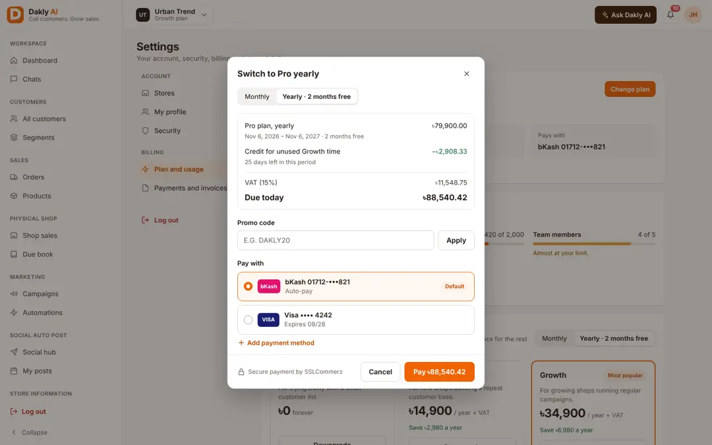
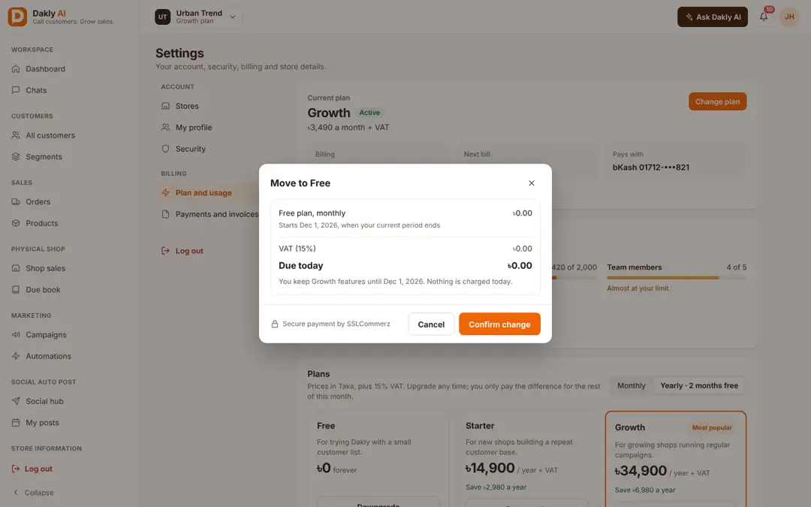
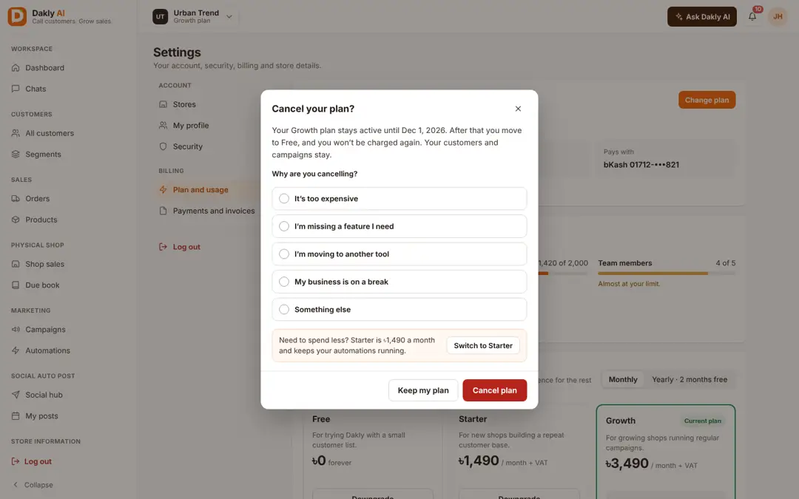
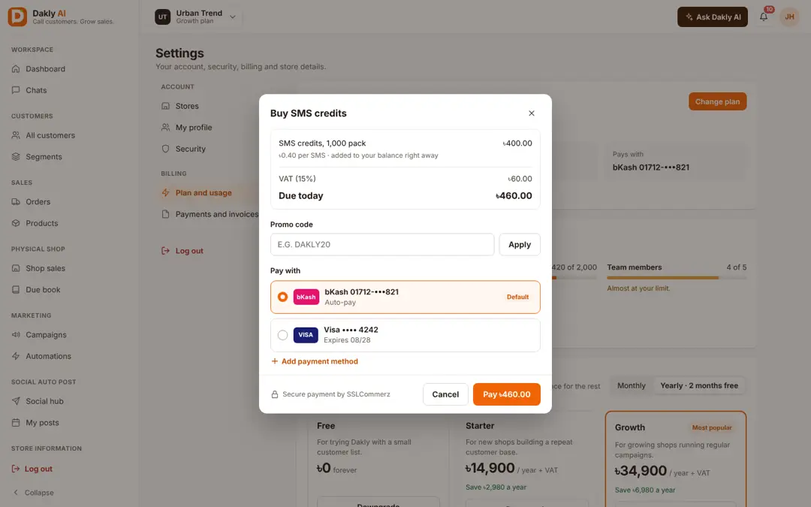
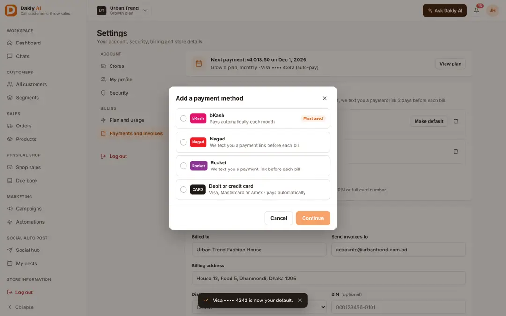
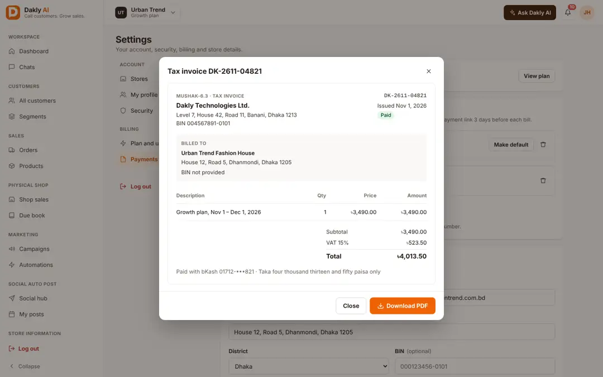
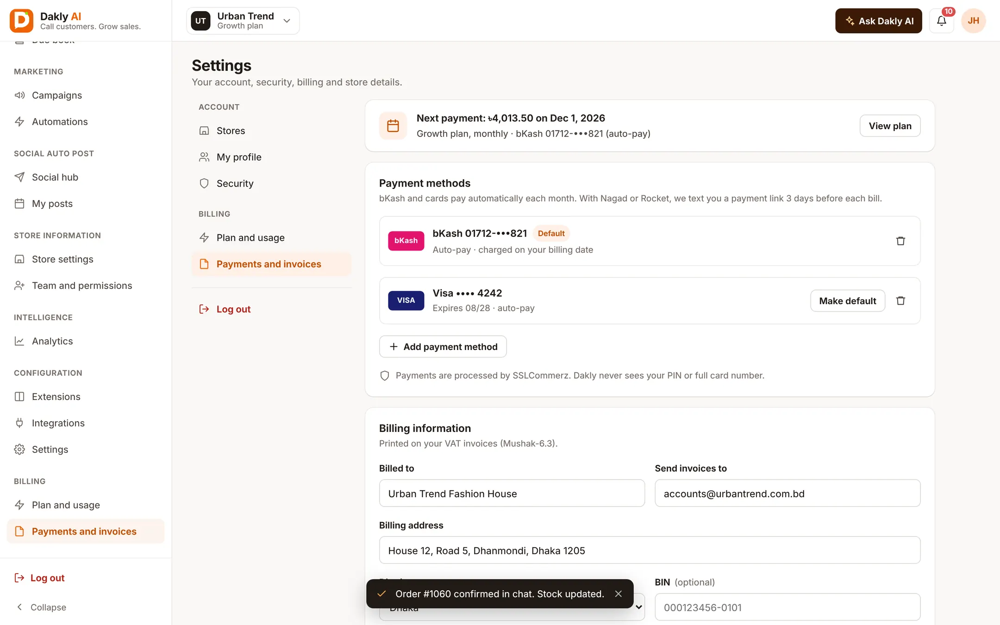

# Payments and billing

|           |                                                                                                                                                              |
| --------- | ------------------------------------------------------------------------------------------------------------------------------------------------------------ |
| Release   | 1                                                                                                                                                            |
| Status    | Building                                                                                                                                                     |
| Extension | Core                                                                                                                                                         |
| Code      | `packages/core/src/{payments,billing,usage,wallets}/`, `packages/providers/src/payment/{bkash,nagad,citybank}/`, `apps/web/src/features/{payments,billing}/` |
| Tasks     | PAY-1 to PAY-11                                                                                                                                              |

## Purpose

Dakly takes money in two ways that must never mix.

| Flow             | Merchant                        | Who pays     | For                                                |
| ---------------- | ------------------------------- | ------------ | -------------------------------------------------- |
| A. Dakly billing | Dakly's own merchant accounts   | Shop owner   | Plan, Chats AI add-on, SMS packs, WhatsApp balance |
| B. Shop payments | The shop's own merchant account | The customer | COD advances and full payments for orders          |

Dakly never holds shop money (D14): collecting for others needs a Bangladesh Bank PSO licence.

## Decisions that change the PRD

The product requirements below are the PRD text from 12 November 2026. Where a later decision changed it, the decision wins:

- D20: payment receipts, invoices, renewal reminders and failed-payment alerts may go by email when the owner has a verified email, in addition to SMS and WhatsApp. The PRD's "no email in release 1" no longer applies.
- D14: gateways at launch are bKash, Nagad and City Bank. SSLCommerz and Rocket are not built.
- D1: the Shop counter staff column in the permissions table applies from release 2.

## Product requirements

### What it is for

Dakly takes money in two different ways, and they must never be mixed up.

| Flow                 | Who is the merchant                   | Who pays            | What for                                                                      | Where the money lands                                                              |
| -------------------- | ------------------------------------- | ------------------- | ----------------------------------------------------------------------------- | ---------------------------------------------------------------------------------- |
| **A. Dakly billing** | Dakly (WPXPO's own merchant accounts) | The shop owner      | Plan subscription, Chats AI add-on, SMS packs, WhatsApp balance top-ups       | Dakly's bKash, Nagad and City Bank merchant accounts                               |
| **B. Shop payments** | The shop (its own merchant accounts)  | The shop's customer | Advance payment (usually the delivery charge) or full prepayment for an order | The shop's own bKash, Nagad or City Bank merchant account. Dakly never touches it. |

**Release:** release 1 for both flows. Gateways at launch: bKash Tokenized Checkout, Nagad Online Payment, and City Bank card acquiring (Visa, Mastercard, Amex). The design is built so more gateways (Rocket, Upay, SSLCommerz, aamarPay) can be added as adapters later without screen changes.

**Why shops connect their own accounts (licensing).** Under Bangladesh's Payment and Settlement Systems Act 2024, collecting money on behalf of other merchants is aggregation and needs a Payment System Operator (PSO) licence from Bangladesh Bank, and banks may not deal with unlicensed operators. Dakly does not hold that licence, so in flow B Dakly only creates the payment request and verifies the result. The money moves directly from the customer to the shop's account. Dakly never receives, holds, splits or pays out shop money. Revisit only if Dakly decides to apply for a PSO licence (see Decisions log D14).

**Why this matters to shops.** Most Bangladeshi f-commerce orders are cash on delivery, and fake or refused orders cost the shop the delivery charge both ways. Asking for the delivery charge in advance by bKash is the most common defence today, but it is done by hand: "send money to 01XXXXXXXXX and send me the TrxID", then the owner checks the bKash app. Dakly automates this with a verified payment link that the AI agent can send in chat.

### User stories

- As a **shop owner**, I want to pay my Dakly plan with bKash once and have it renew by itself, so that my store never stops working.
- As a **shop owner**, I want to top up my WhatsApp and SMS balance in under a minute, so that a campaign is not blocked.
- As a **shop owner**, I want to connect my own bKash merchant account, so that customers pay me directly and Dakly can confirm the payment for me.
- As a **support agent**, I want to send a payment link for the delivery charge from the chat, so that I do not have to check TrxIDs by hand.
- As the **AI sales agent**, I want to send a payment link when the shop's rule says an advance is needed, so that risky COD orders are filtered before booking a courier.
- As a **customer**, I want to pay from my phone in a few taps in Bangla, using bKash, Nagad or a card, and see a clear receipt.
- As a **shop admin**, I want to refund all or part of a payment, so that I can handle cancellations properly.
- As **Dakly finance**, I want every payment, refund and invoice to reconcile with gateway settlement reports, so that the books are correct.

### Screens

#### Settings › Payments › Payment methods (flow B)

- One card per gateway: logo, name, status chip (Not connected, Connected, Sandbox, Needs attention), the account label (for example "bKash merchant ••••4521"), last successful verification time, and buttons Connect, Test, Disconnect.
- **Connect bKash:** fields App key, App secret, Username, Password; mode Live or Sandbox. Help text links to how to get a bKash merchant account (PGW) and where to find the keys.
- **Connect Nagad:** fields Merchant ID, Merchant private key (paste or upload), Nagad public key; mode Live or Sandbox. Shows the callback URL the shop must register in the Nagad merchant panel, with a Copy button.
- **Connect City Bank:** fields Merchant ID, API username and password or client certificate (whichever City Bank issues), terminal ID; mode Live or Test. Shows the return URLs to give City Bank.
- On Save, Dakly calls the gateway with a harmless request (token grant or status query) and shows "Connected" only if it succeeds. Secrets are write-only: after save they show as •••• with a Replace button, never in clear again.
- **Payment rules** section on the same page: default advance type (None, Delivery charge, Fixed amount, Percent of order, Full amount), "Ask for advance when return risk is High" toggle, link expiry (default 24 hours, 1 hour to 7 days), and which connected methods to show customers and in which order.
- **Manual payments** toggle: "I also accept Send Money to a personal number". When on, the shop lists numbers; payments recorded this way are marked Unverified (see PAY-R14).

#### Request payment drawer (from an order or a chat)

- Opened from Order detail › Request payment, or from the chat composer's ৳ button.
- Fields: amount type (advance or full), amount (prefilled from the rule), note shown to the customer, methods offered, expiry.
- Preview of the message that will be sent, in Bangla by default: "আপনার অর্ডার #1063 নিশ্চিত করতে ডেলিভারি চার্জ ৳120 অগ্রিম দিন: {link}".
- Buttons: Send in chat, Copy link. Sending posts the message through the chat channel and logs it on the order timeline.

#### Public payment page (customer side)

- Address: `pay.dakly.app/{short-code}`. Mobile-first, Bangla by default with an English switch, shop logo and name, order number, items summary, amount, expiry countdown.
- One button per method the shop has connected, in the shop's order. Tapping a method redirects to that gateway's hosted page. Dakly never collects card numbers, wallet PINs or OTPs on its own page.
- After the gateway returns: a result page that shows "Checking your payment…" until the server has verified it, then Paid (with TrxID, amount, time, and a Download receipt button), Failed (Try again or choose another method), or Expired.
- The page works on 2G-class connections: under 100 KB, no third-party trackers, server-rendered.

#### Payments list and detail (flow B)

- Under Orders › Payments. Columns: time, order, customer, method, amount, status, TrxID, link. Filters: status, method, date, order. Export to CSV.
- Detail: a timeline of every event (link created, sent, opened, gateway started, gateway callback, verified, refunded) with raw gateway reference IDs, and a Refund button.
- **Refund dialog:** full or partial amount (max is captured minus already refunded and reserved refunds), reason (required), confirmation with the owner's 2FA code when the amount is over the store's refund threshold.

#### Settings › Plan and billing (flow A)

- Current plan, renewal date, price, payment method on file (for example "bKash 017••••321, auto-renew on"), Change plan, Cancel plan.
- **Pay or change payment method:** choose bKash (auto-renew available), Nagad (one-time), or card through City Bank (one-time, or saved card if City Bank tokenisation is enabled).
- **Balances:** WhatsApp balance (৳), SMS credits, Chats AI credits, each with Top up. Top-up amounts as chips (৳200, ৳500, ৳1,000, ৳2,000, custom). Auto top-up: when balance falls below ৳X, charge ৳Y to the saved bKash agreement (off by default).
- **Invoices:** list with number, date, item, amount, VAT, status, PDF download. PDF is a VAT invoice (Mushak 6.3 format) once Dakly is VAT-registered.
- **Billing banners:** "Payment failed, we'll retry on 14 Nov", "Your plan ends in 3 days, add a payment method", "Your store is in read-only mode, pay now".

### How it works

#### The payment intent (shared by both flows)

Every attempt to take money is a **payment intent** row in Dakly, created before the customer sees any gateway page. It has: id, flow (billing or shop), store\_id, amount in poisha (integer), currency BDT, purpose, gateway, merchant reference (unique, for example `DK-7Q2M-01`), status, expiry, and links to the order or invoice.

Statuses: `created` → `pending` (customer sent to gateway) → `succeeded` or `failed` or `cancelled` or `expired`. After success: `partially_refunded`, `refunded`, and for cards `disputed`. Status only moves forward, and every change writes an event row.

The golden rule: **the browser redirect and the callback are only hints.** A payment is succeeded only when Dakly's server has called the gateway's execute or query API itself and the reply matches the intent's amount, currency and merchant reference.

#### bKash Tokenized Checkout

Used for flow A (including auto-renew) and flow B. Steps, per bKash's tokenized checkout API (endpoint names to be confirmed against the official docs at developer.bka.sh when the merchant account is approved):

1. **Grant token.** Server calls Grant Token with app key, app secret, username and password, and caches the id\_token per merchant account until shortly before it expires (about 1 hour); uses Refresh Token after that. Tokens are cached in Valkey, encrypted, keyed by credential id.
2. **Create payment.** Server calls Create Payment with amount, currency BDT, intent "sale", the merchant invoice number (the intent's merchant reference), the payer reference, and the callback URL. bKash returns a paymentID and a bkashURL. Dakly stores the paymentID on the intent and redirects the customer to the bkashURL.
3. **Customer pays** on bKash's page with wallet number, OTP and PIN.
4. **Callback.** bKash redirects the browser to Dakly's callback URL with paymentID and status (success, failure or cancel).
5. **Execute.** On a success callback, the server calls Execute Payment with the paymentID. A reply with statusCode `0000` and transactionStatus Completed, with matching amount and invoice, marks the intent succeeded and stores the trxID.
6. **Query if unsure.** If Execute times out or returns an error, the server calls Query Payment before deciding. The reconciliation job does the same for intents left pending.

**Auto-renew (flow A only).** On first payment the shop can tick "Renew automatically with this bKash account". Dakly then runs the bKash **agreement** flow (create agreement, customer approves on bKash's page, execute agreement) and stores the agreementID. Renewals call Create Payment with the agreementID, which charges without the customer re-entering a PIN, subject to bKash's rules for the merchant account. The shop can cancel the agreement from Plan and billing at any time, and Dakly calls Cancel Agreement.

**Refunds.** Refund API with paymentID, trxID, amount and reason; partial refunds allowed up to the original amount. Refund Status API is used to confirm. Refunds are only possible within bKash's refund window for the account, so the Refund button is disabled with a reason after that.

#### Nagad Online Payment

Used for flow A (one-time payments only at launch) and flow B. Nagad gives its API docs and sandbox only to approved merchants, so the details below come from published SDKs and must be confirmed during onboarding.

1. **Keys.** The merchant generates an RSA key pair in the Nagad merchant panel, keeps the private key, and gets Nagad's public key. Dakly stores both encrypted.
2. **Initialise.** Server sends merchant ID, order ID (the merchant reference), date-time (Asia/Dhaka) and a random challenge, encrypted with Nagad's public key and signed with the merchant's private key. Nagad returns a payment reference ID and its own challenge, encrypted and signed the other way. Dakly verifies Nagad's signature before continuing.
3. **Complete order.** Server sends amount, currency code 050 (BDT), the challenge and the callback URL, encrypted and signed the same way. Nagad returns the URL of its payment page, and the customer is redirected there.
4. **Callback.** Nagad redirects to Dakly's callback URL with the payment reference ID and a status.
5. **Verify.** Server calls Nagad's verify endpoint with the payment reference ID and accepts the payment only if status is Success and amount and order ID match.

Refunds: through the Nagad API where the merchant account allows it, otherwise the shop does it in the Nagad merchant panel and records it in Dakly (the refund is then marked "Recorded manually").

#### City Bank card payments (TranzWare hosted payment page)

Used for flow A (cards) and flow B (cards). City Bank's e-commerce acquiring runs on Compass Plus TranzWare, with 3-D Secure for Visa, Mastercard and Amex. City Bank shares the API spec on signing the merchant agreement; the flow below is the standard hosted-page pattern and must be confirmed then.

1. **Create order.** Server calls City Bank's create-order API with amount (in poisha), currency 050, description, and approve, decline and cancel return URLs. City Bank returns an order ID, a session ID and the hosted page URL.
2. **Customer pays** on City Bank's hosted page, including 3-D Secure. Dakly never sees card data, which keeps Dakly out of PCI DSS card-data scope (SAQ A).
3. **Return.** City Bank redirects the browser to one of the return URLs.
4. **Verify.** Server calls the get-order-status API with the order ID and session ID. Only status Approved with matching amount marks the intent succeeded; store the approval code and masked card (for example "Visa ••••4242").
5. Connection is over mutual TLS with a client certificate if City Bank requires it, stored in the secrets store, never in the database.

**Saved cards for auto-renew** are only built if City Bank enables tokenisation (card-on-file) for Dakly's merchant account, which its Mastercard Payment Gateway Services partnership supports. Until then card payers renew by hand after an SMS or WhatsApp reminder.

**Refunds and disputes.** Refund (full or partial) through the refund API or City Bank's merchant portal. A chargeback notice, entered by Dakly finance or imported from the bank's report, marks the intent `disputed` and alerts the owner.

#### Flow B end to end: advance payment for a COD order

1. An order is drafted in chat (tab 4) or created by hand (tab 5).
2. The payment rule decides whether an advance is needed: always, never, or only when return risk is High.
3. If needed, Dakly creates a payment intent and a short link, and either the AI agent or a person sends it in chat. The order status is "Waiting for advance".
4. The customer opens the link and pays with bKash, Nagad or card on the shop's own merchant account.
5. Dakly verifies the payment with the gateway (4.2 to 4.4). The order moves to "Advance paid", a receipt message is sent in the same chat, and the courier COD amount is reduced by the advance automatically when the parcel is booked.
6. If the link expires unpaid, the order stays in "Waiting for advance" and appears in the "Needs follow-up" filter. The shop can resend, change the amount (which voids the old link), or confirm without an advance.

#### Flow A end to end: subscription and renewal

1. Trial ends or the owner upgrades. Dakly creates an invoice and a payment intent on Dakly's own merchant account.
2. The owner pays by bKash (optionally saving an agreement), Nagad or card.
3. On success the invoice is marked paid, the plan period starts, and a receipt goes by SMS or WhatsApp with a link to the PDF in Dakly.
4. **Renewal:** on the renewal date at 10:00 Dhaka time, Dakly charges the bKash agreement if there is one. Otherwise it sends a pay link by SMS and WhatsApp 3 days before and on the day.
5. **Failed renewal (dunning):** status past\_due. Retries on day 1, 3 and 5 after the due date, each with a reminder. All features keep working for 7 days of grace. On day 8 the store goes read-only: inbox and orders can be viewed, but AI replies, campaigns, posts and automations stop. Paying at any time restores everything at once. After 60 days unpaid, the store is scheduled for data deletion with 14 days' notice.
6. **Plan changes:** upgrades start now and charge the prorated difference; downgrades start at the next renewal.

#### Reconciliation

- A job runs at 1, 5, 15 and 60 minutes after an intent goes `pending`, and then every 6 hours for 3 days, calling the gateway's query or status API. This catches customers who paid but closed the page before the callback.
- Every night, Dakly imports or fetches each gateway's settlement report for Dakly's own merchant accounts (flow A) and matches by trxID and amount. Unmatched lines go to the admin panel's Reconciliation queue (tab 11).
- For flow B, Dakly does not reconcile settlements (that money is the shop's), but it shows the shop a CSV export they can match against their own gateway statement.

### Business rules

- **PAY-R1** A payment is succeeded only after a server-to-server execute, query or status call returns success with the same amount, currency and merchant reference as the intent. Redirect parameters alone never mark a payment paid.
- **PAY-R2** Amounts are stored as integers in poisha (৳1 = 100 poisha). Currency is BDT only. Displayed amounts use the ৳ sign and Bangladeshi grouping (৳1,25,000).
- **PAY-R3** Each intent has a unique merchant reference, and each gateway transaction ID (trxID, payment reference, order ID) can be linked to only one intent. A second success for the same reference is ignored and logged.
- **PAY-R4** Every gateway callback and webhook handler is idempotent: processing the same callback twice has the same result as once.
- **PAY-R5** Shop payments (flow B) are always created on the shop's own credentials. Dakly's own merchant accounts are used only for flow A. Code must make it impossible to create a flow B intent on Dakly credentials.
- **PAY-R6** Gateway credentials are write-only in the UI and encrypted at rest with envelope encryption (per-store data key, master key in the secrets manager). They are decrypted only inside the payments worker, never logged, and never sent to the browser or the AI.
- **PAY-R7** A payment link can be paid once. Changing the amount or methods voids the old link and creates a new one. Expired, voided or paid links show a clear page, never a gateway button.
- **PAY-R8** If the verified amount differs from the intent amount, the intent is marked `needs_review`, not succeeded, and the shop is alerted.
- **PAY-R9** If a customer pays twice for the same order, the second payment is marked "Duplicate" and the shop is prompted to refund it. Dakly never refunds by itself.
- **PAY-R10** Refunds need the Owner or Admin role. Refunds above the store's threshold (default ৳5,000) also need the owner's 2FA code. Total refunds can never exceed the captured amount.
- **PAY-R11** The AI agent may create and send a payment link using the store's payment rules (tool `create_payment_link`). It may not change amounts outside the rule, record a manual payment, mark anything paid, or refund.
- **PAY-R12** An order whose advance is paid has the advance deducted from the COD amount when it is sent with the courier. If the order is cancelled after an advance, the order shows "Refund due ৳X" until a refund is issued or the owner marks it "Kept as cancellation fee".
- **PAY-R13** If a gateway errors or times out 3 times in 5 minutes for a store, that method is hidden from new payment pages for 10 minutes and the store sees "bKash is having problems; customers can still use Nagad or card".
- **PAY-R14** Manual Send Money payments (to a personal number, with a TrxID typed by the customer or staff) are stored as "Unverified" because personal wallets have no API. They count toward the order only after a person ticks "I checked this in my bKash app", which is logged with their name.
- **PAY-R15** Subscription renewal: 7 days of grace, retries on day 1, 3 and 5, read-only from day 8, deletion notice at day 60. Messaging balances (WhatsApp, SMS) are never deleted and remain usable for 12 months after the last top-up.
- **PAY-R16** Top-ups are non-refundable once any of the balance is used. An unused top-up can be refunded within 7 days on request through support.
- **PAY-R17** Every flow A payment creates an invoice with a sequential number per financial year (July to June), for example `DK-2026-27-000123`. Invoices are never edited or deleted; corrections are credit notes.
- **PAY-R18** VAT is applied at the rate set by Dakly finance in the admin panel (currently expected to be the 15% standard rate; to confirm with Dakly's accountant). Prices on the pricing page say whether they include VAT.
- **PAY-R19** Gateway fees on flow B are the shop's agreement with its gateway. Dakly does not add any per-payment fee in release 1.
- **PAY-R20** All times for expiry, renewal and reports use Asia/Dhaka.

### States and edge cases

| Case                                                     | What happens                                                                                                                                                    |
| -------------------------------------------------------- | --------------------------------------------------------------------------------------------------------------------------------------------------------------- |
| Customer closes the bKash page before finishing          | Intent stays `pending`; the reconciliation job queries it. If bKash says not paid, it becomes `cancelled` after expiry.                                         |
| Callback never arrives but money was taken               | Reconciliation catches it within 60 minutes and marks it succeeded; the chat receipt goes out then.                                                             |
| Execute call times out                                   | Query Payment before retrying Execute. Never execute twice without a query in between.                                                                          |
| Gateway credentials invalid or revoked                   | Card shows Needs attention; new links for that method are blocked; the owner gets an in-app and SMS alert.                                                      |
| Store has no gateway connected                           | Request payment shows "Connect bKash, Nagad or a card gateway first" with a button; the AI agent falls back to the store's manual payment instructions, if any. |
| Order amount changes after the link was sent             | Old link voided automatically; the agent or staff is prompted to send the new one.                                                                              |
| Sandbox mode                                             | Payment pages show a yellow "Test payment, no real money" banner; test payments never mark real orders paid.                                                    |
| Card chargeback                                          | Intent `disputed`; owner alerted; order shows the dispute with the bank's deadline.                                                                             |
| Subscription payment fails because of low wallet balance | Dunning (4.6) with a message that names the reason when the gateway gives one.                                                                                  |
| Owner removes the bKash agreement                        | Auto-renew turns off; reminders switch to pay links.                                                                                                            |
| Two staff refund at the same time                        | Row lock on the intent; the second request sees the updated refundable amount and is rejected if it would exceed it.                                            |
| Offline (staff app)                                      | Request payment and refunds need a connection; the button is disabled with "You're offline".                                                                    |

### Permissions

| Action                                 | Owner                     | Admin                 | Marketer | Support agent     | Shop counter staff |
| -------------------------------------- | ------------------------- | --------------------- | -------- | ----------------- | ------------------ |
| Connect or replace gateway credentials | Yes                       | No                    | No       | No                | No                 |
| Edit payment rules                     | Yes                       | Yes                   | No       | No                | No                 |
| Send a payment link                    | Yes                       | Yes                   | No       | Yes               | Yes                |
| View payments                          | Yes                       | Yes                   | No       | Own chats' orders | Own sales          |
| Record a manual payment                | Yes                       | Yes                   | No       | Yes               | Yes                |
| Mark a manual payment checked          | Yes                       | Yes                   | No       | No                | No                 |
| Refund                                 | Yes (2FA above threshold) | Yes (below threshold) | No       | No                | No                 |
| Plan, billing, invoices, top-ups       | Yes                       | View and top up       | No       | No                | No                 |

### Events and notifications

Outbox events: `payment_intent.created`, `payment_intent.succeeded`, `payment_intent.failed`, `payment_intent.expired`, `payment_intent.needs_review`, `refund.created`, `refund.succeeded`, `refund.failed`, `payment.disputed`, `gateway.credentials_invalid`, `subscription.renewed`, `subscription.past_due`, `subscription.read_only`, `wallet.topped_up`, `wallet.low_balance`.

Notifications (email added by D20 for owners with a verified email): payment received goes in-app and to the chat as a receipt; failed renewal, read-only and low balance go by SMS, WhatsApp and email to the owner plus in-app; credential problems go in-app and by SMS to the owner. Automations (tab 6) can trigger on `payment_intent.succeeded` and `payment_intent.expired`, for example "Advance not paid in 6 hours → send reminder".

### Acceptance criteria

1. **Given** a store with bKash connected, **when** a customer pays a ৳120 advance link and the callback arrives with status success, **then** Dakly calls Execute, the intent becomes succeeded with the trxID, the order shows "Advance paid ৳120" and a Bangla receipt is posted in the chat within 5 seconds.
2. **Given** a success callback, **when** Execute returns a different amount, **then** the intent is `needs_review` and the order is not marked paid.
3. **Given** a customer who paid but closed the browser, **when** no callback arrives, **then** the reconciliation job marks it succeeded within 60 minutes.
4. **Given** the same callback delivered three times, **when** processed, **then** there is one succeeded intent, one receipt and one event.
5. **Given** a paid link, **when** someone opens it again, **then** it shows "Already paid" with the receipt and no payment buttons.
6. **Given** a Support agent, **when** they open a payment, **then** the Refund button is not shown.
7. **Given** an Admin, **when** they try to refund ৳6,000 on a ৳5,000 threshold, **then** they are asked for the owner's approval instead.
8. **Given** a subscription with a bKash agreement, **when** the renewal charge fails, **then** retries happen on days 1, 3 and 5, and on day 8 the store becomes read-only with a Pay now banner, and paying restores it immediately.
9. **Given** gateway credentials are saved, **when** any API response, log line or page source is inspected, **then** no secret appears.
10. **Given** a flow B request, **when** the store has no credentials, **then** no intent can be created on Dakly's own merchant accounts (unit-tested).
11. **Given** Nagad's reply signature does not verify, **when** initialising, **then** the payment is stopped and logged as a security event.
12. **Given** a City Bank card payment, **when** the customer returns on the approve URL but get-order-status says Declined, **then** the intent is failed.

### Beyond the prototype

The prototype shows a Payments settings page with toggles and a sample transaction list. Treat that as layout only. What the prototype does not show, and this tab now defines:

- The split between Dakly billing and shop payments, and the licensing reason Dakly must not hold shop money.
- Server-side verification, idempotency, reconciliation and the payment intent state machine.
- Auto-renew through bKash agreements and the dunning schedule.
- Manual Send Money support, which is how most small BD shops take advances today.
- Refund controls, disputes and VAT invoices.

**How others do it, and what Dakly copies:**

- **Shopify** lets merchants connect their own third-party payment providers and only processes payments itself where it is licensed. Dakly copies the "connect your own provider" model for flow B.
- **Stripe Billing** uses smart retries and a grace period before cancelling. Dakly copies the retry plus grace pattern with a fixed schedule suited to bKash.
- **Paddle and Lemon Squeezy** act as merchant of record and collect on behalf of sellers. Dakly cannot do this in Bangladesh without a PSO licence, so it does not.
- **AiPraktor and Nabik** sell prepaid credits topped up by bKash. Dakly does the same for messaging balances, plus a subscription for the plan.
- **WooCommerce bKash and Nagad plugins** in BD usually verify on callback only. Dakly adds the query step and the reconciliation job, which fixes the common "customer paid but order shows unpaid" complaint.

**Still to confirm with the gateways (owner: Dakly finance):**

- Official bKash PGW, Nagad and City Bank API specs and sandbox access.
- Whether bKash allows agreement payments for SaaS subscriptions on Dakly's merchant category.
- City Bank tokenisation for saved cards.
- Each gateway's refund window and fees.
- Dakly's VAT registration.

### Sources

- bKash tokenized checkout overview: https://developer.bka.sh/docs/tokenized-checkout-overview
- bKash tokenized SDK examples (grant, create, execute, query, agreement, refund): https://packagist.org/packages/karim007/laravel-bkash-tokenize, https://github.com/Itsmmdoha/pybkash
- Nagad API (initialise, complete, verify, RSA keys): https://packagist.org/packages/xenon/nagad-api, https://github.com/codeboxrcodehub/nagad, https://corefy.com/docs/connectors/nagad/
- City Bank move to Compass Plus TranzWare: https://www.finextra.com/pressarticle/103230/city-bank-revamps-e-commerce-acquiring-business-with-compass-plus-technologies
- City Bank and Mastercard Payment Gateway Services: https://www.businessinsiderbd.com/banking-insurance/news/11459/city-bank-inks-deal-to-integrate-mastercard-payment-gateway-services
- City Bank hosted checkout in third-party plugins: https://www.cartdna.com/shopify-payment-methods/city-bank-ipg, https://www.nop-station.com/city-bank-payment
- PSO licensing and banks not dealing with unlicensed operators: https://www.tbsnews.net/economy/banking/no-bank-can-make-transactions-unapproved-digital-payment-systems-52483, https://www.tbsnews.net/economy/banking/bb-unveils-draft-rules-open-digital-payments-non-bank-players-1279741
- SSLCommerz API (possible future adapter): https://developer.sslcommerz.com/doc/v4/

## Prototype screens

Captured from the prototype on 13 Nov 2026 by opening each button, tab and dialog. Layout only: the numbers, names and some flows are sample data (see the next section).

**Change plan**

**Move to a smaller plan**

**Cancel plan**

**Buy SMS credits**

**Add a payment method**

**VAT invoice (Mushak-6.3)**

## Engineering

### Screens in release 1

The prototype shows Rocket; release 1 has bKash, Nagad and City Bank cards only. Settings › Payment methods (flow B), the request payment drawer and the customer payment page are not in the prototype.

### How it works

Payment intent (both flows): every attempt to take money is a `payment_intents` row created before the customer sees a gateway page, with flow, store, amount in poisha, purpose, gateway, a unique merchant reference (`DK-7Q2M-01`), status and expiry.

Statuses: `created` → `pending` → `succeeded` | `failed` | `cancelled` | `expired`; after success `partially_refunded`, `refunded`, and `disputed` for cards. Status only moves forward and every change writes an event row.

1. The service creates the intent and asks the driver for a gateway URL.
2. The customer pays on the gateway's hosted page. Dakly never sees PINs or card numbers.
3. The callback (`/payments/{gateway}/callback`) trusts nothing in its parameters. It loads the intent by merchant reference, enqueues `verify-payment-intent`, and shows "Checking your payment" while the page polls.
4. The job calls the gateway's execute or query API. Only a reply with the same amount, currency and reference marks the intent `succeeded`.
5. Status updates use `UPDATE ... WHERE id = :id AND status = :expected`, so two racing callbacks give one success.
6. Reconciliation jobs check pending intents at 1, 5, 15 and 60 minutes, then every 6 hours for 3 days.

Credentials: each store's gateway credentials use envelope encryption. A per-store data key is encrypted by the master key from the secrets store; values are AES-256-GCM with the store id as associated data, so a copied ciphertext fails in another store.

Billing (flow A): subscription status `trialing`, `active`, `past_due`, `read_only`, `cancelled`. A daily job at 10:00 Asia/Dhaka renews (bKash agreement or pay link), retries on days 1, 3 and 5, sets `read_only` on day 8, and sends a deletion notice at day 60. One guard enforces read-only: AI replies, campaign sends, post publishing and automations fail with `STORE_READ_ONLY`; reading keeps working.

Plan catalogue (PAY-10): `plans.trial_days` is 0 to 90; 0 means no trial. The one-time catalogue migration starts Free at 0 and Starter, Growth and Pro at 14 days. For an existing code it changes only a trial length still at 0. Later admin edits stay. Prices and allowances remain placeholders until Q1. The development seed uses these trial lengths too.

ACC-16 implements `BillingService.startPlan` inside store creation. It accepts only
public base plans and snapshots the selected monthly or yearly price. Zero price
starts active with no trial, even if the plan has trial days. A paid price with trial
days starts trialing; its trial and current period end at creation time plus that
many UTC days. A paid price without a trial returns `409 PLAN_NEEDS_PAYMENT` until
PAY-7 adds checkout. Free periods end one calendar month or year later, clamped to
the last day of that month. Later catalogue edits affect new subscriptions only;
existing trial end dates and agreed prices stay unchanged. No vendor is called
inside the store transaction.

Coupons carry `duration` (`once`, `months`, `forever`). `duration_months` is required only for `months`, from 1 to 36. Existing coupons default to `once`. Subscriptions carry `coupon_id` and `coupon_ends_at`; forever has no end time. The discount and duration cannot change after the first redemption; staff create a new coupon instead. The database rejects those edits and decreases to the lifetime redemption count.

Coupon billing rules for PAY-7: once discounts the first paid invoice, then detaches. Months discounts each paid invoice whose period starts before redemption time plus N calendar months (`coupon_ends_at`). A yearly plan with a three-month coupon gets one discounted year. A failed and retried invoice remains one invoice and one redemption. PAY-10 adds storage and contracts only; redemption, expiry and invoice consumers (PAY-7) remain planned.

Usage (PAY-1): every billable AI action goes through `UsageService.consume(storeId, { unit, quantity, reference })`. Units are the AI allowances the schema allows: `ai_conversation`, `ai_content`, `ai_ask`. SMS credits and WhatsApp money are wallets in `wallet_ledger` (PAY-11), not usage units.

- The allowance is the base plan's `limits` entry for the unit, read through `BillingService.currentAllowance`; a unit the plan omits has 0. Add-ons add no allowance yet. A store with no subscription gets `404 SUBSCRIPTION_NOT_FOUND`.
- The period is the subscription's current period. `usage_events.period_start` holds the UTC date of `current_period_start`, because billing counts periods in UTC calendar days. A new period starts at zero.
- One store transaction takes an advisory lock on (store, unit), so two consumes of the last unit cannot both pass. A reference already used for that unit returns its first row and writes nothing. Otherwise, when the period's total plus the quantity passes the allowance, it refuses with `409 USAGE_ALLOWANCE_EXCEEDED`; if not, it writes one row with source `allowance`.
- Top-ups are not drawn yet. The AI top-up wallet (`ai_conversations`) has no service yet; PAY-11 serves only the SMS and WhatsApp wallets.
- A consume that crosses 80% or 100% of the allowance notifies members with `billing.view` (Owner, Admin and custom roles that view billing, the roles that can top up) in the `billing` category, with dedupe key `usage-<percent>:<unit>:<period start>`, so each notice goes once per period. The `usage.threshold_reached` event is not emitted yet.

### Payment intents and callbacks (PAY-2)

Creating an intent records a `created` event in the same store transaction. A shop
intent needs a connected credential for its gateway in that store. Billing
intents use Dakly's own merchant account. When checkout starts, the intent
records the gateway payment id and becomes `pending`.

The API limits signed callback bodies to 64 KB and limits requests by IP.
It saves the original bytes and the gateway's signature headers in
`webhook_events`. The hash of both deduplicates exact replays. The API queues a
job and returns 204. The worker looks up the
merchant reference and verifies the bytes with that merchant's credentials.
An unknown reference or invalid signature is marked ignored and its payload
is cleared. A verified callback records one payment event per gateway event
id and makes the intent due for a check. Completed intake rows use the
seven-day webhook purge.
A server-to-server result must match the reference, currency and amount.
An amount or currency mismatch, duplicate transaction or late success goes
to `needs_review` and leaves the intent unpaid. The event retains the gateway
transaction id and verified amount for review. The browser return belongs to the
gateway integration and can only request a server-to-server check.

### Rules

The PRD's payment rules apply in full. The ones code must make impossible to break:

1. Paid only after a server-to-server check with matching amount, currency and reference (PAY-R1). Redirect parameters never mark anything paid.
2. Every callback and webhook is idempotent (PAY-R4).
3. A flow B intent can only use the store's own credentials; a check constraint and a test prove it (PAY-R5).
4. Credentials are write-only in the UI, encrypted at rest, decrypted only in the payments worker, never logged (PAY-R6).
5. An amount mismatch sets `needs_review`, not `succeeded` (PAY-R8).
6. Refunds need Owner or Admin; above ৳5,000 also the owner's 2-step code; total refunds never exceed the captured amount (PAY-R10).
7. The AI may create a payment link from the store's rule; it may not set amounts, record payments, mark paid or refund (PAY-R11).
8. Manual Send Money payments are Unverified until a person confirms them (PAY-R14).
9. Invoices are numbered per financial year (July to June), never edited; corrections are credit notes (PAY-R17). The PDF is in the app and is emailed to the owner when they have a verified email.

### Permissions

`billing.view`, `billing.edit` (Owner only for plan changes). Shop payments: `orders.edit` to request; `refund` flag to refund.

### Events

Emits `payment.succeeded`, `payment.failed`, `payment.refunded`, `subscription.renewed`, `subscription.past_due`, `subscription.read_only`.

`usage.threshold_reached` is not emitted yet: it is not in the event catalogue (`packages/contracts/src/events/`). Crossing 80% or 100% of an allowance only creates the notification described under Usage (PAY-1) above.

Refund reservations serialize on the common payment intent, not on the individual refund request. In one short transaction, lock the intent, check the permanent refund idempotency key, then reserve the amount in `reserved_refund_poisha` and insert the refund. `requested` and `pending` refunds consume reserved capacity; `succeeded` and `recorded_manually` consume `refunded_poisha`. Their combined amount cannot exceed `verified_amount_poisha`; an unverified payment has no refundable capacity. A manually verified payment records that verified amount first. Commit before calling the gateway. Completion moves the amount from reserved to refunded exactly once under the same lock; a confirmed failure releases the reservation. An unknown gateway outcome stays reserved until reconciliation. A simple SUM-before-insert without this common lock is insufficient.

Wallet writers take a transaction-scoped advisory lock for `(store_id, wallet)`, read the greatest `revision`, then insert the next revision and its resulting balance in the same transaction. Revision starts at 1 and is unique within the wallet; balance reads order by revision, never transaction-start `created_at`. A retried idempotency key returns its existing entry without allocating a revision or changing balance. Legacy rows receive a one-time deterministic revision in migration; this cannot recover historical lock order that was never recorded. The refund protocol still needs implementation and concurrency tests.

### Wallets (PAY-11)

`WalletService` in `wallets/` serves the two messaging wallets, `sms_credits` (a count) and `whatsapp_poisha` (poisha). AI top-ups (`ai_conversations`) stay with the usage allowance (P2), and wallets never call `UsageService`. Every write takes an idempotency key, unique per store: the same key again returns the first entry and writes nothing.

| Method                                         | Rows written                                                                                                                                        |
| ---------------------------------------------- | --------------------------------------------------------------------------------------------------------------------------------------------------- |
| `balance(storeId, wallet)`                     | None; the `balance_quantity_after` of the highest revision, 0 for an empty wallet                                                                   |
| `reserve(storeId, { wallet, quantity, ... })`  | `reserve` of minus the quantity. Its row id is the reservation id                                                                                   |
| `release(storeId, { reservationId, ... })`     | `release` of plus the reserved quantity                                                                                                             |
| `charge(storeId, { reservationId, quantity })` | `release` of the whole reservation, then `charge` of minus the charged quantity, in one transaction                                                 |
| `credit(storeId, { wallet, quantity, ... })`   | `adjustment` of plus the quantity, by staff, referencing the staff audit row; a new entry publishes `wallet.credited`, at the entry's database time |

Release and charge rows reference the reservation (`reference_type` `wallet_reservation`, `reference_id` the reserve row id). Every settled reservation has exactly one `release` row; under the wallet lock a second release or charge of the same reservation fails with `WALLET_RESERVATION_SETTLED`. A charge may be smaller than the reservation, never larger (`WALLET_CHARGE_OVER_RESERVATION`). Reserve, charge and credit quantities are whole numbers above 0 (`WALLET_QUANTITY_INVALID`); a charge of nothing is a release. Writing the charge as its own row keeps every delta non-zero, keeps the balance equal to the sum of deltas, and records the full charge of a reservation. A write that would take the balance below zero fails with `WALLET_BALANCE_TOO_LOW`; the service checks this before writing, and the `wallet_ledger_balance` check constraint maps to the same error.

A staff credit is an `adjustment`, not a `top_up`: nothing was paid, so the top-up refund rule (PAY-R16) does not apply to it. Until PAY-8 sells SMS packs and WhatsApp top-ups, support and Super admin staff credit a shop from the admin app (P4, D28) with `POST /admin/stores/:storeId/wallet-credits/preview` and then `POST /admin/stores/:storeId/wallet-credits`. This follows the ADM-6 risky action pattern: a reason of 10 to 1000 characters, a signed effect naming the shop, wallet and quantity that expires in five minutes, then one store transaction that rechecks the staff member, writes the staff audit row and the shop audit row, and only then appends the ledger row. If either audit write fails, nothing changes. A retried confirmation returns the first credit.

The shop reads its balances with `GET /wallets`, which needs `billing.view`: Owner and Admin have it, and a custom role can be given it. The response is `{ smsCredits, whatsappPoisha }`.

Issued invoice document fields are immutable through application grants. Only `status` and `paid_at` can change; bill-to, lines, totals, tax, number and issue time require a separate credit note rather than an edit.

### Data

`payment_gateway_credentials`, `payment_intents` (also the payment link, by `short_code`), `payment_events` (append-only), `refunds`, `plans` (plans and add-ons by `kind`), `coupons` (`discount_percent` or `discount_amount_poisha`), `subscriptions` (current period price, pending price and its start date, ADM-R10), `subscription_items` (add-ons such as Chats AI tiers), `invoices`, `invoice_counters`, `wallet_ledger` (append-only; `quantity_delta` is poisha for WhatsApp and a count for SMS and AI), `usage_events`, `gateway_settlement_lines` (nightly settlement import for Dakly's own accounts; a match sets `payment_intents.settled_at`). Full design: [docs/data](../data/README.md).

### Edge cases to test

- Callback arrives twice: one success.
- Two different refund keys compete for the last refundable amount: at most one reservation succeeds; completed manual refunds consume capacity.
- A gateway timeout retains the reservation; repeated success/failure callbacks settle it once.
- Wallet transactions start A then B but lock B then A: the highest revision still gives the correct balance.
- An app-role edit to issued invoice contents fails while settlement status and paid time remain editable.
- Verified amount differs: `needs_review` and a shop alert.
- Customer pays twice for one order: second marked Duplicate; Dakly never refunds by itself.
- A gateway errors 3 times in 5 minutes: that method is hidden for 10 minutes.

### Acceptance

- Given an order with a ৳200 advance rule, when the customer pays by bKash and the execute call succeeds, then the order shows `advance_paid` and COD drops by ৳200.
- Given a subscription 8 days past due, when the AI tries to reply, then it is blocked with `STORE_READ_ONLY` and the owner sees why.

## Open questions

Q1 (prices). City Bank card tokenisation is not confirmed (D15). Gateway API details come only after merchant approval.
