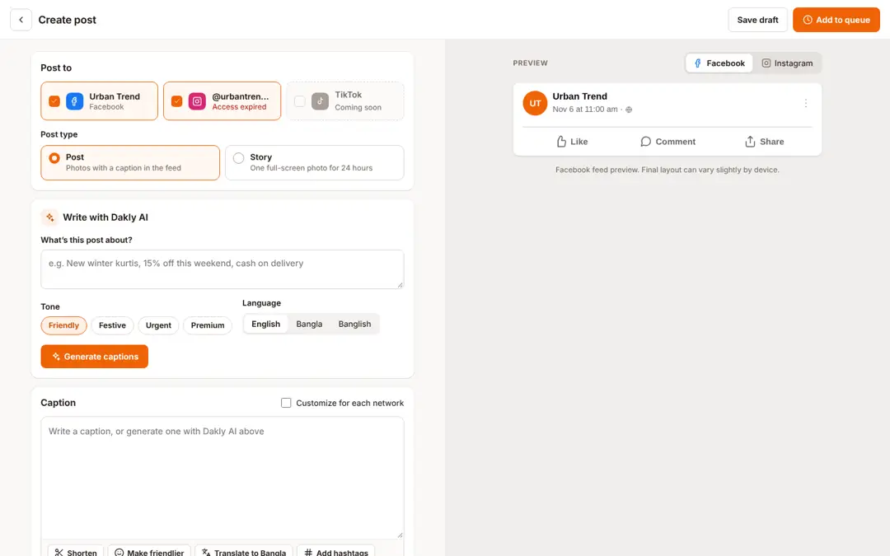
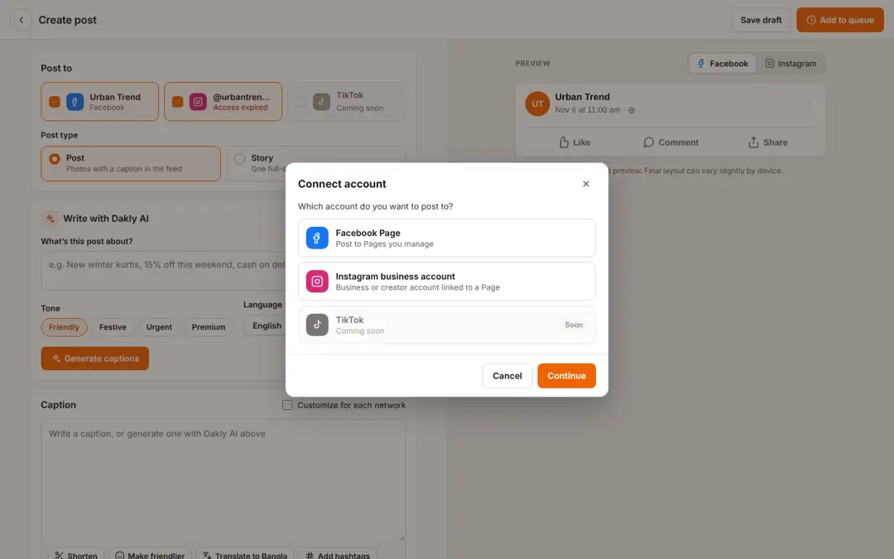
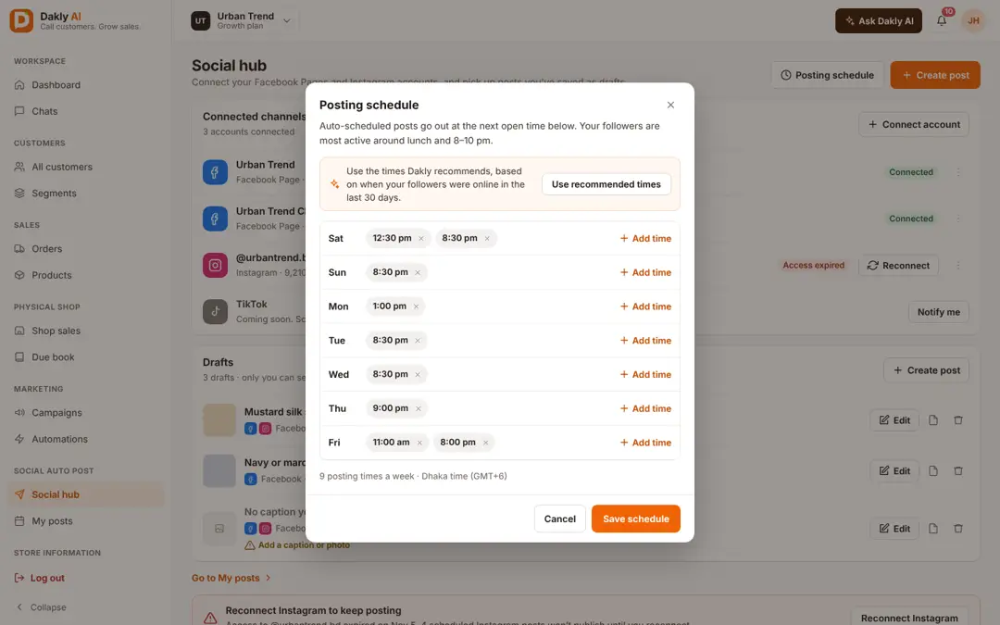
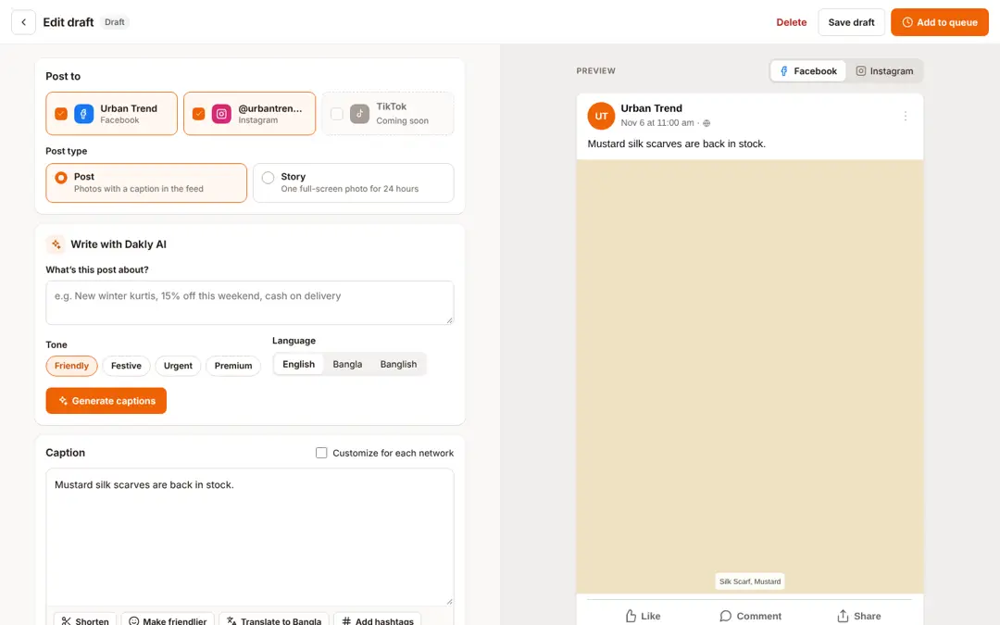
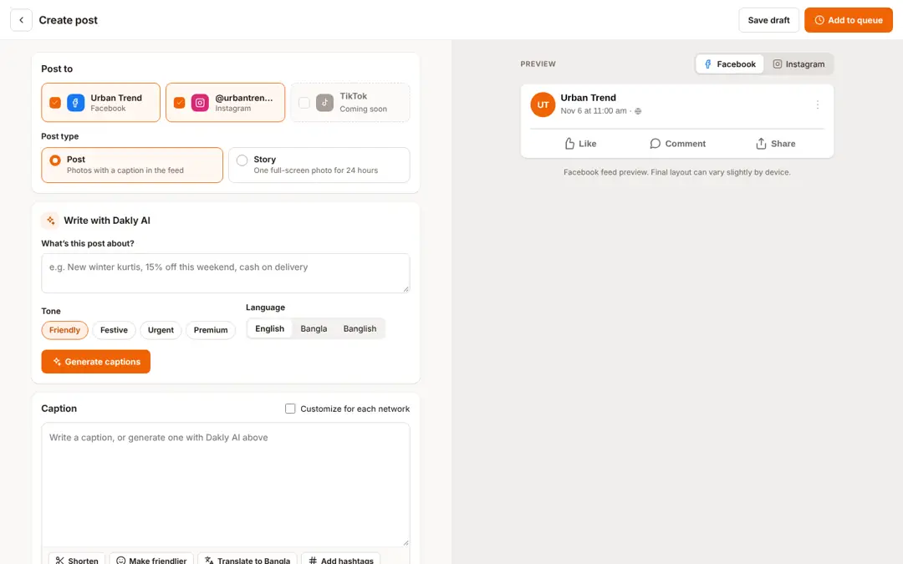

# Content Studio and Social Auto Post

|           |                                                                                  |
| --------- | -------------------------------------------------------------------------------- |
| Release   | 1                                                                                |
| Status    | In progress                                                                      |
| Extension | Core (Content Studio), Social Auto Post                                          |
| Code      | `packages/core/src/{content,social}/`, `apps/web/src/features/{content,social}/` |
| Tasks     | SOC-1 to SOC-6                                                                   |

## Purpose

Writes Facebook and Instagram posts in the shop's voice and publishes them on a schedule, so a small shop posts every day without a social media person.

## Decisions that change the PRD

The product requirements below are the PRD text from 12 November 2026. Where a later decision changed it, the decision wins:

- D7: every AI-written post needs a person to approve it before it is published.
- D4: Instagram stays in Social posting and Chats; Instagram DM campaigns are release 2.

## Product requirements

### What it is for

Shop owners know they should post every few days and write good Bangla captions, but don't have time. Content Studio writes posts, messages and product descriptions in the shop's own voice; Social Auto Post schedules them to Facebook Pages and Instagram at the times followers are online. Release 1 (Content Studio in core; Social Auto Post is an extension). TikTok stays "Coming soon".

### User stories

- As an owner, I want 3 caption options in Bangla, Banglish or English in my shop's voice, so I just pick one.
- As an owner, I want Dakly to post at the best time automatically, so I don't need to remember.
- As an owner, I want one calendar of everything scheduled, published or failed, and to drag a post to another day.
- As an owner, I want to see which posts got reach, comments and orders.

### Screens

| Screen            | Elements                                                                                                                                                                                                                                                                                                                                                                                                                                                                                                                                                                                                                                                                                                                                                                                                                                                     |
| ----------------- | ------------------------------------------------------------------------------------------------------------------------------------------------------------------------------------------------------------------------------------------------------------------------------------------------------------------------------------------------------------------------------------------------------------------------------------------------------------------------------------------------------------------------------------------------------------------------------------------------------------------------------------------------------------------------------------------------------------------------------------------------------------------------------------------------------------------------------------------------------------ |
| AI Content Studio | AI credits left and reset date; tabs Create, Library, Brand profile. Create: (1) What do you want to write? Facebook post, Instagram caption, WhatsApp message, SMS, Product description (Email subject lines hidden until Email ships); (2) What's it about? New arrival, Sale or offer, Festival greeting (Eid ul-Fitr, Eid ul-Adha, Durga Puja, Pohela Boishakh, Victory Day, Winter sale), Back in stock, Thank you, Behind the scenes; product (optional); anything else Dakly should know; (3) How should it sound? Language (Bangla, English, Banglish), length (Short, Medium, Long), tone (Friendly, Festive, Urgent, Premium, Playful), add my hashtags, end with how to order, use my Brand Profile; Write 3 options ("Uses 3 AI credits"). Results: 3 cards with Copy, Edit, Save to library, Use in post, Use in campaign. Idea chips to start. |
| Brand profile     | Shop name, what you sell, who you sell to, voice (chips), words to use, words to avoid, default language, call to action in Bangla and English, hashtags, website or link.                                                                                                                                                                                                                                                                                                                                                                                                                                                                                                                                                                                                                                                                                   |
| Library           | Saved pieces with type, language, date; search; reuse.                                                                                                                                                                                                                                                                                                                                                                                                                                                                                                                                                                                                                                                                                                                                                                                                       |
| Social hub        | Connected channels (Facebook Pages and Instagram accounts with followers and status Connected, Access expired with Reconnect; TikTok Coming soon with Notify me); Connect account; Drafts (private to creator until scheduled) with Edit, Duplicate, Delete; Posting schedule; Create post; banner when an account needs reconnecting.                                                                                                                                                                                                                                                                                                                                                                                                                                                                                                                       |
| Create post       | Post to (Facebook Pages and Instagram accounts as chips); type Post or Story; caption (one for all, or customise per network); AI caption panel (topic, tone, language → 3 options; tools Shorten, Friendlier, Translate to Bangla or English, Add hashtags); media (up to 10 photos from upload or from Products); Facebook link (optional); Instagram first comment (optional); live preview per network; When: Add to queue (next open slot, recommended), Pick date and time, Publish now; Save draft.                                                                                                                                                                                                                                                                                                                                                   |
| Posting schedule  | Weekly time slots per day (default from follower activity, for example Sat 12:30 and 20:30, Fri 11:00 and 20:30); Use recommended times; add or remove slots; time zone note.                                                                                                                                                                                                                                                                                                                                                                                                                                                                                                                                                                                                                                                                                |
| My posts          | Tabs Calendar and Published. Calendar: Month, Week, List; filter by account; colour legend Scheduled, Needs attention, Published, Failed; drag a scheduled post to another day; click opens the post. Published: sort by newest, most reach, most reactions; each with reach, reactions, comments, link taps and orders. Built so far: the Calendar and Published tabs (the Calendar count is upcoming posts); weeks start on Saturday; phones open on List; a post with a blocked account shows as Needs attention. A scheduled post moves to another day by dragging it, keeping its time, or from its details with a Move to date and time; the move follows the schedule rules (future time, one post per account per time). Orders per post (Q17) follow.                                                                                               |

### How it works

**Writing**

The language model receives: the format and its limits, the topic, product facts (name, price, sizes, description) from Products, the brand profile, the language and tone, and rules (no emoji unless the brand allows, a clear call to action, 2–3 hashtags at the end, no invented prices or discounts). It returns exactly 3 options. Banglish means natural mixed Bangla script and English words as Bangladeshi shoppers write on Facebook. Each generation uses 3 AI credits; editing tools (shorten, friendlier, translate, hashtags) use 1.

**Scheduling and publishing**

1. Add to queue picks the next free slot in the posting schedule that is at least 15 minutes ahead.
2. At publish time Dakly calls the Facebook Pages API or the Instagram content publishing API with media and caption (and first comment, link).
3. On success the post becomes Published and stores the post ID; reach, reactions, comments and link taps are pulled every 6 hours for 7 days, then daily for 30 days.
4. On failure (token expired, media rejected, rate limit) the post becomes Failed with the reason; Retry is offered, and the owner gets a Fix now notification.
5. Needs attention = scheduled within 24 hours but something will block it (expired access, missing media for Instagram).

**Recommended times**

From Page insights (when followers are online, last 30 days) and the store's order times. New Pages with no data use a default schedule (12:30 and 20:30 daily, Dhaka time) until 30 days of data exist.

**Orders from posts**

A post's orders = orders from customers who tapped a Dakly-tracked link in it, or started a chat from a comment on it (private reply) and ordered within the attribution window.

### Business rules

| ID      | Rule                                                                                                                                        |
| ------- | ------------------------------------------------------------------------------------------------------------------------------------------- |
| SOC-R1  | Instagram posts need at least 1 photo, caption up to 2,200 characters and up to 30 hashtags. Stories need 1 photo.                          |
| SOC-R2  | A scheduled time must be in the future (store time zone).                                                                                   |
| SOC-R3  | Warn 7 days before Meta access expires and again on expiry; scheduled posts for that account show Needs attention.                          |
| SOC-R4  | Drafts are visible only to their creator until scheduled; Owners and Admins can see all drafts in a "Team drafts" filter.                   |
| SOC-R5  | Deleting a published post in Dakly does not delete it from Facebook or Instagram (stated in the confirm dialog).                            |
| CONT-R1 | AI writing never invents prices, discounts, codes or claims ("best in Bangladesh", "guaranteed"); words in "words to avoid" are never used. |
| CONT-R2 | When AI credits are 0, Write is disabled with the reset date and a top-up option.                                                           |

### States and edge cases

- No Page connected: Social hub shows Connect your Facebook Page as the only action.
- Photo too large or wrong ratio for Instagram: auto-crop preview with "Adjust".
- Two posts in the same slot: second moves to the next free slot with a toast.
- AI service slow: after 20 seconds show the fallback "Try again"; never post an empty caption.

### Permissions

View Social posts: see calendar and results. Edit: create, schedule, publish, connect accounts (connecting needs Owner or Admin because it uses their Facebook login).

### Events

post.scheduled, post.published, post.failed, post.metrics\_updated, account.token\_expiring, content.generated.

### Acceptance criteria

- Given the schedule has Fri 20:30 free, when the owner adds a post to the queue on Friday at 18:00, then it is scheduled for Fri 20:30.
- Given Instagram access expired, when a post for Facebook + Instagram is due, then Facebook publishes, Instagram is marked Failed with "Access expired", and a Fix now notification appears.
- Given the brand profile avoids "cheap", when 3 options are generated, then none contains "cheap".
- Given a published post, after 6 hours its reach and reactions appear in Published.

### Beyond the prototype

The prototype's posts, captions and best-time charts are samples. Nabik's Social Studio, Buffer and Later show the useful additions.

| Addition                                                                                                                                 | Why                                                            | Release |
| ---------------------------------------------------------------------------------------------------------------------------------------- | -------------------------------------------------------------- | ------- |
| Weekly content plan: AI proposes 3–7 posts for the week from new products, stock, offers and festivals; the owner approves all in one go | Owners want a plan, not a blank editor (Nabik)                 | 1       |
| Bangladesh festival and sale calendar (Pohela Boishakh, Eid, Puja, Victory Day, 11.11, winter season) feeding suggestions                | Most sales spikes are seasonal                                 | 1       |
| Product photo tools: remove background, add price tag and logo, square and story sizes                                                   | Most sellers shoot on a phone                                  | 1       |
| AI images only for backgrounds and banners, never to change how a product looks                                                          | Misleading product images cause returns and Meta policy issues | 1       |
| Idea board and saved drafts shared by the team                                                                                           | Collaboration                                                  | 1       |
| Post results from Meta (reach, reactions, comments, link taps, chats started, orders) per post                                           | Ties posts to sales                                            | 1       |
| Meta catalog sync from Products, so posts and ads can tag products                                                                       | Shops tagging products sell more on Instagram                  | 2       |

**Do not copy from the prototype:** sample captions, follower counts, best-time values and post results. Best times are computed from the Page's own insights.

## Prototype screens

Captured from the prototype on 13 Nov 2026 by opening each button, tab and dialog. Layout only: the numbers, names and some flows are sample data (see the next section).

**Create post**

**Connect account**

**Posting schedule**

**Edit a post**

**My posts: create post**

**My posts: list view**

**My posts: week view**

## Where the prototype is wrong or missing

The prototype is a concept with sample data. Build from this doc, not from the prototype, where they differ.

### Design review: Social hub and My posts

The post composer and scheduling are well thought out. But the design can't decide whether Instagram is supported: it shows a connected Instagram account with scheduled posts, while the connect and compose screens say Instagram is "Coming soon". The team needs to settle that before build.

| Feature            | What the design shows                                                                                                                                                                                                                                                                                   | Gaps and questions for build                                                                                                                                                                     |
| ------------------ | ------------------------------------------------------------------------------------------------------------------------------------------------------------------------------------------------------------------------------------------------------------------------------------------------------- | ------------------------------------------------------------------------------------------------------------------------------------------------------------------------------------------------ |
| Connected channels | 2 Facebook Pages and 1 Instagram account with follower counts; Instagram "Access expired" with Reconnect; TikTok "Coming soon" with Notify me                                                                                                                                                           | Meta tokens expire. Decide how early to warn (the design warns only after expiry).                                                                                                               |
| Connect account    | Choose Facebook Page or Instagram business account (Instagram marked "Coming soon")                                                                                                                                                                                                                     | Contradicts the connected @urbantrend.bd account and the Instagram filter on the calendar.                                                                                                       |
| Create post        | Post or Story, AI captions (topic, tone: Friendly/Festive/Urgent/Premium, language: English/Bangla/Banglish), caption tools (shorten, friendlier, translate to Bangla, hashtags), up to 10 photos from upload or from products, Facebook link, Instagram first comment, live Facebook/Instagram preview | "Post to" only offers Facebook, Instagram marked "Coming soon". "From products" needs the store product sync. Instagram Stories need the Instagram API, so Story may be Facebook-only at launch. |
| When to post       | Auto-schedule at the next open slot (recommended), pick a time, or publish now                                                                                                                                                                                                                          | The suggested slots (Fri, Nov 6) are in the past compared with the prototype's own date (Sat, Nov 7).                                                                                            |
| Posting schedule   | 9 weekly time slots, "Use recommended times" based on when followers were online in the last 30 days                                                                                                                                                                                                    | Needs Page insights permission from Meta. New Pages have no data, so define a default schedule.                                                                                                  |
| Drafts             | 3 drafts, only visible to the creator until scheduled; Edit, Duplicate, Delete with confirm                                                                                                                                                                                                             | Should team members (Marketer role) see each other's drafts?                                                                                                                                     |
| My posts calendar  | Month/Week/List views, filter by account, colour legend (Scheduled, Needs attention, Published, Failed), drag to reschedule, Bangla and English posts                                                                                                                                                   | Good. Failed and "needs attention" posts need a retry flow.                                                                                                                                      |
| Published posts    | Tab with 4 published posts                                                                                                                                                                                                                                                                              | Post results (reach, clicks, orders) feed Analytics; define which Meta metrics are pulled and how often.                                                                                         |

## Engineering

### Posts and targets

The posts API saves, reads, edits and deletes drafts. Each target names a connected
Facebook Page or Instagram account in the store. Drafts belong to their creator.
Owners and Admins can read team drafts. Editing an AI-written draft keeps its
approval requirement. Reusing a create key returns the creator's saved draft.

Owners, Admins and Marketers can approve an AI-written draft. Scheduling it can
also record their approval. Editing the draft clears an earlier approval.
People can pick a future time or queue each target in the store's time zone.
Each connection can save weekly posting slots. An account without saved slots
uses 12:30 and 20:30 daily. A queue slot must be at least 15 minutes away, and
one account can use a slot once. Scheduling records `post.scheduled` for each
target. Moving a scheduled post records `post.scheduled` again for the new time; the earlier publish job finds no target at its time and does nothing.

With Meta publishing configured, the worker queues a publish job for each target. Instagram waits for its media
container to finish. A successful target stays published when another target
fails. Each target gets three retries over 30 minutes and a Fix now notification
if it fails. A check 24 hours before publishing flags an account that needs
reconnecting or a photo that is missing. Instagram targets require JPEG photos
when saved, approved and published. A suspended store cannot publish. Its
target fails if the store is still suspended on the last attempt. A first
comment goes to Instagram only. A recovery job runs each minute and restores
missing or failed jobs for targets due within 24 hours. The window for a missed
or failed publication ends 30 minutes after the scheduled time, including time
with Meta publishing disabled. After that, recovery records a saved receipt or
marks the target failed.

If Meta receives a publish request without returning a result, Dakly checks the
Instagram container for confirmation. A confirmed container can be marked
published even if Meta did not return the post ID. For a Facebook result it cannot confirm,
Dakly asks the shop to check the Page before posting again.

Facebook and Instagram use the connected Page token. Live publishing requires
Meta app review for `pages_manage_posts` and `instagram_content_publish`. Stores
may need to reconnect to grant them. An Instagram first comment needs comment
permission. Dakly shows a warning if it cannot confirm the comment.

The web screens (SOC-5) are a separate task. SOC-4 adds AI
caption generation and checks generated text before scheduling.

### Screens in release 1

### Web screens (SOC-5)

The Social hub lists each connected Facebook Page and Instagram account with its status, then the signed-in person's drafts, and shows a reconnect banner for an account whose access expired. Connect account opens the choice of Facebook Page or Instagram account, then the same Facebook sign-in dialog as Integrations (`components/meta-connect/`). Reconnect opens that dialog for the expired account. Where the screen differs from the design on purpose:

- Follower counts and Notify me wait for SOC-7 (followers are not stored and nothing records TikTok interest). Draft rows show the first photo as a thumbnail; post responses carry `photos` (id and a 15 minute download link for each ready photo, in post order; a photo that is not ready is left out).
- Instagram shows its single brand pink (`--color-instagram`) in place of the gradient.
- Posting schedule edits one account's weekly slots at a time (an account picker shows when there are several), because slots are stored per connection. Use recommended times waits for follower-activity data and moves to SOC-7.
- Duplicate copies the draft with its accounts and captions; Delete asks first. Edit arrives in a later SOC-5 part.
- Create post (`/social/posts/new`) is a full-screen editor outside the app shell, like the workflow canvas, built from the shared post editor in `features/social/components/post-editor/`, which Content Studio reuses for Use in post. It has Post to, Post or Story, the caption (one for all or per network), a live Facebook and Instagram preview, When (Add to queue, Pick date and time, Publish now), Save draft and Add to queue. The preview shows "Next open slot" or the chosen time instead of a sample date, and an Instagram account whose access expired shows Access expired and cannot be selected.
- Missing from Create post until later SOC-5 PRs: the AI caption panel with Shorten, Make friendlier, Translate and Add hashtags; photos from Products, the Facebook link and the Instagram first comment; and Upload from device for photos that are not products.
- An AI-written draft that nobody approved shows Needs your OK (D7).

TikTok shows Coming soon and stays hidden in release 1. The prototype's Instagram "Access expired" disagrees with the campaign builder; status comes from the real connection.

### How it works

1. A post has one row (caption, media, post or story) and one target per account it goes to. Each target has a nullable caption override and its own status (`draft`, `waiting_approval`, `scheduled`, `publishing`, `published`, `failed`), external post id and error, so Facebook can publish while Instagram fails.
2. AI-written captions need approval (D7): saving one sets `waiting_approval` until an Owner, Admin or Marketer schedules it. Captions a person typed skip this.
3. Add to queue picks the first free posting slot at least 15 minutes ahead in Asia/Dhaka. A unique index on account and time settles a race; the loser takes the next slot.
4. Publishing is a delayed job per target. Instagram uses the container flow (create, wait for finished, publish). Three retries over 30 minutes, then `failed` with a Fix now notification.
5. 24 hours ahead, a job flags targets whose token is expired or whose media is missing.
6. Insights are fetched every 6 hours for 7 days, then daily to day 30. Publishing sets the first refresh 6 hours out. An hourly sweep queues one refresh job per due published target, and the job reads reach, reactions, comments and shares through the Meta driver and overwrites the saved numbers, so a repeat run writes the same values. A count Meta does not report for that post stays empty; a story has reach only. A rate limit or outage retries with exponential backoff starting at 5 minutes. A rejected token marks the account for reconnect through the channels service, and a post Meta refuses to read keeps its last numbers; both move on to the next refresh time. After day 30 the target has no next refresh time.
7. Content Studio writes 3 options per request using the brand profile. Shorten, Friendlier and Translate return one option. Product writing uses saved product details. The model gets the brand profile only when the member can view it. The store's words to avoid always apply. A valid generation uses 3 `ai_content` credits and a valid edit uses 1.
8. Save to library stores the edited text, format, language, creator and AI provenance in `content_pieces`. Formats are Facebook post, Instagram caption, WhatsApp, SMS and product description; languages are Bangla, English and Banglish. Save to library checks that an AI run belongs to this store and completed content writing before adding AI provenance. Copying or editing an AI piece keeps its AI-written approval provenance. Library filters use kind and language, ordered by `(created_at, id)`.
9. Each `(post, connection)` has one target. A null caption override uses the post caption; an empty override intentionally has no caption. Resolve this effective text before validating each selected network's format and limits at save, approval and publish. The storage ceiling is not proof that a provider accepts the caption.
10. Brand audience, preferred words and Bangla/English calls to action have dedicated fields. Brand voice remains the writing style; it does not carry unrelated values. A store with no saved profile starts with empty fields.
11. Library pages show the newest pieces first. Editing keeps the creator and AI provenance. A copy uses the current member as its creator and keeps the source's AI provenance.

### Rules

1. Nothing AI-written is published without a person's approval.
2. Publishing uses the Page token from the channel connection; there is no separate login.
3. Generated text passes moderation before it can be scheduled.

### Permissions

`social.view`, `social.edit`.

### Events

Emits `post.scheduled`, `post.published`, `post.failed`.

### Data

`brand_profiles` (including `audience`, `preferred_words`, `call_to_action_bn`, `call_to_action_en`), `content_pieces` (saved body, kind, language, creator and provenance), `posts`, `post_targets` (caption override and metrics as columns), `files` for media. The posting schedule lives in each connection's `settings`; `ai_runs` retains generation telemetry, never the saved text. Full design: [docs/data](../data/README.md).

### Edge cases to test

- Facebook publishes and Instagram fails: two target statuses, one post.
- Two posts race for one slot.
- Token expires the day before a scheduled post.
- Save, reload, edit and copy an SMS, WhatsApp message and product description in each language: body, author and AI provenance survive.
- Save separate Facebook and Instagram captions, reload and publish: each account receives its override; a null override receives the common caption and an empty override stays empty.
- A second target for the same post and connection is rejected; separate posts still compete for the scheduled slot.

### Acceptance

- Given a post to Facebook and Instagram, when Instagram rejects the image, then Facebook shows Published and Instagram shows Failed with the reason and Fix now.

- Given an AI-generated Bangla SMS is edited and saved to the Library, when it is reloaded by type and language, then the exact edited text and creator are present and using it in a campaign still requires approval.
- Given different captions for Facebook and Instagram, when a saved draft is reopened, then each caption is preserved and checked against its selected network before publishing.

## Open questions

None.
