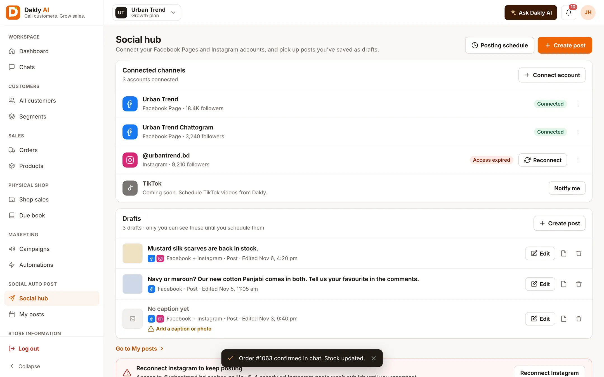
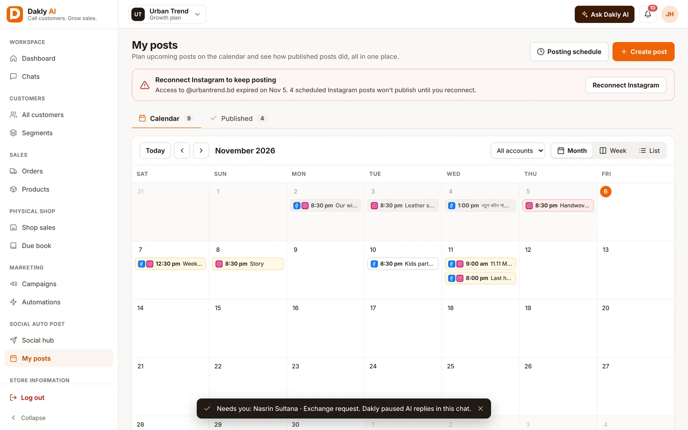

# Content Studio and Social Auto Post

|           |                                                                                  |
| --------- | -------------------------------------------------------------------------------- |
| Release   | 1                                                                                |
| Status    | Not started                                                                      |
| Extension | Core (Content Studio), Social Auto Post                                          |
| Code      | `packages/core/src/{content,social}/`, `apps/web/src/features/{content,social}/` |
| Tasks     | SOC-1 to SOC-5                                                                   |

## Purpose

Writes Facebook and Instagram posts in the shop's voice and publishes them on a schedule, so a small shop posts every day without a social media person.

## Screens

TikTok shows Coming soon and stays hidden in release 1. The prototype's Instagram "Access expired" disagrees with the campaign builder; status comes from the real connection.

## How it works

1. A post has one row (caption, media, post or story) and one target per account it goes to. Each target has its own status (`draft`, `waiting_approval`, `scheduled`, `publishing`, `published`, `failed`), external post id and error, so Facebook can publish while Instagram fails.
2. AI-written captions need approval (D7): saving one sets `waiting_approval` until an Owner, Admin or Marketer schedules it. Captions a person typed skip this.
3. Add to queue picks the first free posting slot at least 15 minutes ahead in Asia/Dhaka. A unique index on account and time settles a race; the loser takes the next slot.
4. Publishing is a delayed job per target. Instagram uses the container flow (create, wait for finished, publish). Three retries over 30 minutes, then `failed` with a Fix now notification.
5. 24 hours ahead, a job flags targets whose token is expired or whose media is missing.
6. Insights are fetched every 6 hours for 7 days, then daily to day 30.
7. Content Studio generates 3 captions per request from the brand profile and counts against `ai_content` (3 per generation, 1 per edit).

## Rules

1. Nothing AI-written is published without a person's approval.
2. Publishing uses the Page token from the channel connection; there is no separate login.
3. Generated text passes moderation before it can be scheduled.

## Permissions

`social.view`, `social.edit`.

## Events

Emits `post.scheduled`, `post.published`, `post.failed`.

## Data

`brand_profiles`, `posts`, `post_targets`, `posting_slots`, `post_metrics`, `media_assets`. `content_generations` is cut by the schema review; generations would live in `ai_runs` (pending review).

## Edge cases to test

- Facebook publishes and Instagram fails: two target statuses, one post.
- Two posts race for one slot.
- Token expires the day before a scheduled post.

## Acceptance

- Given a post to Facebook and Instagram, when Instagram rejects the image, then Facebook shows Published and Instagram shows Failed with the reason and Fix now.
