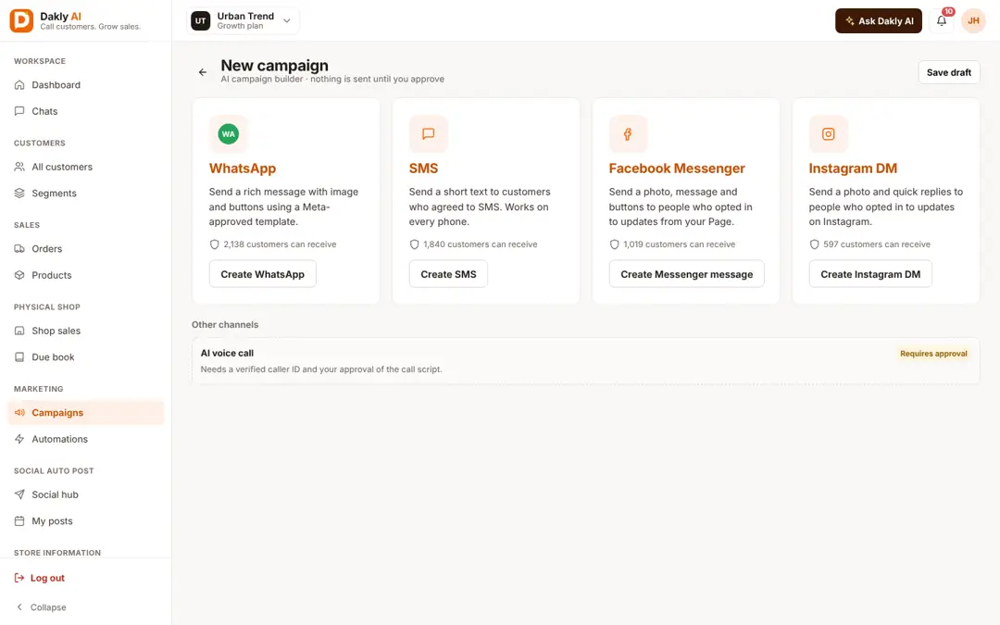
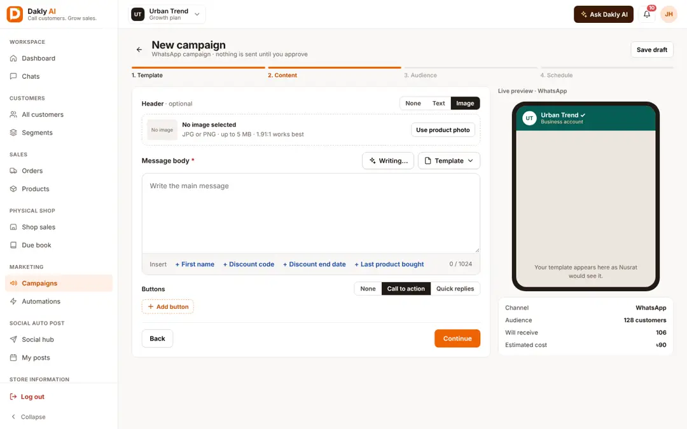
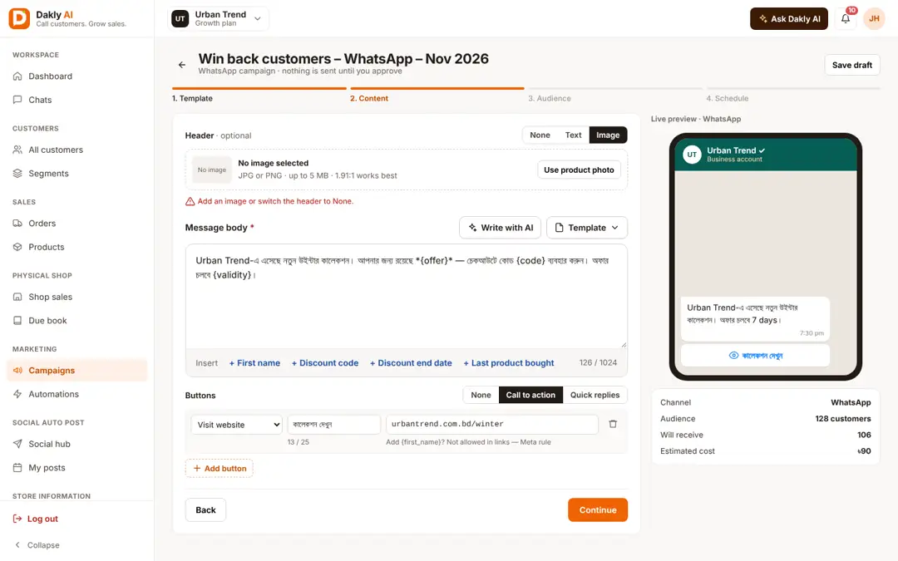
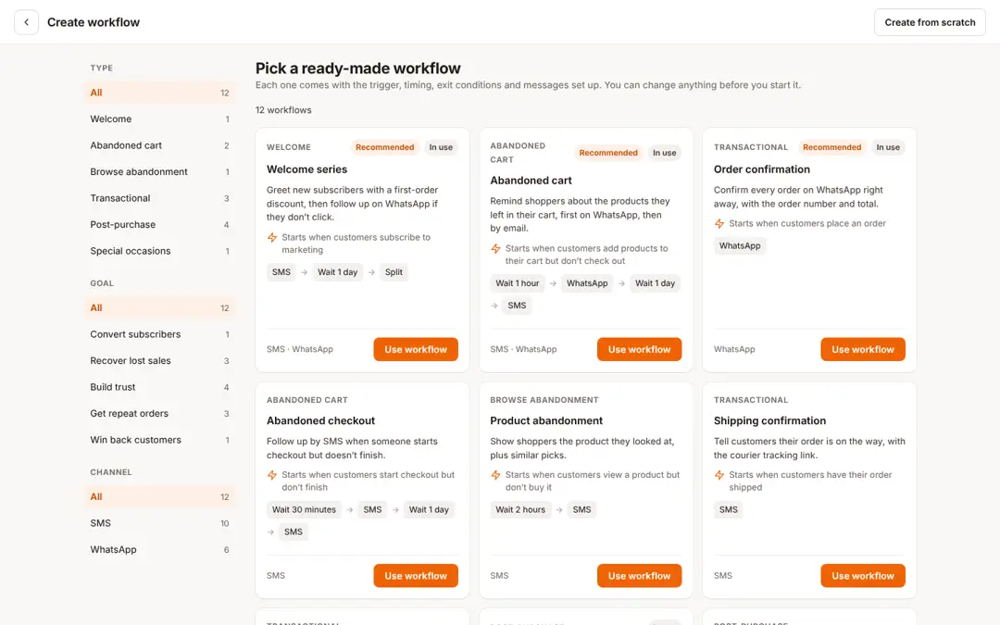
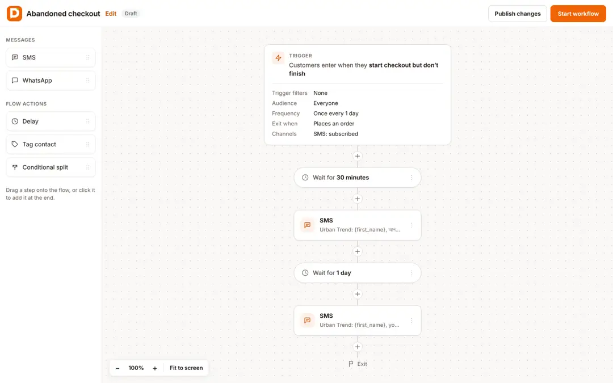
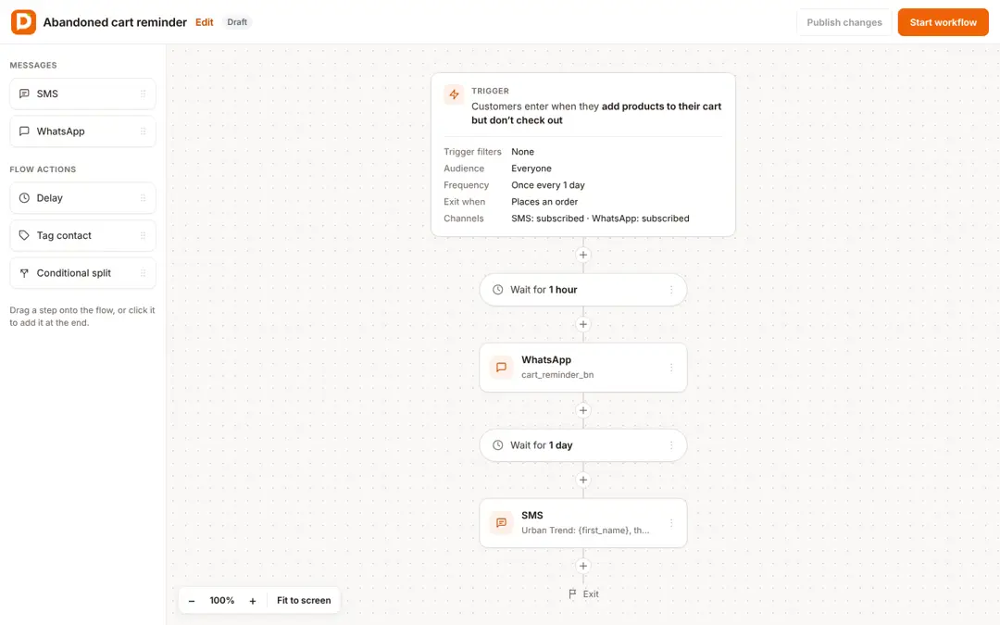

# Campaigns and automations

|           |                                                                                                                                                 |
| --------- | ----------------------------------------------------------------------------------------------------------------------------------------------- |
| Release   | 1                                                                                                                                               |
| Status    | Not started                                                                                                                                     |
| Extension | Core                                                                                                                                            |
| Code      | `packages/core/src/{campaigns,automations,templates}/`, `packages/contracts/src/automations/`, `apps/web/src/features/{campaigns,automations}/` |
| Tasks     | CAMP-1 to CAMP-12, plan in [campaigns-and-automations.md](../plans/campaigns-and-automations.md)                                                |

## Purpose

Campaigns send one message to a group once. Automations send messages on their own when a customer does something. Both reach only people who agreed to hear from the shop, and nothing goes out until a person approves it. Channels in release 1: WhatsApp, SMS, and Messenger to people whose 24-hour chat window is open (D24). Instagram DM campaigns are release 2 (D4); email campaigns are later (D20). The market study behind the rules below: [automations, segments and campaigns study](https://claude.ai/artifact/E8kkbJNVxeZx6G8a3E57UQ).

## Decisions that change the PRD

The product requirements below are the PRD text from 12 November 2026. Where a later decision changed it, the decision wins:

- D20: email campaigns are a later release. Hide the email channel in the builder, recipes and channel lists.
- D4: Instagram DM campaigns are release 2.
- D3: AI voice calls are hidden.
- D23: release 1 has the free workflow builder with a template library. The engineering section below replaces the earlier "7 fixed recipes" assumption.
- D24: Messenger campaigns go only to people whose 24-hour window is open when their message is sent. Meta's Marketing Messages API is not offered to Bangladesh businesses, so CAMP-R6's opted-in path does not exist.
- Channel rules checked on 13 Nov 2026 change CAMP-R4 (SMS opt-out is a link, not a reply) and add the WhatsApp daily reach and per-person limits; see "Channel rules" under Engineering.
- D21: the shipping update fires when staff move an order to With courier, with the tracking code they typed. There is no courier status feed.

## Product requirements

### What it is for

Campaigns send one message to a group, once. Automations send messages on their own when a customer does something. Both only reach customers who agreed to hear from the shop, and nothing goes out until a person approves it. Release 1 with WhatsApp, SMS and Messenger. Instagram DM campaigns move to release 2, all email (campaigns, automation steps and transactional) moves to a later release, and AI voice calls are hidden (their builder cards are hidden).

### User stories

- As an owner, I want to pick a goal (win back, new collection, sale…) and get a ready Bangla message, the right audience and the best time, so a campaign takes 3 minutes.
- As an owner, I want to see the cost and exactly who will get it before I approve.
- As an owner, I want a results page per campaign showing who read, tapped and ordered, so I know what worked and can resend.
- As an owner, I want ready-made workflows (welcome, order confirmation, shipping update, win back, birthday) that I switch on once.

### Screens

| Screen                      | Elements                                                                                                                                                                                                                                                                                                                                                                                                                                                                                                                                                                                                 |
| --------------------------- | -------------------------------------------------------------------------------------------------------------------------------------------------------------------------------------------------------------------------------------------------------------------------------------------------------------------------------------------------------------------------------------------------------------------------------------------------------------------------------------------------------------------------------------------------------------------------------------------------------- |
| Campaign list               | Create campaign; search; filters status (Draft, Scheduled, Sending, Sent, Failed) and date; columns: name, channel(s), status, sent, tap rate, orders, revenue; row opens results (or the builder for drafts).                                                                                                                                                                                                                                                                                                                                                                                           |
| Builder step 0 · Goal       | 9 goals: Win back customers; Increase repeat purchases; Promote new collection; VIP customer offer; Announce a discount; Clearance (sell remaining sizes and colours); Promote best sellers; Welcome new customers; Seasonal campaign (Winter, Eid ul-Fitr, Eid ul-Adha, Durga Puja, Pohela Boishakh, Victory Day); or Start from scratch.                                                                                                                                                                                                                                                               |
| Step 1 · Channel            | Cards with reachable count: WhatsApp (rich message, Meta-approved template), SMS (sender shown), Facebook Messenger (people who opted in to Page updates). Each shows cost per message.                                                                                                                                                                                                                                                                                                                                                                                                                  |
| Step 2 · Content            | Template picked by goal and language (Bangla or English); Offer section (type: percentage, fixed ৳, free delivery, gift with purchase; value; coupon code; valid until); product or collection; WhatsApp: header image, body with variables ({first\_name}, {offer}, {code}, {validity}, {product}, {link}), up to 3 buttons (open link, call shop, quick reply); SMS: text with character and part counter (Bangla 70 per part, English 160), sender, auto-added opt-out; Messenger: image, text, buttons. Live phone preview "what Nusrat will see". Write with AI and Rewrite. Send test to my phone. |
| Step 3 · Audience           | Recommended audience for the goal (for example Win back → Stopped buying), or any segment, lifecycle stage, tag, or hand-picked customers; exclusions (messaged in the last N days, default 3; ordered in the last N days; high return risk); counts: matching, without consent (removed), reachable, final.                                                                                                                                                                                                                                                                                             |
| Step 4 · Schedule           | Send now; Pick date and time; Recommended time (from the store's best time insight, for example "Fri, Nov 6 at 7:30 pm (recommended)"). Shows effect of quiet hours and daily limit ("Goes out over 2 days: 1,000 today, 240 tomorrow").                                                                                                                                                                                                                                                                                                                                                                 |
| Step 5 · Review and approve | Summary: goal, channel, audience count, schedule, estimated cost (and balance after), template approval status, preview; checkbox "I've checked the message and audience"; Approve and send / Approve and schedule. Save draft available on every step.                                                                                                                                                                                                                                                                                                                                                  |
| Campaign results            | Header: status, channel, sent time, audience. KPI row: sent, delivered, read (not for SMS), tapped, orders, revenue, cost, return per ৳1. Funnel. Lists by outcome (Ordered, Tapped, Read, Delivered, Failed) with customer names. Failures grouped by reason with "Send by SMS to N with SMS consent". Actions: Resend to people who didn't read (after 48 h, new message), Duplicate, Create follow-up to tappers who didn't order.                                                                                                                                                                    |
| Automations list            | Recommended next (3 cards); tabs All, Active, Disabled, Draft; workflow cards: name, status, trigger sentence, steps count, channels, people entered and revenue in 30 days, Enable/Disable, Edit, Duplicate, Delete.                                                                                                                                                                                                                                                                                                                                                                                    |
| Workflow library            | 12 ready-made workflows filterable by type (Welcome, Abandoned cart, Browse abandonment, Transactional, Post-purchase, Special occasions), goal and channel; each shows trigger, timing, steps; Use workflow.                                                                                                                                                                                                                                                                                                                                                                                            |
| Workflow editor             | Canvas with trigger box (event, filters, audience, frequency, exit rules), step boxes (SMS, WhatsApp, Delay, Tag contact, Condition split with yes/no branches), add-step menu, zoom, Show stats per step, built-in checks with one-click fix, Save draft, Publish changes.                                                                                                                                                                                                                                                                                                                              |

### How it works

**Sending engine**

1. On approve, Dakly freezes the audience list (people who match at that moment) and the message.
2. It removes anyone without consent for the channel, blocked, marked not a customer, or who got any marketing message from the store in the exclusion window.
3. Sends are queued and paced: WhatsApp within Meta's messaging limit tier and the store's daily limit; SMS within the provider's rate and the daily limit; nothing during quiet hours (the rest waits for the next allowed time).
4. Each message is personalised; missing {first\_name} falls back to "আপনি" (Bangla) or "there" (English).
5. Links are wrapped as short tracked links (dkly.co/abc) per recipient, so taps are attributed.
6. Provider callbacks update each recipient: queued, sent, delivered, read, failed (with reason), tapped. Orders are attributed by the rules in the Glossary.
7. Cost is reserved from the balance at approval and settled per delivered message; undelivered messages are refunded. Until delivery receipts arrive (ACC-14), workflow SMS are charged when the provider accepts them.

**WhatsApp templates**

Every WhatsApp campaign uses a template. Ready-made templates are pre-approved per store; an edited or new template is submitted to Meta at Review and shows In review. The campaign stays Scheduled until Meta approves (typically minutes to 24 hours); if rejected, the owner sees Meta's reason in plain words and a Fix button. Variables are not allowed inside button links (Meta rule), which the editor blocks.

**Automations**

Triggers, their filters and the sources they need are in [Workflow catalogue](#workflow-catalogue). Exit rules: places an order, cancels an order, clicks a link in this workflow, gets a tag; enters a segment comes later, once segment membership is stored. Frequency: once per person ever, once per N days, every time.

Steps run per person: a delay waits (minutes, hours, days, weeks, or until a time of day); a message step sends inside quiet hours rules; a condition split checks (clicked a link in a previous step, replied on WhatsApp, customer field, segment) and branches yes or no. Built-in checks warn, for example "Wait before checking opens or clicks: add a 2–24 hour delay before the split" or a message step with no consent channel.

Triggers depend on connected sources; a template whose source the store lacks shows what it needs instead of Use.

**Ready-made workflows**

The release 1 templates are in [Workflow catalogue](#workflow-catalogue).

**Editing a live workflow**

Publish changes applies to people who enter after publishing. People already in the workflow continue on their current step; if their step was deleted they move to the next existing step. The editor shows "N people are in this workflow now" before publishing.

### Business rules

| ID      | Rule                                                                                                                                                                                                                                                                                                                      |
| ------- | ------------------------------------------------------------------------------------------------------------------------------------------------------------------------------------------------------------------------------------------------------------------------------------------------------------------------- |
| CAMP-R1 | No campaign or automation sends without a person's approval (Approve, Enable or Publish).                                                                                                                                                                                                                                 |
| CAMP-R2 | Marketing messages need channel consent; transactional workflow messages (order confirmation, shipping update) need only a phone and are labelled Transactional.                                                                                                                                                          |
| CAMP-R3 | Frequency cap: a person gets at most 1 marketing message per store per channel per day and 3 per 7 days across campaigns and automations (editable).                                                                                                                                                                      |
| CAMP-R4 | Every SMS marketing message ends with a short opt-out link (dkly.co/s/abc) to a one-tap page in Bangla and English, because Bangladesh A2P SMS cannot receive replies (changed 13 Nov 2026); WhatsApp marketing messages include a "Stop offers" quick-reply button.                                                      |
| CAMP-R5 | Cost estimate uses the real per-category rate: WhatsApp marketing about ৳9 and utility about ৳0.45 per delivered message (Meta Bangladesh rates from Oct 1, 2026, to be confirmed with the BSP) plus Dakly's margin; SMS ৳0.35–0.40 per part; Messenger free. Approve is blocked if the balance can't cover the estimate. |
| CAMP-R6 | Messenger campaigns go only to people whose last message to the Page is under 23 hours old when their message is sent; anyone past that is skipped as "window closed" (D24).                                                                                                                                              |
| CAMP-R7 | A Scheduled campaign can be edited or cancelled until 5 minutes before send; a Sending campaign can be paused (remaining messages stop).                                                                                                                                                                                  |
| AUTO-R1 | A workflow can't be enabled if any message step has no approved template or no consent channel.                                                                                                                                                                                                                           |
| AUTO-R2 | A person in two workflows that both fire the same day gets only the higher-priority message (Transactional > Abandoned > Welcome > Others), per CAMP-R3.                                                                                                                                                                  |

### States and edge cases

- Balance too low at send time: pause, notify the owner, resume after top-up.
- WhatsApp quality rating drops to low: pause marketing sends automatically and show why.
- Template rejected after scheduling: campaign moves to Draft with the reason.
- 0 reachable people: Approve disabled with "No one in this audience can receive WhatsApp. Try SMS (N reachable)."
- SMS with Bangla characters over 70: shows parts and cost per part.

### Permissions

View Campaigns or Automations: see lists and results. Edit: create, edit, approve, enable. Approval can be restricted to Owner and Admin with a store setting "Only owners and admins can approve sends" (default on); a Marketer's campaign then shows "Needs your OK" on the Owner's Dashboard.

### Events

campaign.approved, campaign.sent, message.delivered, message.read, message.failed, message.tapped, message.opted\_out, order.attributed, automation.enabled, workflow.person\_entered, workflow.step\_sent, workflow.person\_exited.

### Acceptance criteria

- Given 128 people in Stopped buying, 109 with WhatsApp consent, 6 messaged in the last 3 days, when the owner picks Win back on WhatsApp, then the final audience is 103 and the estimate uses the WhatsApp marketing rate.
- Given a campaign sent 2 days ago, when the owner opens it from the list, then the results page shows delivered, read, tapped, orders and revenue matching Analytics › Campaigns.
- Given 34 WhatsApp failures of which 29 have SMS consent, when the owner taps Send by SMS, then 29 SMS are queued and the cost is shown first.
- Given an active abandoned-cart workflow, when its first delay is changed from 1 hour to 2 hours, then people already waiting keep their original timer and new entrants wait 2 hours.

### Beyond the prototype

The prototype's campaign results, costs and templates are examples (its WhatsApp cost was about 10× too low). Klaviyo, Wati, Interakt and ManyChat show what makes campaigns earn money safely.

| Addition                                                                                                                                                                  | Why                                                                        | Release |
| ------------------------------------------------------------------------------------------------------------------------------------------------------------------------- | -------------------------------------------------------------------------- | ------- |
| Holdout group: optionally keep 5–10% of the audience unsent and report the extra orders versus the holdout                                                                | Shows true lift, not just orders that would have happened anyway (Klaviyo) | 2       |
| A/B test of message text or offer on a sample, then send the winner to the rest automatically                                                                             | Standard in Klaviyo and Wati                                               | 2       |
| Best time to send per customer from when they read past messages                                                                                                          | Raises read and tap rates                                                  | 2       |
| Frequency cap per customer across all campaigns and automations (default: 1 per channel per day and 3 per 7 days, D41)                                                    | Protects WhatsApp quality rating and stops opt-outs                        | 1       |
| Cost shown before approval in ৳ from the real Meta rate table and SMS parts, with a spend cap per campaign                                                                | Owners must know the cost before sending                                   | 1       |
| Ready-made automations for Bangladesh: COD order confirmation on WhatsApp, delivery feedback, review request, reorder reminder, birthday, Eid and Puja greetings, winback | Saves setup time; Nabik and Klaviyo ship recipes                           | 1       |
| WhatsApp template manager with Meta approval status, category check, and quality rating per template                                                                      | Rejected or low-quality templates block sends                              | 1       |
| Opt-out keywords in Bangla and English and an unsubscribe link in SMS                                                                                                     | Compliance                                                                 | 1       |

**Do not copy from the prototype:** sample campaign results, the ৳0.85 WhatsApp cost, audience counts and the "WhatsApp + Email" sample (Email campaigns are hidden by D2).

### Automation engine: lessons from Omnisend and Klaviyo

Omnisend and Klaviyo are the reference products for e-commerce automation. Dakly's workflow engine adopts the parts below, adapted to WhatsApp, SMS and Messenger instead of email.

#### Building blocks

| Block              | Behaviour in Dakly                                                                                                                                                                               | Reference                                    |
| ------------------ | ------------------------------------------------------------------------------------------------------------------------------------------------------------------------------------------------ | -------------------------------------------- |
| Trigger            | One event or a daily date check starts the workflow. The release 1 triggers are in [Workflow catalogue](#workflow-catalogue).                                                                    | Omnisend real-time and custom-event triggers |
| Trigger filter     | Conditions checked once at entry (for example "order total over ৳2,000" or "source is chats").                                                                                                   | Klaviyo trigger filters                      |
| Workflow filter    | Conditions checked before every step (for example "has not ordered since entering"). If false, the person exits.                                                                                 | Klaviyo flow filters                         |
| Delay              | Wait N minutes, hours or days; wait until a time of day; wait until a weekday. Delays respect quiet hours.                                                                                       | Omnisend delay and timing controls           |
| Condition split    | Yes/No path on any customer field, event in a time window ("tapped the last message", "ordered in the last 3 days") or channel reachability.                                                     | Omnisend conditional split                   |
| Channel branch     | Send on the best reachable channel in order the owner sets: for example WhatsApp if consented and on WhatsApp, else Messenger if inside the 24-hour window or opted in, else SMS.                | Omnisend channel branching                   |
| Random split (A/B) | Split people by percentage to test text, offer or timing; report each path; owner picks the winner or Dakly picks after a set number of days.                                                    | Omnisend and Klaviyo A/B in flows            |
| Send message       | WhatsApp template, SMS, Messenger. Dynamic fields (name, last product, order number, due amount, tracking link) and a product recommender block (bought together, same category, back in stock). | Omnisend product recommender                 |
| Actions            | Add or remove tag, update a field, create a task for staff, notify the team, hand the chat to a person, add to Due reminder, give a coupon code.                                                 | Klaviyo and respond.io actions               |
| Exit conditions    | Leave the workflow when a goal happens (for example ordered, replied, opted out, order cancelled). Each workflow has a goal; reaching it exits and counts as a conversion.                       | Omnisend exit conditions                     |

#### Entry and frequency rules

- **Re-entry:** per workflow, choose once ever, once every N days, or every time. Default once every 30 days.
- **One active run:** a person can be in the same workflow only once at a time.
- **Smart sending:** skip a marketing step if the person got any marketing message from the shop in the last N hours (default 24, the same default as Klaviyo), counted per channel and across campaigns and workflows.
- **Frequency cap** across everything (default 1 per channel per day and 3 per 7 days, D41) and **quiet hours** (default 9 pm to 9 am, store time). Transactional steps (order confirmed, shipped, due added) ignore both.
- **Consent check** at every send step, not only at entry.
- **Editing a live workflow:** changes apply to new entrants; people already inside continue on the version they entered, unless the owner chooses "Stop the old version", which removes everyone still in the old version (Omnisend offers the same two choices). Changing a delay only affects steps not yet scheduled (Klaviyo rule).
- **Pausing:** pausing holds everyone where they are; resuming continues delays from where they stopped, skipping sends whose moment passed by more than 24 hours.

#### Pre-built workflows (release 1)

The release 1 templates, with trigger, steps and goal, are in [Workflow catalogue](#workflow-catalogue).

#### Reporting per workflow and per step

People entered, currently inside, exited by reason, messages sent, delivered, read, tapped, goal reached, orders, money (last-touch, Glossary), cost and return per ৳1. Each step shows its own numbers so owners can see where people drop. A/B paths show side-by-side results with a confidence note ("Too early to tell" until 100 people per path).

#### Verified details from Klaviyo and Omnisend docs (12 Nov 2026)

These rules are taken from the two products' help centres and are now part of the Dakly spec.

| Rule                        | How Klaviyo and Omnisend do it                                                                                                                                                                                                                           | Dakly rule                                                                                                                                                       |
| --------------------------- | -------------------------------------------------------------------------------------------------------------------------------------------------------------------------------------------------------------------------------------------------------- | ---------------------------------------------------------------------------------------------------------------------------------------------------------------- |
| When conditions are checked | Klaviyo checks trigger filters once at entry; profile (flow) filters are checked before every step and again at send time. Omnisend audience filters are checked once; exit conditions are checked continuously.                                         | Same: trigger filter once; workflow filter and exit conditions before every step and at send time.                                                               |
| Exit conditions             | Omnisend allows up to 4 exit conditions, each up to 5 filters, combined with OR; they apply only to people who enter after they're set.                                                                                                                  | Up to 5 exit conditions combined with OR; new exit conditions also apply to people already inside (safer for consent), shown in a warning before publishing.     |
| Splits                      | Klaviyo multi-branch split up to 20 paths using profile or trigger-event data, with an Else path.                                                                                                                                                        | Condition split up to 10 paths plus Else.                                                                                                                        |
| Re-entry                    | Omnisend: "once ever" or "once every N days"; cart abandonment defaults to once per 24 hours. respond.io: a contact can't re-enter a workflow they are still in.                                                                                         | Same defaults as listed above (once every 30 days; cart and order-link reminders once per 24 hours).                                                             |
| Channel without consent     | Omnisend: a contact not opted in for SMS exits at the SMS step unless "pass to next step" is ticked.                                                                                                                                                     | Each send step has "If not reachable: skip to next step" (default) or "exit".                                                                                    |
| Quiet hours                 | Klaviyo SMS quiet hours default 8 pm to 11 am local time; checked at send time, before smart sending; transactional messages are exempt.                                                                                                                 | Default 9 pm to 9 am Bangladesh time (editable 8–10 pm to 8–10 am); checked at send time before smart sending; transactional exempt.                             |
| Manual review               | Klaviyo can set a step to Manual: messages wait in "Needs review" for Send all, Cancel all or one by one.                                                                                                                                                | Any send step can be set to "Review before sending"; messages wait in a review list. Default on for steps with offers over 20% off.                              |
| Trigger preview             | Omnisend shows the last 10 trigger events before you switch a workflow on.                                                                                                                                                                               | Builder shows the last 10 matching events and how many people would have entered in the last 7 days.                                                             |
| Segment timing              | Omnisend warns that segments refresh every 1–2 minutes, so a segment filter right after a trigger can miss people; it suggests a short delay then a split.                                                                                               | Segment-joined triggers fire after the segment's incremental update; builder adds a 2-minute delay automatically when a segment filter follows an event trigger. |
| Predictions                 | Klaviyo predicted CLV needs at least 500 customers with orders, 180 days of history, orders in the last 30 days and some customers with 3+ orders; retrained weekly; it warns countdown messages to the expected next order date can cause unsubscribes. | Predicted fields (release 2) appear only when a shop meets similar minimums; reorder reminders use the shop's known product cycle where set, before predictions. |

Sources: [Klaviyo flows guide](https://help.klaviyo.com/hc/en-us/articles/115002774932), [Klaviyo predictive analytics](https://help.klaviyo.com/hc/en-us/articles/360020919731), [Klaviyo SMS quiet hours](https://help.klaviyo.com/hc/en-us/articles/4408737146651), [Omnisend exit conditions](https://support.omnisend.com/en/articles/3873110-exit-conditions-in-automations), [Omnisend trigger settings](https://support.omnisend.com/en/articles/3947985-automation-trigger-settings), [Omnisend workflow settings](https://support.omnisend.com/en/articles/3954813-omnisend-automation-workflow-settings), [respond.io workflows](https://respond.io/help/workflows/workflows-overview)

## Prototype screens

Captured from the prototype on 13 Nov 2026 by opening each button, tab and dialog. Layout only: the numbers, names and some flows are sample data (see the next section).

**New campaign: choose a channel**

**WhatsApp campaign: content step**

**WhatsApp campaign: content filled**

**Pick a ready-made workflow**

**Workflow builder**

**Edit a workflow**

## Where the prototype is wrong or missing

The prototype is a concept with sample data. Build from this doc, not from the prototype, where they differ.

### Design review: Campaigns and Automations

The campaign builder and the visual workflow editor are the strongest screens in the design: Bangla-first templates, a live WhatsApp preview, cost and reach before sending, and "nothing is sent until you approve". The gaps are a campaign results page, the email channel, and the store events that several automations depend on.

| Feature                             | What the design shows                                                                                                                                                                                                                          | Gaps and questions for build                                                                                                                                                                                                                                                                 |
| ----------------------------------- | ---------------------------------------------------------------------------------------------------------------------------------------------------------------------------------------------------------------------------------------------- | -------------------------------------------------------------------------------------------------------------------------------------------------------------------------------------------------------------------------------------------------------------------------------------------- |
| Campaign list                       | Name, channel, status (Sent, Scheduled), sent, clicked, orders, revenue                                                                                                                                                                        | Clicking a campaign does nothing, so there is no results or detail page. Needs one (delivery, reads, taps, orders, who ordered, resend to non-openers). No Draft or Failed status, no search or date filter.                                                                                 |
| Choose channel                      | WhatsApp (2,138 reachable), SMS (1,840), Facebook Messenger (1,019), Instagram DM (597), AI voice call (needs approval and verified caller ID)                                                                                                 | No Email channel, yet past campaigns are "WhatsApp + Email". AI voice call does nothing yet, though "Call customers" is the product tagline. Decide if voice is in the first release.                                                                                                        |
| Template step                       | 10 templates per channel by goal (win back, VIP, new collection, sale, clearance, festival incl. Eid, Puja, Pohela Boishakh, welcome, reorder) or blank; Bangla copy personalised with the customer's name                                     | Several templates repeat the same placeholder copy. WhatsApp marketing templates need Meta approval, which can take hours to days; the builder must show approval status.                                                                                                                    |
| Content, Audience, Schedule, Review | 4 steps then "Review and approve" with live WhatsApp preview, audience count and estimated cost (e.g. 106 people, ৳90)                                                                                                                         | Good. The Coming-up card says that reminder goes to 94 customers, but its review says 106. Define how quiet hours and daily limits change the schedule shown.                                                                                                                                |
| Save draft                          | Available on every step                                                                                                                                                                                                                        | Drafts need a place to live in the campaign list.                                                                                                                                                                                                                                            |
| Automations list                    | 5 workflows with status (Active, Disabled, Draft), trigger, steps, channels, people entered and revenue in 30 days; Enable/Disable, Edit, Duplicate, Delete; 3 recommended workflows                                                           | Good.                                                                                                                                                                                                                                                                                        |
| Workflow library                    | 12 ready-made workflows filterable by type, goal and channel: welcome, abandoned cart, abandoned checkout, browse abandonment, order confirmation, shipping, cancellation, order follow-up, cross-sell, review request, reactivation, birthday | Each needs a store event: checkout started, product viewed, shipped, cancelled, paid. Shopify gives most by webhook. Browse abandonment needs a tracking script on the shop's site. Shipping needs courier tracking links (Pathao, Steadfast, RedX), and no courier integration is designed. |
| Workflow editor                     | Visual canvas: trigger with filters, audience, frequency and exit rule; steps for SMS, WhatsApp, delay, tag contact and conditional split (e.g. clicked a link); zoom; show stats; publish changes                                             | Solid. Only SMS and WhatsApp steps exist, but the abandoned-cart description says "then by email". Define what happens to people already mid-flow when a workflow is edited.                                                                                                                 |

### Missing design: campaign results page and drafts

Owner decision (18 Nov 2026): build the campaign list and builder from `campaigns.webp` and `campaigns-and-automations/` first. Draft rows open the builder; sent rows open a read-only summary in the builder until results exist. Build results after ORD-3 from the screen table above and this section, with no separate design. CAMP-4 stays In progress after the list and builder merge.

The first builder slice opens an SMS draft, saves its name and goal, and shows a read-only summary for a sent campaign. It sends only changed fields, resets the form to the saved values on success, and shows a server error if a save is refused. After creating a draft, the form stays locked while the builder opens. The campaign list links these screens in the next slice. Content, audience, scheduling and approval controls follow separately.

**Why it's needed.** Clicking a campaign in the Campaigns list does nothing. Shop owners send a campaign and then want to know if it worked and who bought. The Dashboard, Analytics and notifications ("Kurti campaign earned ৳1,86,900 · Send it again") all point to a page that doesn't exist.

**What to design.**

- **Header**: name, channel, status, sent date and time, audience (segment name and count), cost, Duplicate, Send again, Delete.
- **Result cards**: sent, delivered, read (WhatsApp and email only), tapped link, orders, money earned, return per ৳1.
- **Funnel**: the same sent → delivered → read → tapped → ordered shape as Analytics, for this one campaign.
- **Who ordered**: list of customers with order value and date, linking to their profile.
- **Failures**: count of messages that failed, grouped by reason (not on WhatsApp, invalid number, opted out, daily limit reached), with "Send these by SMS" as the notifications panel already suggests.
- **Follow-up actions**: Resend to people who didn't read, Message people who tapped but didn't buy.
- **Message preview**: the exact message that was sent, with its template name.

**Campaign list changes.** Add statuses Draft, Sending (with progress, since daily limits spread big sends over days), Paused, Failed. Add search, a channel filter and a date range. Drafts saved from the builder need to appear here.

**States.** Scheduled but not sent yet (show countdown, Edit, Cancel); sending in progress across several days; results still coming in (orders count for 7 days, so show "results final on Nov 15").

### Missing design: AI voice calls (hidden, D3)

**Why it's needed.** The product tagline is "Call customers. Grow sales." Yet the only voice feature is an "AI voice call · Requires approval" card in the campaign builder that does nothing when clicked. If calling is the differentiator, it has no design at all. If it isn't in the first release, the tagline should change.

**What to design.**

- **Eligibility and approval**: what "requires approval" means (verified caller ID, BTRC rules, Dakly review of the script), how to apply, and the waiting state.
- **Call script builder**: goal (win back, confirm a COD order, collect feedback), AI-written script in Bangla with editable branches ("if the customer says yes…", "if busy, call back"), voice choice (male or female, Dhaka accent), max call length, and a "Listen to a sample" button.
- **Audience and schedule**: segment, calling hours (not at night, not during prayer times if the shop wants), retries for no answer.
- **Cost**: per-minute price and estimated total before approving.
- **Results**: answered, not answered, completed, outcome per customer (interested, ordered, call back, not interested), recordings and transcripts, and follow-up actions (send WhatsApp to everyone interested).
- **Manual calls**: the customer profile already has a Call button. Decide whether it just opens the phone dialler, and whether to log the call and an outcome afterwards.

**Smaller first step.** COD order confirmation by automated call is a common need in Bangladesh and has a clear script, so it may be a better first voice feature than marketing calls.

## Engineering

### Screens in release 1

Builder steps: Goal, Channel, Content, Audience, Schedule, Review and approve. The campaign results page is not designed. Remove from the prototype: the ৳0.85 WhatsApp cost, the "WhatsApp + Email" sample, the AI voice call card.

### How it works

Campaign states: `draft` → `waiting_approval` → `scheduled` → `sending` → `sent` | `cancelled`, with `paused` and `failed`. Every allowed change is in [state-machines.md](../data/state-machines.md#campaign-and-recipients).

1. On approval, the audience is frozen into `campaign_recipients`, one row per contact, with a skip reason where it applies (no consent, Not a customer, no phone, frequency cap, quiet hours).
2. The cost estimate is recipients × the real rate (WhatsApp marketing about ৳9, utility about ৳0.45, SMS ৳0.35 to ৳0.40 per part, plus margin). Approval reserves it from the wallet; actual cost settles after delivery reports; undelivered messages are refunded.
3. The sender job sends in batches within the channel's rate and the store's daily limit, writes each recipient's status, and can restart: it picks up recipients still queued.
4. Links are wrapped as tracked short links per recipient; provider callbacks update queued, sent, delivered, read, failed, tapped.

WhatsApp templates: every WhatsApp campaign uses a template. Edited or new templates go to Meta for approval; the campaign waits as Scheduled. A rejection moves it to Draft with Meta's reason in plain words.

Messenger campaigns (D24): the audience is filtered to people whose last inbound Messenger message is under 23 hours old at approval, and each send checks again; a closed window skips the recipient as `window_closed`. Messenger sends are free, so the estimate shows ৳0.

### Tracked links and the SMS opt-out page

`links/` owns `tracked_links` and `tracked_link_visits`. A sender calls `LinksService.create(storeId, links)` with the source (campaign, automation, post, chat or order), its id, the contact and, for a redirect, the stored URL. Each link gets an 8-character base62 code, unique across stores, because the short link names no store. Links read `SHORT_LINK_BASE_URL` (A4): `dkly.co/<code>` for a redirect and `dkly.co/s/<code>` for an opt-out once the domain is bought; until then the API serves them at `/l/<code>` and `/l/s/<code>`.

The public routes take no session. They find the store and link from the code through `tracked_link_for_code`, then work inside that store. A code that never existed, a deleted link and a code on the wrong path all give the same 404. The three routes share one limit of 120 requests a minute per address, counted under a hash of the address, because mobile carriers put many customers behind one address.

- Redirect (`GET /l/:code`): every tap adds a visit and raises `tap_count`, and the redirect goes only to the link's stored URL. The first tap sets `first_tapped_at` and emits `message.tapped`; later taps are visits only. A visit keeps the time, an event key and `visitor_hash` (D31): an HMAC-SHA256 of the store id, address and user agent under a random salt made for each Asia/Dhaka day and kept in Valkey for two days. The address and user agent are never stored, the same visitor hashes the same only within a day, and a day's hashes cannot be recomputed once its salt has expired.
- SMS opt-out (CAMP-R4): opening `GET /l/s/:code` shows a Bangla and English page and changes nothing, because phones fetch links to draw previews. Its one button posts to the same address, which writes an SMS withdrawal through `ConsentService.record` with source `opt_out_link` and emits `message.opted_out`. A tap when the current SMS consent is already withdrawn writes nothing, and two taps at once write one withdrawal. Order updates still go out (CAMP-R2). The page posts from the short link origin, which the origin check allows only on this opt-out route (`@AllowShortLinkOrigin()`).

### Campaign drafts (CAMP-2)

`CampaignsService` in `packages/core/src/campaigns/` keeps drafts, so the builder can save on every step. `POST /campaigns` takes a name and the channel; goal, content, include and exclude segment ids (up to 10 each) and `scheduledFor` are optional, and a later `PATCH /campaigns/:campaignId` changes only the fields it sends. An empty `scheduledFor` means send on approval. `GET /campaigns` lists the newest first with a cursor, and `DELETE /campaigns/:campaignId` removes a draft. Reads need `campaigns.view` and writes `campaigns.edit`. Change and delete apply only to a `draft`; anything later is refused with `CAMPAIGN_NOT_DRAFT`.

SMS is the only channel a draft accepts: its content is `{ text }`, up to 1,000 characters, and the builder counts its parts with `countSmsParts`. Messenger content (text, image and buttons) comes with CAMP-7, and WhatsApp templates with CAMP-1. A draft does not check that its segment ids exist; the estimate and approval do, with `SEGMENT_NOT_FOUND`.

### Estimate and approval (CAMP-2)

The audience is every contact in any include segment and in no exclude segment, read through `SegmentsService` in pages of 500. Each page goes through `SendPolicyService.checkAudience` as of the send time: `scheduledFor`, or now when it is empty.

- `GET /campaigns/:campaignId/estimate` (`campaigns.view`, drafts only) returns `audienceCount`, `skippedByReason`, `recipientsCount` (the final audience), `smsParts` and `smsCredits` (parts × final recipients). An empty message has 0 parts. SMS has no poisha rate yet, so `costPoisha` is 0.
- `POST /campaigns/:campaignId/approve` (`campaigns.edit`) works in one store transaction. It locks the draft and refuses an empty message (`CAMPAIGN_TEXT_EMPTY`), a send time at or before now (`CAMPAIGN_SEND_TIME_PASSED`) or no final recipients (`CAMPAIGN_NO_RECIPIENTS`). It writes one `campaign_recipients` row per contact with its phone as `destination_address`: `queued`, or `skipped` with the gate's reason. Only then does it reserve the credits with `WalletService.reserve` under the key `campaign-approval:<campaignId>:<approvedAt>`, so the wallet lock is held only until commit. A short balance refuses with `WALLET_BALANCE_TOO_LOW` and rolls everything back (CAMP-R5). The campaign moves to `scheduled` when it has a send time and to `sending` otherwise, with `recipients_count` set to the final queued count, as in the estimate, and `skipped_count` to the skips. `campaign.approved` is emitted. Later segment or contact changes do not touch the frozen rows. A second approval is `CAMPAIGN_NOT_DRAFT`.
- While the sending setting `onlyOwnersAndAdminsApprove` is on (the default), only an Owner or Admin approves; anyone else gets `CAMPAIGN_APPROVAL_DENIED` (403). Only an Owner or Admin may change the setting itself through `PATCH /store` (`STORE_APPROVAL_SETTING_DENIED`), so a custom role with settings edit cannot turn it off.
- A quiet-hours defer is frozen as `queued`, and the sender waits for the allowed time. During quiet hours the cap is therefore not shown at approval; the sender's own check applies it.
- The estimate counts the message text as written. The opt-out link that CAMP-R4 adds is not counted yet; workflow sends do count it.
- An audience over 20,000 contacts (`MAX_CAMPAIGN_AUDIENCE`) is refused with `CAMPAIGN_AUDIENCE_TOO_LARGE` (409) by both the estimate and the approval, before any send check or recipient row. The cap counts the audience, before skips, because that is the number of contacts approval reads and writes in the request. It is temporary: CAMP-13 makes approval a job with progress and removes it.

### Edit, cancel, pause and resume (CAMP-2)

Each change is a guarded update from one state, listed in a table in `CampaignsService`. All four routes need `campaigns.edit` and return the campaign.

| Route                                    | From                                  | To          | Refused with                                                            |
| ---------------------------------------- | ------------------------------------- | ----------- | ----------------------------------------------------------------------- |
| `POST /campaigns/:campaignId/unschedule` | `scheduled`                           | `draft`     | `CAMPAIGN_NOT_SCHEDULED`                                                |
| `POST /campaigns/:campaignId/cancel`     | `scheduled`                           | `cancelled` | `CAMPAIGN_NOT_SCHEDULED`                                                |
| `POST /campaigns/:campaignId/pause`      | `sending`                             | `paused`    | `CAMPAIGN_NOT_SENDING`                                                  |
| `POST /campaigns/:campaignId/resume`     | `paused` with `pause_reason` `manual` | `sending`   | `CAMPAIGN_NOT_PAUSED`; `CAMPAIGN_PAUSED_BY_SYSTEM` for any other reason |

- Edit and cancel (CAMP-R7) work until 5 minutes before `scheduledFor`, by the Clock; inside that, or past the send time, they are refused with `CAMPAIGN_CHANGE_TOO_LATE` (409). Each runs in one store transaction that locks the campaign and releases its credit reservation through `WalletService.release`, last, so the wallet lock is held only until commit.
- Edit is its own action, because returning to draft lets go of the frozen audience and the credits, which a `PATCH` should not do on the side. It deletes the recipients and clears the approver, approval time, estimated cost and counts. The draft can then be changed and approved again, which freezes the audience and reserves anew. The reservation key holds the approval time, so a second approval is not taken for a replay of the first.
- Cancel keeps the recipients and moves the queued ones to `cancelled`; skipped ones stay skipped. It sets `finished_at`, which starts the 372-day recipient retention ([growth.md](../data/growth.md)).
- Pause sets `pause_reason` to `manual`, and resume clears it. Until the sender (CAMP-3) is built, they only move the status.
- Only a `manual` pause resumes by hand. Resume is guarded on `status = 'paused'` and `pause_reason = 'manual'`, so it cannot race a system pause; any other reason is refused with `CAMPAIGN_PAUSED_BY_SYSTEM` (409), with the reason in the error's `fields` under `pauseReason`. Each other reason resumes through its own rule: balance on top-up (CAMP-3), and quality, template and provider pauses when their cause clears (CAMP-3 and CHN-3).
- No event is emitted for these changes; the [event catalogue](../data/jobs.md#events-in-m2-and-m3) lists none.
- Cancelling a `sending` or `paused` campaign, which state-machines.md allows, waits for CAMP-3, because the credits for recipients already sent must be charged before the rest is released.

### Sender (CAMP-3)

The sender runs on the `campaign` queue in `apps/worker`. The `start-due-campaigns` sweep gets up to 100 due store IDs from `campaign_due_stores` and saves the last ID in Valkey to continue next tick. For each store, one guarded update sets `sending` and `started_at` on up to 100 due scheduled rows under store RLS. It skips rows locked by edits or cancellation. A failed store is logged and the sweep continues to the next one. Immediate approvals record the start time when approved. The sender PR adds the recurring schedule and the batch job that sends to recipients.

### Frozen destinations and final send checks

At approval, bind each non-SMS campaign to `channel_connection_id`. Resolve each sendable recipient's `contact_identity_id` under that connection and freeze its address. A Messenger id is Page-scoped: a contact on two Pages must use the identity on the selected Page. Resolve or create a WhatsApp identity from the contact's own consented WhatsApp address under the selected business connection; this does not verify or merge a profile. The chosen template must belong to that connection. SMS stores a normalized phone and has no channel connection or channel identity. A skipped recipient with no address may have no identity.

Before every actual send, verify the contact, identity, connection, channel and frozen address still agree in this store. Never silently switch a scheduled recipient to another Page, number or contact after a merge or edit; require a new approved audience or record an ineligible recipient. Connection binding is immutable after approval. These ownership and address checks are service requirements alongside database tenant constraints.

Immediately before provider submission, repeat consent, window, block, plan and frequency checks. Both `queued` and pre-submission `sending` may become `skipped` with a skip reason. Record the skip and release its reserved cost atomically, with no provider send. A provider-accepted or uncertain submission must be reconciled; it cannot be relabelled as an unsent skip. A withdrawal after scheduling records `no_consent`; a closed Messenger window records `window_closed`.

### Send gate (CAMP-9)

`SendPolicyService.check(storeId, { contactId, channel, category, at })` in `packages/core/src/sending/` is the one place that decides consent, block, kind, window, quiet hours and the frequency cap (A1 in the [plan](../plans/campaigns-and-automations.md)). The sending job calls it inside the short transaction that moves a message to sending. It returns `send`, `defer` with the time quiet hours end, or `skip` with a recipient skip reason, and reads time only from `at`. CHN-2 adds the sending identity on the frozen connection. Checks run in this order and stop at the first that fails:

1. Contact: a deleted contact is `no_address`; a blocked contact is `blocked` for every category.
2. Marketing only: a Not a customer contact is `not_customer`; a contact past the plan's customer limit (ACC-R8) is `over_plan_limit`; a channel consent that is not `granted` in `contact_consent_current` is `no_consent`, so a withdrawal after approval skips.
3. SMS needs a phone, else `no_address`, for every category.
4. Window: SMS has none. Messenger, Instagram and WhatsApp skip as `window_closed` until CHAT-2 stores inbound message times and CHN-3 adds WhatsApp templates.
5. Marketing only, quiet hours: inside the store's quiet hours, in the store's time zone, the send defers to the end hour. Default 21:00 to 09:00; 20:59 sends and 21:00 defers to 09:00 the next day.
6. Marketing only, frequency cap (CAMP-R3, D41): at most 1 marketing message on the channel in the last 24 hours and 3 across channels in the last 7 days. It counts `campaign_recipients` in `sent`, `delivered` or `read` from marketing campaigns and `automation_run_steps` with a send time whose own `category` is `marketing`, from Postgres (A2), on the existing `(store_id, contact_id, sent_at)` indexes. Over either limit is `frequency_cap`.

   A campaign recipient counts once it is `sent`, `delivered` or `read`, and a recipient still in `sending` counts as a send happening now. A workflow step counts from its `sent_at` while its outcome is `sending`, `sent` or `unconfirmed`. An unconfirmed step counts because the provider may have accepted it. For marketing, `check` requires an open store transaction (`STORE_TRANSACTION_REQUIRED` otherwise) and takes a transaction advisory lock on the store and contact before it counts, so a second check for the same person waits until the first transaction has marked its message sending and committed, then counts it.

Staff replies check 1, 3 and 4. Transactional sends check 1, 3 and 4 and ignore consent, quiet hours and the cap (CAMP-R2).

`SendPolicyService.checkAudience(storeId, { contactIds, channel, category, at })` runs the same rules for a page of up to 500 contacts. It reads the contacts and their phones through `ContactsService.findRecipients` and, for marketing, their consent through `ConsentService.currentForAudience` (the only consent read allowed 500 contacts; everything else keeps 100), the sending settings and, outside quiet hours, the page's marketing sends. It takes no lock and needs no transaction. Approval freezes the skips it returns; the check inside the send transaction can still skip a queued recipient, but never sends a skipped one.

Quiet hours, the cap and the approval setting are the `sending` section of `stores.settings`, parsed by `sendingSettingsSchema` in `packages/contracts/src/stores.ts`: `quietHours` with `startHour` 20 to 22 and `endHour` 8 to 10, `frequencyCap` with `perChannelPerDay` 1 to 3 and `perSevenDays` 1 to 10, and `onlyOwnersAndAdminsApprove`, on by default. `PATCH /store` with `storeSettings.edit` takes the whole section, as `GET /store` returns it, so a save never resets a part to its default. A store that never saved the section gets the defaults.

The workflow takes the SMS wallet lock before `SendPolicyService.checkForSend` locks the contact and frequency count. The gate reads the application clock after those locks, checks the contact and sending rules, and returns a decision, the checked phone and the decision time. The cap counts earlier committed sends even if their recorded time is ahead of this worker's clock. The contact row stays locked through commit, ordering contact and consent edits against the sending row. The workflow rechecks that it is active and the version is running, then refreshes its tags and taps and checks its goal, exits and filters. If the send can proceed, it reserves credits and saves the sending row with the application's decision time for the cap. The workflow renews the claim on the sweep's Postgres clock after the gate writes. The sweep uses that same clock for wake times and lateness. Messaging verifies the phone again before submission.

The gate does not reserve cost: the campaign reserves at approval (CAMP-2) and the sending job reserves or releases around the gate in the same transaction (CAMP-3, CAMP-5).

### Channel rules

Checked 13 Nov 2026; sources are in the market study. Confirm the SMS rules with the chosen aggregator.

| Channel   | Rule that shapes the build                                                                                                                                                                                                                                    |
| --------- | ------------------------------------------------------------------------------------------------------------------------------------------------------------------------------------------------------------------------------------------------------------- |
| WhatsApp  | Bangladesh rates from 1 Oct 2026: marketing $0.0732, utility and authentication $0.0037 per delivered message. A business portfolio reaches 250 unique people a day when new, then 2K, 10K, 100K, unlimited; the schedule step reads it and spreads the send. |
| WhatsApp  | Meta caps marketing per person and returns 131049: mark the recipient `meta_user_limit`, never retry within 24 hours, offer SMS. Marketing sent inside an open window does not count toward the cap.                                                          |
| WhatsApp  | Utility templates must not carry offers; Meta re-categorises and bills them as marketing. The template editor blocks offer fields in utility templates.                                                                                                       |
| Messenger | Marketing Messages API not offered in Bangladesh. POST_PURCHASE_UPDATE, CONFIRMED_EVENT_UPDATE and ACCOUNT_UPDATE tags rejected since 27 Apr 2026. HUMAN_AGENT lets a person reply for 7 days.                                                                |
| SMS       | Marketing goes on the aggregator's promotional route with its Do Not Call filter; codes and order updates on the masking route. A2P cannot receive replies. Bangla is the suggested default (70 characters a part).                                           |

Window first: a send step tries a free-form message on the channel where the customer's window is still open, then a WhatsApp template, then SMS, in an order the owner can change. A wait can end "before the window closes".

### Core send step

Campaigns and workflows send through `MessagingService.send(storeId, { channel, contactId, body, operationKey, destination? })` in `messaging/` (D37). SMS is the only channel so far (D40); Messenger and Instagram join the same method later.

- It reads the contact's phone through `ContactsService`. A contact with no phone is refused with `MESSAGING_CONTACT_HAS_NO_PHONE`. The phone goes only to the SMS driver; it is never logged or returned.
- Messaging can check a frozen destination before calling the provider. A changed phone returns `MESSAGING_DESTINATION_CHANGED`. A prepared sender name is bound to its store, and messaging looks up the current store's approved sender when the prepared value belongs to another store.
- It counts parts with `countSmsParts` in `packages/contracts/src/sms.ts`, where the web app can use the same counter. One part holds 160 GSM-7 or 70 Unicode characters; a longer text splits into parts of 153 or 67, because each part carries a header. One Bangla character makes the whole text Unicode, and `^ { } \ [ ] ~ | €` take two GSM-7 characters each. One part costs one SMS credit.
- It calls the driver with no store transaction open and refuses to run inside one (`MESSAGING_INSIDE_TRANSACTION`). It returns the provider message id, parts and credits. The caller, a campaign recipient or a workflow step, records status and cost and decides retries; `messaging/` writes no rows.
- Every SMS goes from Dakly's shared sender until the store's own sender name is approved ([feature 02](02-channel-connections.md)); then it goes from that name. Delivery receipts come with the provider driver (ACC-14). Mailpit captures SMS in development, tests and staging. It has no delivery receipts, so an accepted capture counts as delivered there.
- The operation key goes to the driver as its idempotency key. The fake driver remembers keys in memory. Mailpit uses the key as the Message-ID and looks up an exact match among the first 100 search results. Concurrent sends can overlap before either stores a capture. If that leaves duplicates, Mailpit search returns the newest matching capture. The aggregator’s durable client reference comes with ACC-14.
- `SmsService` converts a refusal to `SMS_SEND_REFUSED`, which describes the current attempt. Mailpit treats a failed lookup before submission, a refusal before the message body, and confirmed DNS or TCP connect errors as refusals. A missing or rejected final SMTP reply leaves an unknown outcome unless the operation key resolves to a stored capture. Callers still reconcile an earlier uncertain attempt, and a retry must pass its send rules before reusing the key. A prepared sender stays bound to its store.
- Isolated staging capture runs use a non-production application runtime. The production guard rejects `SMS_DRIVER=mailpit`. Staging Mailpit needs the same receipt settings as local Compose and CI: `MP_IGNORE_DUPLICATE_IDS=true`, `MP_MAX_MESSAGES=0` and `MP_MAX_AGE=7d`. These settings suppress later captures with the same Message-ID and keep seven days of captures without the default count limit. A restart can clear a mailbox without persistent storage.

### Workflow builder (D23)

A workflow is a graph: a trigger (one event or daily date check, filters checked once), a re-entry rule, workflow filters, a goal, up to 5 exit conditions, and steps keyed by a stable `stepKey`. Step kinds: `wait` (duration, time of day, weekday, until a reply or tap with a timeout, or before the Messenger window closes), `condition` (up to 10 paths plus Else), `random_split` (2 to 4 paths adding up to 100%), `send` (category, ordered channel list, text and up to 3 reply buttons, if not reachable skip or exit, review before sending), `action` and `exit`. The goal is an exit condition that counts as a conversion. Workflow filters, exit conditions and consent are checked before every step and again at send time.

Build in two stages so templates can ship if the canvas slips: (1) engine, versions, runs and the template library with settings forms; (2) the canvas.

Template library: complete graphs shipped in code, copied into the store as a draft on Use template. The templates are in [Workflow catalogue](#workflow-catalogue). Templates whose prerequisites the store lacks show what they need instead of Use.

Limits: 50 steps a workflow, 90 days of waiting on any path, 5 exit conditions, 10 condition paths plus Else, 4 random paths, 100 workflows a store; warn when more than 10 active workflows share a trigger.

Publish is blocked when a path has no end or loops, a send step has no reachable channel or approved template of the right category, a split on tapped or replied has less than 2 hours of wait before it, or the trigger's source is missing. It warns on offers over 20% off (Review before sending turns on), a marketing send right after the trigger, and a schedule the frequency cap will mostly block.

Drafts: `GET /automations` lists a store's workflows that are not archived, oldest first, 50 to a page; `GET /automations/:automationId` returns one with its draft graph; `POST /automations` and `PATCH /automations/:automationId` save the name and draft graph; `POST /automations/:automationId/archive` archives it. Reads need `automations.view` and writes `automations.edit`. Saving a draft refuses a path with no end or a loop (the graph schema). `automations.trigger_type`, the trigger the runner matches, is set from the first draft on create; editing the draft never changes it. The draft can be edited in any status but archived. An archived workflow is gone from the list and every route answers 404. A store has at most 100 workflows that are not archived. While "Only owners and admins can approve sends" is on, Publish and Enable need an Owner or Admin (`AUTOMATION_APPROVAL_DENIED` otherwise); pause, archive and Stop the old version need only `automations.edit`.

Publish refuses these, with the step in the error's `fields`:

- `AUTOMATION_TRIGGER_UNAVAILABLE`: the catalogue does not mark the trigger ready before Channels, or its source is a planned event that nothing emits. Birthday passes, because birthdays live on contacts.
- `AUTOMATION_CHANNEL_UNREACHABLE`: a send step lists no SMS. SMS is the only channel that sends; Messenger and WhatsApp steps, and WhatsApp's approved template check, are not available.
- `AUTOMATION_TAPS_UNAVAILABLE`: a `tapped` condition or workflow filter, or a `tapped_link` goal or exit. Taps on workflow messages are not recorded yet.
- `AUTOMATION_REVIEW_UNAVAILABLE`: a send step with "Review before sending" on. The review list does not exist yet.
- `AUTOMATION_ACTION_UNAVAILABLE`: an action other than adding or removing a tag.
- `AUTOMATION_SPLIT_TOO_SOON`: under 120 minutes of wait on the shortest path from the send step a condition reads. Only a duration and a wait-for-reply-or-tap timeout count; a wait for a time of day, a weekday or the window closing may end a minute later.

Publish shows no warnings.

Versions: Publish writes an `automation_versions` row whose graph and publication metadata are immutable. The app may update only `is_stopped` for owner stop control. Runs keep the version they entered; the owner may choose "Stop the old version". Moving runs to a new version is allowed only where step keys match.

Statuses follow [state-machines.md](../data/state-machines.md#workflow). Publish sets `active` from `draft`, `active` or `paused`, copies the draft into the next version number and points the workflow at it. Its status update locks the workflow row first, so two publishes at the same moment get versions 1 and 2. Each publish also sets `automations.trigger_type` from the published graph. Disable on the list is pause (`active` to `paused`), and Enable is `paused` to `active`. Delete is archive; an archived workflow's versions stay for the runs on them. "Stop the old version" sets `is_stopped` on a version that is no longer the published one; the published version is stopped by pausing. Enable does not repeat the publish checks: nothing a store can change before channel connections alters their result.

Runs: `automation_runs` holds the current step, `status`, `wake_at` and the version, unique on (automation, contact, trigger key) so an event delivered twice runs once. Postgres is the source of truth for waiting runs: a sweeper job every minute claims due runs through a SECURITY DEFINER "due work" function in batches and queues one idempotent job per (run, step). Running claims are leases: the sweep also reclaims expired `claimed_at` values, including a crash between claiming and queueing. A worker guards writes with its claim generation/time, and provider sends use a stable `(run, step)` operation key; an uncertain provider result must be reconciled before resending. A stale worker cannot advance a newly claimed run. No row lock spans a provider call. Temporary provider errors retry with back-off for up to 36 hours, then the run fails with a readable reason. Each executed step writes an `automation_run_steps` row, kept until 372 days after the run finishes (365-day rebuild plus 7-day lookback), for per-step numbers, attribution and the per-person history. Active runs retain their evidence.

Runner: the `wake-due-runs` job on the `workflow` queue runs every minute in the worker. It claims due runs through `due_automation_runs`, no more than the queue has room for under 1,000 and at most 100 of one store a tick, stores in turn, and queues one `continue-automation-run` job per claim, deduplicated on the run, step and claim time. The step job renews the lease when it starts. The function skips runs of a paused workflow, so pausing holds everyone where they are. The step job does nothing unless the run still holds that claim on that step. A stopped version exits the run (`version_stopped`) at its next step, and so does an archived workflow (`archived`). The step row and the run's next state are written in one short transaction guarded by the run's `claimed_at` and current step, so a stale worker changes nothing. A step that goes straight on writes a fresh `claimed_at` and queues the next step's job with it. A committed step clears `last_error` and sets `attempts` back to 0; a run whose step job started more than 10 times without a committed step fails with "This step failed too many times in a row".

- Before every other step the goal (`goal`), the exit conditions (`exit_condition`) and the workflow filters (`workflow_filter`) are checked, in that order.
- `wait` sets `wake_at` and moves the run to the next step: a duration, or a time of day or weekday in the store's time zone. Quiet hours do not apply to waits. A wait for a reply or tap lasts its timeout, and a wait for the Messenger window ends at once, until CHAT-2 brings replies and windows.
- `random_split` picks its path from a hash of the run id and step key, so a retry takes the same path. The step row's `outcome` is `path_1` to `path_4`.
- `exit` ends the run as `done`.
- `condition` takes the first path that holds, else Else; its row's `outcome` is `path_1` to `path_10` or `else`. A tag reads the contact's tags and a segment is matched live. Reachable means `SendPolicyService` would send a transactional message on that channel: an address and an open window, which only SMS has yet; consent is the send step's own check. A reply and an order never hold, as neither can happen yet, and publish refuses a tap. Tags carry no time, so the `got_tag` exit counts a tag the person already had.
- `action` adds or removes a tag with the step, in the same guarded transaction, through `ContactsService.changeTag`; a contact with 50 tags gets no new one. Publish refuses the other actions, and a run that meets one fails.
- An already-expired step bypasses sender preparation and takes its guarded `late` outcome. Other SMS steps look up the approved sender before entering the final dispatch gate; a failed lookup rejects the job without a provider submission or credit reservation; the claim lease recovers it. A prepared sender belongs to its store. Messaging looks up the destination store's sender when a prepared value is for another store.
- The `send` step supports SMS (MSG-1). A step without SMS skips as `window_closed`. A step set to require review fails, since publish rejects that setting for now.
- The gate checks the claim and policy in one short transaction. A workflow that is paused, stopped or archived holds or ends the run if the change takes effect before the liveness check. A pause after that check lets the authorized send proceed.
- A marketing send creates a one-tap opt-out link through `LinksService.create` (CAMP-R4). The same transaction writes a `sending` row with the step's category, channel and cap timestamp.
- After commit, `MessagingService.send` submits the text and, for marketing, the opt-out link on a new line. The operation key is `run:<runId>:<stepKey>`.
- A second short transaction marks an accepted send `sent`, stores the provider message ID and time, and moves the run on.
- A defer waits until quiet hours end. A skip writes a `skipped` row with its reason, then the step's "if not reachable" goes on to the next step or exits the run (`not_reachable`). A send step whose run became due more than 24 hours before the step runs, as after a pause, is skipped as `late`: the step compares the time now with the run's `wake_at`, and repeats that check after the dispatch lock waits before reserving.
- A send handed to the provider without an answer is not sent again yet: the run fails, the row is marked `unconfirmed` and still counts toward the marketing cap, and the run's `last_error` says the outcome is unknown and its credits stay reserved. So does a row still `sending` that a later claim finds, as after a worker died mid-send, and a run that a stopped version, an archived workflow or the attempts limit ends on such a row. A refused send (`AppError`), including a failed final contact lookup before submission (`MESSAGING_PREPARATION_FAILED`), fails the run with its message and releases its credits, as `MessagingService` refuses before it calls the provider. The send-retries PR adds resends with the same operation key.
- Credits: the gate's transaction reserves the message's SMS parts from `sms_credits` through `WalletService.reserve` with key `run:<runId>:<stepKey>`, before the opt-out link and the send row are written. There are no delivery receipts yet, so a send is charged when the provider accepts it: sent charges the SMS parts Dakly counted locally from the outgoing text, in the same transaction that settles the row. The refund of a message the provider fails to deliver comes with delivery receipts (ACC-14). Only a send that provably never reached the provider is released: a refusal on its first try. A send with an unknown outcome, one handed to the provider without an answer, keeps its credits reserved; the row is marked `unconfirmed` and still counts toward the marketing cap, and the run's `last_error` says the outcome is unknown. A reconciliation task settles those reservations once the provider reports status (ACC-14). In this intermediate part, a short balance skips the step as `no_credits` and "if not reachable" applies. The balance-pause PR adds the owner-approved pause and top-up resume. Send costs, retries and balance pause must merge back to back with no deploy between them.
- Advancing to the next step sets its due time to the advancement time; renewing the same step keeps its existing due time.
- Step outcomes: `scheduled` (wait), `path_N` or `else` (splits), `sending`, `sent`, `skipped`, `late`, `unconfirmed` and `failed` (send), `done` (action and exit).

### Workflow catalogue

The graph schema is [`automations/graph.ts`](../../packages/contracts/src/automations/graph.ts) in `packages/contracts` (A5 in the [plan](../plans/campaigns-and-automations.md)). It rejects a path that loops, a step that leads to a missing step, a graph over the limits above, an unknown step kind, a trigger filter the trigger does not take, and a condition or wait that reads replies or taps from a step that is not a send step. The publish checks that need store data (reachable channel, approved template, wait before a split, missing source) belong to the service.

Triggers and actions are in [`automations/catalogue.ts`](../../packages/contracts/src/automations/catalogue.ts). "Ready before" follows the build order (D40): Channels means it works with Dakly data and SMS alone, before channel connections and Orders; Orders means it works before Orders but needs channels or products; a dash means it waits for Orders or a later source. A source marked "not yet" is an event no task emits yet; the task that builds the source adds it to `packages/contracts/src/events/`.

| Trigger                   | Source                               | Filters (required in bold)                                           | Needs                     | Ready before |
| ------------------------- | ------------------------------------ | -------------------------------------------------------------------- | ------------------------- | ------------ |
| `consent_given`           | `consent.changed`                    | channel, consent source                                              |                           | Channels     |
| `tag_added`               | `contact.tag_added`, not yet         | **tag**                                                              |                           | Channels     |
| `segment_joined`          | `segment.entered`, not yet           | **segment**                                                          | Stored segment membership |              |
| `link_tapped`             | `message.tapped`                     | channel                                                              |                           | Channels     |
| `birthday`                | Daily job in store time              | segment                                                              | Birthdays                 | Channels     |
| `chat_started`            | `conversation.started`               | channel                                                              | Channels                  | Orders       |
| `comment_on_post`         | `comment.received`, not yet          |                                                                      | Channels                  | Orders       |
| `lead_captured`           | `chat.lead_saved`, not yet           | channel                                                              | Channels                  | Orders       |
| `back_in_stock`           | `variant.restocked`, not yet         | product                                                              | Products                  | Orders       |
| `price_dropped`           | `product.price_dropped`, not yet     | product                                                              | Products                  | Orders       |
| `order_placed`            | `order.created`, not yet             | order total, product, payment status, delivery district, first order | Orders                    |              |
| `order_paid`              | `payment.succeeded`, not yet         | order total                                                          | Orders                    |              |
| `order_shipped`           | `order.stage_changed`, not yet       | order total, delivery district                                       | Orders                    |              |
| `order_delivered`         | `order.stage_changed`, not yet       | order total, product                                                 | Orders                    |              |
| `order_cancelled`         | `order.stage_changed`, not yet       | order total                                                          | Orders                    |              |
| `order_returned`          | `order.stage_changed`, not yet       | order total                                                          | Orders                    |              |
| `order_link_abandoned`    | `order_link.abandoned`, not yet      | product                                                              | Orders                    |              |
| `lifecycle_stage_entered` | `contact.stage_changed`, not yet     | **lifecycle stage**                                                  | Orders                    |              |
| `days_since_last_order`   | Daily job in store time              | **days**                                                             | Orders                    |              |
| `reorder_due`             | Daily job, days before the usual gap | **days**, product                                                    | Orders                    |              |
| `cart_abandoned`          | `cart.abandoned`, not yet            | cart total                                                           | Store sync, Q13           |              |
| `checkout_abandoned`      | `checkout.abandoned`, not yet        | cart total                                                           | Store sync, Q13           |              |
| `product_viewed`          | `product.viewed`, not yet            | product                                                              | Tracking script           |              |

Shipped means staff moved the order to With courier (D21). Lifecycle stages come from orders, so every contact is in no stage until Orders exists. Segment joined waits for stored segment membership, which segments do not keep yet (feature 03); the same holds for an "enters a segment" exit condition. A custom event by API, "update a field" and "add to Due reminder" are not release 1: Dakly has no public API in release 1, no editable contact field is named for workflows, and Due is release 2.

| Action           | Settings                                                        | Needs           | Ready before |
| ---------------- | --------------------------------------------------------------- | --------------- | ------------ |
| `add_tag`        | tag                                                             |                 | Channels     |
| `remove_tag`     | tag                                                             |                 | Channels     |
| `create_task`    | title                                                           |                 | Channels     |
| `notify_team`    | text                                                            |                 | Channels     |
| `hand_to_person` | none                                                            | Chats extension | Orders       |
| `give_coupon`    | percent, amount in poisha or free delivery; valid for 1–90 days | Orders          |              |

Templates are in [`automations/templates.ts`](../../packages/contracts/src/automations/templates.ts). This catalogue holds the templates that run before Orders; each has a trigger, steps, goal, category and prerequisites. Templates that need Orders, store sync or the tracking script are added with their source ([plan](../plans/campaigns-and-automations.md#waiting-on-other-work)). Categories are the library types: transactional, abandoned, welcome, post-purchase, win back and special occasion; AUTO-R2 ranks transactional, then abandoned, then welcome, then the rest. Re-entry defaults to once every 30 days; welcome runs once ever and back in stock every time.

Festival greetings are campaigns, not workflows (Asif, 16 Nov): a shop sends them as an ordinary campaign and picks the send date in the builder, so there is no festival or date-reached trigger.

| Template                | Trigger                                   | Steps (default)                                                         | Goal         | Category         | Needs     |
| ----------------------- | ----------------------------------------- | ----------------------------------------------------------------------- | ------------ | ---------------- | --------- |
| Welcome new subscribers | Consent given                             | Welcome now; wait 2 days; SMS with best sellers                         | Placed order | Welcome          |           |
| Chat follow-up          | Chat started on Messenger                 | Wait 2 hours; Messenger follow-up inside the window; exit if they reply | Placed order | Abandoned        | Channels  |
| Back in stock           | Variant restocked, person on waiting list | Message with the product and order link                                 | Placed order | Abandoned        | Products  |
| Birthday                | Birthday                                  | Greeting at 10:00; wait 7 days                                          | Placed order | Special occasion | Birthdays |

"If no order" in a template is its goal: placing an order exits the run before the next step.

### Rules

From PRD tab 6:

- CAMP-R1: No campaign or automation sends without a person's approval (Approve, Enable or Publish).
- CAMP-R2: Marketing needs channel consent; transactional messages need only a phone and are labelled Transactional.
- CAMP-R3: At most 1 marketing message per store per channel per day and 3 per 7 days, across campaigns and automations.
- CAMP-R5: The estimate uses the real per-category rate. Approve is blocked if the balance cannot cover it.
- CAMP-R4: Marketing SMS ends with a one-tap opt-out link; WhatsApp marketing has a "Stop offers" button.
- CAMP-R6: Messenger campaigns only reach people whose window is open at send time.
- CAMP-R7: A Scheduled campaign can be edited or cancelled until 5 minutes before sending; a Sending campaign can be paused.
- AUTO-R1: An automation cannot be enabled if a message step has no approved template or no consented channel.
- AUTO-R2: A person hit by two automations on the same day gets only the higher priority (Transactional, then the rest).

Also: quiet hours 9 pm to 9 am store time for marketing; consent is checked again at every send, not only at approval; WhatsApp quality dropping to low pauses marketing sends.

### Permissions

`campaigns.view`, `campaigns.edit`, `automations.view`, `automations.edit`. "Only owners and admins can approve sends" is on by default.

### Events

Emits `campaign.approved`, `campaign.sent`, `message.delivered`, `message.read`, `message.failed`, `message.tapped`, `message.opted_out`, `order.attributed`, `automation.enabled`, `automation.run_sent`.

### Data

`whatsapp_templates` (with Meta's quality rating), `discount_codes` (offer codes, in Orders), `campaigns` (roll-up counts, `paused` and `failed` states), `campaign_recipients`, `tracked_links`, `automations`, `automation_versions`, `automation_runs`, `automation_run_steps`. `campaigns.channel` allows `messenger`; recipient skip reasons include `meta_user_limit`, `window_closed`, `do_not_call`, `daily_reach_limit` and `no_credits`. Attribution is columns on `orders`. Full design: [docs/data](../data/README.md).

### Edge cases to test

- Balance runs out mid-send: pause, notify, resume after top-up.
- 0 reachable people: Approve disabled with a reason and an SMS suggestion.
- Bangla SMS over 70 characters shows parts and cost per part.
- The same order event delivered twice sends one confirmation.
- WhatsApp returns 131049 for a recipient: no retry for 24 hours, SMS offered.
- A Messenger recipient's window closes while the campaign is sending: skipped as `window_closed`, not sent.
- A workflow version is published while 40 people wait on a deleted step: they finish on the old version.
- Crash after a workflow claim and before enqueue: lease recovery queues the same step and provider idempotency prevents a second send.
- A contact on two Messenger Pages uses the selected Page identity; SMS accepts null connection and identity.
- Consent is withdrawn after approval while a recipient is queued or claimed but unsent: skip and release cost without calling the provider.

### Acceptance

- Given 128 people in Stopped buying, 109 with WhatsApp consent and 6 messaged in the last 3 days, when the owner picks Win back on WhatsApp, then the final audience is 103 and the estimate uses the marketing rate.
- Given 34 WhatsApp failures of which 29 have SMS consent, when the owner taps Send by SMS, then the cost shows first and 29 SMS are queued.

- Given a queued recipient withdraws consent or their Messenger window closes, when the final send gate runs, then the recipient becomes Skipped with `no_consent` or `window_closed`, reserved cost is released once and nothing is sent.

## Open questions

Q2 (BSP and margin). Still to confirm outside Dakly: Messenger utility template availability for Bangladesh Pages, and whether WhatsApp in-window utility messages are billed after 1 Oct 2026.
