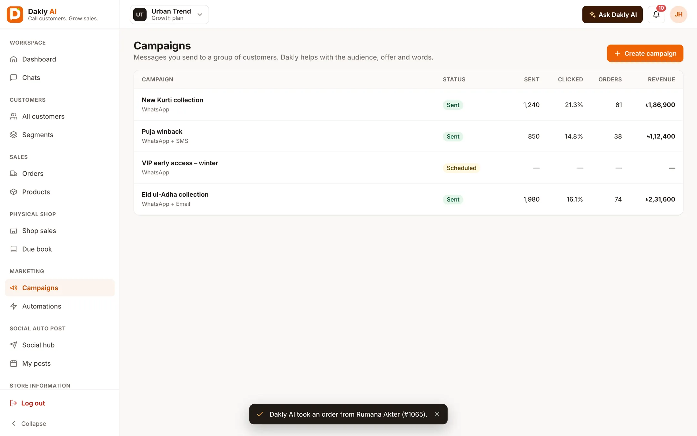
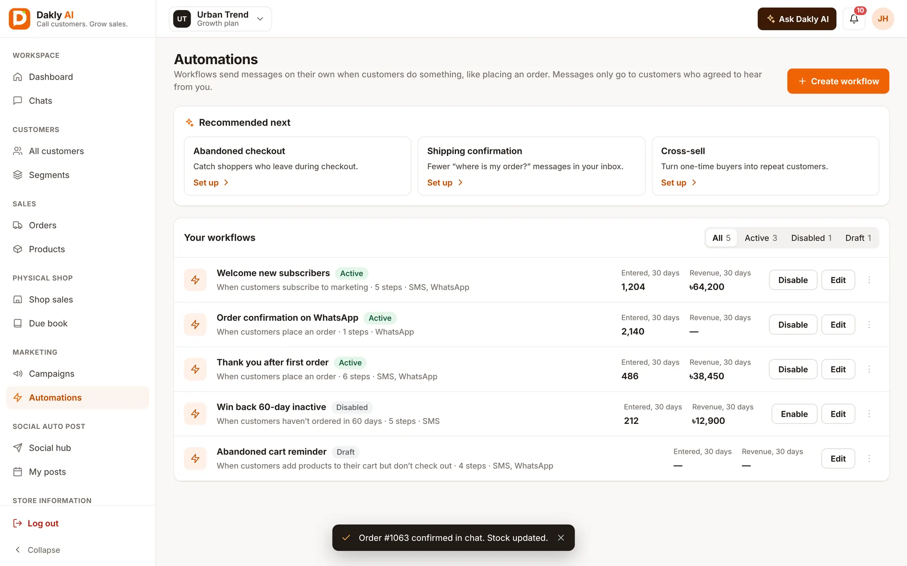

# Campaigns and automations

|           |                                                                                                          |
| --------- | -------------------------------------------------------------------------------------------------------- |
| Release   | 1                                                                                                        |
| Status    | Not started                                                                                              |
| Extension | Core                                                                                                     |
| Code      | `packages/core/src/{campaigns,automations,templates}/`, `apps/web/src/features/{campaigns,automations}/` |
| Tasks     | CAMP-1 to CAMP-7                                                                                         |

## Purpose

Campaigns send one message to a group once. Automations send messages on their own when a customer does something. Both reach only people who agreed to hear from the shop, and nothing goes out until a person approves it. Channels in release 1: WhatsApp and SMS; Messenger is open (Q14). Instagram DM campaigns are release 2 (D4); email is later (D2).

## Screens

Builder steps: Goal, Channel, Content, Audience, Schedule, Review and approve. The campaign results page is not designed. Remove from the prototype: the ৳0.85 WhatsApp cost, the "WhatsApp + Email" sample, the AI voice call card.

## How it works

Campaign states: `draft` → `waiting_approval` → `scheduled` → `sending` → `sent` | `cancelled`.

1. On approval, the audience is frozen into `campaign_recipients`, one row per contact, with a skip reason where it applies (no consent, Not a customer, no phone, frequency cap, quiet hours).
2. The cost estimate is recipients × the real rate (WhatsApp marketing about ৳9, utility about ৳0.45, SMS ৳0.35 to ৳0.40 per part, plus margin). Approval reserves it from the wallet; actual cost settles after delivery reports; undelivered messages are refunded.
3. The sender job sends in batches within the channel's rate and the store's daily limit, writes each recipient's status, and can restart: it picks up recipients still queued.
4. Links are wrapped as tracked short links per recipient; provider callbacks update queued, sent, delivered, read, failed, tapped.

WhatsApp templates: every WhatsApp campaign uses a template. Edited or new templates go to Meta for approval; the campaign waits as Scheduled. A rejection moves it to Draft with Meta's reason in plain words.

Automations (working assumption for Q6): fixed recipes with editable timing and text, not a free workflow builder.

| Recipe                   | Trigger                                        |
| ------------------------ | ---------------------------------------------- |
| Abandoned chat follow-up | Buying interest, no order, inside the window   |
| Order confirmation       | Order placed (transactional)                   |
| Shipped                  | Order marked sent with courier (transactional) |
| Advance not paid         | Advance requested, unpaid after N hours        |
| Review request           | Delivered N days ago                           |
| Restock alert            | Variant restocked, person waiting              |
| Win back                 | No order in N days                             |

Each recipe is an `automations` row (recipe key, on or off, settings validated by a zod schema per recipe) and an `automation_runs` row per contact and trigger, unique on (automation, contact, trigger), so an event delivered twice runs once.

## Rules

From PRD tab 6:

- CAMP-R1: No campaign or automation sends without a person's approval (Approve, Enable or Publish).
- CAMP-R2: Marketing needs channel consent; transactional messages need only a phone and are labelled Transactional.
- CAMP-R3: At most 1 marketing message per store per channel per day and 3 per 7 days, across campaigns and automations.
- CAMP-R4: Every marketing SMS ends with an opt-out; WhatsApp marketing has a "Stop offers" button.
- CAMP-R5: The estimate uses the real per-category rate. Approve is blocked if the balance cannot cover it.
- CAMP-R7: A Scheduled campaign can be edited or cancelled until 5 minutes before sending; a Sending campaign can be paused.
- AUTO-R1: An automation cannot be enabled if a message step has no approved template or no consented channel.
- AUTO-R2: A person hit by two automations on the same day gets only the higher priority (Transactional, then the rest).

Also: quiet hours 9 pm to 9 am store time for marketing; consent is checked again at every send, not only at approval; WhatsApp quality dropping to low pauses marketing sends.

## Permissions

`campaigns.view`, `campaigns.edit`, `automations.view`, `automations.edit`. "Only owners and admins can approve sends" is on by default.

## Events

Emits `campaign.approved`, `campaign.sent`, `message.delivered`, `message.read`, `message.failed`, `message.tapped`, `message.opted_out`, `order.attributed`, `automation.enabled`, `automation.run_sent`.

## Data

`campaigns`, `campaign_recipients`, `whatsapp_templates`, `short_links`, `automations`, `automation_runs`. `touches` is cut by the schema review (pending review).

## Edge cases to test

- Balance runs out mid-send: pause, notify, resume after top-up.
- 0 reachable people: Approve disabled with a reason and an SMS suggestion.
- Bangla SMS over 70 characters shows parts and cost per part.
- The same order event delivered twice sends one confirmation.

## Acceptance

- Given 128 people in Stopped buying, 109 with WhatsApp consent and 6 messaged in the last 3 days, when the owner picks Win back on WhatsApp, then the final audience is 103 and the estimate uses the marketing rate.
- Given 34 WhatsApp failures of which 29 have SMS consent, when the owner taps Send by SMS, then the cost shows first and 29 SMS are queued.

## Open questions

Q6 (recipes or builder), Q14 (Messenger campaigns), Q2 (BSP and margin).
