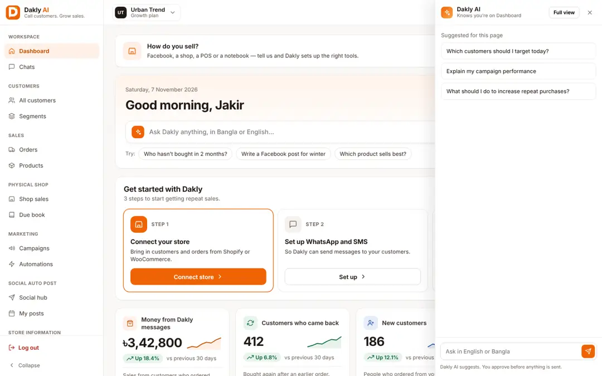
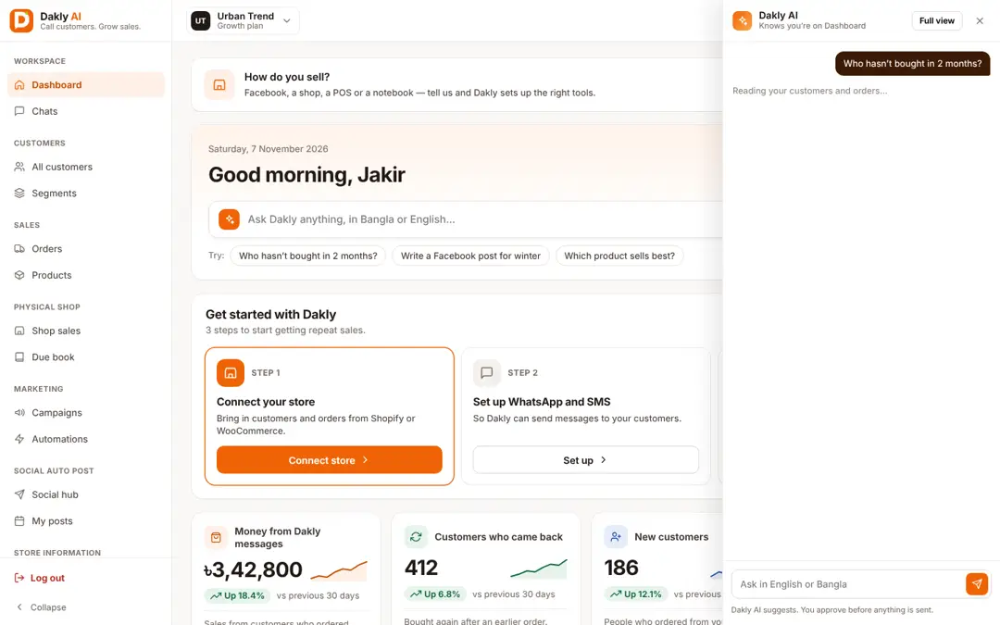
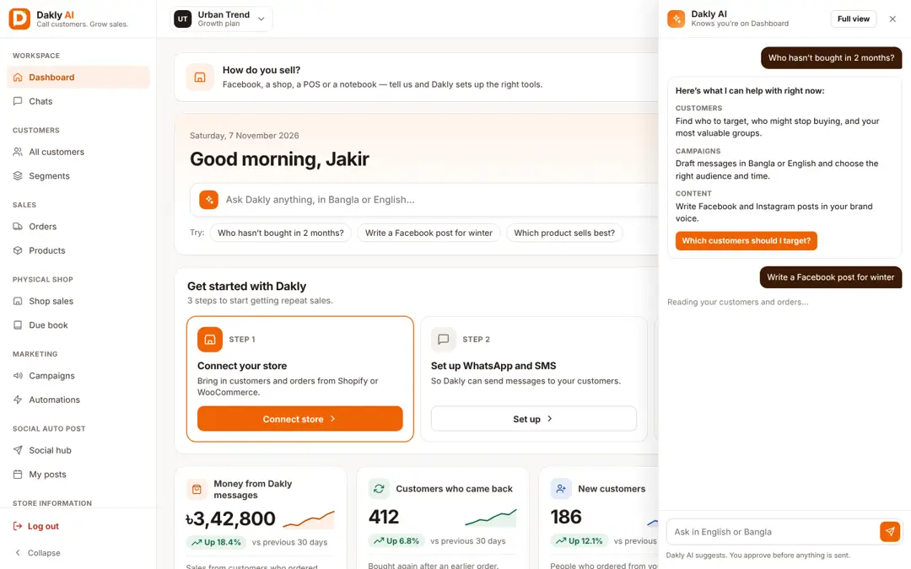
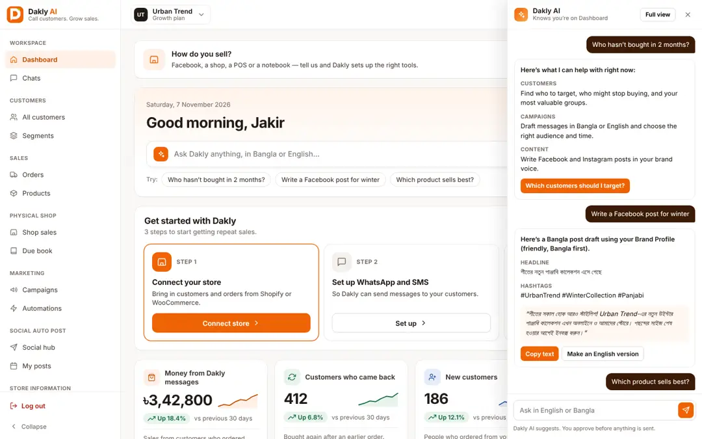
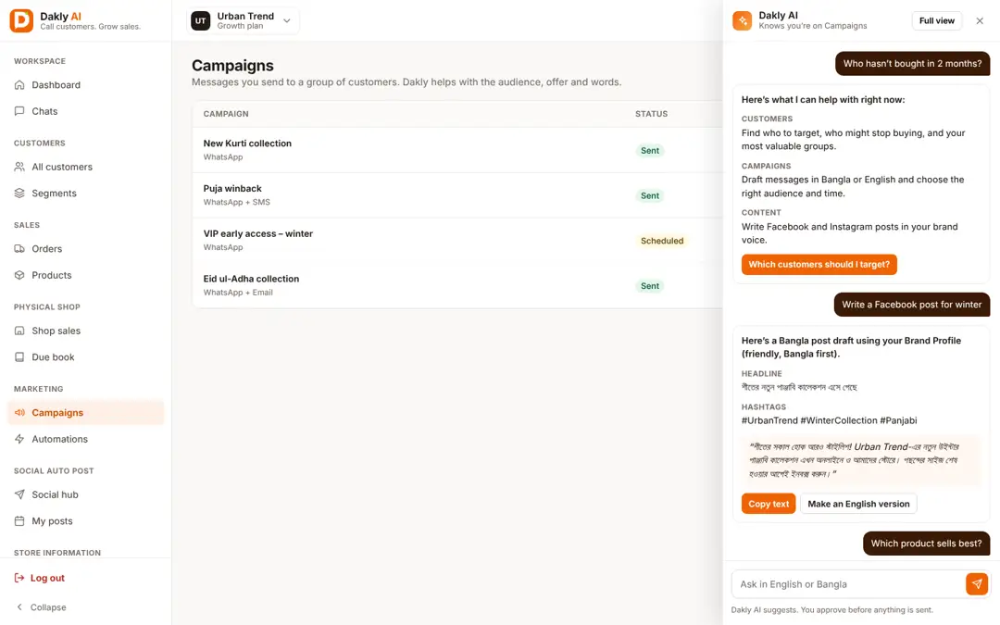
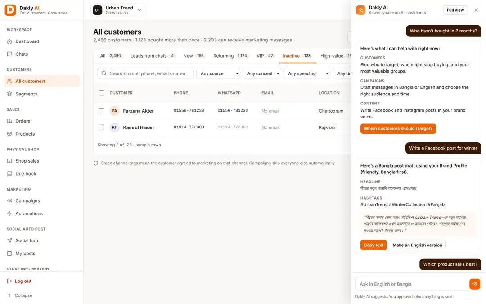
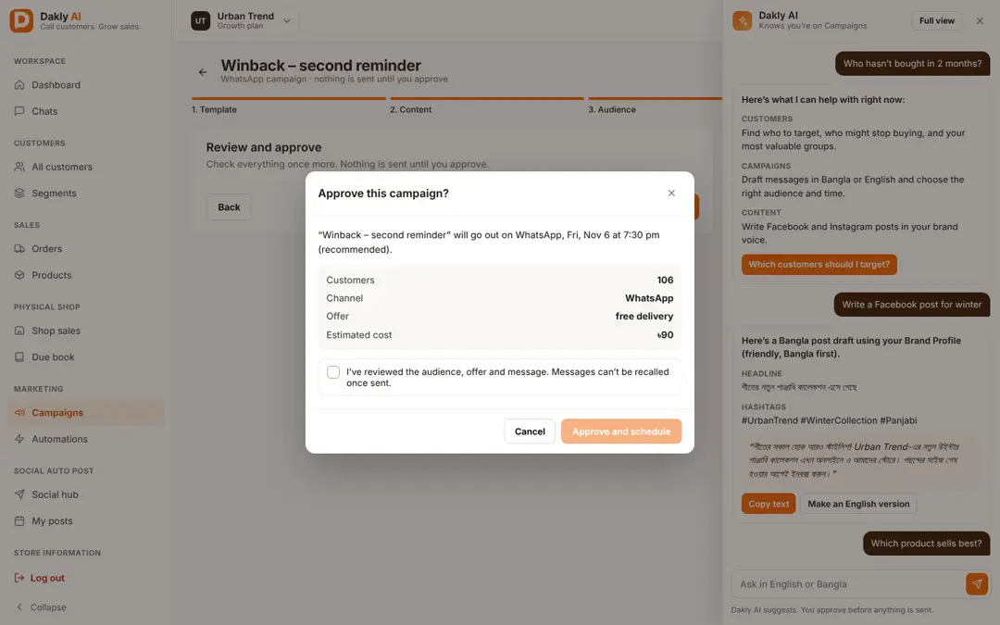
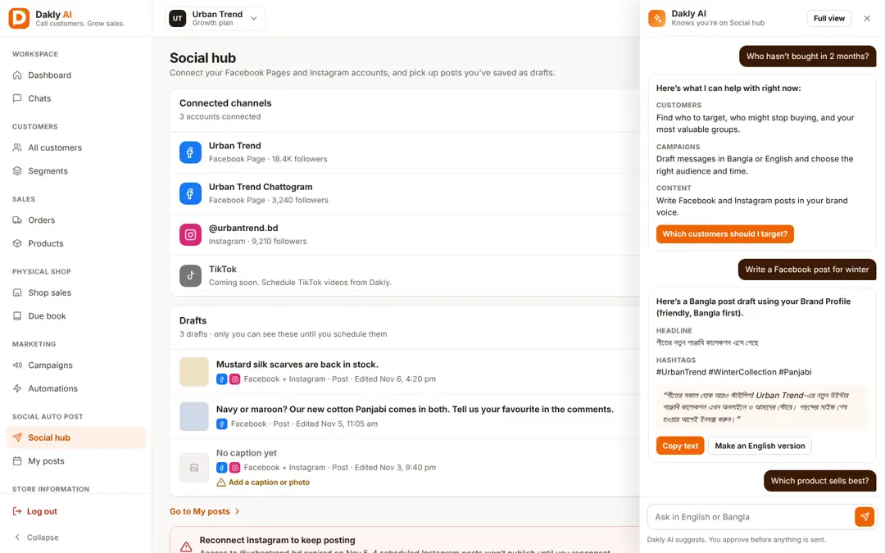
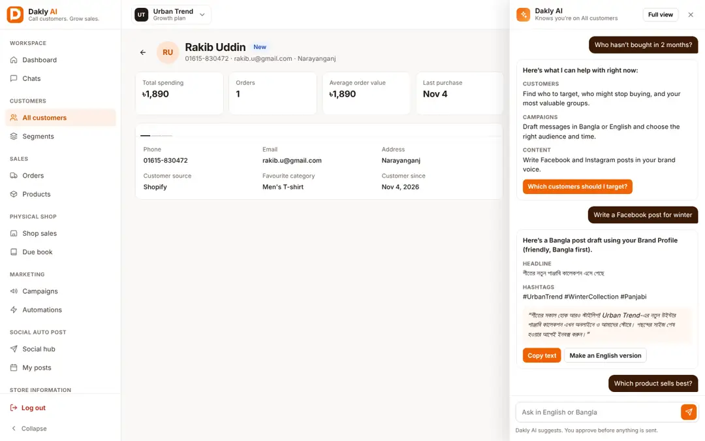
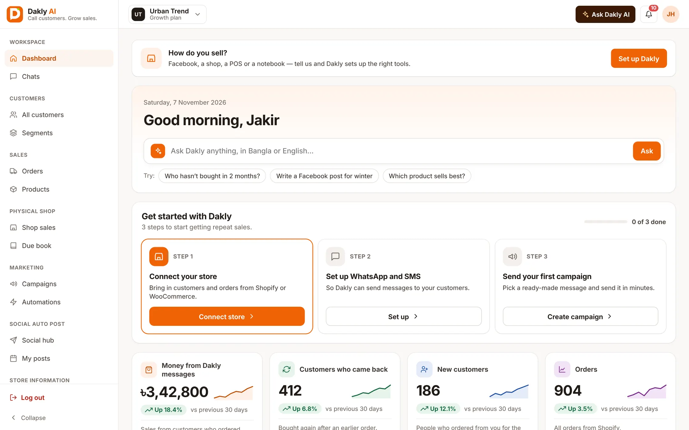

# Dashboard, notifications and Ask Dakly AI

|           |                                                                                                            |
| --------- | ---------------------------------------------------------------------------------------------------------- |
| Release   | 1                                                                                                          |
| Status    | Not started                                                                                                |
| Extension | Core                                                                                                       |
| Code      | `packages/core/src/{dashboard,notifications,ask}/`, `apps/web/src/features/{dashboard,notifications,ask}/` |
| Tasks     | HOME-1 to HOME-6                                                                                           |

## Purpose

The first screen after sign-in: what needs the owner today, what Dakly earned them, and a box to ask questions about their own shop in Bangla or English.

## Decisions that change the PRD

The product requirements below are the PRD text from 12 November 2026. Where a later decision changed it, the decision wins:

- D17: Ask Dakly AI runs on OpenAI through `AiService`, not the Claude API.
- D20: the daily or weekly digest goes by WhatsApp in release 1; a digest by email can follow because transactional email is in release 1, but it is not built until Asif asks.
- Schema review (pending review): one notification row per user who should see it.

## Product requirements

### What it is for

Tell the owner, in under a minute, how the shop is doing and the one thing to do next. The Dashboard shows the state, Smart notifications list the opportunities and problems, and Ask Dakly AI answers questions in plain Bangla or English. Release 1.

### User stories

- As an owner, I want to see money earned from Dakly, returning and new customers and orders at a glance, so I know if things are improving.
- As an owner, I want Dakly to tell me which customers to contact today and how much that could earn, so I don't have to analyse anything.
- As an owner, I want to ask "who hasn't bought in 2 months?" and get a list I can message, so I act straight away.
- As an owner, I want to be told immediately when something breaks (messages failing, a page disconnected, customers waiting), so I don't lose sales.

### Screens

| Screen              | Elements                                                                                                                                                                                                                                                                                                                                                                                                                                                                                                                                                                                                                                  |
| ------------------- | ----------------------------------------------------------------------------------------------------------------------------------------------------------------------------------------------------------------------------------------------------------------------------------------------------------------------------------------------------------------------------------------------------------------------------------------------------------------------------------------------------------------------------------------------------------------------------------------------------------------------------------------- |
| Dashboard           | Date and greeting by time of day (Good morning before 12:00, Good afternoon 12:00–16:59, Good evening after); Ask box with 3 page-aware suggestions; setup checklist (tab 1); 4 KPI cards with sparkline, change and one-line explanation; "Who's buying from you" weekly bars (Came back vs New) with a generated insight; "Your customers at a glance" 6 lifecycle stages with stacked bar and a "Bring them back" call-out; "How your messages are doing" last 4 campaigns; "Coming up" next 4 scheduled items; shortcuts (Send a message, Add customers, Post on Facebook, Ask Dakly AI); "Latest from your customers" activity feed. |
| Period control      | 7 days / 30 days / 90 days (default 30) on Dashboard; applies to KPIs and the buyer chart.                                                                                                                                                                                                                                                                                                                                                                                                                                                                                                                                                |
| Smart notifications | Bell with unread count in the top bar; page with To do and Done tabs; header "You could earn ৳X from N ideas below"; groups Fix now, Ways to sell more, Good news; each card: title, reason, avatars and count of people, estimated ৳, primary button, Done, Undo. Detail view: why, data used, suggested action, two buttons. Preferences: categories on/off and frequency.                                                                                                                                                                                                                                                              |
| Ask Dakly AI panel  | Opens from the top bar or any Ask box, slides in from the right (full screen on phone). Shows 3 suggestions for the current page, chat history, input with send, "Dakly AI uses only your shop's data. It never sends or publishes anything without your approval."                                                                                                                                                                                                                                                                                                                                                                       |
| Ask Dakly AI page   | Left: New conversation, recent conversations by date. Main: 7 starter prompts (Customers, Campaigns, Segments, Content, Offers, Results, Growth), then the conversation.                                                                                                                                                                                                                                                                                                                                                                                                                                                                  |

### How it works

**Dashboard data**

All numbers come from the Glossary definitions. "Money from Dakly messages" = Money from marketing. "Your customers at a glance" = lifecycle stages, which always sum to Total customers; each row opens All customers filtered to that stage. Campaign rows open the campaign results page. "Coming up" lists scheduled campaigns, scheduled posts, automations running today ("Automatic · N sent today") and items waiting for approval ("Needs your OK" with Review). The activity feed shows the latest 5 events of these kinds: new customer, purchase, became a Best customer, read a message, came back after N days; each links to the customer.

**Insight sentence on the buyer chart**

Written by rules, not free AI text: busiest week in the period and its buyer count; share of buyers who had bought before; if that share is 50% or more add "so messaging past customers works well for you", otherwise "so finding new buyers matters most right now".

**Smart notifications engine**

A nightly job (06:00 local) plus real-time triggers create notification cards. Each card type has a rule, an audience, an estimate and an action:

| Card                             | Trigger rule                                                                      | Estimated ৳                                            | Action                                          |
| -------------------------------- | --------------------------------------------------------------------------------- | ------------------------------------------------------ | ----------------------------------------------- |
| Messages didn't send             | Any WhatsApp failures in a campaign in the last 24 h                              | None                                                   | Send by SMS to those with SMS consent           |
| Account disconnected             | Meta token expired or expiring within 7 days                                      | None                                                   | Reconnect                                       |
| Customers waiting for a reply    | Chats in Needs you for over 30 minutes during business hours                      | None                                                   | Reply now (opens Chats › Needs you)             |
| Showed interest but didn't order | Chats where price was shared, no order, no reply for 24 h                         | Count × average order value × 20%                      | Follow up (opens a pre-written follow-up)       |
| Stopped buying                   | Stopped buying stage grew by 10+ people in 14 days                                | Count × AOV × store's win-back conversion (default 8%) | Win them back (campaign builder, goal win-back) |
| VIPs overdue                     | VIP segment members past 1.5 × their usual gap                                    | Count × their AOV × 40%                                | Send VIP offer                                  |
| New customers not welcomed       | New customers with no message in their first 7 days, and no welcome automation on | Count × AOV × store's second-order rate                | Say welcome                                     |
| No posts planned                 | No scheduled post in the next 7 days and Social Auto Post is on                   | None                                                   | Plan posts                                      |
| Campaign doing well              | Tap rate 50%+ above the store's median                                            | None                                                   | Send it again to a similar group                |
| Metric milestone                 | Repeat purchase rate up 1+ point vs previous 30 days                              | None                                                   | See report                                      |

Conversion defaults are replaced by the store's own rates once it has 3 or more campaigns of that kind. Cards expire after 7 days or when their condition is no longer true. A card the owner marks Done moves to Done; Undo brings it back.

**Ask Dakly AI**

The assistant is a language model with read-only tools over the current store's data. It never writes data directly; every action is a button that opens the right screen pre-filled for the owner to review.

| Tool the AI can call                  | Returns                                                  |
| ------------------------------------- | -------------------------------------------------------- |
| query\_customers(filters)             | Count and sample of customers matching filters           |
| get\_segment(name) / list\_segments() | Segment rules, counts, spend                             |
| get\_campaign\_results(id or period)  | Sent, delivered, read, tapped, orders, revenue, failures |
| get\_metrics(names, period)           | Any Glossary metric                                      |
| get\_products(filters)                | Products, prices, stock, sales, times asked              |
| get\_customer(id)                     | Profile facts for the customer page                      |
| get\_brand\_profile()                 | Voice and language settings for writing                  |

| Answer type              | When                                                                                | Shows                                                                           | Buttons                                                                   |
| ------------------------ | ----------------------------------------------------------------------------------- | ------------------------------------------------------------------------------- | ------------------------------------------------------------------------- |
| Audience suggestion      | "Who should I target?", "inactive", "haven't bought"                                | Suggested audience and count, why, recommended action, data used, draft message | Generate campaign; View customers                                         |
| Segment from description | Owner describes a group in words                                                    | Rules in plain words, estimated count, data used                                | Review and save segment; View customers                                   |
| Top segments             | "Highest value"                                                                     | Ranked segments with count, spend, average, one-line meaning                    | Create campaign; Open segments                                            |
| Content draft            | "Write a post / message"                                                            | Headline, text, hashtags in the brand voice                                     | Copy; Make an English (or Bangla) version; Use in campaign; Schedule post |
| Offer ideas              | "Offer for VIPs"                                                                    | 3 offer types with reasons; never invents discount values or codes              | Create campaign                                                           |
| Performance explained    | "Explain my campaign"                                                               | Facts, Dakly's interpretation, attribution note                                 | Retry failed by SMS; Create follow-up                                     |
| Advice                   | "How do I get more repeat orders?"                                                  | 3 numbered actions with the store's numbers                                     | One button per action                                                     |
| Customer next step       | Asked on a customer profile                                                         | Facts and one suggestion                                                        | Send personal offer                                                       |
| Not enough data          | The answer needs data the store doesn't have yet (for example fewer than 30 orders) | What is missing and how to get it                                               | Relevant setup action                                                     |
| Can't do that            | Request outside Dakly (for example "refund this card")                              | One sentence on what Dakly can do instead                                       | Up to 2 suggestions                                                       |

### Business rules

| ID       | Rule                                                                                                                                                                       |
| -------- | -------------------------------------------------------------------------------------------------------------------------------------------------------------------------- |
| HOME-R1  | Dashboard numbers equal the Analytics numbers for the same period and window (Glossary).                                                                                   |
| HOME-R2  | Clickable-looking rows always open something: stage rows open a filtered list, campaign rows open results, feed items open the customer.                                   |
| AI-R1    | The assistant only uses the current store's data. It must quote the numbers it used and say "sample estimate" when a count is estimated.                                   |
| AI-R2    | It answers in the language of the question (Bangla script, Banglish or English).                                                                                           |
| AI-R3    | It never invents prices, discounts, coupon codes, delivery charges or policies. If asked, it asks the owner to set them.                                                   |
| AI-R4    | It never sends, publishes, deletes or spends money. Buttons only open screens.                                                                                             |
| AI-R5    | Each answer costs AI usage: 1 unit per answer, 3 per content draft with options. Shown under the input as "N AI credits left". At 0, the panel explains and offers top-up. |
| AI-R6    | Conversations are kept for 90 days per user and are private to that user.                                                                                                  |
| NOTIF-R1 | A person can appear in at most one "Ways to sell more" card at a time (highest estimated value wins), so estimates are not double-counted in "You could earn".             |
| NOTIF-R2 | Fix now cards are also sent as a push or SMS to the Owner if not opened within 2 hours (configurable in preferences).                                                      |

### States and edge cases

- New store with no orders: KPIs show ৳0 and "No orders yet"; the buyer chart is replaced by "Your chart appears after your first 5 orders"; at-a-glance shows the import options.
- Less than one full period of history: change badges show "New" instead of a percentage.
- Assistant offline or provider error: "Dakly AI is busy. Try again in a minute." and keep the typed question.
- Owner asks about another store: "I can only see Urban Trend. Switch store to ask about Urban Trend Kids."

### Permissions

Dashboard is visible to every role, but each card hides if the role has no access to its area (for example a Support agent doesn't see campaign results). Ask Dakly AI only uses data the asking user is allowed to view, and masks phones if their role masks phones.

### Events

notification.created, notification.done, assistant.asked, assistant.action\_clicked (for learning which answers are useful).

### Acceptance criteria

- Given 2,486 customers, when the Dashboard loads, then the 6 stage counts add up to 2,486.
- Given the attribution window is 3 days, when the owner opens Dashboard and Analytics for the last 30 days, then "Money from Dakly messages" equals "Your marketing earned".
- Given the owner asks "কারা ২ মাস কিনেনি?", then the answer is in Bangla and includes a customer count and a View customers button.
- Given 128 customers in Stopped buying of whom 109 have WhatsApp consent, when the owner taps Win them back, then the campaign builder opens with goal Win back, audience Stopped buying and "109 can receive on WhatsApp".

### Beyond the prototype

The prototype's dashboard numbers, notifications and AI answers are hand-written examples. In the product every number comes from the metrics service (Glossary) and every notification from a rule.

| Addition                                                                                                                                                                                                     | Why                                                                   | Release |
| ------------------------------------------------------------------------------------------------------------------------------------------------------------------------------------------------------------ | --------------------------------------------------------------------- | ------- |
| Ask Dakly AI answers only from Dakly's own data through fixed query tools, and shows its source under each answer ("From Orders, last 30 days"). If data is missing it says so and suggests what to connect. | Prevents made-up numbers; the prototype's answers were scripted       | 1       |
| Each AI answer that suggests an action has a button that opens the prepared action (draft campaign, segment, reorder list) for approval                                                                      | Turns advice into results, as Klaviyo and Nabik do                    | 1       |
| Daily or weekly digest to the owner on WhatsApp (email in a later release): yesterday's orders, money from marketing, chats waiting, dues, one suggestion                                                    | Owners live in WhatsApp, not dashboards (Nabik sends digests)         | 1       |
| Shop goals: owner sets a monthly sales or repeat-customer goal; Dashboard shows progress and the AI plans towards it                                                                                         | Nabik's "Shop Lead" works toward goals; gives the dashboard a purpose | 2       |
| Smart notifications are rules with thresholds, dedupe keys, snooze, and a "Why am I seeing this?" line; each rule can be turned off                                                                          | The prototype listed fixed examples; real rules must not spam         | 1       |
| Mobile-first dashboard layout and push notifications (installable web app)                                                                                                                                   | Most owners run the shop from a phone                                 | 1       |

**Do not copy from the prototype:** the specific KPI values, the sample notifications text and counts, and the scripted Ask Dakly AI conversations.

## Prototype screens

Captured from the prototype on 13 Nov 2026 by opening each button, tab and dialog. Layout only: the numbers, names and some flows are sample data (see the next section).

**Ask Dakly AI panel**

**Ask: who hasn't bought in 2 months (prototype answer)**

**Ask: write a Facebook post (prototype answer)**

**Ask: which product sells best (prototype answer)**

**KPI card opened**

**Stage row opened**

**Approve a campaign from Coming up**

**Open calendar**

**Activity feed item opened**

## Where the prototype is wrong or missing

The prototype is a concept with sample data. Build from this doc, not from the prototype, where they differ.

### Design review: Dashboard and Ask Dakly AI

The dashboard is well aimed at a shop owner: money first, then who is buying, who is slipping away, and one-click actions. Ask Dakly AI is the headline feature, but the design only shows its welcome screen. No answer was ever designed, so the team has nothing to build the most important screen from.

| Feature                     | What the design shows                                                                                                                               | Gaps and questions for build                                                                                                                                                                                                                                                                                   |
| --------------------------- | --------------------------------------------------------------------------------------------------------------------------------------------------- | -------------------------------------------------------------------------------------------------------------------------------------------------------------------------------------------------------------------------------------------------------------------------------------------------------------- |
| Greeting and AI ask box     | Date, "Good morning, Jakir", ask box "in Bangla or English", 3 suggested questions                                                                  | Date and greeting are fixed text.                                                                                                                                                                                                                                                                              |
| Get started checklist       | 3 steps: connect store, set up WhatsApp and SMS, send first campaign; "0 of 3 done"                                                                 | Shows 0 of 3 even though the store and WhatsApp are connected and campaigns were sent. Needs real completion rules and should hide when done.                                                                                                                                                                  |
| KPI cards                   | Money from Dakly messages ৳3,42,800, customers who came back 412, new customers 186, orders 904, each with change vs previous 30 days and sparkline | Money figure contradicts Analytics (৳5,15,124 for the same period). No date-range control.                                                                                                                                                                                                                     |
| Who's buying chart          | Weekly bars, came back vs new, with a plain-language insight (busiest week, 69% repeat)                                                             | Maths checks out. Insight text needs rules or the AI to generate it.                                                                                                                                                                                                                                           |
| Customers at a glance       | 6 groups adding to 2,486, a stacked bar, "224 slipping away or stopped" call-out with "Bring them back"                                             | "Bought once" is 752 here but One-time buyers is 702 on Segments. "Regulars" is 1,124 here but Regular customers is 614 on Segments. Rows look clickable but aren't.                                                                                                                                           |
| How your messages are doing | 4 recent campaigns with status label (Working well, Doing okay), tap rate bar, revenue and orders                                                   | Define the thresholds behind "Working well". Rows should open the campaign.                                                                                                                                                                                                                                    |
| Coming up                   | Scheduled campaign, Facebook post, a winback that "Needs your OK" with Review, daily automation                                                     | Approval queue is a good idea. It needs its own place (e.g. a To-do in notifications).                                                                                                                                                                                                                         |
| Shortcuts                   | Send a message, Add customers, Post on Facebook, Ask Dakly AI                                                                                       | Fine.                                                                                                                                                                                                                                                                                                          |
| Latest from your customers  | Activity feed (new customer, purchase, became best customer, read message, came back)                                                               | Good. Each item should link to the customer profile.                                                                                                                                                                                                                                                           |
| Ask Dakly AI side panel     | Knows the current page, 3 page-specific suggestions, "Dakly AI suggests. You approve before anything is sent." Full view keeps a chat history       | Every question, typed or suggested, returns the same capability menu. Design the answer types: a customer list with "Create segment", a drafted message with "Use in campaign", a chart, a "not enough data" reply, and Bangla replies. Define which actions the AI may prepare and which credit cost applies. |

### Missing design: Ask Dakly AI answer screens

**Why it's needed.** The AI assistant is the product's name and pitch. In the prototype, every question returns the same welcome menu ("Here's what I can help with right now"). Engineers have no design for what an answer looks like, which is the most-used screen in an AI product.

**What to design.** One answer layout per kind of question, in both the side panel and Full view:

- **Customer list answer** ("Who hasn't bought in 2 months?"): a one-line summary ("128 customers, ৳6,10,400 spent before"), the first 5 to 10 names with last order and spend, and actions: Save as segment, Create campaign, Export.
- **Draft answer** ("Write a Facebook post for winter"): 2 or 3 caption options in the chosen language, with Use in post, Regenerate, Make shorter, Translate. For messages: Use in campaign.
- **Number or chart answer** ("Which product sells best?"): a short answer with the number first, a small bar chart or ranked list, the date range used, and "See in Analytics".
- **Recommendation answer** ("What should I do to increase repeat purchases?"): 2 or 3 numbered actions, each with expected ৳ impact and a button that opens the prepared campaign, segment or workflow.
- **Bangla and Banglish**: the same layouts with Bangla text, so the team can check line length and fonts.

**States.** Thinking (with what it's reading: "Reading 2,486 customers"); not enough data ("Connect your store first"); question outside scope; AI credits used up; error and retry; feedback (thumbs up or down); "what data did this use" disclosure.

**Rules to decide.** Which actions the AI may prepare but never send (the design promises "You approve before anything is sent"); how many credits each answer type costs; whether chat history is per user or shared with the team.

## Engineering

### Screens in release 1

Setup banner, greeting with the Ask box, a 3-step getting started card, KPI cards (money from marketing, customers who came back, new customers, orders), lifecycle groups, campaign suggestions, posts calendar and people to follow up. The prototype's numbers disagree with Analytics and Segments; every number here comes from the glossary. "How do you sell?" is asked at sign-up only.

### How it works

The dashboard reads `GET /dashboard` once per period. The `period` query accepts 7, 30 or 90 days and defaults to 30. The API uses the same report functions as Analytics for both periods and the daily points. Orders and Sales require Orders access. New customers, Customers who came back and lifecycle groups require Customers access. The lifecycle groups use the latest snapshot in the selected period. Money from Dakly messages uses the attribution rollup and requires Analytics view access. The dashboard shows money cards in whole taka, with report values kept in poisha. The Ask box waits for HOME-4, and the setup checklist waits for ACC-13. Campaign suggestions and the posts calendar are outside HOME-3. Lifecycle counts are visible without stage links until All customers can filter by lifecycle stage.

Notifications

1. A rule calls `NotificationsService.notify(storeId, { type, category, dedupeKey, recipientPermission, title, body?, actionUrl?, priority? })`. The recipients are the active members whose role grants `recipientPermission` (for example `chats.view`), built-in or custom, read through `TeamService`. In one store transaction it writes one row per recipient and publishes one `notification.created` event per row it created. A dedupe key is used once per user for good, even after the card is done, so a rule that should fire again puts its period or occurrence in the key (for example `usage-80:ai_conversation:2026-11-01`).
2. Routes, for the signed-in member's own rows in the session's store only (`@AnyMember()`, since every role gets notifications): `GET /notifications` (newest first, `cursor`, `limit`, `category`, `status`), `POST /notifications/:notificationId/seen`, `/done` and `/snooze` (`{ until }`, a future UTC time). Each POST answers 204; another member's row is 404 like a missing one.
3. Status moves: seen only moves a new card, so opening a snoozed or done card changes nothing; done is final; snoozing a done card is `NOTIFICATION_DONE` (409) and a past time is `SNOOZE_NOT_IN_FUTURE` (400). Each change is one guarded update, so two changes at once on one card end in a state these rules allow. The `wake-snoozed-notifications` job runs every 30 seconds and moves each snoozed card whose `snoozedUntil` has passed back to `new` with no snooze time. It writes no event, so an open stream does not send the woken card; the list shows it on its next refresh.
4. Web: the bell in the top bar shows the count of `new` cards (one page of up to 100; past that it shows "100+"). It opens a sheet whose tab, All or one category, is the `notifications` search parameter, so `?notifications=fix_now` opens the sheet on Fix now. Each card shows its status as text and offers Mark seen (new cards), Done, and Snooze until a date and time the member picks (read as local time and sent as UTC); a done card has no actions. The list refreshes after each change and when the window gets focus.
5. Live updates: the bell opens one `GET /events/stream` per page (Server-Sent Events, see [architecture](../architecture.md#real-time)) and opens it again when the session's shop or access changes. Each `notification` message refreshes the bell count and the open list. The browser reconnects a dropped stream itself and sends `Last-Event-ID`, so the API replays up to 100 missed rows. While the stream is down the web app polls the bell and list every 60 seconds, opens the stream again if the browser has stopped retrying (an error response such as a 502), and stops polling once the stream is back, refreshing once to cover the gap.
6. Delivery: in the app over the stream above; web push for staff who allow it (HOME-5); and SMS, WhatsApp or email only for billing, credential and security alerts (email is allowed for these, D20).

Ask Dakly AI

1. Answers questions about the store's own data. It never writes SQL.
2. It calls read-only report tools (sales by period, top products, orders by stage, customers by segment, AI performance) that return glossary numbers. Each tool carries a description, the words owners use for it in Bangla, Banglish and English, the unit of each number and the allowed values of each argument ([ai-and-llm.md](../rules/ai-and-llm.md) rule 15).
3. Each answer shows the numbers it used. With too little data it says so (design needed).
4. Drafts (a post, a campaign) open in their editor and need approval like any other AI-written content (D7).
5. Counts against `ai_ask`.

How it runs (HOME-4 part 1):

1. `POST /assistant/messages` takes `{ question, history }` (up to 6 earlier turns of the open panel; nothing is stored until HOME-6) and answers `{ kind: 'answer', text, sources, creditsLeft }` or `{ kind: 'cannot_answer', text }`. Any member may ask. Without credits it answers `ASK_CREDITS_UNAVAILABLE` (409) before calling the model; when AI is paused, busy or fails it answers `ASK_UNAVAILABLE` (503).
2. The tools are `get_sales` (orders, sales, average order value), `get_marketing_results` (money and orders from Dakly messages), `get_customers` (new, came back, lifecycle stages) and `get_top_products` (up to 5 products by items sold, with their sales). Each takes one `window` (`last_7_days`, `last_30_days` or `last_90_days`) and returns the window and the one before it, with percent change; the product list covers the window only. `get_sales_today`, `get_sales_yesterday` and `get_sales_this_month` take no argument and give the same sales figures for that calendar period in the shop's time zone, against yesterday, the day before and the same days of last month. Product sales count items after discount, without delivery, and leave out cancelled orders. They read `AnalyticsService` only. A member is offered a tool only when their role can view its area: Orders, Analytics or Customers.
3. The model runs up to 4 rounds of tool calls on the `reply` tier. The question and earlier turns go in labelled untrusted blocks.
4. Before the answer is returned, code checks that every figure in it appears in this run's tool results. A failed check, or a figure with no tool call behind it, gives `cannot_answer` and logs a warning with the store id only (no question text in logs); a saved question log waits for HOME-6. One credit is used when the model answers, even when this check then refuses the answer.
5. Orders by stage and AI performance wait for reports on `AnalyticsService`.

Web (HOME-4 part 2):

1. The dark Ask Dakly AI button in the top bar (icon only on a phone) opens a panel on the right edge, full width on a phone. The panel is open when the `ask` search parameter is `open`, so a link can open it.
2. The panel shows the page it is on when it knows the page, a suggestion for each report (best selling product, sales today, this month, yesterday and the last 30 days, campaign performance and customers who came back, each shown only when the role can view that report), the conversation, an input and the line "Dakly AI suggests. You approve before anything is sent." Each answer shows its sources under the text ("From Orders, last 30 days") and the credits left appear under the input after the first answer. The conversation lasts until the shop is switched or the page is reloaded; saved history is HOME-6.
3. A busy or paused AI shows "Dakly AI is busy. Try again in a minute." and puts the question back in the input. No credits shows that they are used up for the plan period.
4. Waits on other work: Full view and the Ask Dakly AI page (HOME-6), the Ask box on the Dashboard, suggestions that differ per page, a customer-targeting suggestion (no tool covers it), the top-up button (no billing screen yet), feedback buttons, and the action buttons under an answer.

### Rules

1. A number shown on the dashboard is computed by the same function as on Analytics. Committed source changes reach its summary within five minutes through incremental outbox processing; nightly reconciliation repairs drift. Late returns and corrections restate the original reporting days.
2. Ask Dakly AI cannot change data.
3. Ask Dakly AI never writes SQL; a question no tool covers gets "I can't answer that yet" and the question is logged for a new tool.

### Permissions

Dashboard cards follow the area permissions behind each card. Ask Dakly AI only uses report tools the member's role can see.

### Events

Listens to most events to create notifications: `conversation.handed_over`, `payment.failed`, `channel.needs_reconnect`, `usage.threshold_reached`, `post.failed`, `subscription.past_due`.

### Data

`notifications` (one row per user, unique per store, user and dedupe key), `memberships.notification_preferences` (NOTIF-R2 timing and channels, digest daily or weekly), `push_subscriptions`, `assistant_messages`. Full design: [docs/data](../data/README.md).

### Acceptance

- Given a delivered order, a late return or a corrected payment, when its event commits, then Dashboard and Analytics reflect the same corrected period within five minutes without waiting for the nightly job.
- Given money from marketing is ৳3,42,800 on Analytics for the last 30 days, then the dashboard shows the same.
- Given "who hasn't bought in 2 months?", then the answer lists the Stopped buying count and a link to the segment.
- Given "গত মাসে কত বিক্রি হলো?" or "last month sales koto?", then the AI calls the sales report for last month and shows the same taka amount as Analytics.

## Open questions

None.
