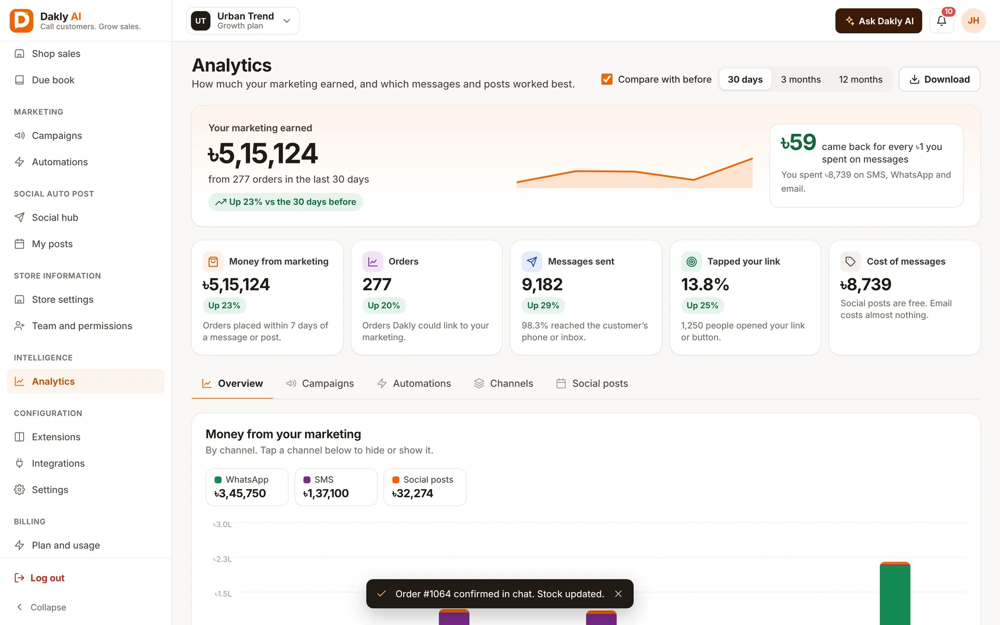

# Analytics

|           |                                                                    |
| --------- | ------------------------------------------------------------------ |
| Release   | 1                                                                  |
| Status    | Not started                                                        |
| Extension | Core                                                               |
| Code      | `packages/core/src/analytics/`, `apps/web/src/features/analytics/` |
| Tasks     | ANA-1 to ANA-3                                                     |

## Purpose

Shows the owner in Taka what Dakly earned them and where sales come from: chats, campaigns, automations, posts.

## Screens

Six tabs in the prototype. It ignores the new sales sources (chats, order link); the Sales tab is not designed yet.

## How it works

1. Every number is defined in the [glossary](../product/glossary.md). One report function per number lives in `analytics/` and is used by the dashboard, Ask Dakly AI and this page.
2. Attribution: an order is attributed to the last message or post the contact tapped or read within the window (default 7 days). Cancelled and returned orders are removed.
3. Reports read from summary tables refreshed by jobs, not from raw events on each page load, so a shop with 50,000 customers loads in under 2 seconds.
4. All periods are in Asia/Dhaka days.

## Rules

1. One definition per number (D13). A new number goes in the glossary first.
2. Totals on different tabs for the same period match to the taka.

## Permissions

`analytics.view`.

## Data

Summary tables per store and day, owned by `analytics/`. Exact list pending the schema review.

## Acceptance

- Given the headline says 277 orders from marketing, then the funnel's last step also says 277.
