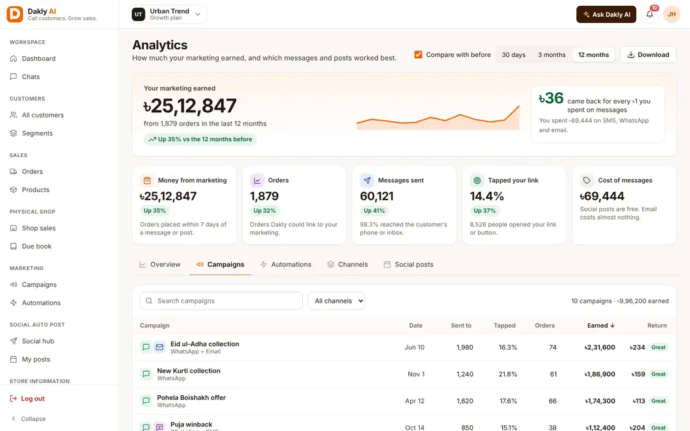
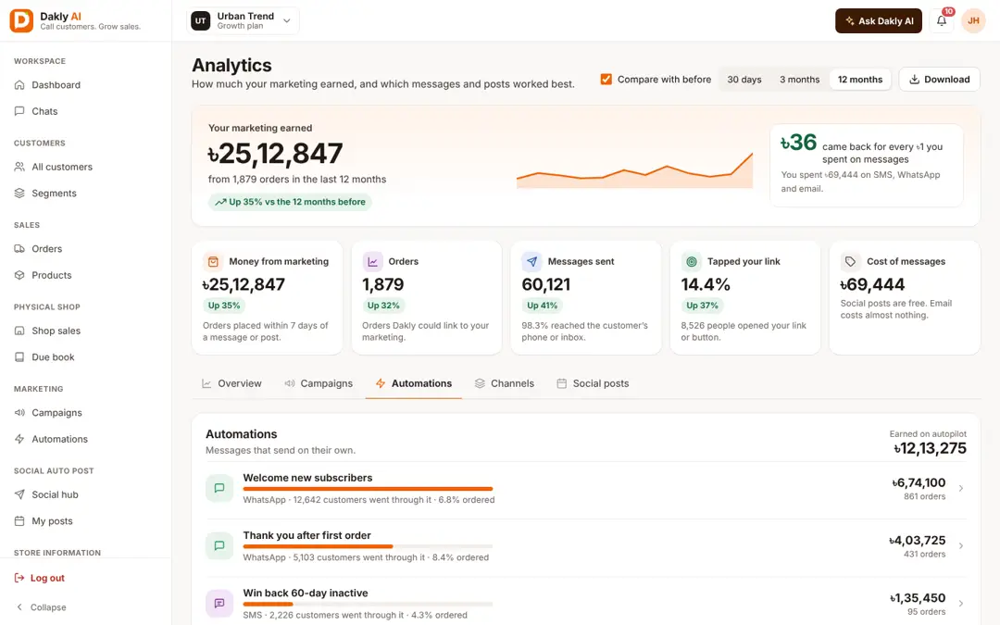
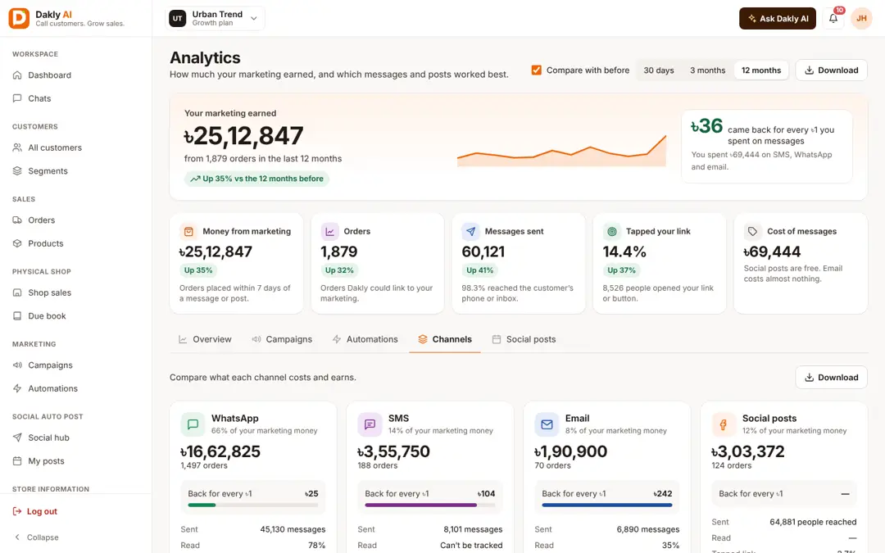
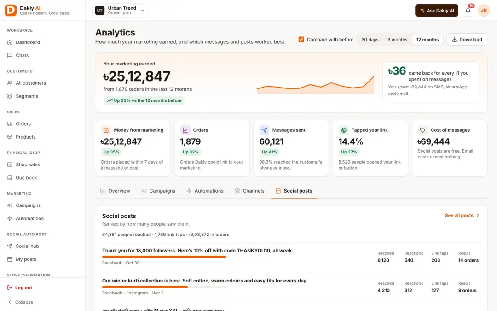

# Analytics

|           |                                                                    |
| --------- | ------------------------------------------------------------------ |
| Release   | 1                                                                  |
| Status    | Not started                                                        |
| Extension | Core                                                               |
| Code      | `packages/core/src/analytics/`, `apps/web/src/features/analytics/` |
| Tasks     | ANA-1 to ANA-4                                                     |

## Purpose

Shows the owner in Taka what Dakly earned them and where sales come from: chats, campaigns, automations, posts.

## Decisions that change the PRD

The product requirements below are the PRD text from 12 November 2026. Where a later decision changed it, the decision wins:

- D20: the Email row in the Channels tab stays hidden until email campaigns ship.
- D21: courier performance needs courier data and moves to the courier release.
- D1 and D6: Shop counter and POS appear in the Sales tab only when those sources exist (POS by CSV import in release 1).

## Product requirements

### What it is for

Answer two questions for the owner: "How much did my marketing earn?" and "What should I do more of?" Analytics reads from the shared metrics service defined in the Glossary, so its numbers always match the Dashboard, Campaigns and Chats. Release 1, core (every plan). The Sales tab is new in this PRD; it is not in the design yet.

### User stories

- As an owner, I want one headline number for money my marketing earned, with the change from before, so I know if Dakly pays for itself.
- As an owner, I want to see what came back for every ৳1 I spent on messages, so I can compare SMS and WhatsApp honestly.
- As a marketer, I want to rank campaigns, automations, channels and posts by money earned, so I repeat what worked.
- As an owner, I want to see where messages lose people (sent → delivered → read → tapped → ordered), so I know what to fix.
- As an owner with a shop and a page, I want one view of all sales by source (chats, order link, shop counter, POS, website), so I see the whole business.
- As an accountant, I want to download the numbers as CSV.
- As a skeptical owner, I want to read how Dakly decides an order came from marketing, and change the window.

### Screens

| Screen                  | What it shows                                                                                                                                                                                                                                                                                |
| ----------------------- | -------------------------------------------------------------------------------------------------------------------------------------------------------------------------------------------------------------------------------------------------------------------------------------------- |
| Header                  | Title, one-line explanation, period picker (30 days, 3 months, 12 months, Custom range), "Compare with before" toggle, Download button                                                                                                                                                       |
| Headline card           | "Your marketing earned ৳X from N orders in the last P", change vs before; side card "৳Y came back for every ৳1 you spent on messages" with the cost line                                                                                                                                     |
| KPI row                 | Money from marketing, Orders, Messages sent, Tapped your link, Cost of messages, each with change and a one-line definition                                                                                                                                                                  |
| Tabs                    | Overview, Campaigns, Automations, Channels, Social posts, Sales                                                                                                                                                                                                                              |
| Overview tab            | Stacked area chart of money by channel per week (tap legend to hide a channel), three "Best" cards, the funnel "From message to order", one AI tip under the funnel                                                                                                                          |
| Campaigns tab           | Table: campaign, channel, sent date, sent, delivered, read, tapped, orders, money, cost, return per ৳1, status label. Sort by any column. Row opens Campaign results (tab 6)                                                                                                                 |
| Automations tab         | Table: automation, trigger, people entered, messages sent, orders, money, cost, return per ৳1, on/off. Row opens the automation                                                                                                                                                              |
| Channels tab            | One row per channel (WhatsApp, SMS, Messenger, Instagram, Social posts; Email added when it ships): sent, delivered rate, read rate, tap rate, orders, money, cost, return per ৳1                                                                                                            |
| Social posts tab        | Table: post preview, network, posted at, reach, reactions, comments, link taps, chats started, orders, money. Data from Meta insights plus Dakly links                                                                                                                                       |
| Sales tab (new)         | Total sales by source: Chats, Order link, Shop counter, POS, Shopify, WooCommerce, Manual. Order count, sales money, average order value, share of total, change. Line chart by week. Footnote: "Sales counts every order. Money from marketing counts only orders after a message or post." |
| How Dakly counts orders | Side sheet: plain explanation of touches and last-touch credit, window selector 1, 3 or 7 days (owner only), example timeline, list of what is not counted                                                                                                                                   |

### How it works

#### Attribution engine

1. Every outbound message and tracked link records a touch candidate: store, customer, channel, source (campaign id, automation id or post id), sent at, and later delivered at, read at, tapped at.
2. A touch becomes eligible to earn credit by the Glossary rule: SMS when delivered, WhatsApp, Messenger and Instagram when read (email too, once it ships), any channel when the link is tapped, a social post only when the customer taps a Dakly link in it or starts a chat from it.
3. When an order is created (any source except cancelled orders and walk-in sales with no phone), the engine finds the customer by phone and looks back over the store's window (default 7 days) for eligible touches. The touch time used is the moment the touch became eligible (read or tapped time), not the send time.
4. The most recent eligible touch gets 100% of the credit (last touch). If none, the order is "not from marketing" and only appears in the Sales tab.
5. The attributed record stores order id, touch id, source, channel, order money at that time and window used. One order has at most one attribution record.
6. If the order is later cancelled, the record is deleted. If it is returned, money from marketing drops by the returned amount on the return date's recalculation (history is restated, not reversed on a later date, so past periods change when returns arrive; the page says "Includes returns up to today").
7. If the owner changes the window, attribution is recalculated for the last 365 days in a background job (under 10 minutes for 100,000 orders) and a banner says "Recalculating with the new 3-day window".
8. Test messages, messages to team members and messages that failed to send never create touches.

Edge cases: an order placed by phone with a different number than the one messaged is not linked (no fuzzy matching in release 1). Two touches in the same minute: the tapped one wins over the read one; if still tied, the campaign wins over the automation. A chat started from a Click-to-Messenger ad is not a Dakly touch (ads are out of scope) unless the customer taps a Dakly link.

#### Best cards

- **Best campaign:** highest return per ৳1 among campaigns sent in the period with at least 100 delivered and at least 3 orders. Shows money earned and "৳X back for every ৳1". If none qualify: "Send a campaign to 100 or more customers to see your best one."
- **Best channel:** highest return per ৳1 among paid channels with at least ৳500 cost in the period. Label says "Best return", not "most money", so a cheaper channel can win while another earns more. A second line shows the channel that earned the most money if it is different.
- **Best automation:** highest money from marketing among automations; ties broken by return per ৳1.

#### Funnel "From message to order"

Steps: Sent → Delivered → Read → Tapped → Ordered. Each step shows the count and "% of the step before".

- Sent and Delivered include every channel.
- Read uses only channels that report reads (WhatsApp, Messenger, Instagram). The step label says "(not SMS)" and its percentage is Read ÷ delivered on those channels only, so the bar never implies SMS was unread.
- Tapped counts unique people who tapped, all channels.
- Ordered equals "Orders from marketing" in the KPI row for the same period. This fixes the design, where the funnel showed 264 and the KPI showed 277.
- The AI tip under the funnel names the step with the biggest drop against the store's own 90-day median and suggests one fix (for example clearer offer, one button, send at the time customers read).

#### Compare with before

When on, each KPI shows the previous period value in grey, and charts draw the previous period as a dashed line. Period alignment follows the Glossary (previous period of equal length).

#### Download

CSV per tab, UTF-8 with BOM so Excel shows Bangla correctly. File name `dakly-analytics-<tab>-<from>-<to>.csv`. Columns match the table plus ids. Exports over 50,000 rows are generated in the background and offered as an in-app notification link valid for 7 days.

### Business rules

- **ANA-R1:** Every metric uses the Glossary definition. No screen computes its own version.
- **ANA-R2:** Attribution is last touch with a store-level window of 1, 3 or 7 days (default 7). Only the owner can change it; the change is logged.
- **ANA-R3:** Money from marketing excludes delivery charge and subtracts returns. Sales tab money includes all non-cancelled orders and also excludes delivery, so the two can be compared.
- **ANA-R4:** Return per ৳1 is hidden when cost is ৳0 (free channels show "Free").
- **ANA-R5:** The funnel's Ordered step equals Orders from marketing.
- **ANA-R6:** Walk-in shop sales count in the Sales tab but never in marketing attribution.
- **ANA-R7:** Social post reach and reactions come from Meta and can lag up to 48 hours; the tab says "Facebook updates these numbers for up to 2 days".
- **ANA-R8:** Periods longer than 12 months are not offered in release 1. Reports read daily rollups (`store_daily_metrics`), kept 24 months; raw rows follow the retention in D31 (D39).

### States and edge cases

| State                                              | What the user sees                                                                                                                          |
| -------------------------------------------------- | ------------------------------------------------------------------------------------------------------------------------------------------- |
| New store, no messages yet                         | Empty state: "Send your first campaign to see what your marketing earns" with a button to Campaigns. Sales tab still works if orders exist. |
| Messages but no orders yet                         | Numbers show ৳0 with "Orders usually arrive within 3 days of a message".                                                                    |
| Recalculating window                               | Banner, numbers dimmed until done.                                                                                                          |
| Meta insights not connected                        | Social posts tab shows Dakly link taps and orders only, with "Connect Facebook Page to see reach".                                          |
| Period with partial data (plan started mid-period) | Note: "Dakly started counting on 3 Oct".                                                                                                    |
| Very small numbers                                 | Percentages based on fewer than 20 people show "Too few to compare" instead of a change.                                                    |

### Permissions

Uses the Analytics area from Team and permissions (tab 1). Owner and Admin: everything, including the attribution window. Marketer (View by default): all tabs except the Sales tab, which needs Orders or Shop sales access; cannot change the window. Support agent and Shop counter staff: no access by default. "Download customer lists" is not needed to download Analytics CSVs, because they contain no phone numbers.

### Events

`attribution.created`, `attribution.removed`, `attribution.window_changed`, `analytics.exported`, `analytics.viewed` (tab, period) for product analytics.

### Acceptance criteria

- Given a customer read a WhatsApp campaign on day 1 and tapped an SMS link on day 3, when they order on day 5 with a 7-day window, then the SMS campaign gets the order and the WhatsApp campaign does not.
- Given the window is 3 days and a customer ordered 4 days after their only touch, then the order appears in the Sales tab and not in Money from marketing.
- Given an attributed ৳2,000 order is returned, then Money from marketing for its period drops by ৳2,000 on next refresh and Orders stays the same while the order is counted under returns.
- The Dashboard "Money from Dakly messages", the Analytics headline and the Overview chart total show the same value for the same period.
- The funnel's Ordered count equals the KPI Orders count for every period.
- Best channel with SMS ৳94 per ৳1 and WhatsApp earning more money shows SMS with label "Best return" and a second line naming WhatsApp as most money.
- CSV opens in Excel with Bangla names readable and the same totals as the screen.

### Beyond the prototype

The prototype's analytics numbers are samples and disagreed with each other. These additions make Analytics trustworthy at scale.

| Addition                                                                                                                  | Why                                            | Release |
| ------------------------------------------------------------------------------------------------------------------------- | ---------------------------------------------- | ------- |
| Profit view: money from marketing minus product cost, delivery and message cost, and return per ৳1 on profit              | Revenue can look good while profit is negative | 1       |
| Courier performance: delivery success, return rate, average days to deliver and COD payout delay per courier and district | Helps choose couriers; data Dakly already has  | 1       |
| AI agent report: chats handled, resolution rate, orders from AI chats, hand-over reasons, AI cost                         | Proves the Chats AI add-on pays for itself     | 1       |
| Cohort retention: of customers who first bought in a month, how many bought again in months 1, 2, 3                       | Standard retention view (Klaviyo, Shopify)     | 2       |
| Lift from holdout groups shown next to last-touch numbers                                                                 | Honest incrementality                          | 2       |
| All analytics served from the columnar store with pre-computed daily tables                                               | Required by the scale tab                      | 1       |

**Do not copy from the prototype:** every value on the page, the funnel counts (264 vs 277) and "best" cards. The Glossary and this tab define them.

## Prototype screens

Captured from the prototype on 13 Nov 2026 by opening each button, tab and dialog. Layout only: the numbers, names and some flows are sample data (see the next section).

**Campaigns tab**

**Automations tab**

**Channels tab**

**Social posts tab**

**How Dakly counts orders**

## Where the prototype is wrong or missing

The prototype is a concept with sample data. Build from this doc, not from the prototype, where they differ.

### Design review: Analytics

Analytics answers the right question for a shop owner ("how much did my marketing earn?"), and the editable attribution window is a smart, honest touch. But its numbers don't match the Dashboard or Campaigns pages, or even its own sub-tabs. The team needs one metrics definition before engineering starts.

| Feature                              | What the design shows                                                                                                                                                                            | Gaps and questions for build                                                                                                                                                   |
| ------------------------------------ | ------------------------------------------------------------------------------------------------------------------------------------------------------------------------------------------------ | ------------------------------------------------------------------------------------------------------------------------------------------------------------------------------ |
| Headline                             | "Your marketing earned ৳5,15,124 from 277 orders in the last 30 days", return per ৳1 spent (৳59), total message cost (৳8,739); 30 days / 3 months / 12 months; compare with before; CSV download | The Dashboard shows ৳3,42,800 for the same 30 days and the same 7-day rule.                                                                                                    |
| KPI cards                            | Money, orders, messages sent (9,182, 98.3% delivered), link taps (13.8%), cost                                                                                                                   | Good set. Tap rate is 13.8% here but the funnel works out to 17%.                                                                                                              |
| Revenue by channel chart             | WhatsApp ৳3,45,750, SMS ৳1,37,100, Social ৳32,274, tap to show or hide each                                                                                                                      | These add up correctly to the headline.                                                                                                                                        |
| Best campaign / channel / automation | Puja winback (৳204 back per ৳1), SMS (৳94 per ৳1), Welcome new subscribers                                                                                                                       | "Best" is ranked by return, not money: New Kurti earned more. Label it "Best return".                                                                                          |
| Message funnel                       | Sent 9,182, delivered 9,026, read 7,172, tapped 1,250, ordered 264, plus advice                                                                                                                  | 264 orders here vs 277 in the headline. SMS reads can't be tracked, so "Read" should say it's WhatsApp and email only on the chart itself.                                     |
| Campaigns tab                        | 4 campaigns, ৳3,67,300, sent, tap rate, orders, earned, return, rating (Great/Good)                                                                                                              | Lists "Weekend Panjabi sale" and "Back in stock: silk scarves", which are missing from the Campaigns page. Tap rates differ slightly from the Campaigns page (21.6% vs 21.3%). |
| Automations tab                      | ৳1,15,550 earned on autopilot, per-workflow results                                                                                                                                              | Welcome series is labelled "WhatsApp" here but "SMS, WhatsApp" on the Automations page.                                                                                        |
| Channels tab                         | Share of money, orders, return, read and tap rates, cost per message (WhatsApp \~৳0.95, SMS \~৳0.35, social free), email empty state with advice                                                 | Good comparison. Email costs are "almost nothing" but no email sender is set up anywhere.                                                                                      |
| Social posts tab                     | Ranked posts with reach, reactions, link taps, orders; insight that Bangla posts reach 30% more                                                                                                  | The summary (6,902 reached, 188 taps, 13 orders) doesn't match the 4 posts listed (15,185 reached, 414 taps, 29 orders).                                                       |
| How orders are counted               | Explains the rule and lets the owner pick a 1, 3 or 7 day window                                                                                                                                 | Keep. The window must apply everywhere (Dashboard, Campaigns, Automations).                                                                                                    |

## Engineering

### Screens in release 1

Six tabs in the prototype. It ignores the new sales sources (chats, order link); the Sales tab is not designed yet.

### How it works

1. Every number is defined in the [glossary](../product/glossary.md). One report function per number lives in `analytics/` and is used by the dashboard, Ask Dakly AI and this page.
2. Attribution: an order is attributed to the last message or post the contact tapped or read within the window (default 7 days). Cancelled and returned orders are removed.
3. Reports read summary tables. Incremental outbox processing updates affected store/day/metric rows within five minutes of the source commit, deduplicates event ids and restates original reporting days for late returns and corrections. A nightly reconciliation repairs missed or divergent summaries. Loading a shop with 50,000 customers in under 2 seconds remains a performance acceptance target, not a measured result of this schema PR.
4. All periods are in Asia/Dhaka days.
5. A 365-day attribution rebuild needs 372 days of eligible touch evidence (including the maximum 7-day lookback). Keep workflow step evidence through 372 days after run completion. Link taps are kept one row per tap, with exact times, for 13 months (D31); first/last tap counters on the link alone cannot rebuild attribution.

### Rules

1. One definition per number (D13). A new number goes in the glossary first.
2. Totals on different tabs for the same period match to the taka.

### Permissions

`analytics.view`.

### Data

`store_daily_metrics` (one row per store, day, metric and dimension), owned by `analytics/`. The order subscriber writes `orders` by the original creation day. It also writes `buyer_activity`
with one row per buyer and day, using the buyer's first non-cancelled order day as the value. That lets a period count each repeat buyer once even when they order on several days. A cancellation can move the first order day, so the subscriber replaces that buyer's retained days.

Each store’s lifecycle snapshot holds a count for each of the six stages. Contact stats publish an event when a stage changes.

The order event ID is recorded in the same transaction as its summary rows. Order edits publish `order.edited` with the order ID. Marketing attribution waits for ANA-2.

Reports use the current and previous ranges of store-local calendar days. A returning buyer is counted once across the full period. The daily points count that same group on each day it ordered. Lifecycle counts read the latest snapshot inside the period.

Nightly reconciliation repairs up to 31 order days or 100 buyers per job. It reads the original creation dates and clears stale buyer activity for removed or excluded buyers. The last page removes old event markers. Full design: [docs/data](../data/README.md).

### Acceptance

- Given the headline says 277 orders from marketing, then the funnel's last step also says 277.
- Given an attribution window changes after 90 days, then a 365-day rebuild still finds eligible historic automation sends, and the exact link taps from up to 372 days back.
- Given a late return or correction, then all affected summaries restate the original reporting dates within five minutes and nightly reconciliation produces the same totals.
- Given suspended or closing stores have retained source rows, then maintenance includes them before advancing the global watermark. A failed store or unfinished page prevents advancement and raw partition deletion; retries restart the day without double counting.

## Open questions

None.
