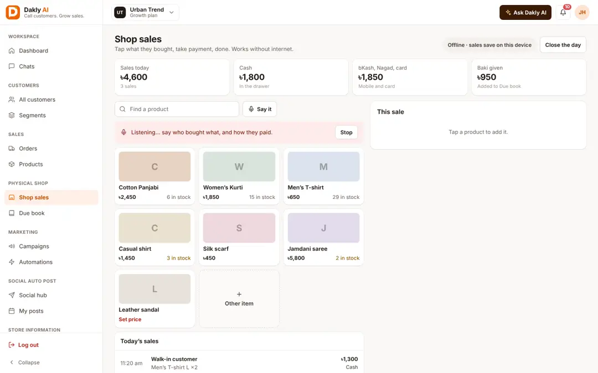
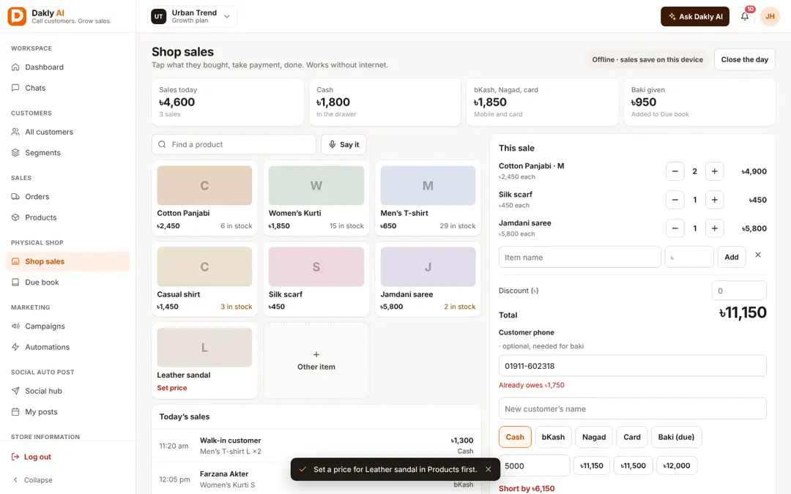
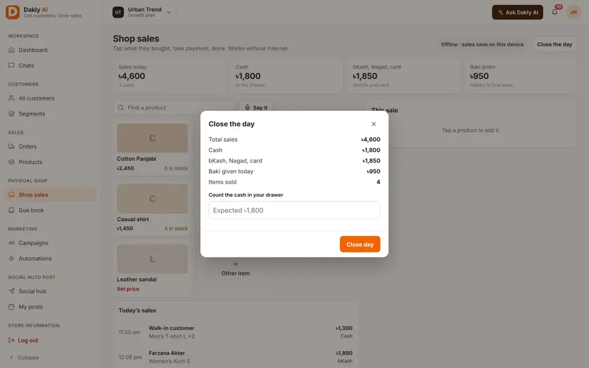
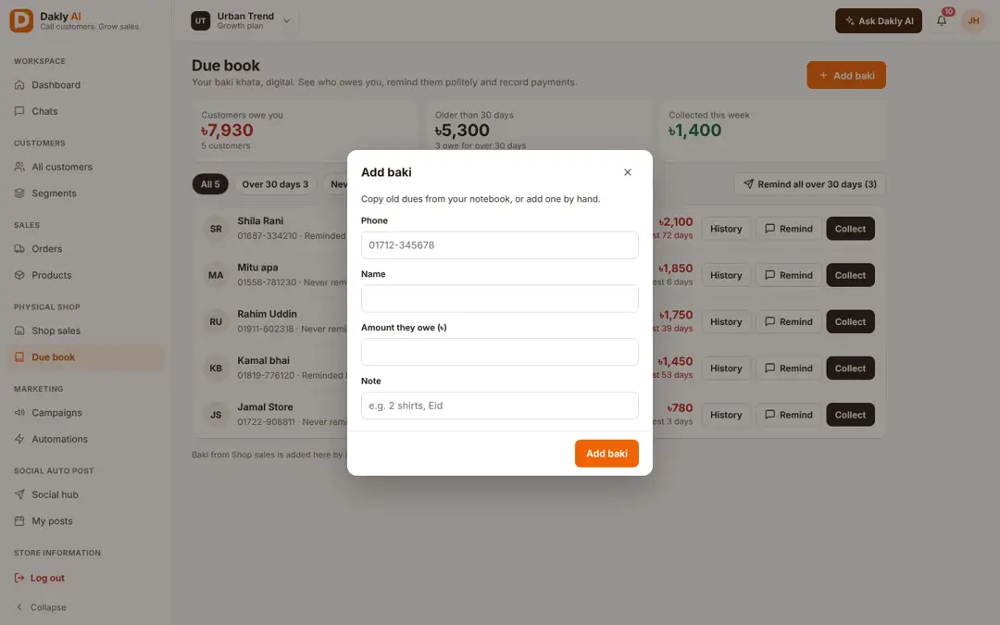
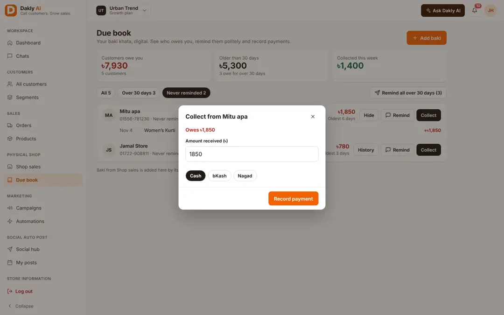
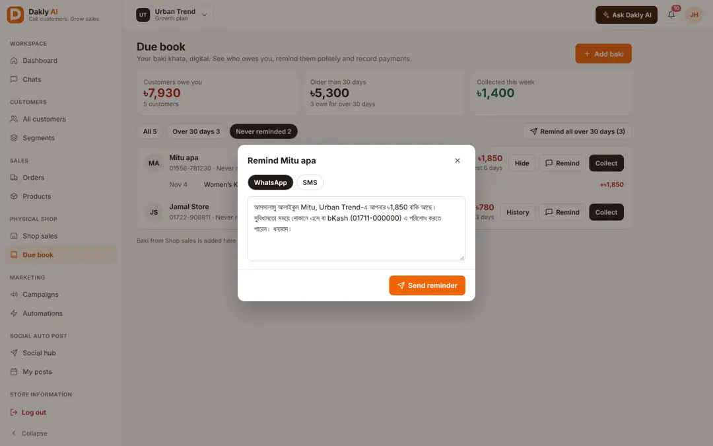
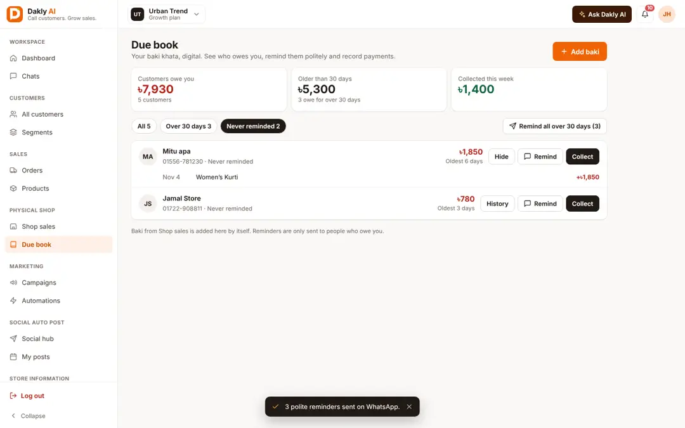
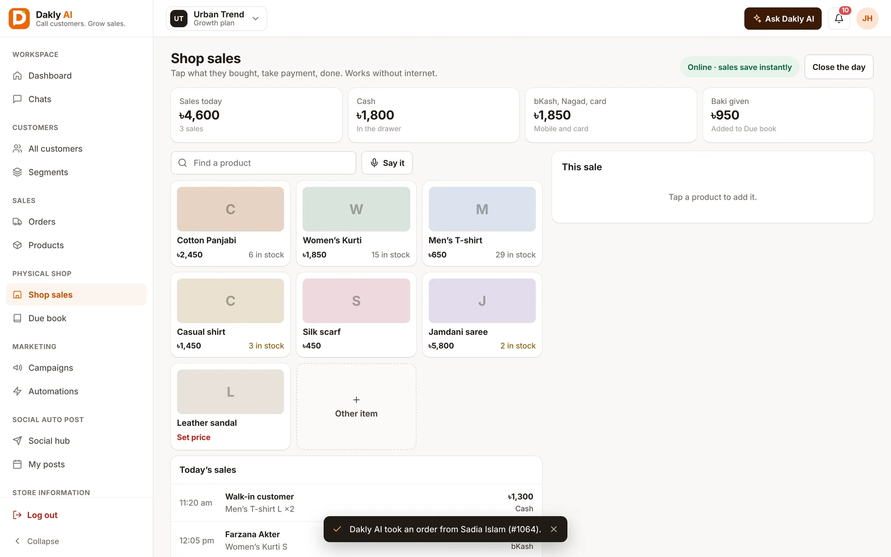
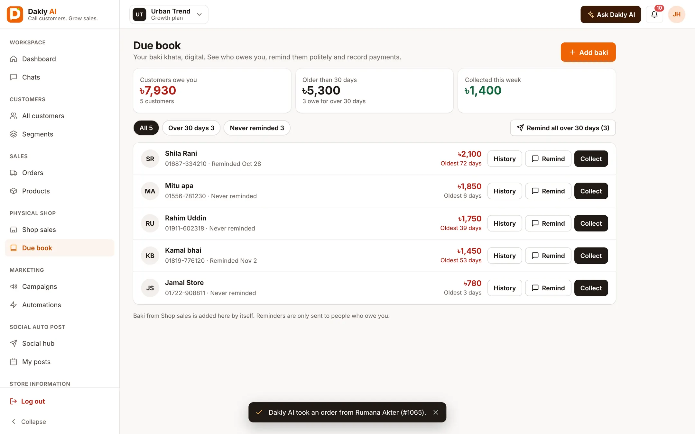

# Physical Shop: Shop sales, Due book, Khata Scanner, POS

|           |                           |
| --------- | ------------------------- |
| Release   | 2                         |
| Status    | Not planned for release 1 |
| Extension | Physical Shop             |

## Purpose

Release 2 (D1). Do not build any of this in release 1, and do not add tables or options for it "to be ready". This page records what is known so release 2 starts from it.

## Decisions that change the PRD

The product requirements below are the PRD text from 12 November 2026. Where a later decision changed it, the decision wins:

- D1: all of Physical Shop is release 2.
- D11: Due book reminders, baki notices and receipts use the shop's SMS credits.
- D14: Rocket is a recorded payment method at the counter only; Dakly does not integrate with it.

## Product requirements

### What it is for

Many Dakly shops also sell over a counter, and most of those keep a paper khata (baki notebook). This module brings counter sales and baki into the same customer list, so a shop can message its walk-in regulars and collect what it is owed. It has four parts.

| Part                      | What it does                                                                               | Release                                                                                    |
| ------------------------- | ------------------------------------------------------------------------------------------ | ------------------------------------------------------------------------------------------ |
| Shop sales (Pocket Sales) | A fast counter till on phone or tablet: tap products, pick payment, done. Works offline.   | Release 2 (Physical Shop extension)                                                        |
| Due book                  | Who owes how much, since when; remind and collect.                                         | Release 1 (D46)                                                                            |
| Khata Scanner             | Photograph notebook pages; AI reads names, phones, amounts and creates customers and baki. | Release 1 (D46)                                                                            |
| POS connections           | Bring sales and customers from an existing POS.                                            | Release 1: Excel or CSV upload only. Release 2: API key, webhook and named POS connectors. |

Decisions applied: Due book reminders use the shop's SMS credits (or WhatsApp utility messages from the ৳ balance if the shop picks WhatsApp). Walk-in sales count in sales numbers but never create customers or receive messages.

What others do: TallyKhata and OkCredit made baki tracking free and sent an SMS to the customer on every credit entry, which builds trust and is the habit shops already have. SeloraX bundles a POS with its online store. Dakly's angle is not to be a full POS, but to connect counter buyers and baki to marketing (see the Competitors tab).

### User stories

- As a counter salesperson, I want to record a sale in 3 taps, even when the internet is down, so the queue doesn't wait.
- As an owner, I want to type or say a customer's phone at checkout so the sale lands on their customer record.
- As an owner, I want a baki sale to go into the Due book automatically, with the customer told by SMS, so there is no argument later.
- As an owner, I want to see who owes me for over 30 days and remind all of them in one tap, politely.
- As an owner, I want to record partial payments in cash, bKash or Nagad.
- As an owner with old khata notebooks, I want to photograph a page and get customers and dues without typing.
- As an owner with a POS, I want my POS sales in Dakly so my counter regulars get campaigns.
- As a cashier, I want a digital receipt sent by SMS if the customer wants one.

### Screens

| Screen             | What it shows                                                                                                                                                                                                                                                                                                                                                                                                                                                                                                              |
| ------------------ | -------------------------------------------------------------------------------------------------------------------------------------------------------------------------------------------------------------------------------------------------------------------------------------------------------------------------------------------------------------------------------------------------------------------------------------------------------------------------------------------------------------------------- |
| Shop sales         | Top: Sales today (money, count), Cash (in the drawer), bKash, Nagad and card, Baki given (added to Due book). Product grid with stock ("6 in stock", "Set price" for items without a price, "Other item" for free entry). "Say it" voice button. Today's sales list (time, customer or Walk-in, items, amount, payment). Right panel "This sale": cart lines, quantity, size, discount, total, customer phone, payment method, receipt switch, consent switch, Complete sale. Offline badge and "N sales waiting to sync". |
| Sale history       | Filter by date, source (Pocket Sales, Voice entry, POS, Khata import), payment, cashier, sync status (Synced, Waiting, Failed, Duplicate).                                                                                                                                                                                                                                                                                                                                                                                 |
| Due book           | Top: total owed and number of customers, Older than 30 days, Collected this week. Filters: All, Over 30 days, Never reminded. "Remind all over 30 days (N)". Row: name, phone, last reminded, amount owed, oldest debt age, History, Remind, Collect. Footer: "Baki from Shop sales is added here by itself. Reminders are only sent to people who owe you."                                                                                                                                                               |
| Due history drawer | Every baki and payment for that customer with date, items, amount, method, who recorded it, running balance.                                                                                                                                                                                                                                                                                                                                                                                                               |
| Collect dialog     | Amount (default full), method (Cash, bKash, Nagad, Rocket, Card, Bank), date, note; "Send thank-you SMS" switch.                                                                                                                                                                                                                                                                                                                                                                                                           |
| Remind dialog      | Channel (SMS default, WhatsApp if connected), message preview in Bangla or English, cost shown ("Uses 1 SMS credit").                                                                                                                                                                                                                                                                                                                                                                                                      |
| Khata Scanner      | Advice cards (Start fresh in Pocket Sales, Add the last 1–3 months, Digitize old notebooks slowly), Upload photos, Past imports list (date, pages, type, rows imported, new customers).                                                                                                                                                                                                                                                                                                                                    |
| Khata review       | Per page: photo beside a table of read rows (date, name, phone, item, amount, type sale or baki or payment), confidence colour, matched customer, merge suggestion, Import button. Every cell is an input: date (with the year), name, phone, product and amount. A wrong phone or amount blocks the import until it is fixed.                                                                                                                                                                                             |
| POS connections    | Connected card (method, branch, last sync, Sync now, counts: customers imported, sales imported, synced, failed, duplicates, sales without a customer), "Fix failed sales", sync history, report download, Reconnect. Providers list. Tip: "Ask for the customer's phone at checkout".                                                                                                                                                                                                                                     |
| POS connect wizard | Choose method, credentials or file, branch mapping, field mapping, history range, consent question, test, finish.                                                                                                                                                                                                                                                                                                                                                                                                          |

### How it works

#### Shop sales

1. Staff taps products to add them. Products with sizes ask for the size; stock shown is the Products tab stock (tab 5) and decreases when the sale completes. Products without a price ask for a price. "Other item" takes a name and price and does not touch stock.
2. Customer: staff types a phone (11 digits). Dakly finds the customer or shows "New customer" and asks for a name. Leaving it empty makes a Walk-in sale.
3. Payment: Cash, bKash, Nagad, Rocket, Card, Bank, or Due. Split payment is allowed (for example ৳500 cash and the rest Due). Due needs a phone and a name.
4. Consent switch "Can we send offers by SMS?" defaults off; when on, it records SMS marketing consent with source "Shop counter", time and staff member.
5. Receipt switch (default on when a phone is entered): sends a transactional SMS "Urban Trend: ৳1,850 paid by bKash. Thank you!" with a short link to the receipt. This uses 1 SMS credit and is not marketing, so it needs no consent.
6. Complete sale creates an Order with source "Shop counter", status Delivered and paid amounts, updates stock, updates the customer's history, and for any Due part creates a Due entry.
7. **Voice ("Say it")**: staff holds the button and says, for example, "Mitu apa, ekta kurti, shoto, 1850 taka, baki". Dakly AI turns speech into a draft cart, customer and payment and highlights unsure fields in yellow. Nothing is saved until staff taps Complete. Counts as one AI action in usage.
8. **Offline**: the page works without internet using data cached on the device (products, prices, stock, last 5,000 customers). Sales are stored on the device with a local id and sync when online, oldest first. Stock may go below zero when two devices sell offline; Dakly shows a "Stock went below 0" note to fix. If a phone in an offline sale matches no customer, it is created at sync.
9. Edit and cancel: a sale can be edited or cancelled the same day by the cashier, later only by Owner or Admin. Cancelling returns stock and removes the Due part (if partly paid, the payment becomes store credit or a cash refund note).

#### Due book

1. Balance per customer = sum of baki entries − sum of payments. Payments settle the oldest baki first (FIFO), which gives "oldest debt age".
2. When a baki is created, Dakly sends a transactional SMS (switch per store, default on): "Urban Trend: ৳950 baki added. Total due ৳1,750." This is the TallyKhata habit that stops disputes.
3. Remind sends one reminder. "Remind all over 30 days" sends to every customer with debt older than 30 days who was not reminded in the last 7 days. Reminder text is polite and fixed by template (the AI may rephrase within the template, never add threats or late fees).
4. Limits: maximum 1 reminder per customer per 7 days, and only between 9 am and 8 pm. Reminders are sent to people who owe money only and are classed as transactional.
5. Collect records a payment, lowers the balance, and optionally sends a thank-you SMS. Overpaying creates store credit shown as a negative balance "Shop owes ৳200".
6. Writing off a debt (Owner or Admin) closes it with a reason and keeps it in history.
7. Due book money is not "Total spent" until paid; the order counts as an order straight away.

#### Due book API (DUE-1)

What the code does now. The SMS notices and reminders are under "Baki notices and reminders (DUE-2)" below, and the screen is under "Due book screen (DUE-3)".

- Every baki, payment and write-off is a row in `due_entries`. Rows are never edited or deleted by the app; a correction is a new row. The row says who recorded it and when it happened. Edit and delete of an entry, from the "Customer disputes baki" case, are not built yet.
- The balance is the baki total minus payments and write-offs. A negative balance means the shop owes the customer. Payments and write-offs both settle the oldest baki first, and the oldest debt is the date of the oldest baki that is still open.
- A payment needs a method (cash, bKash, Nagad, Rocket, card or bank). A write-off needs a reason and cannot be more than the balance. Only an Owner or Admin can write off; the Due book permission alone is not enough.
- Baki and payments can carry a past date, for entries copied from a paper khata. A date in the future is refused. A write-off is always dated now.
- "Collected this week" is the payments of the last 7 days, and "Older than 30 days" counts only the part of each baki that is still open.
- The list shows customers who owe, oldest debt first, and leaves out customers who were removed from the customer list.
- Each entry publishes `due.added`, `due.payment_recorded` or `due.written_off` in the same transaction. The khata import (KHT-2) calls `DueBookService.recordBaki` and `collectPayment` with source `khata_import` and the date from the page.

Routes (all under the Due book permission: `dueBook.view` to read, `dueBook.edit` to write):

| Route                                                              | What it does                                                                         |
| ------------------------------------------------------------------ | ------------------------------------------------------------------------------------ |
| `GET /due-book/summary`                                            | Total owed, customers owing, older than 30 days, never reminded, collected in 7 days |
| `GET /due-book/customers?filter=all\|over_30_days\|never_reminded` | Customers who owe, with balance, oldest debt and last reminded, by cursor            |
| `GET /due-book/customers/:contactId`                               | One customer's balance and oldest debt                                               |
| `GET /due-book/customers/:contactId/entries`                       | History, newest first, with the balance after each entry                             |
| `POST /due-book/customers/:contactId/baki`                         | Add baki: `amountPoisha`, optional `note`, optional `occurredAt`                     |
| `POST /due-book/customers/:contactId/payments`                     | Collect: `amountPoisha`, `method`, optional `note`, `occurredAt`                     |
| `POST /due-book/customers/:contactId/write-offs`                   | Write off: `amountPoisha`, `reason`. Owner or Admin only                             |

#### Baki notices and reminders (DUE-2)

- Every message is one row in `due_messages` (kind `baki_notice` or `reminder`, status `queued`, `sending`, `sent`, `skipped` or `failed`, and a skip reason). The row is the record that a message was asked for, so a retried job never sends it twice, and the reminder rows are what the 7-day limit counts.
- **Baki notice.** `due.added` is relayed to one subscriber, which stores the notice and sends it. The text is Bangla: "রিনার দোকান: ৳950 বাকি যোগ হয়েছে। মোট বাকি ৳1,750। ধন্যবাদ।" There is one notice per baki. None is sent when the shop turned the switch off (`dueBook.bakiNoticeEnabled` in the store settings, on by default), for a khata import (source `khata_import`), for a baki dated more than a day before it was recorded (copied from a paper khata), or when the customer's balance after it is not above zero.
- **Reminder.** "Remind" is `POST /due-book/customers/:contactId/reminders` and "Remind all over 30 days" is `POST /due-book/reminders/overdue`. Each customer is checked under their own lock, then the reminder is stored and `due.reminder_requested` is published in the same transaction; the subscriber sends it. The text is fixed: "রিনার দোকান: প্রিয় গ্রাহক, আপনার ৳1,750 বাকি আছে। সুবিধামতো পরিশোধ করলে কৃতজ্ঞ থাকব। ধন্যবাদ।" The AI does not rephrase it yet.
- **Limits (SHOP-R4).** One reminder per customer per 7 days, counting reminders that are queued, sending or sent. Reminders are asked for and sent only from 9 am up to 8 pm in the shop's time zone; a request outside those hours is refused with `DUE_REMINDER_OUTSIDE_HOURS`, and a reminder that was stored just before 8 pm and reached delivery after it is skipped as `outside_hours`. A single Remind that breaks a rule answers 409 with `DUE_REMINDER_TOO_SOON`, `DUE_NOT_OWING`, `DUE_REMINDER_NO_PHONE`, `DUE_REMINDER_BLOCKED` or `DUE_REMINDER_OUTSIDE_HOURS`. Remind all skips such customers and counts them: `{ queued, skippedRecentlyReminded, skippedNoPhone, skippedBlocked }`. One call covers at most the 500 customers with the oldest debt.
- **Delivery.** Both kinds are transactional (SHOP-R3): no marketing consent is needed, a blocked customer or one with no phone is skipped, and the text has no offer, link or fee. The message uses the shop's SMS credits: the credits for the text's parts are reserved before sending, charged when the provider accepts, and returned when it refuses. A shop with no credits left gets a skipped message with reason `no_credits`. The send is not inside a database transaction. If a job stops after the provider call, the retry sends under the same operation key and settles the credits once.
- A baki notice or reminder is SMS only. WhatsApp utility messages, the message preview and the "Send thank-you SMS" switch are not built.

#### Due book screen (DUE-3)

Route `/due-book`, in the "Physical shop" group of the menu. It shows for a member with `dueBook.view`; Add baki, Remind, Remind all and Collect show for `dueBook.edit`. The session context carries `canViewDueBook` and `canEditDueBook`.

- Top: three cards (Customers owe you, Older than 30 days, Collected this week) from `GET /due-book/summary`.
- Filter chips All, Over 30 days and Never reminded, each with its count, kept in the address as `?filter=`. "Never reminded" counts customers with no reminder that was queued, sent or being sent, the same rule as the 7-day limit.
- Each row: initials, name, phone, "Reminded Oct 28" or "Never reminded", the amount owed, "Oldest N days" (red after 30 days), History, Remind and Collect. The list is oldest debt first, 50 at a time with "Show more".
- History opens under the row and lists date, note (or the entry kind) and the amount, "+" for baki and "-" for payments and write-offs. There is no write-off screen yet.
- Add baki takes phone, name, amount and note. The customer with that phone is used; if none has it, one is made with the name. Collect starts with the full balance and takes Cash, bKash or Nagad.
- Remind sends the fixed Bangla SMS (see DUE-2). The dialog shows no editable text and no WhatsApp tab, because the text is fixed by the server and WhatsApp reminders are not built. "Remind all over 30 days" sends at once and reports how many were queued and how many were left out.

#### Khata Scanner

1. The owner uploads up to 10 photos at a time (JPG, PNG or PDF pages; max 10 MB each), or takes them in the phone camera.
2. Processing steps shown live: Straighten photo, Read handwriting, Match customers. Bangla and English handwriting, Bangla and English digits.
3. Each row gets fields and a confidence score. Rows under 85% are yellow and must be checked; the import button stays off until every yellow row is confirmed or skipped.
4. Matching: phone exact match first, then name plus similar phone (one digit different) is offered as "Same person as Mitu Akter?". Never merged automatically.
5. Import creates customers (source "Khata import", no marketing consent), sales (orders with source Khata import, dated from the page) and baki entries. Rows without a phone become walk-in sales and are not linked.
6. Past imports can be undone within 7 days, removing every record they created that hasn't been changed since.
7. Photos are stored for 30 days for review, then deleted; the extracted rows stay.
8. Each page counts as one AI scan in usage.

##### Khata scan API (KHT-1)

Every route needs `customers.edit` and works on one page at a time. The list of past imports is in KHT-2's table below (added in KHT-3).

| Route                              | What it does                                                                                                                |
| ---------------------------------- | --------------------------------------------------------------------------------------------------------------------------- |
| `POST /khata-scans/pages`          | Takes the content type and size, returns `pageId` and a 15 minute upload URL. At most 100 pages an hour per shop.           |
| `POST /khata-scans/pages/:id/read` | Checks the photo is stored and the plan has a page left, then queues the read. Retries a page that failed.                  |
| `GET /khata-scans/pages/:id`       | Status, a 15 minute photo link while the photo is kept, and the rows with confidence, `needsCheck` and the suggested match. |

- Page status: `uploaded`, `reading`, `read`, `unreadable`, `failed` (code `allowance` or `model`).
- The read goes through `AiService` on the `handwriting` tier, so the model is whatever `AI_HANDWRITING_MODEL` names (default `gpt-6.1-terra`). The cheaper `gpt-6-luna` that other vision work uses invented names on a real handwritten page, so scans do not share its tier. The model returns each name, phone, date and amount as written. Code then converts Bangla and English digits, `৳`, `Tk`, `/-` and lakh grouping into poisha, validates the phone and date, and caps any row it could not fully place at 84 so it stays yellow (SHOP-R7). A row with no name or no readable amount is dropped.
- Before the read, a photo is stood upright by its EXIF turn flag and sized to 2,600 pixels on the long side. The model also reports `turnClockwiseDegrees`; when it is not 0 the photo is turned by that much and read again, up to three reads in all, adding each new turn to the one made (the model can name the wrong way first). Rows from a page still sideways after that are dropped. All reads are one charge. An amount starting with ৮ and three or more digits is capped at 84, because ৳ can be read as ৮. `eval:models --jobs khata` runs seven fixture pages (Bangla, Banglish, mixed, two sideways, a month heading, and an owner's real phone photo where names and dates are scored exactly) and fails on a wrong amount, date or phone, or a month word as a sure name. Dates may carry a month word (`১৬ মে`, `May 16`). A name that is only a month word such as `মাসের` or `মে` is capped at 84.
- Names are kept in the script they were written in. Matching never compares scripts: an exact phone is matched first, then the same phone with one digit different counts only if the contact shares a word with the row's name. A match is a suggestion, never a merge.
- One scan is charged per page that gives at least one row, as `ai_scan` usage with the page id as the reference, so a rerun is free. A page the model cannot read is `unreadable` and costs nothing. The allowance is the `ai_scan` number in the plan's limits, set in the plan catalogue; a plan without it allows no scans.
- The photo's file is set to expire after 30 days. The daily file purge clears the page's reference and deletes the photo (KHT-2); the rows stay.

##### Khata import (KHT-2)

All three routes need `customers.edit`.

| Route                                | What it does                                                                                                                     |
| ------------------------------------ | -------------------------------------------------------------------------------------------------------------------------------- |
| `POST /khata-scans/pages/:id/import` | Takes one decision per row (`import` or `skip`, `isChecked`, optional `mergeContactId`) and imports the page in one transaction. |
| `GET /khata-scans/imports`           | The shop's 20 latest imports, newest first, with rows read, imported, new customers, status and the undo deadline.               |
| `POST /khata-scans/imports/:id/undo` | Removes what the import made, within 7 days of the import.                                                                       |

- Every row on the page needs a decision, so the owner never imports a row by leaving it out. A row under 85% is imported only with `isChecked: true` (SHOP-R7); otherwise nothing is saved.
- A customer who already has the row's phone is used as is. Otherwise a customer is made once for that phone, with source `khata_import`, kind customer and no consent (SHOP-R2). A similar-phone suggestion is used only when the owner sends it as `mergeContactId`.
- A baki row becomes a Due book baki and a payment row a cash payment, both with source `khata_import` and the date from the page at noon in Dhaka (today if the page has no date, or a date in the future). Both need a phone or a chosen customer. No baki notice is sent for them.
- A sale row becomes an order with source `khata_import`, dated from the page, already delivered and paid (COD 0), with no items. With a phone or a chosen customer it is linked to that customer; without one it is a walk-in sale linked to nobody (SHOP-R1). It sends `order.imported`, not `order.created`, so no automation, attribution or confirmation runs for it; customer totals and sales numbers do pick it up. These orders are records: they cannot be edited, moved to another stage or shipped, and they never reach courier booking. Recipient phone, address and district may be empty only for this source; a database check enforces it for every other source.
- Undo deletes the baki, payments and sales the import made (a sale someone has changed stays), and the customers it added that nobody has edited since and that have no other Due book entry. Only those khata-import ledger rows can be deleted by the app. The page goes back to read, so it can be imported again.
- The daily file purge lets go of a page's photo once its 30 days are over and deletes the file. The page and its rows stay (rule 7).

- Read quality is gated in `khata-row-reading.spec.ts`: a set of Bangla, Banglish and mixed lines, with Bangla and English digits, that must all convert correctly. It tests what the code does with the model's text. How well the model reads real handwriting needs a set of real page photos, which is open until the shop owner supplies them.

##### Khata Scanner screen (KHT-3)

Route `/customers/khata-scan`, opened from Add customers > Scan your khata. It shows for a member with `customers.edit` (`canCreateCustomer`). The design is the Khata Scanner screen of the prototype; screenshots are in `docs/design/evidence/kht-3-khata-scan/`.

- **Start.** Two cards (Add the last 1–3 months, Digitize old notebooks slowly) and "Past imports" from `GET /khata-scans/imports`: date, "1 page", rows imported of rows read, new customers, and Undo while the 7 days last. "Start from today" in the design points at Shop sales, which is not built, so it is not offered.
- **Add pages.** Take photo (phone camera) or Upload photos or PDF, up to 10 pages at a time, JPG, PNG or PDF, 10 MB each. Pressing "Read N pages" uploads each page to its link, queues the read and moves on.
- **Reading.** The three steps follow the page status: waiting, reading, then review. A page that is `unreadable` or `failed` shows its reason, and a failed page can be read again.
- **Review.** One tab per page, one row per read line: date, customer, phone, product, amount, confidence and status. A row under 85% has yellow boxes and "Check this". "Looks right" confirms it (`isChecked`), "Skip" leaves it out. "Import N rows" stays off until every yellow row is confirmed or skipped (SHOP-R7), and a baki or payment with no phone must be linked or skipped. A similar-phone customer is offered as "Same person as Mitu Akter?" and only "Yes, link" sends `mergeContactId`.
- **Result.** Rows found, imported, new customers, matched to existing customers, walk-in sales and skipped, with links to Orders and Customers and "Scan more pages".
- **Not in the screen.** The rows cannot be edited, because the import takes decisions only; there is no Qty column because a read row has none; and a page is imported on its own, so each tab has its own Import button.

#### POS connections

Release 1, CSV or Excel:

1. Owner exports sales from the POS and uploads. Template columns: date, time, receipt no, branch, customer name, phone, item, size, quantity, unit price, discount, payment method, cashier. Only date, amount and receipt no are required.
2. Dakly shows a mapping screen with guessed columns, previews 10 rows and counts: rows read, with phone, without phone, duplicates (same receipt no and branch already imported), errors with reasons.
3. Import creates orders with source POS. Rows without phone are walk-in sales. Customers created get no marketing consent unless the file has a consent column with "yes" and the owner ticks "My customers agreed to receive messages".
4. A downloadable report lists failed rows with reasons, which can be fixed and re-uploaded; duplicates are skipped.

Release 2 adds: API key connection to listed POS systems, webhook at `hooks.dakly.app/pos/{store}/` with signed requests (HMAC secret), sync every 15 minutes plus Sync now, branch mapping, a sync history log and failed-sale fixing in the app.

### Business rules

- **SHOP-R1:** A sale without a phone is a walk-in sale. It counts in sales numbers and the Sales tab of Analytics, never creates a customer and never gets messages.
- **SHOP-R2:** Counter, khata and POS customers get no marketing consent by default. Consent is only recorded when the customer said yes, with source, time and staff member.
- **SHOP-R3:** Receipts, baki notices and due reminders are transactional and need no marketing consent, but must contain no offers.
- **SHOP-R4:** Due reminders: max 1 per customer per 7 days, 9 am to 8 pm only, polite fixed template.
- **SHOP-R5:** Payments settle the oldest baki first.
- **SHOP-R6:** Offline sales are never lost: kept on the device until the server confirms. Logging out with unsynced sales is blocked with a warning.
- **SHOP-R7:** Khata rows under 85% confidence cannot be imported until checked. Merges are always suggested, never automatic.
- **SHOP-R8:** A duplicate POS row (same receipt no and branch) is skipped, never imported twice.
- **SHOP-R9:** Shop and POS money uses the Glossary money rule (items after discount, no delivery charge).

### States and edge cases

| Case                       | Behaviour                                                                                                |
| -------------------------- | -------------------------------------------------------------------------------------------------------- |
| Product out of stock       | Can still be sold with a warning "Stock will go below 0"; Products shows the negative stock to fix.      |
| No SMS credits left        | Receipt and baki SMS are skipped with a banner "Buy SMS credits to send receipts". The sale still saves. |
| Customer disputes baki     | Owner can edit or delete an entry; every change is in History with who and when.                         |
| Same phone, different name | Uses the existing customer; name difference is shown, not overwritten.                                   |
| Khata photo too blurry     | "We couldn't read this page. Try again in good light, flat on a table." No charge for unreadable pages.  |
| CSV with Bangla digits     | Converted to English digits before matching phones.                                                      |
| Device clock wrong         | Server time is used for synced sales; the device time is kept as "recorded at".                          |

### Permissions

Shop counter staff: create sales, edit or cancel own sales the same day, add baki, collect payments, view products; phone numbers masked except while typing a new one. Owner and Admin: everything, including write-offs, khata imports, POS connections and editing old sales. Marketer and Support agent: no access by default.

### Events

`sale.created`, `sale.updated`, `sale.cancelled`, `sale.synced_offline`, `due.added`, `due.payment_recorded`, `due.reminder_requested`, `due.written_off`, `khata.scan_started`, `khata.rows_imported`, `khata.import_undone`, `pos.import_completed`, `pos.row_failed`, `pos.sync_completed` (release 2).

### Acceptance criteria

- Given the device is offline, when staff completes 3 sales and the internet returns, then all 3 appear on the server within 1 minute in order, and stock is reduced once each.
- Given a ৳1,450 sale paid ৳500 cash and ৳950 Due for Rahim Uddin, then Today's sales shows "Baki ৳950", Cash goes up ৳500, Baki given goes up ৳950 and the Due book shows Rahim with ৳950 more.
- Given Shila Rani was reminded 3 days ago, when the owner taps "Remind all over 30 days", then she is skipped and the dialog says how many were skipped and why.
- Given a payment of ৳1,000 against baki of ৳600 (60 days old) and ৳800 (10 days old), then the 60-day baki is fully settled and oldest debt age becomes 10 days.
- Given a khata page with 21 rows, 2 below 85%, then Import is disabled until both are checked, and the import record says "19 of 21 rows imported" if 2 are skipped.
- Given a POS CSV with 100 rows, 17 without phone and 3 already imported, then 80 sales link to customers, 17 are walk-in sales, 3 are reported as duplicates and none of the 97 imported customers has marketing consent unless the owner confirmed it.

### Beyond the prototype

The prototype's till, dues and POS screens use sample data and demo POS names. Real counters need these, based on TallyKhata, Nabik and retail POS apps.

| Addition                                                                                                        | Why                                                     | Release |
| --------------------------------------------------------------------------------------------------------------- | ------------------------------------------------------- | ------- |
| Barcode scanning with the phone camera or a USB or Bluetooth scanner                                            | Faster than tapping a grid once a shop has 50+ products | 2       |
| Receipt printing on 58 mm and 80 mm Bluetooth thermal printers                                                  | Standard in BD shops                                    | 2       |
| Cashier shifts with opening cash, closing count and a day-end report (sales by payment method, cash difference) | Owners need to check the drawer                         | 2       |
| VAT invoice (Mushak-6.3) option for VAT-registered shops                                                        | Legal requirement for some shops; Nabik supports it     | 2       |
| Customer baki statement link the shop can send (all entries and balance)                                        | Settles disputes; TallyKhata habit                      | 2       |
| Stock shared with online orders in real time, with per-location stock                                           | Prevents selling the same item twice                    | 2       |

**Do not copy from the prototype:** demo POS providers, sample dues and sales, and the khata import counts.

## Prototype screens

Captured from the prototype on 13 Nov 2026 by opening each button, tab and dialog. Layout only: the numbers, names and some flows are sample data (see the next section).

**Shop sales: say it**

**Shop sales: other item**

**Close the day**

**Due book: add baki**

**Due book: collect**

**Due book: remind**

**Due book: history**

## Engineering

### Screens in release 1

### Known requirements

- Shop sales: a counter till that works offline on the device and syncs later with visible status. A sale is never lost or counted twice, so the API needs an idempotency key per sale.
- Due book (baki): who owes what, payments against it, reminders by SMS using the shop's SMS credits (D11).
- Khata Scanner: photos of notebook pages read by a vision model into rows the owner reviews before import.
- POS connectors by API or webhook (D6). Release 1 has CSV import only.
- Shop counter staff role sees Shop sales and Due book only.

## Open questions

None.
