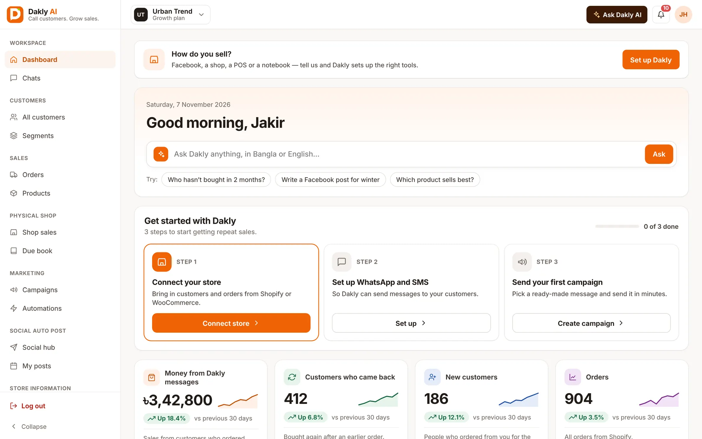

# <Feature name>

|           |                                                                    |
| --------- | ------------------------------------------------------------------ |
| Release   | 1                                                                  |
| Status    | Not started · Building · Done (match [tasks.md](../tasks.md))      |
| Extension | Core, or the extension that switches it on                         |
| Code      | `packages/core/src/<feature>/`, `apps/web/src/features/<feature>/` |
| Tasks     | IDs from [tasks.md](../tasks.md)                                   |

## Purpose

Two or three sentences: who uses it and what problem it solves.

## User stories

- As a <role>, I want <thing> so that <reason>.

## Screens

What is on each screen, and anything the prototype gets wrong.

## How it works

Numbered steps for each flow, in the order they happen. Name the service method that owns each step.

## Rules

Rules the service enforces. Each one becomes at least one test.

1. ...

## Permissions

Which area and level each action needs (`orders.view`, `orders.edit`).

## Events

Events this feature emits through the outbox, and events it listens to.

## Data

Tables this feature owns. Mark anything affected by the open schema review as "pending review".

## Edge cases to test

- ...

## Acceptance

- Given ..., when ..., then ....

## Open questions

Links to rows in [open-questions.md](../product/open-questions.md).
